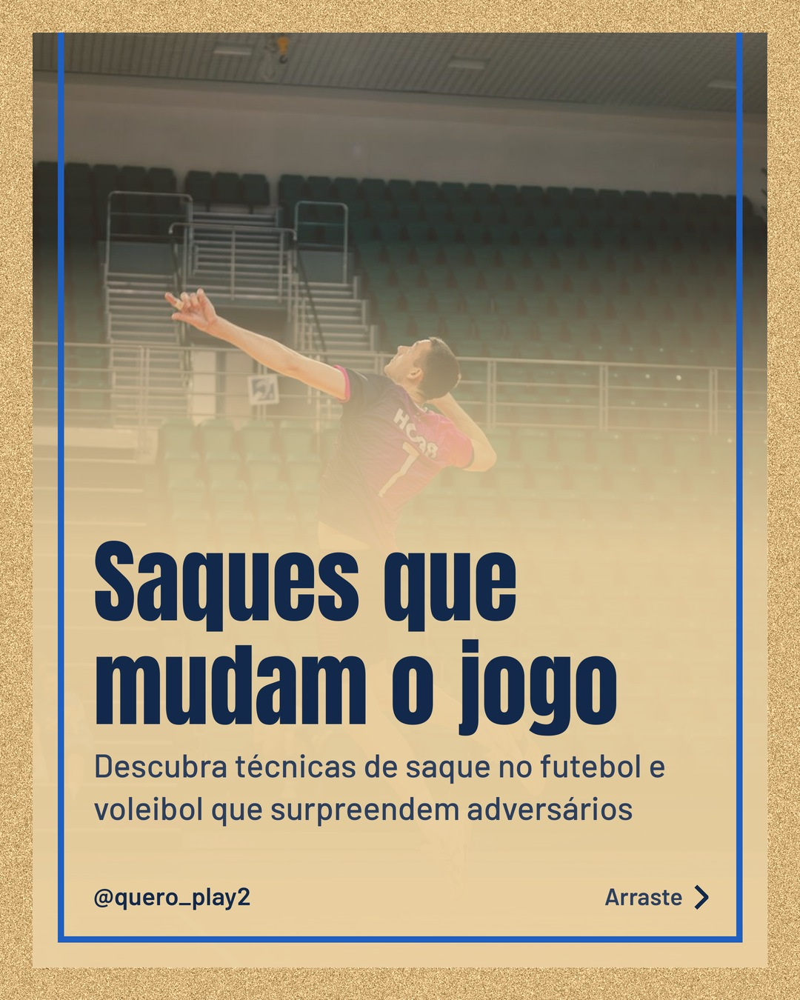
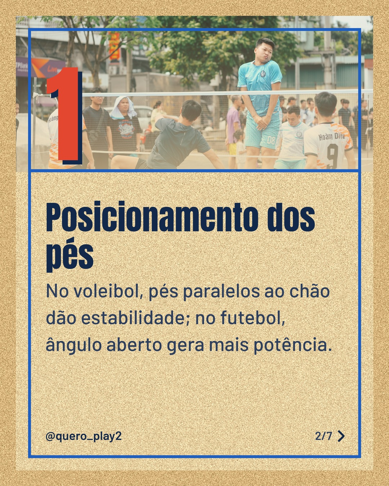
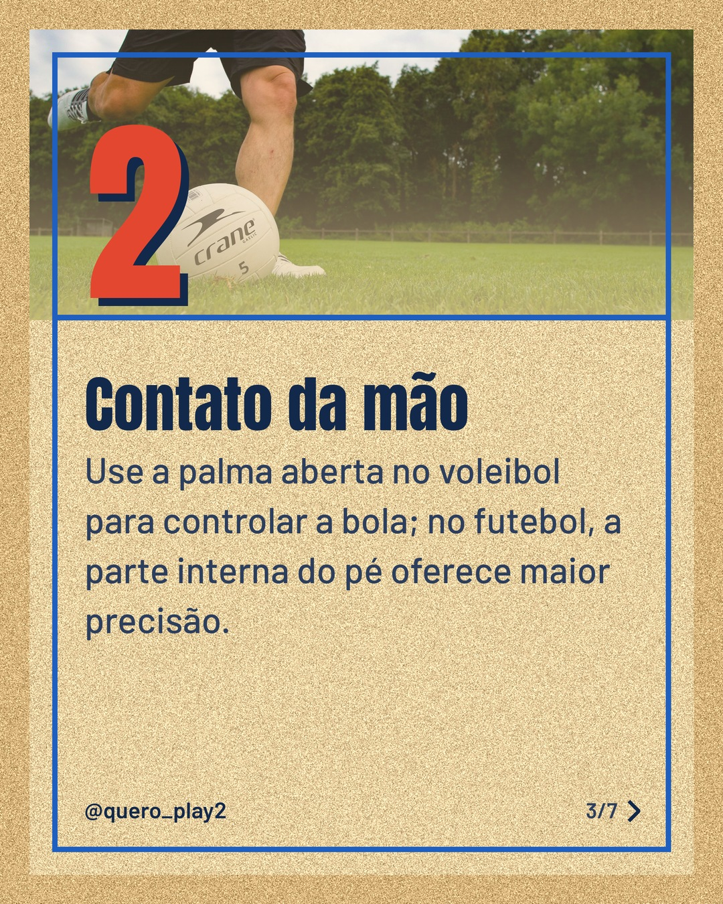
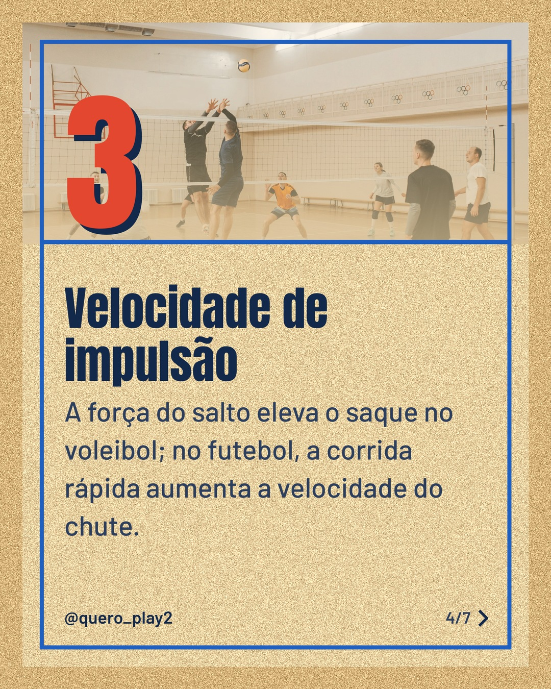
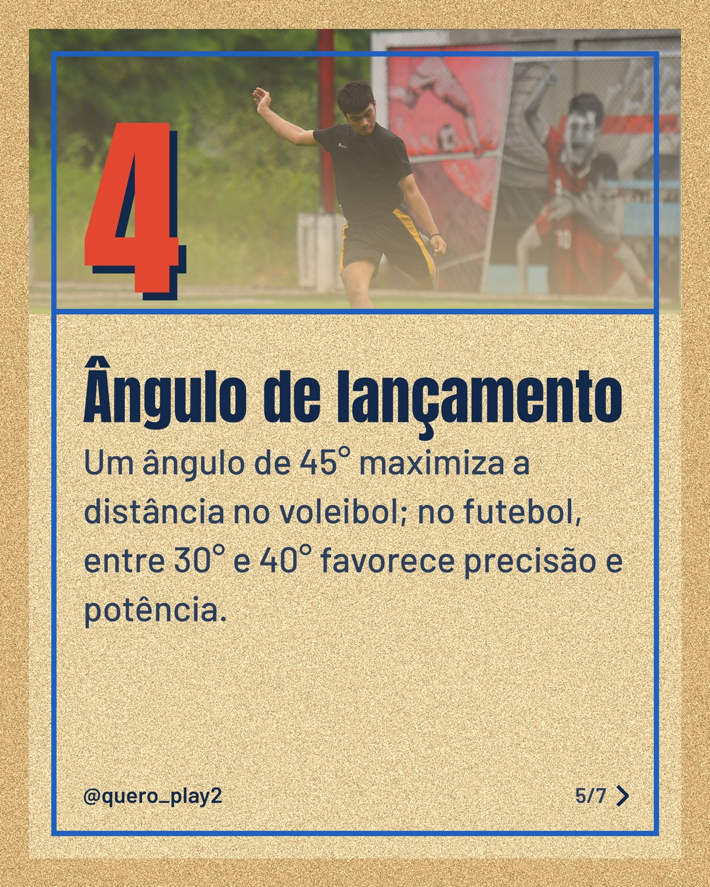
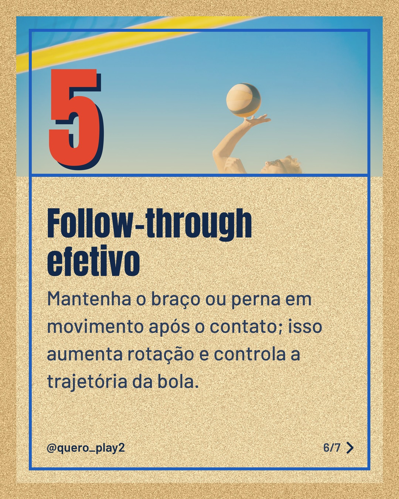

# areia

**Status:** aguardando revisão · 7 slides · gerado com `groq/openai/gpt-oss-120b`

      

## Legenda

> Já pensou que o jeito de sacar pode transformar seu desempenho? ⚽️🏐
>
> Nos slides a seguir, explicamos passo a passo como adaptar técnicas do futebol e do voleibol para melhorar a potência e precisão dos seus saques.
>
> Deslize para o lado, teste as dicas na próxima partida e conte nos comentários como foi! Não esqueça de curtir e seguir para mais curiosidades esportivas. 🚀
>
> 📷 Fotos: Daniil Kondrashin, Thang Nguyen, Pablo Hsm, Pavel Danilyuk, syah rizal ananda e Kampus Production (Pexels)
>
> #futebol #voleibol #curiosidades #saques #dicas #esporte #treinamento #bola

---
**Quer mudar algo?** Edite o `legenda.txt` para trocar a legenda, ou o `post.json` para trocar os textos dos slides (depois rode `python main.py redesenhar 2026-10-11_143343`).
Foto não combinou? `python main.py trocar-foto 2026-10-11_143343 N` (0 = capa, 1, 2... = slides).
Para descartar este post, apague esta pasta.
