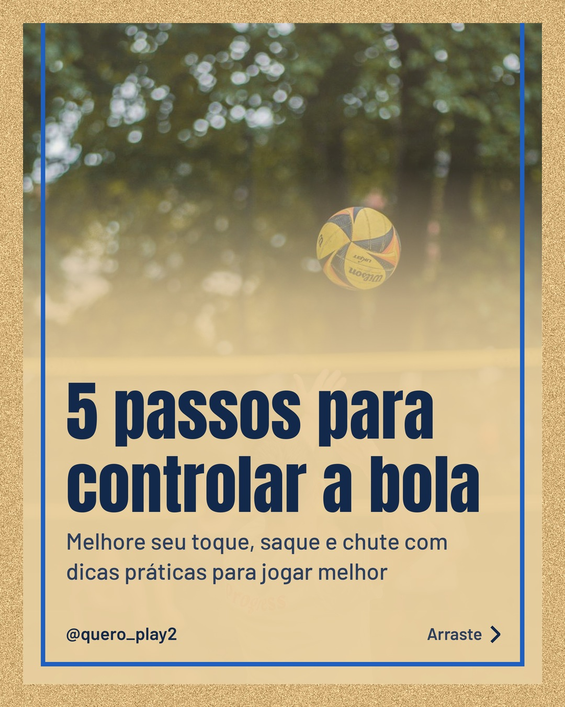
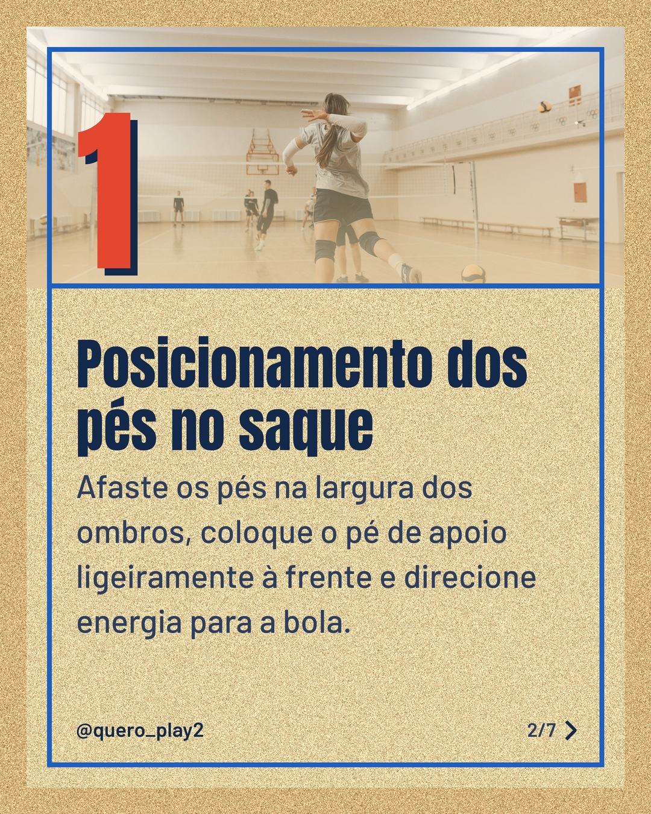
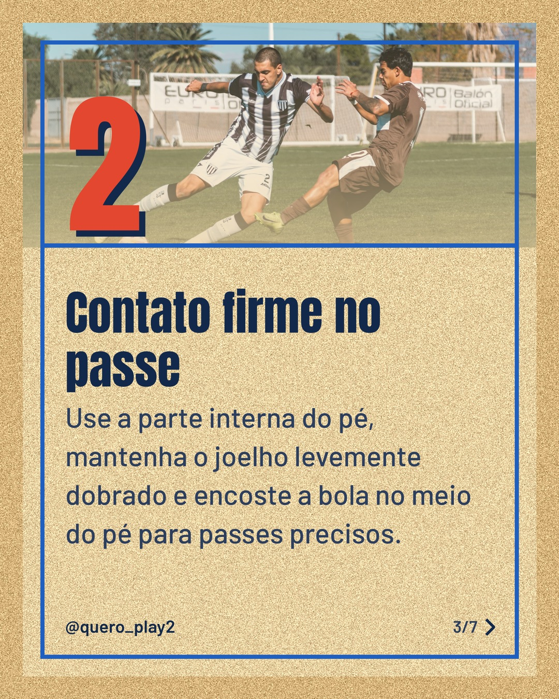
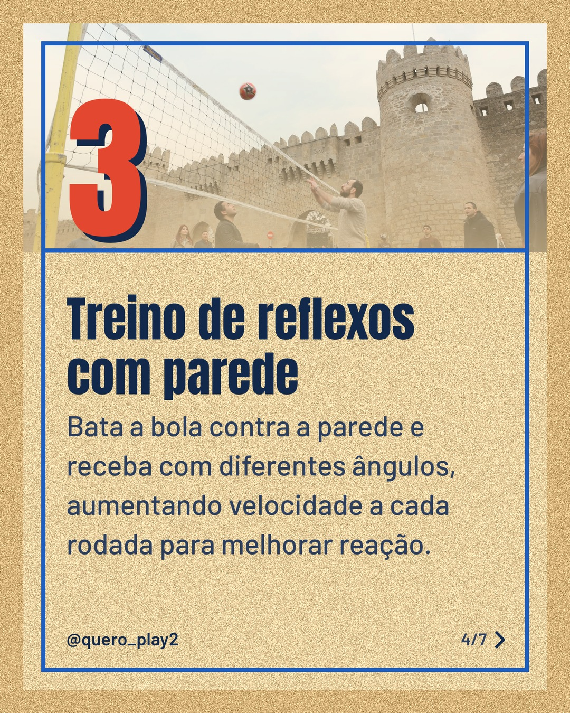
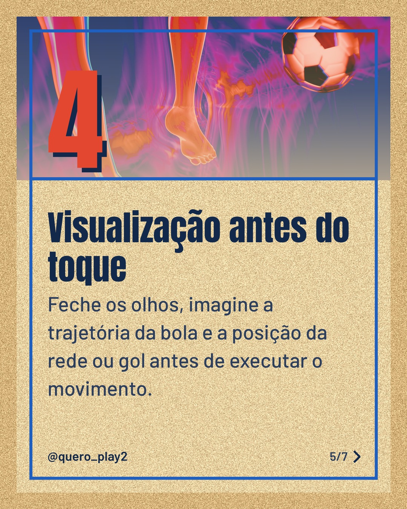
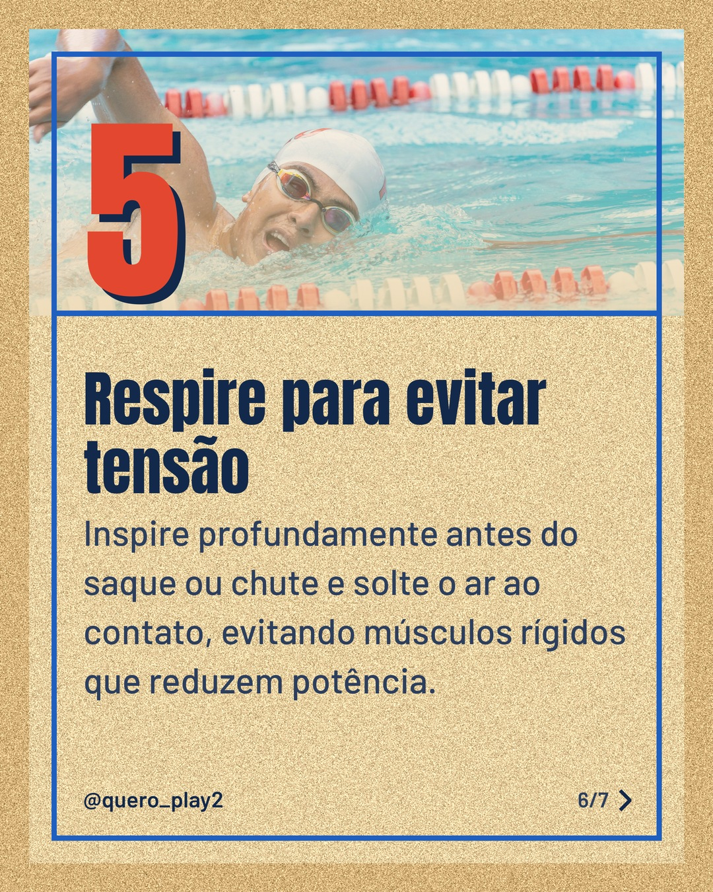
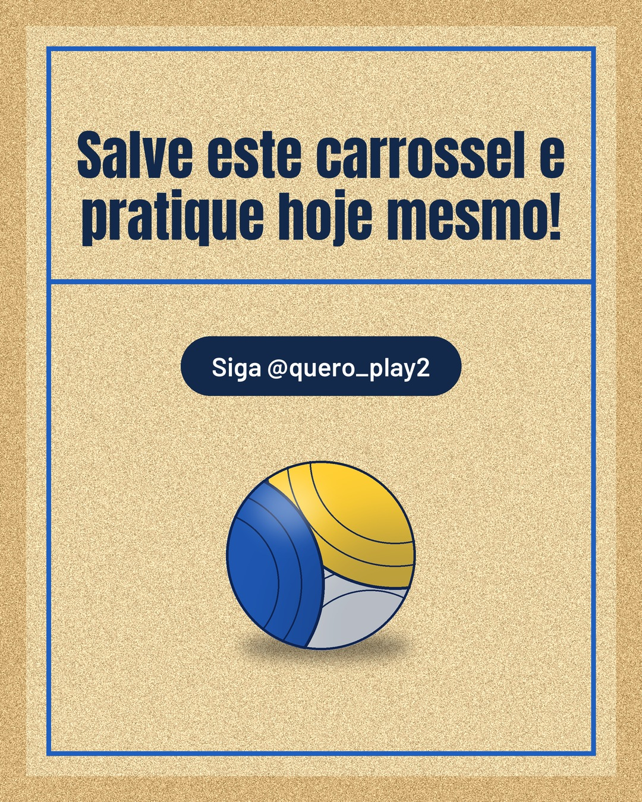

# areia

**Status:** aguardando revisão · 7 slides · gerado com `groq/openai/gpt-oss-120b`

      

## Legenda

> Quer melhorar seu toque tanto no futebol quanto no vôlei? 🚀
> Deslize para o lado e descubra 5 passos simples que vão transformar sua performance.
> Teste cada dica no treino de hoje e sinta a diferença na hora. ⚽🏐
> Curtiu? Salve, compartilhe e comente qual dica funcionou melhor para você!
>
> 📷 Fotos: Sebastian Dziomba, Pavel Danilyuk, Franco Monsalvo, Tahir Xəlfəquliyev, Steve A Johnson e Sergio Benavides (Pexels)
>
> #futebol #volei #dicasdeesporte #controledebola #treinamento #esportebrasil #paixaopelojogo #aprendaesporte #futebolvolei #dicaspraticas

---
**Quer mudar algo?** Edite o `legenda.txt` para trocar a legenda, ou o `post.json` para trocar os textos dos slides (depois rode `python main.py redesenhar 2026-10-12_180705`).
Foto não combinou? `python main.py trocar-foto 2026-10-12_180705 N` (0 = capa, 1, 2... = slides).
Para descartar este post, apague esta pasta.
