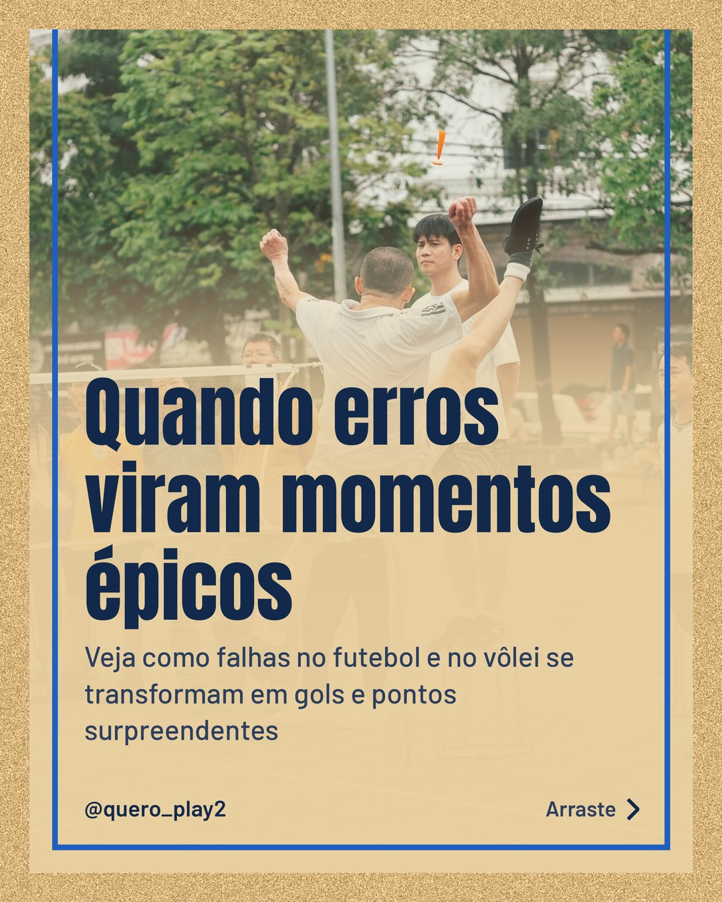
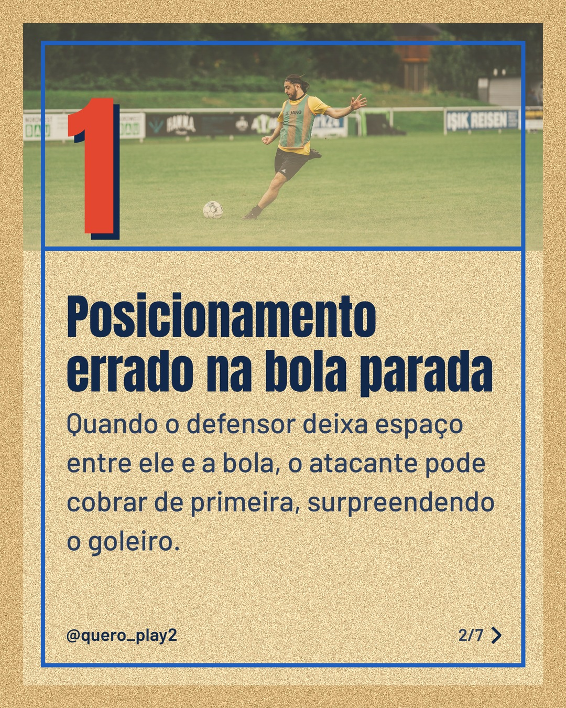
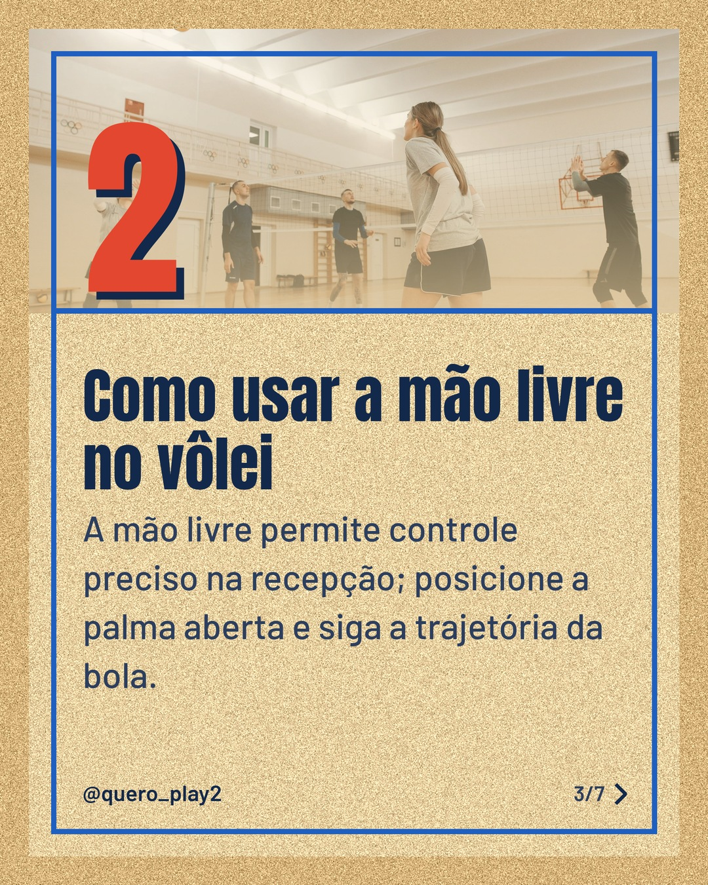
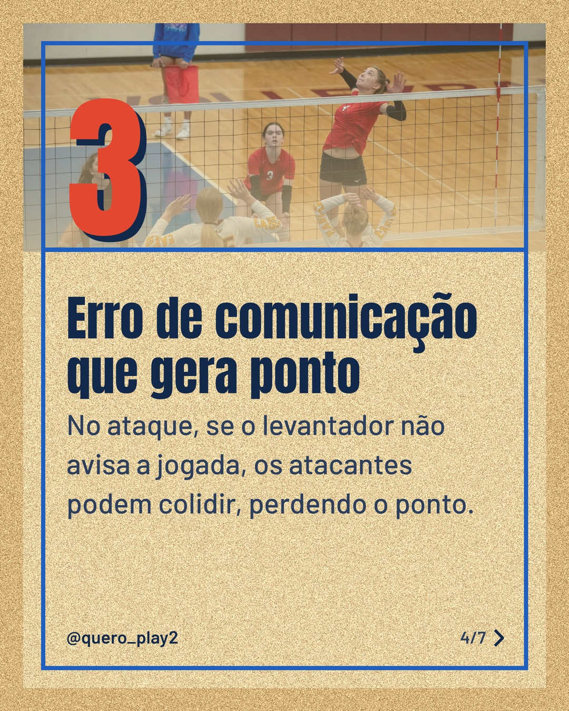
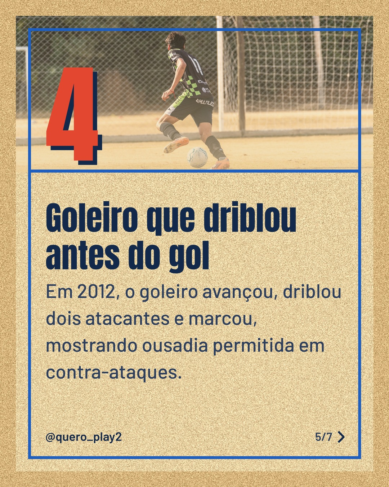
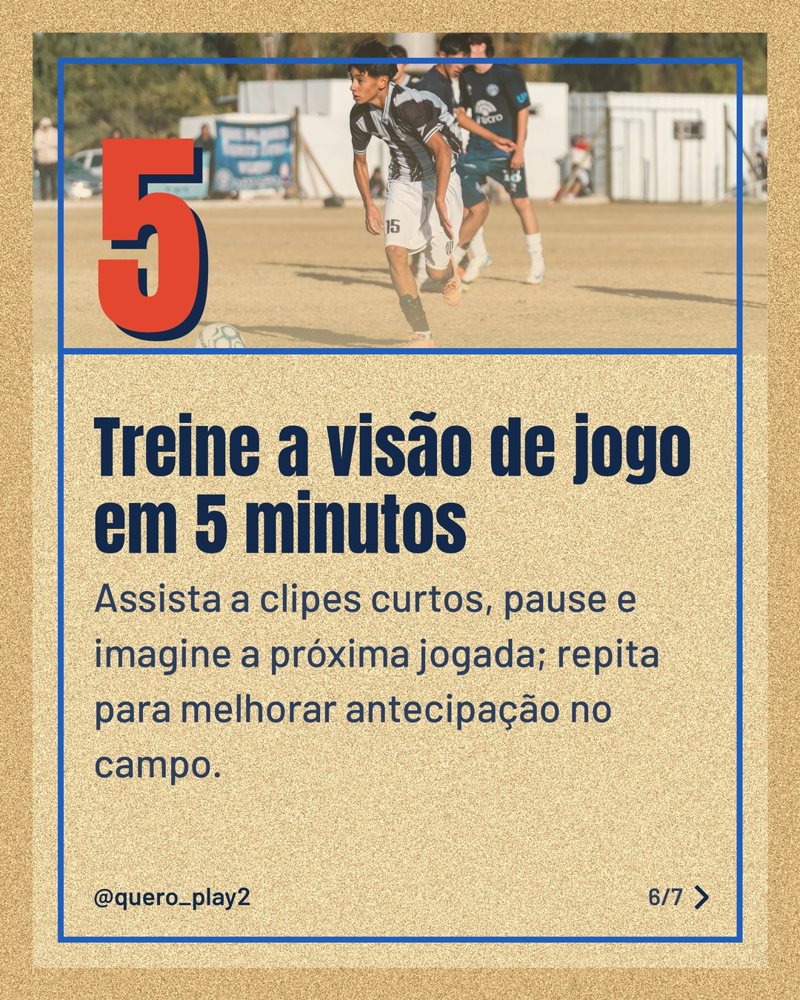

# areia

**Status:** aguardando revisão · 7 slides · gerado com `groq/openai/gpt-oss-120b`

      

## Legenda

> Descubra como pequenos erros podem virar grandes momentos no futebol e no vôlei. 🤯
>
> Deslize para o lado e veja exemplos reais de lances inesperados que mudaram o rumo das partidas. Cada slide traz uma dica prática que você pode aplicar nos treinos.
>
> Curtiu? Salve, marque os amigos e siga para mais curiosidades esportivas! 🚀
>
> 📷 Fotos: Thang Nguyen, Omar Ramadan, Pavel Danilyuk, Tom Fisk e Franco Monsalvo (Pexels)
>
> #futebol #volei #curiosidades #esporte #gols #ponto #taticas #jogadores #brasil

---
**Quer mudar algo?** Edite o `legenda.txt` para trocar a legenda, ou o `post.json` para trocar os textos dos slides (depois rode `python main.py redesenhar 2026-10-13_160555`).
Foto não combinou? `python main.py trocar-foto 2026-10-13_160555 N` (0 = capa, 1, 2... = slides).
Para descartar este post, apague esta pasta.
