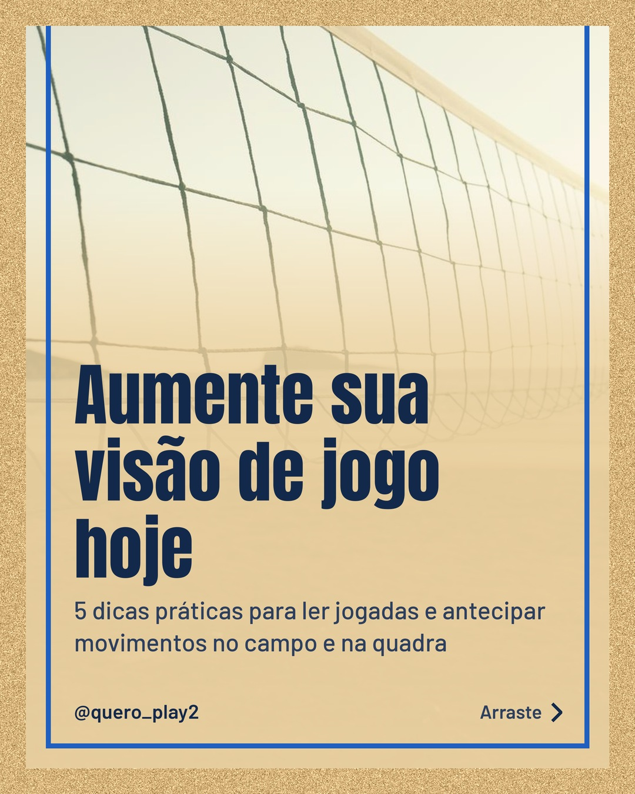
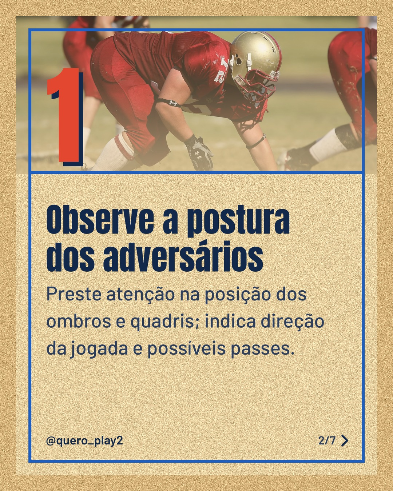
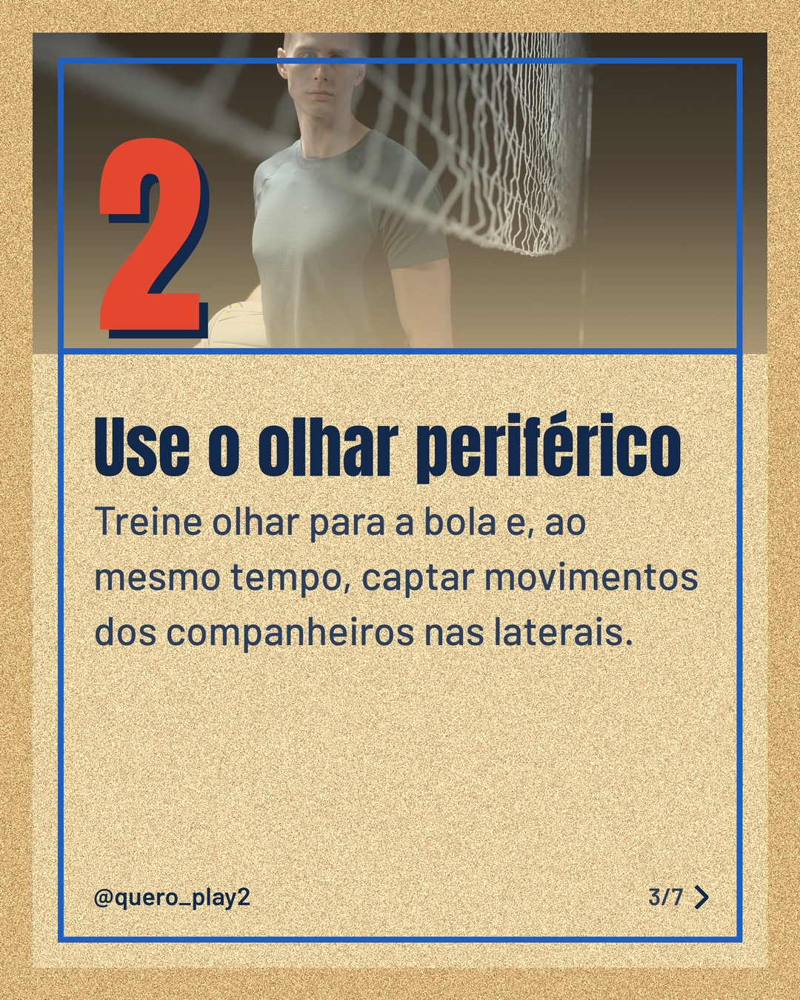
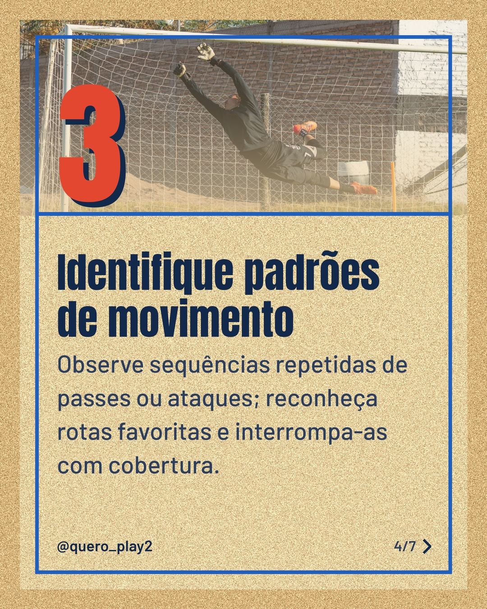
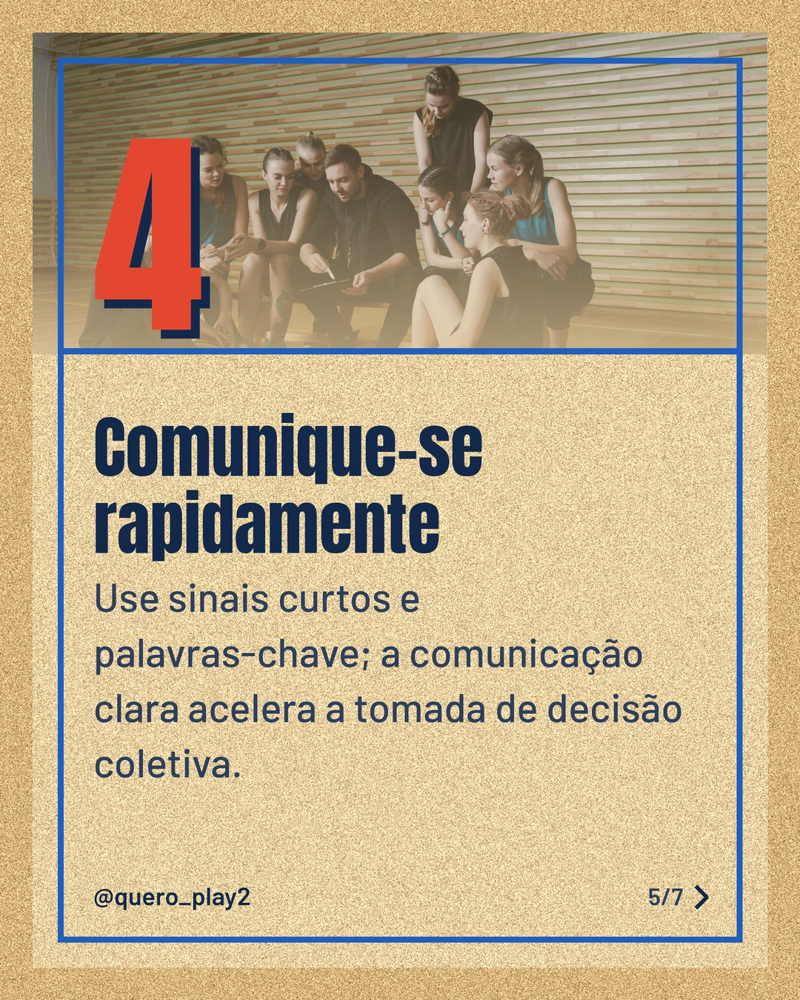
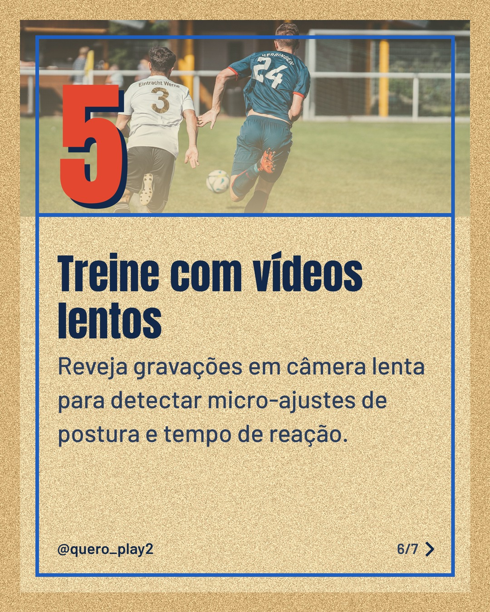
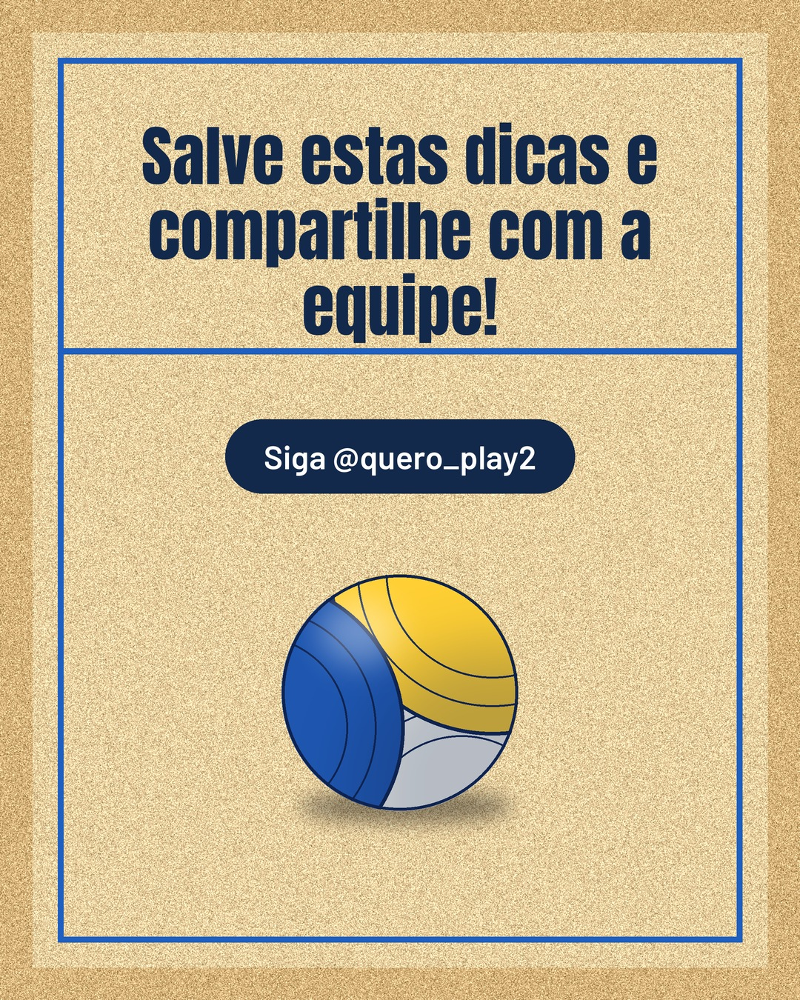

# areia

**Status:** aguardando revisão · 7 slides · gerado com `groq/openai/gpt-oss-120b`

      

## Legenda

> Você sabia que melhorar a visão de jogo pode mudar totalmente seu desempenho? 🤔
>
> Confira cada slide e coloque as técnicas em prática nos treinos e jogos. Cada detalhe conta para antecipar o próximo lance.
>
> Deslize para o lado, experimente e marque quem vai curtir essas dicas. 💪
>
> 📷 Fotos: Rahime Gül, Pixabay, cottonbro studio, Franco Monsalvo e Omar Ramadan (Pexels)
>
> #futebol #voleibol #curiosidades #esportes #treinamento #dicas #visãodejogo #tática #performance #atleta

---
**Quer mudar algo?** Edite o `legenda.txt` para trocar a legenda, ou o `post.json` para trocar os textos dos slides (depois rode `python main.py redesenhar 2026-10-14_135340`).
Foto não combinou? `python main.py trocar-foto 2026-10-14_135340 N` (0 = capa, 1, 2... = slides).
Para descartar este post, apague esta pasta.
