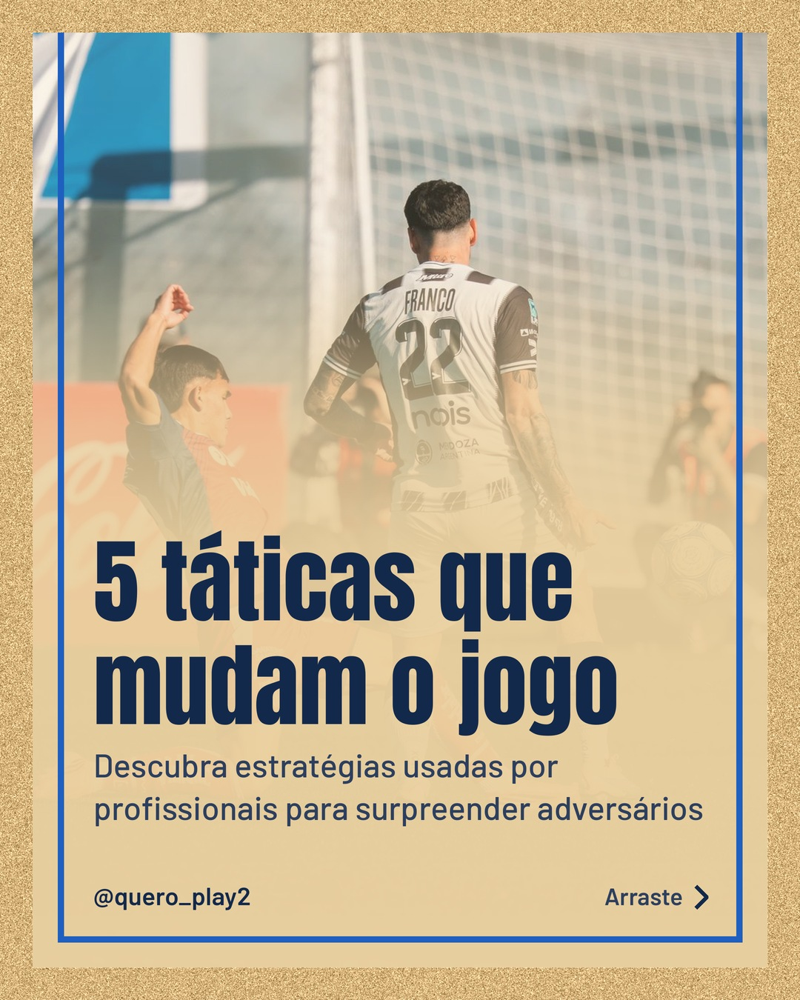
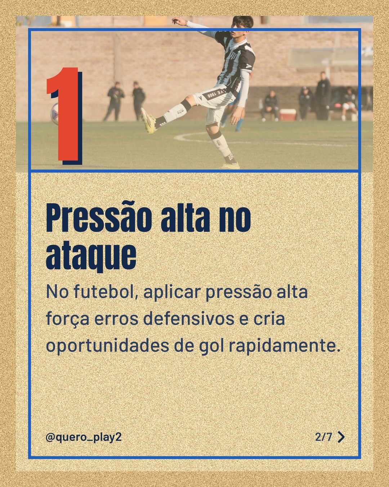
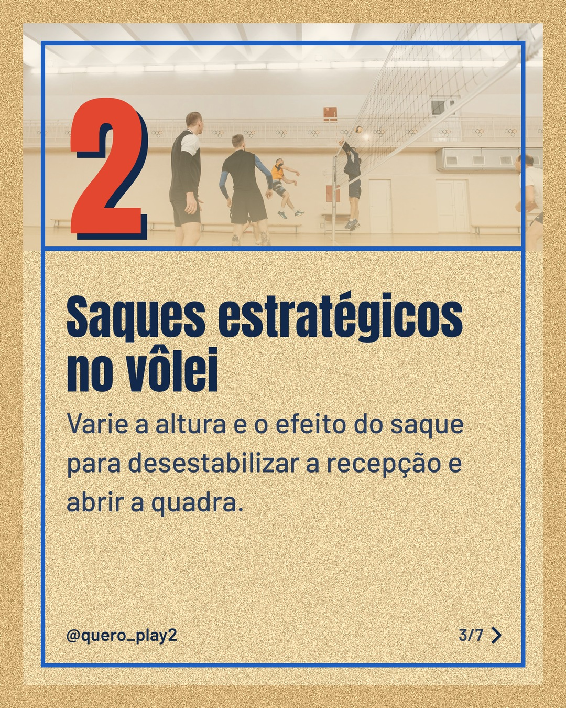
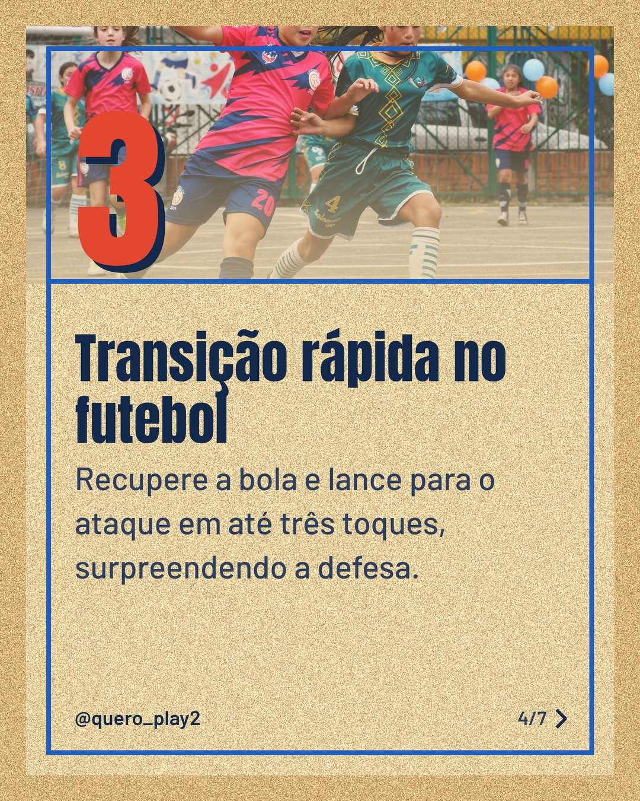
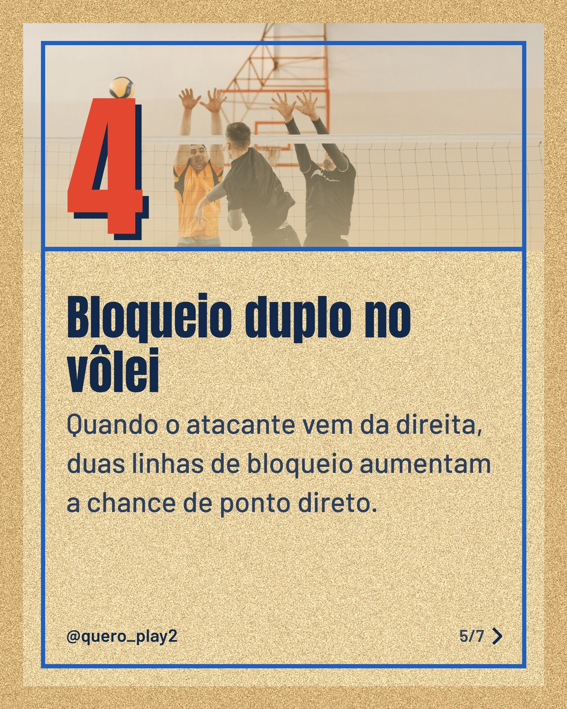
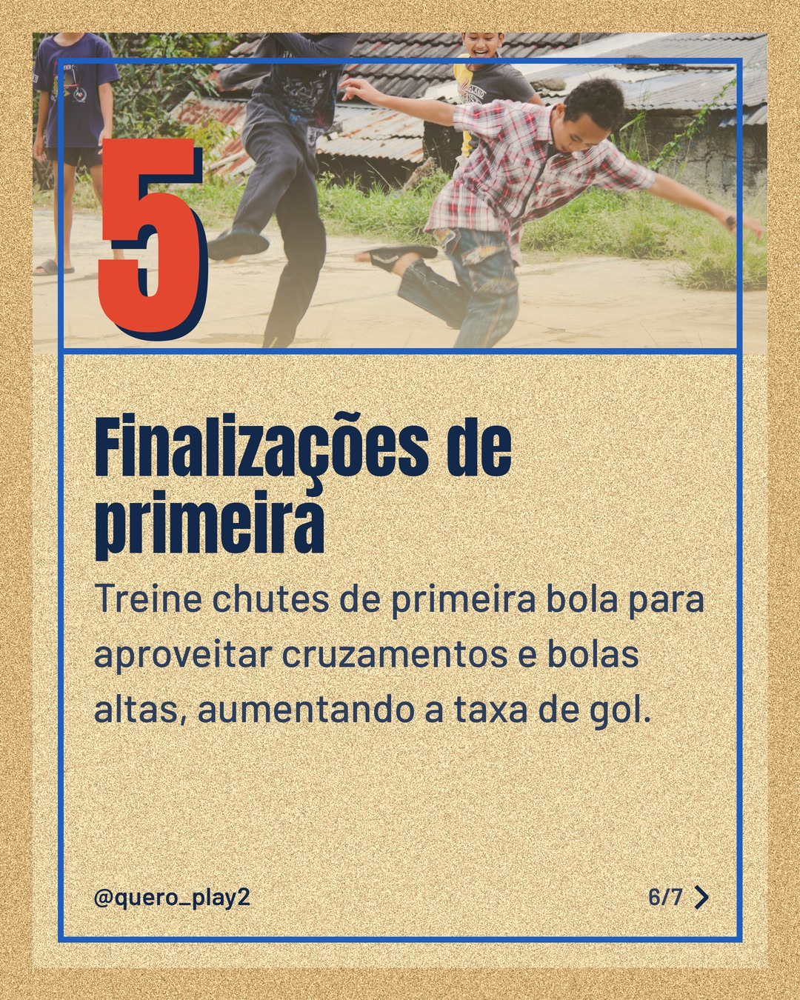
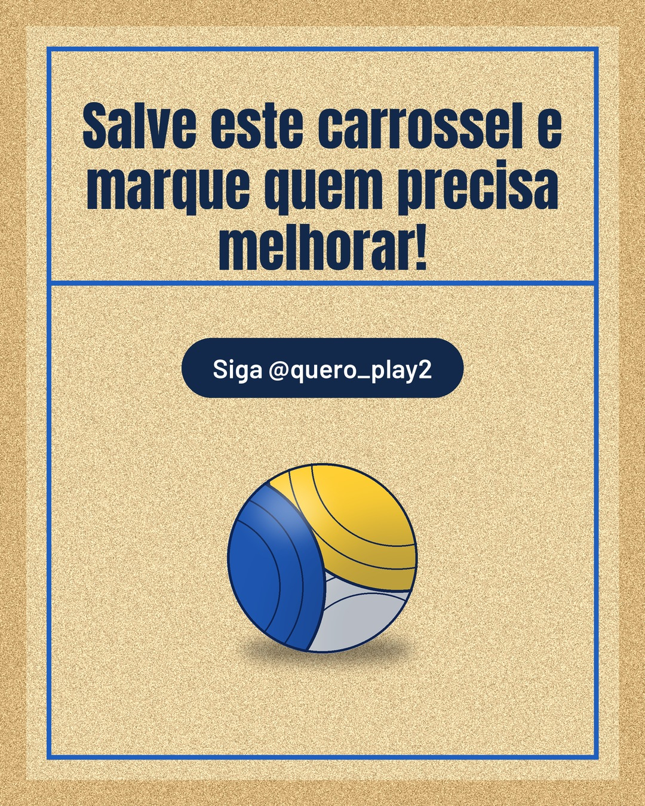

# areia

**Status:** aguardando revisão · 7 slides · gerado com `groq/openai/gpt-oss-120b`

      

## Legenda

> ⚽️ Você sabia que pequenas mudanças táticas podem transformar o desempenho da sua equipe?
>
> 🏐 No vôlei, ajustes simples no saque ou bloqueio dão vantagem enorme.
>
> Deslize para o lado e descubra cada dica prática que você pode aplicar agora mesmo.
>
> Curtiu? Salve, comente sua experiência e siga para mais curiosidades esportivas!
>
> 📷 Fotos: Mateo Franciosi, Franco Monsalvo, Pavel Danilyuk, Laura Rincón e Iman Taufik (Pexels)
>
> #futebol #volei #taticas #esporte #curiosidades #treinamento #dicas #jogo #performance #coach

---
**Quer mudar algo?** Edite o `legenda.txt` para trocar a legenda, ou o `post.json` para trocar os textos dos slides (depois rode `python main.py redesenhar 2026-10-15_134031`).
Foto não combinou? `python main.py trocar-foto 2026-10-15_134031 N` (0 = capa, 1, 2... = slides).
Para descartar este post, apague esta pasta.
