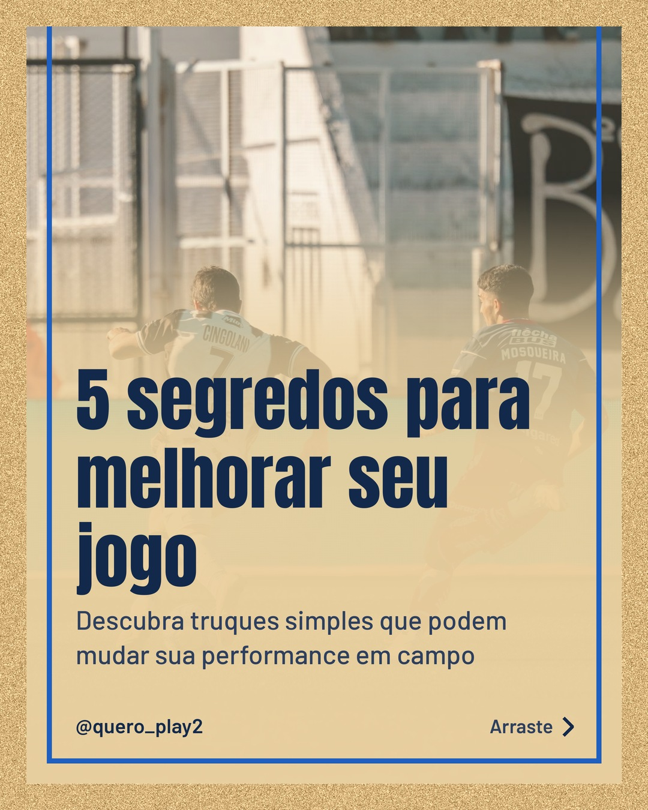
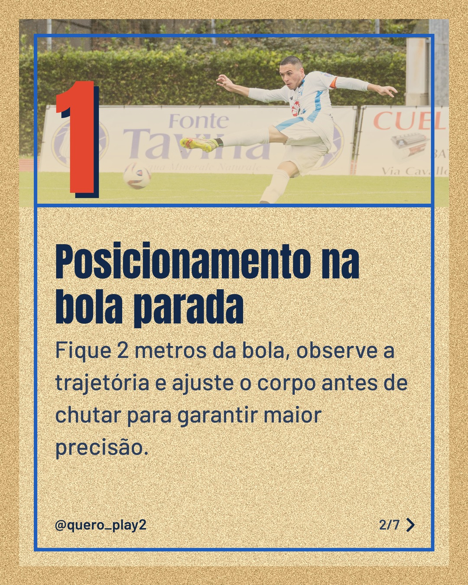
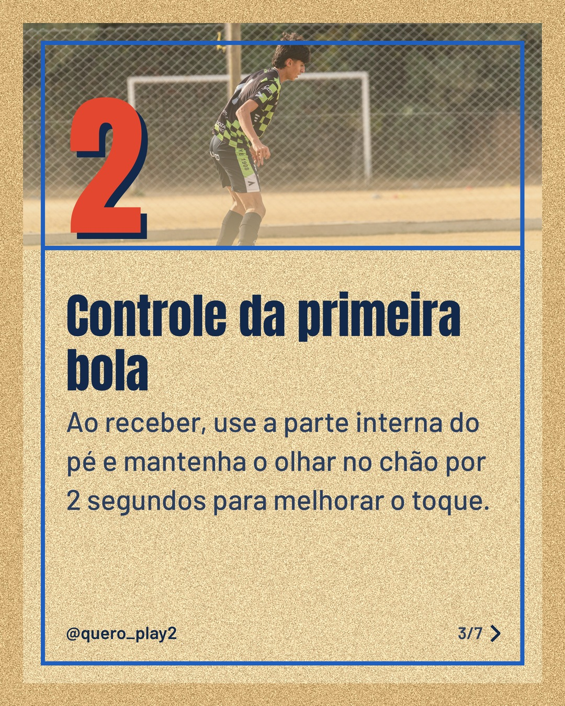
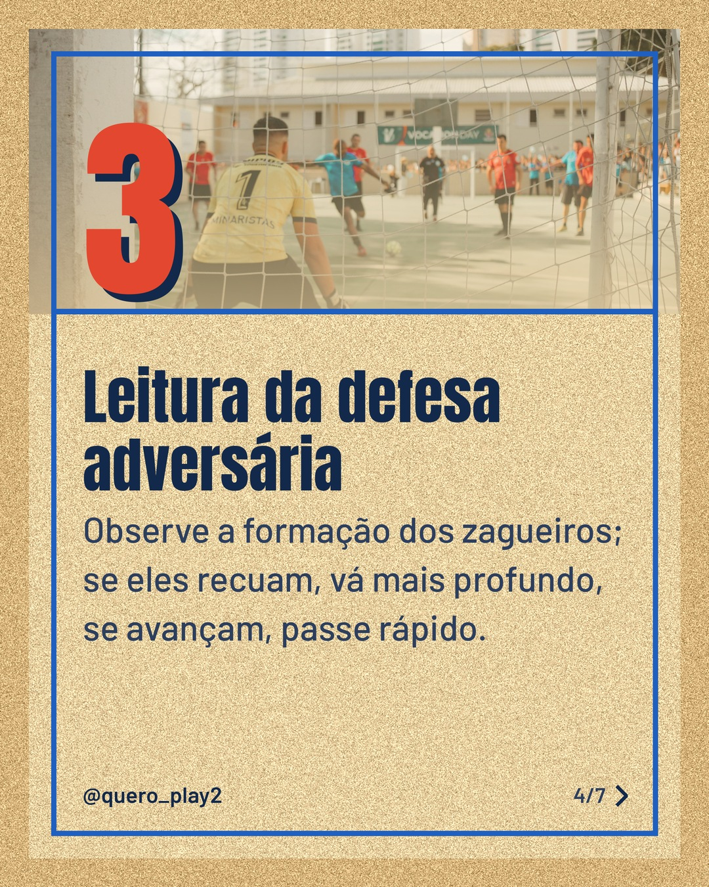
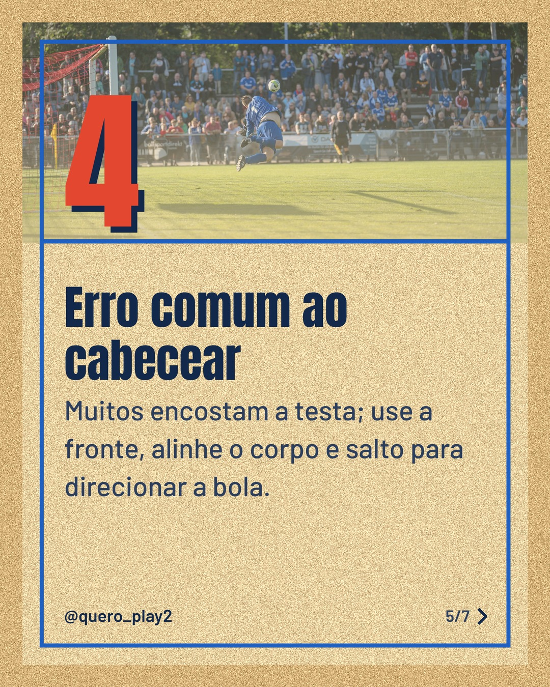
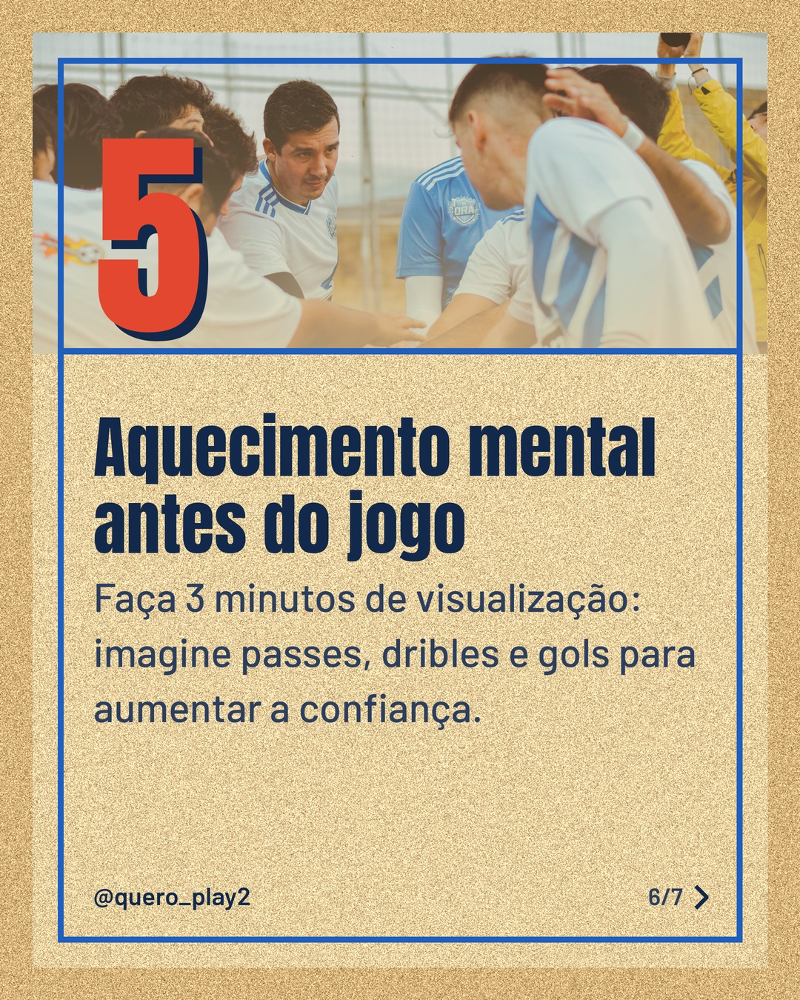

# areia

**Status:** aguardando revisão · 7 slides · gerado com `groq/openai/gpt-oss-120b`

      

## Legenda

> ⚽️ Quer elevar seu nível no futebol? Cada detalhe conta, e eu trouxe 5 dicas práticas para você aplicar já nos treinos.
> Deslize para o lado e descubra como melhorar posicionamento, controle, leitura da defesa, cabeceio e preparação mental.
> Curtiu? Deixe seu comentário, marque o parceiro de treino e não esqueça de seguir para mais curiosidades esportivas!
>
> 📷 Fotos: Mateo Franciosi, Davide Gargiulo, Franco Monsalvo, Federico Velazco, Omar Ramadan e César O'neill (Pexels)
>
> #futebol #dicasdefutebol #treinamentofutebol #curiosidadesfutebol #jogadodefutebol #soccer #footballtips #sportslearning #futebolbrasileiro #jogadocriativo

---
**Quer mudar algo?** Edite o `legenda.txt` para trocar a legenda, ou o `post.json` para trocar os textos dos slides (depois rode `python main.py redesenhar 2026-10-16_132329`).
Foto não combinou? `python main.py trocar-foto 2026-10-16_132329 N` (0 = capa, 1, 2... = slides).
Para descartar este post, apague esta pasta.
