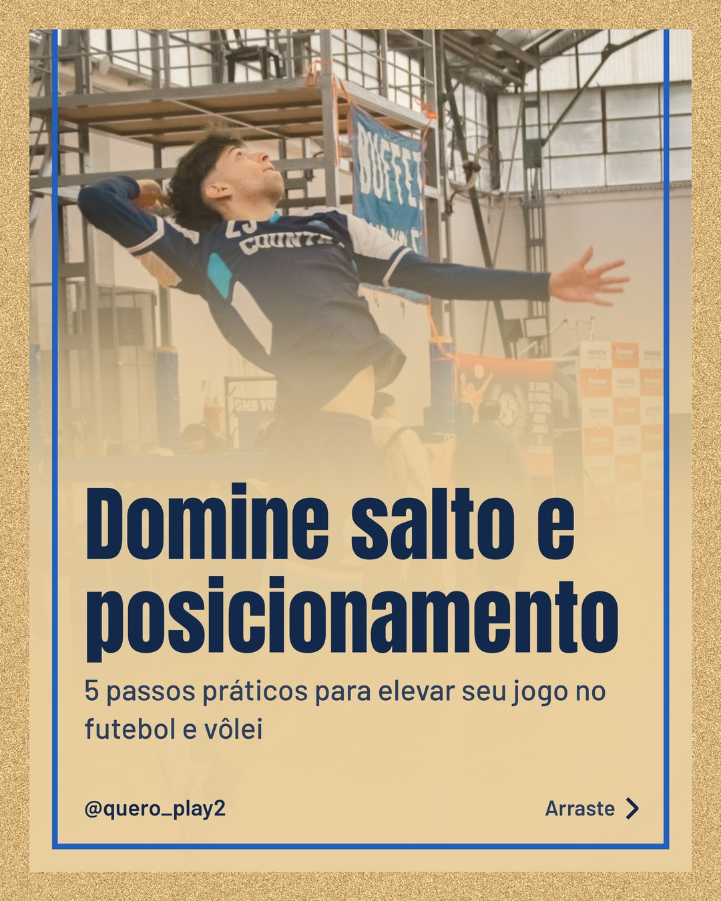
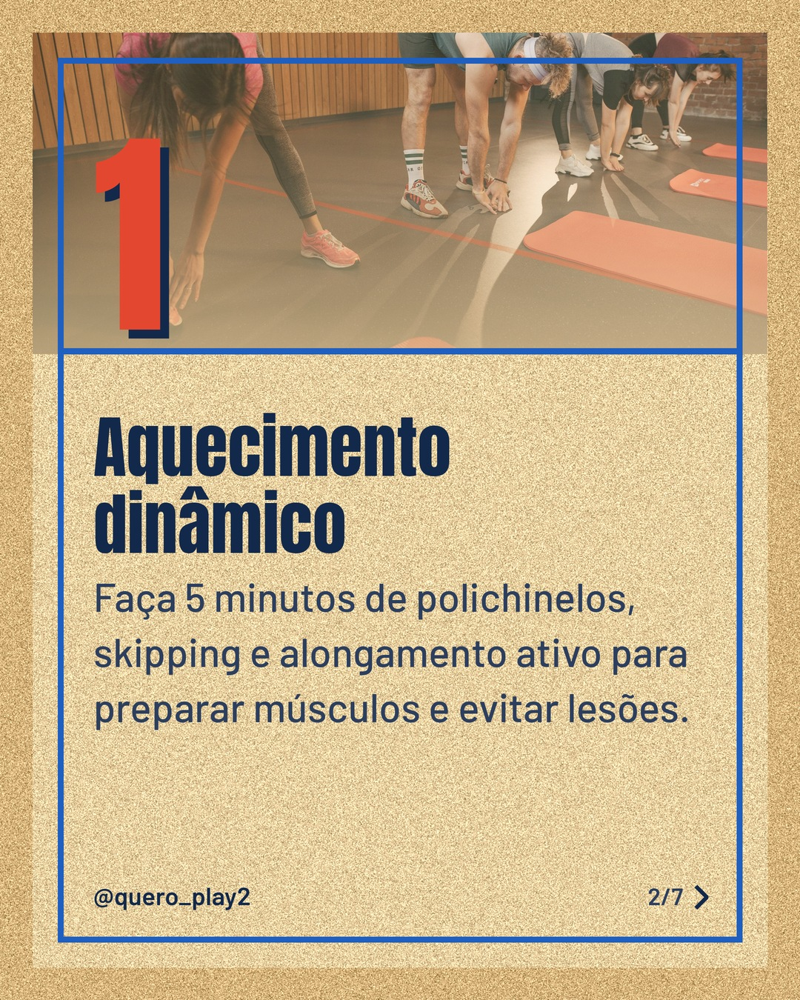
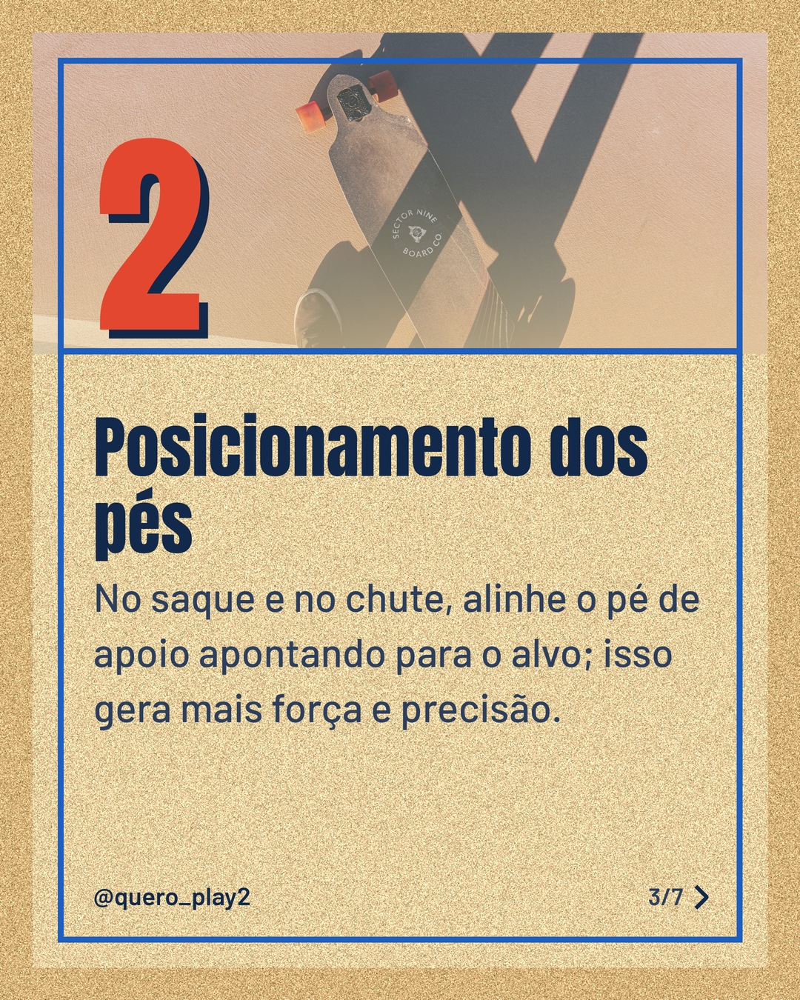
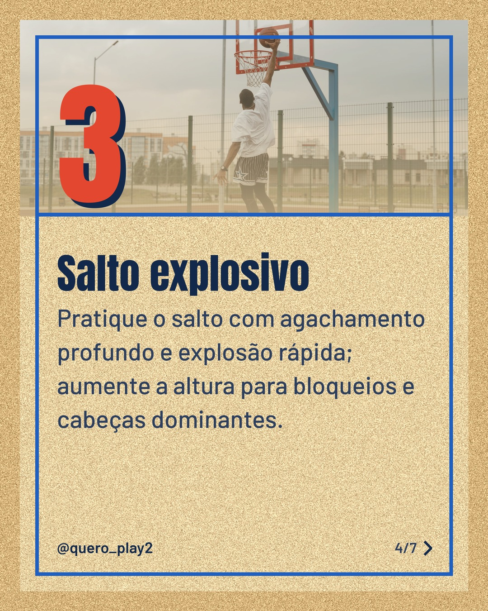
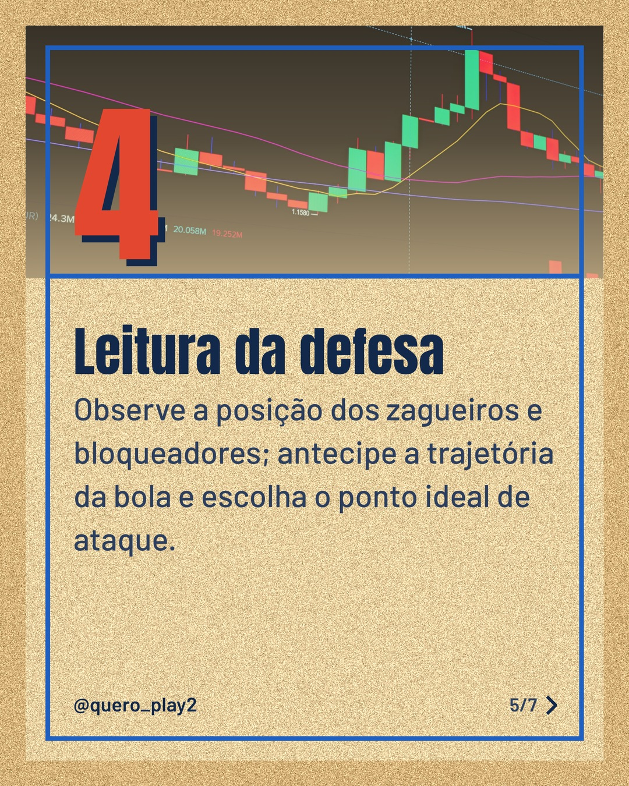
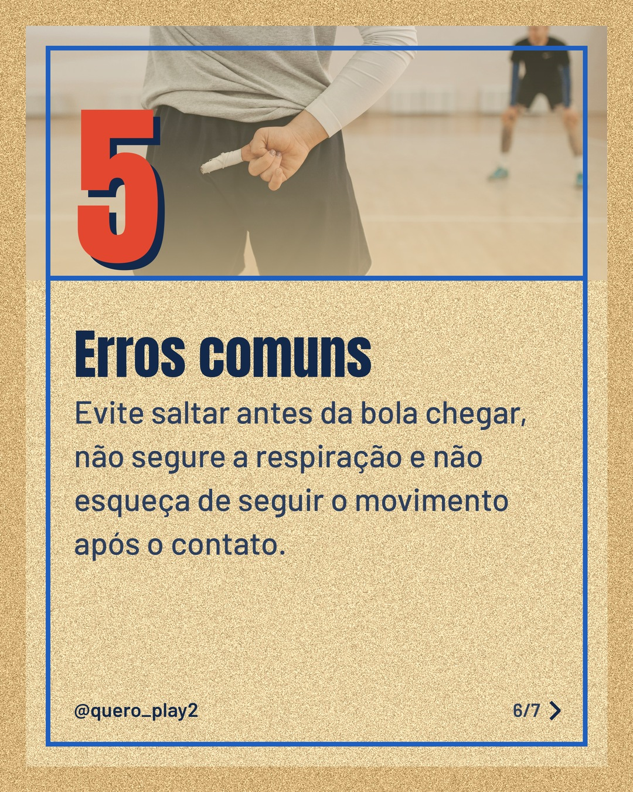
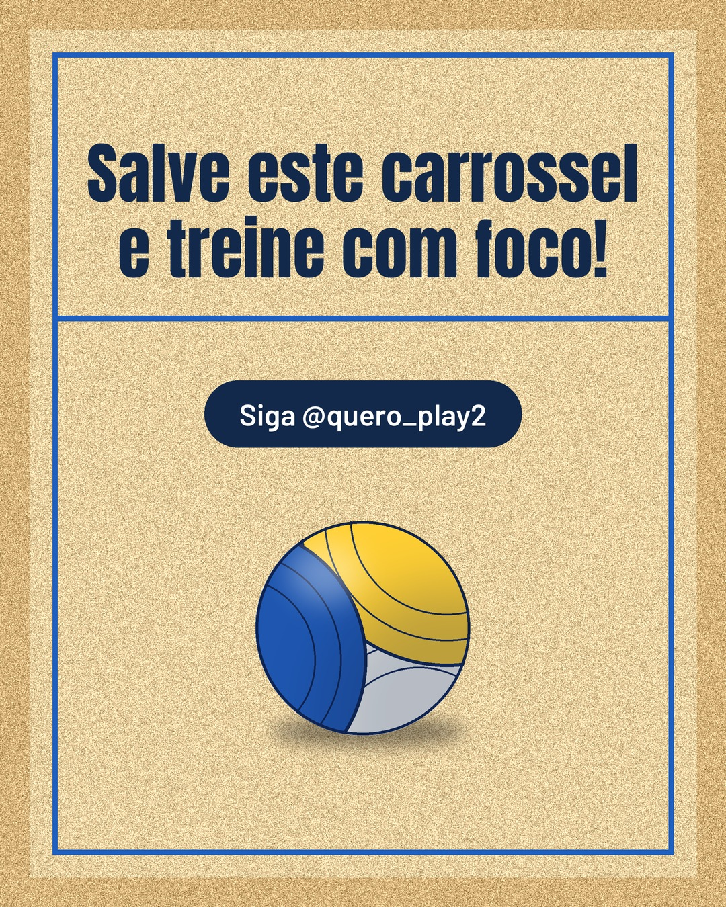

# areia

**Status:** aguardando revisão · 7 slides · gerado com `groq/openai/gpt-oss-120b`

      

## Legenda

> Quer melhorar seu salto e posicionamento no futebol e vôlei? 🚀
> Segue o passo a passo que separei, fácil de aplicar nos treinos.
> Deslize para o lado e descubra cada dica. Depois comenta qual vai testar primeiro! 💬
> Curtiu? Salve, compartilhe e siga para mais curiosidades esportivas. 👍
>
> 📷 Fotos: Fer Strange, Pavel Danilyuk, Selvin Esteban, Tima Miroshnichenko e Rafael Minguet Delgado (Pexels)
>
> #futebol #volei #treino #esporte #dicasdeesporte #salto #posicionamento #performance #jogos #atletismo

---
**Quer mudar algo?** Edite o `legenda.txt` para trocar a legenda, ou o `post.json` para trocar os textos dos slides (depois rode `python main.py redesenhar 2026-10-17_121743`).
Foto não combinou? `python main.py trocar-foto 2026-10-17_121743 N` (0 = capa, 1, 2... = slides).
Para descartar este post, apague esta pasta.
