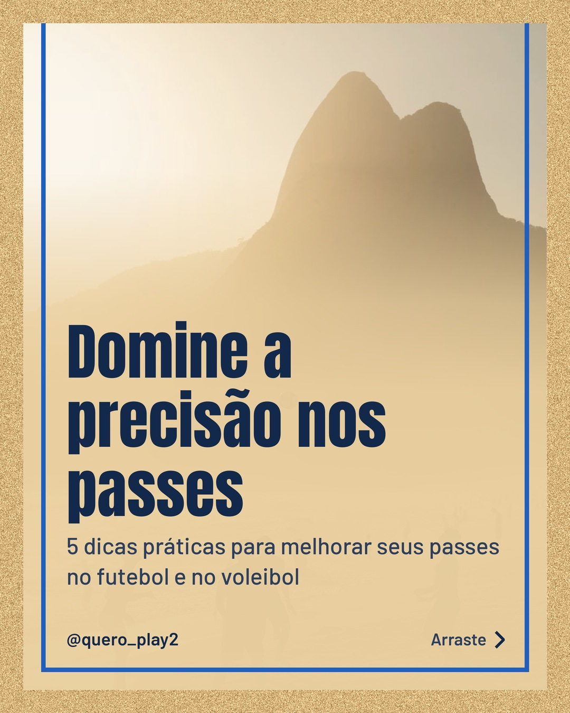
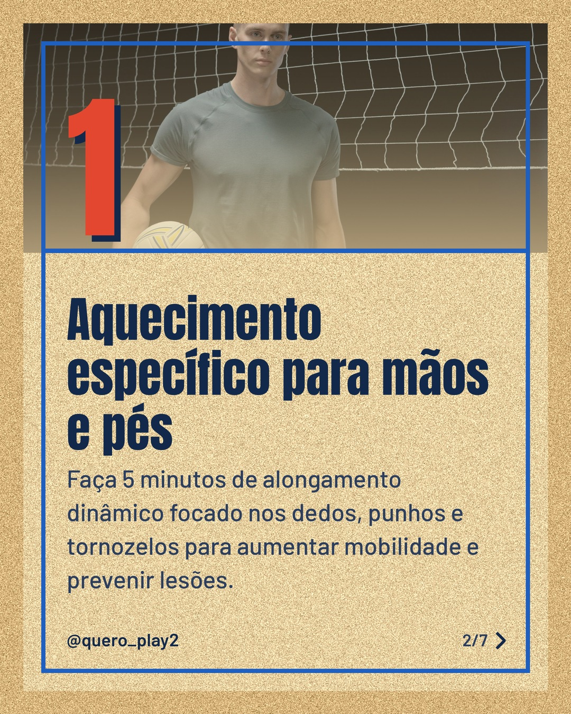
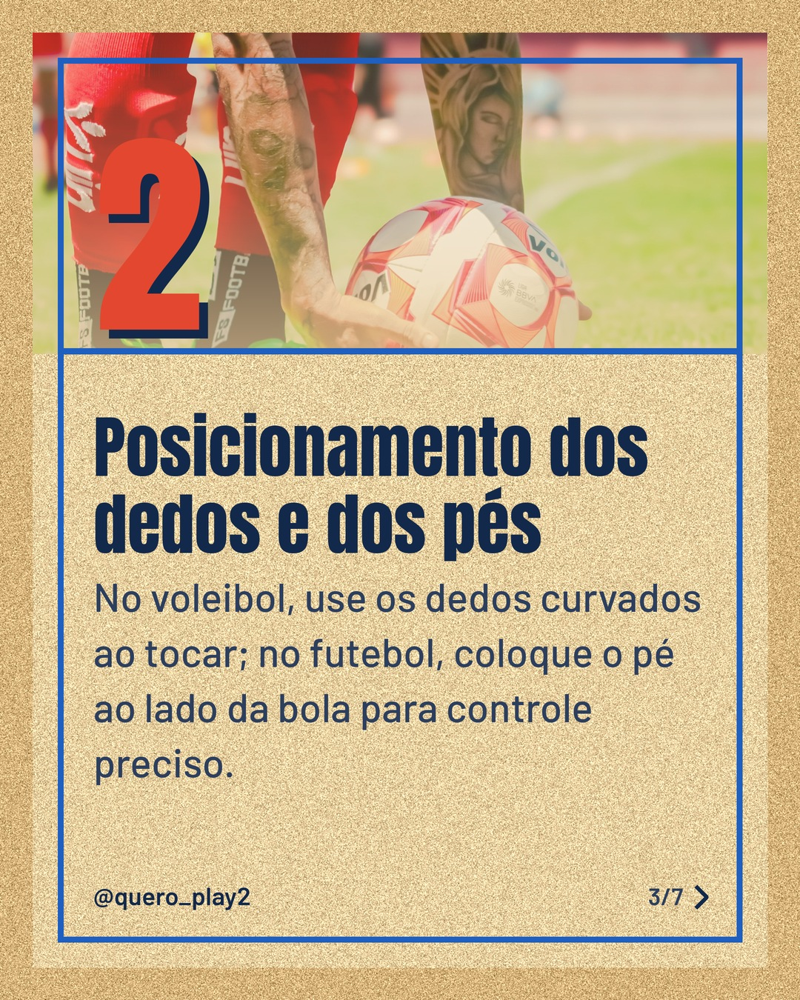
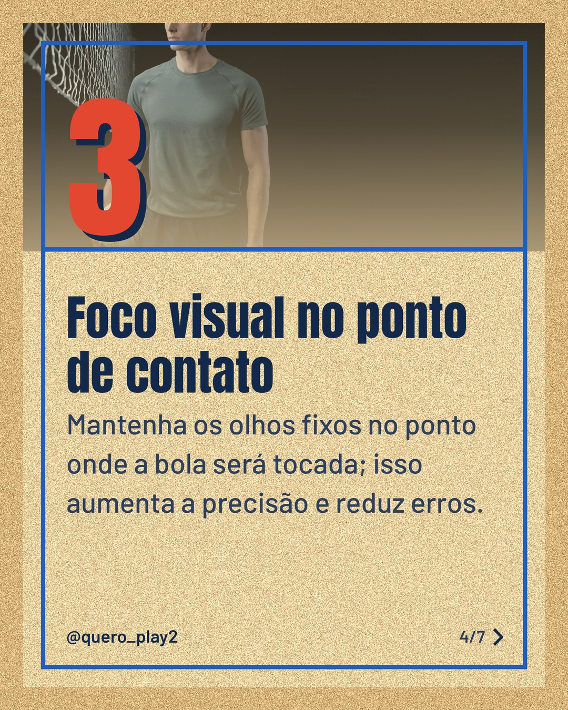
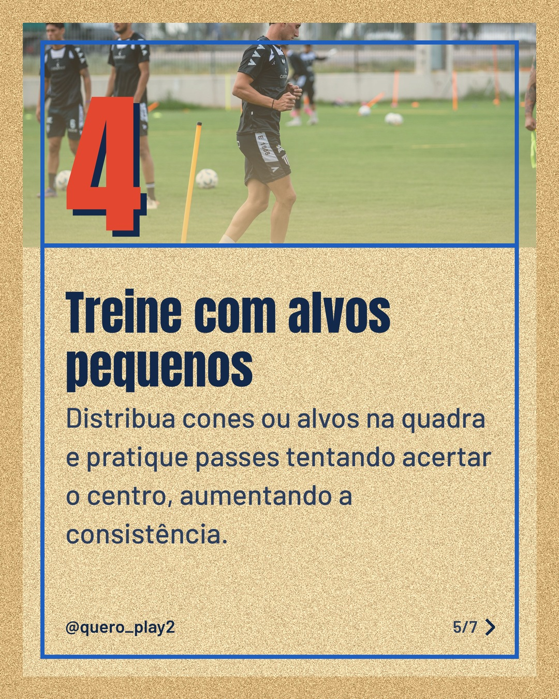
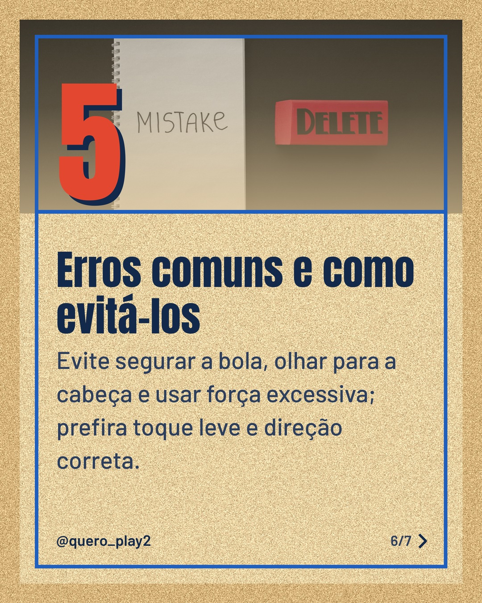
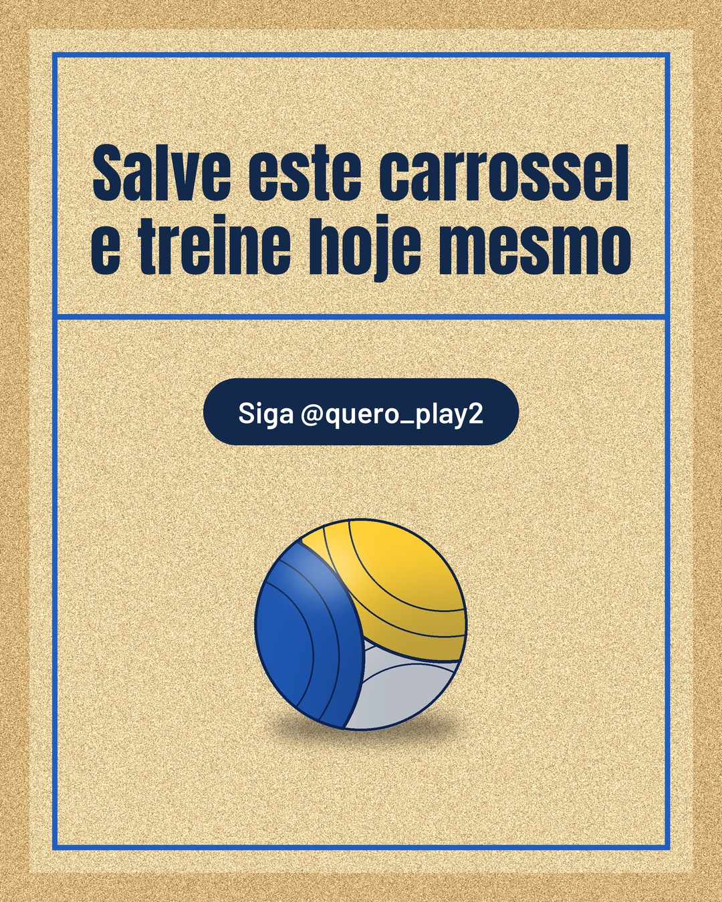

# areia

**Status:** aguardando revisão · 7 slides · gerado com `groq/openai/gpt-oss-120b`

      

## Legenda

> Quer melhorar seus passes no futebol e no vôlei? 🎯 Descubra 5 dicas simples que vão transformar sua precisão.
> Deslize para o lado e veja cada passo: aquecimento, posicionamento, foco visual, alvos e erros a evitar.
> Curtiu? Deixe um comentário, marque um amigo e siga o perfil para mais curiosidades esportivas!
>
> 📷 Fotos: Karl  Groendal, cottonbro studio, Eden FC, Franco Monsalvo e KATRIN  BOLOVTSOVA (Pexels)
>
> #futebol #volei #passes #dicasesportivas #treinamento #precisao #esporte #curiosidades #jogadores #melhorejogo

---
**Quer mudar algo?** Edite o `legenda.txt` para trocar a legenda, ou o `post.json` para trocar os textos dos slides (depois rode `python main.py redesenhar 2026-10-18_123925`).
Foto não combinou? `python main.py trocar-foto 2026-10-18_123925 N` (0 = capa, 1, 2... = slides).
Para descartar este post, apague esta pasta.
