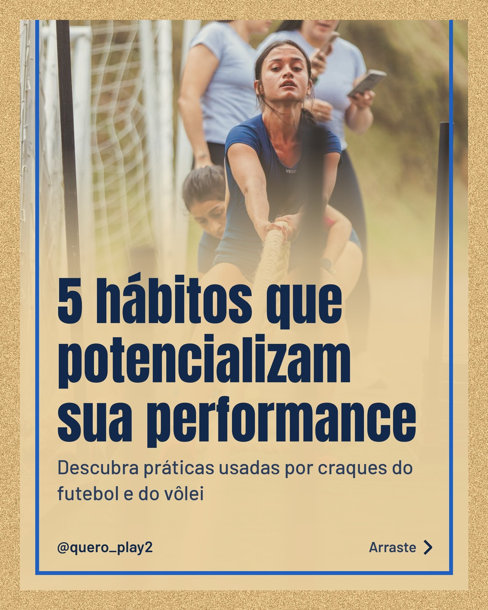
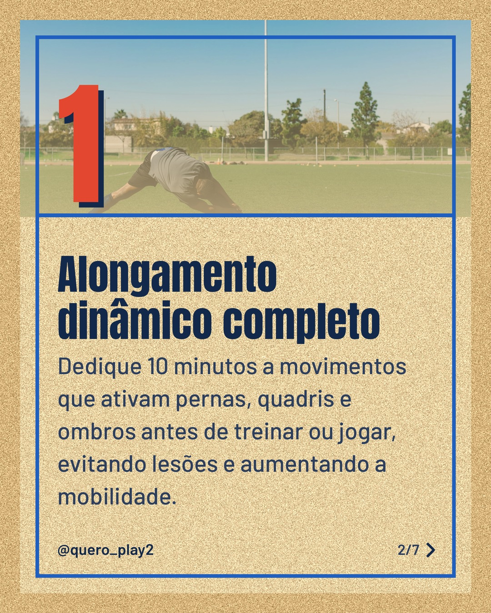
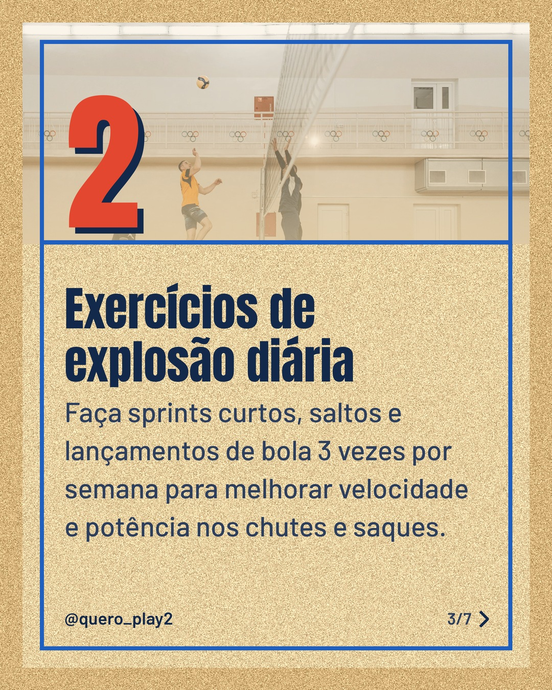
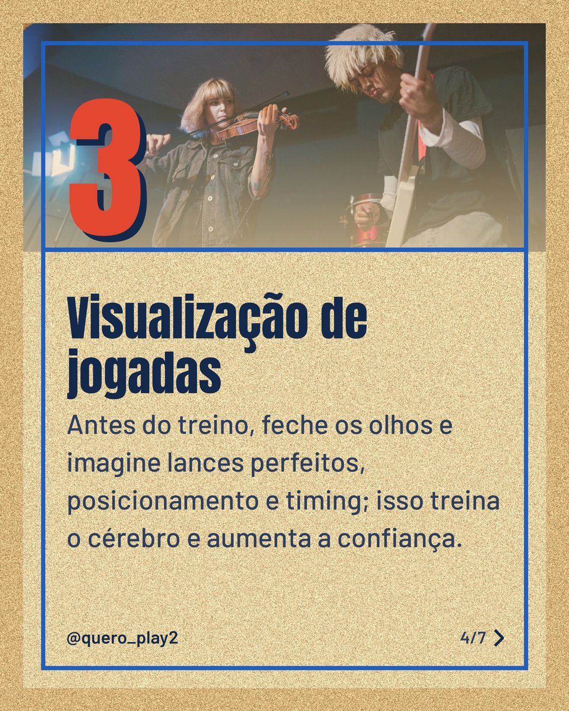
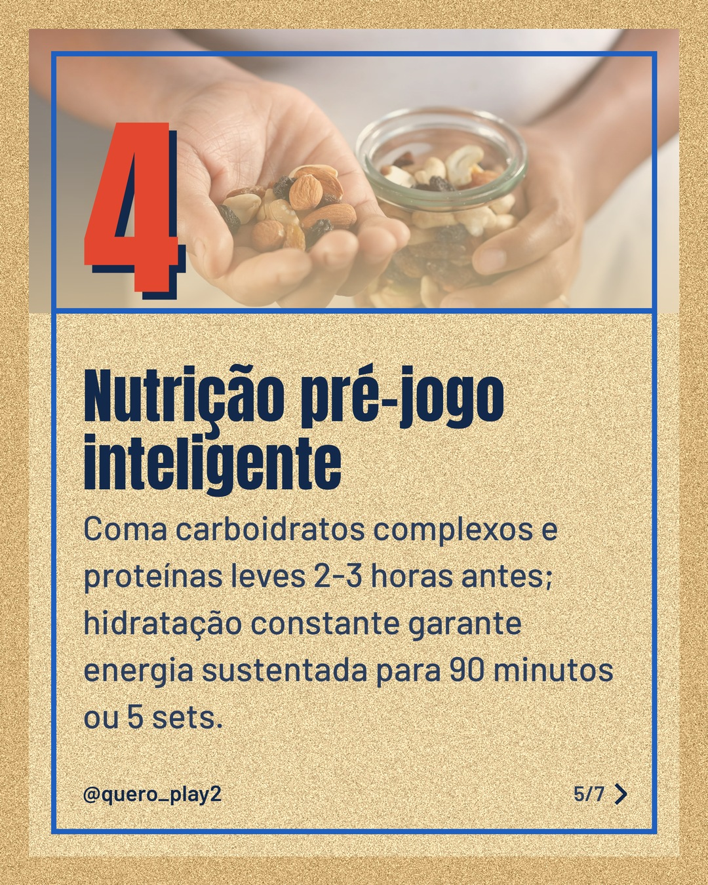
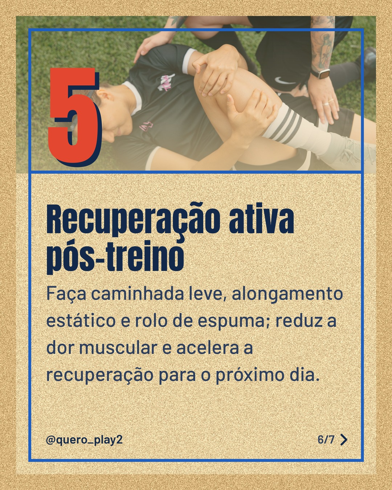
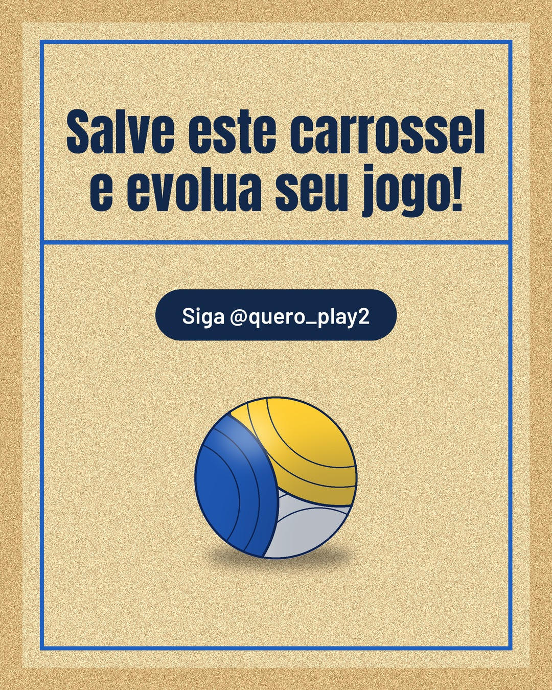

# areia

**Status:** aguardando revisão · 7 slides · gerado com `groq/openai/gpt-oss-120b`

      

## Legenda

> Você sabia que pequenos hábitos diários podem transformar sua performance no futebol e no vôlei? ⚽🏐
> Deslize para descobrir 5 práticas simples usadas pelos grandes atletas e comece a aplicar já nos seus treinos.
> Curtiu? Deixe seu comentário, compartilhe com amigos e siga @seuperfil para mais curiosidades esportivas!
>
> 📷 Fotos: CRISTIAN CAMILO  ESTRADA, RDNE Stock project, Pavel Danilyuk, Towfiqu barbhuiya e Anastasia  Shuraeva (Pexels)
>
> #futebol #volei #esporte #treino #dicasdesportivas #performance #saude #nutricao #recuperacao #motivacao

---
**Quer mudar algo?** Edite o `legenda.txt` para trocar a legenda, ou o `post.json` para trocar os textos dos slides (depois rode `python main.py redesenhar 2026-10-19_153435`).
Foto não combinou? `python main.py trocar-foto 2026-10-19_153435 N` (0 = capa, 1, 2... = slides).
Para descartar este post, apague esta pasta.
