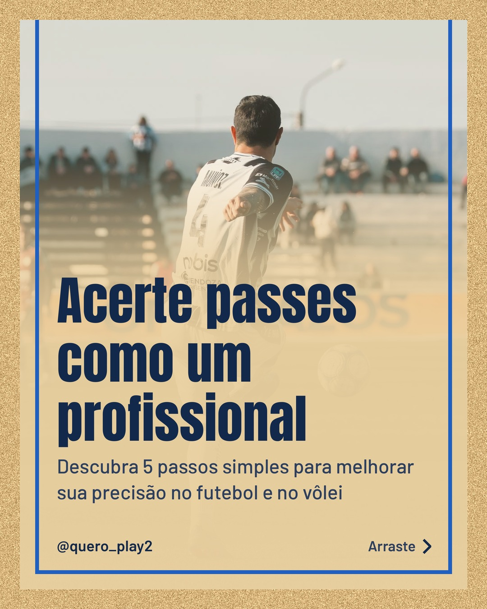
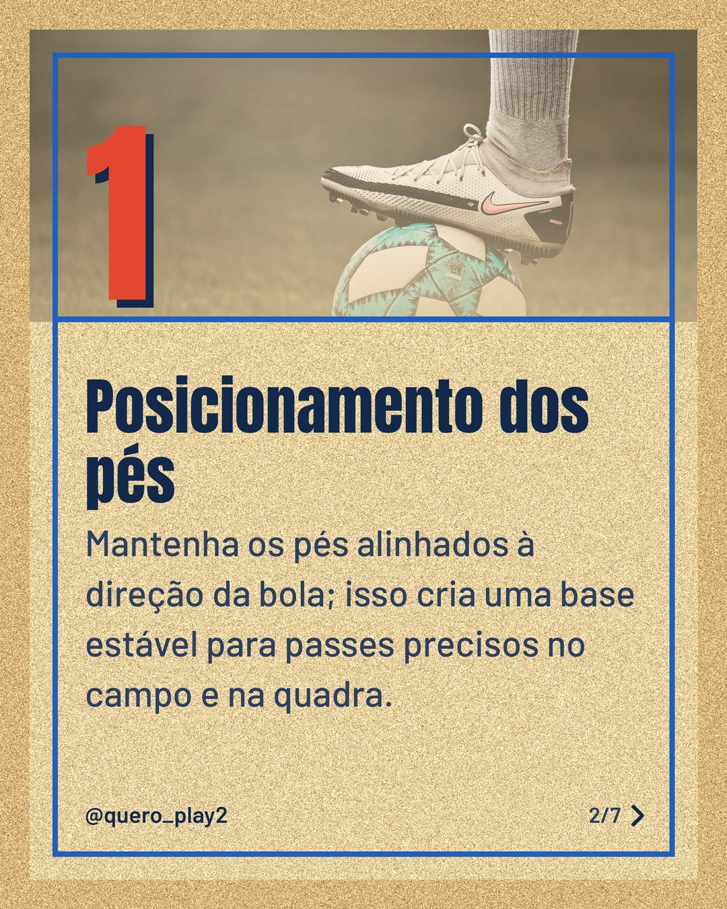
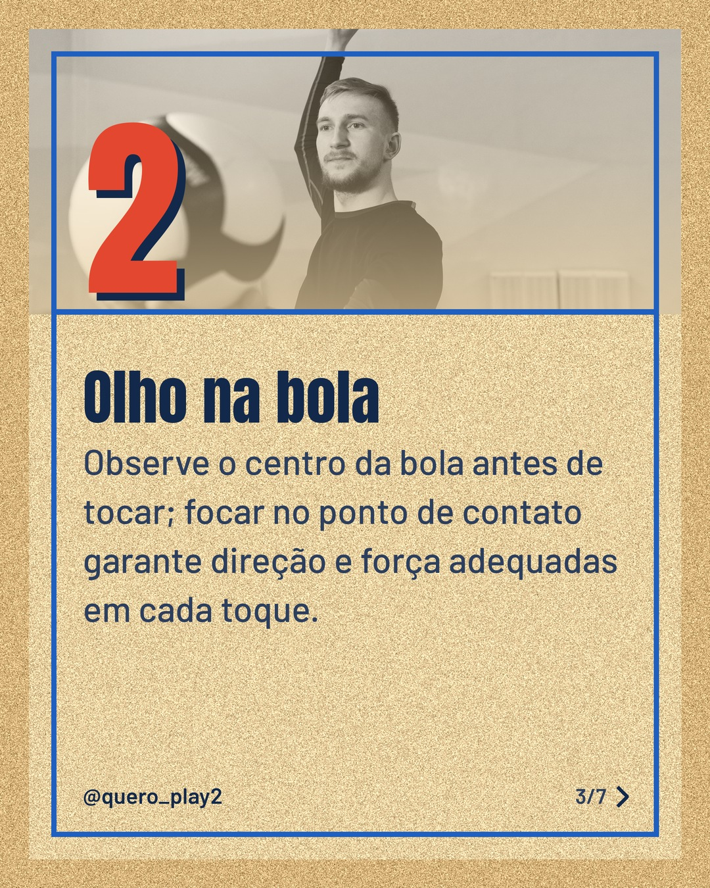
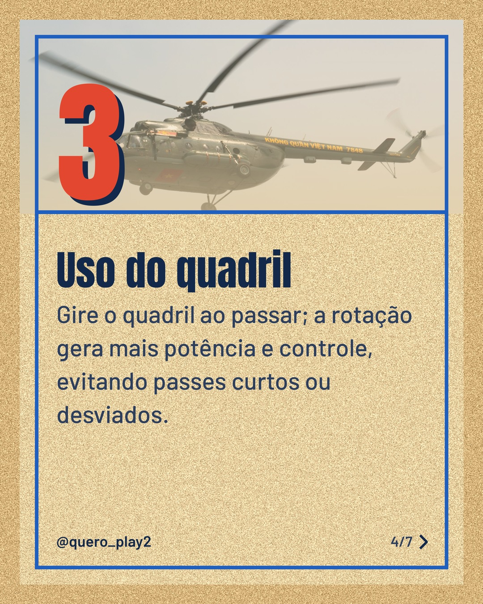
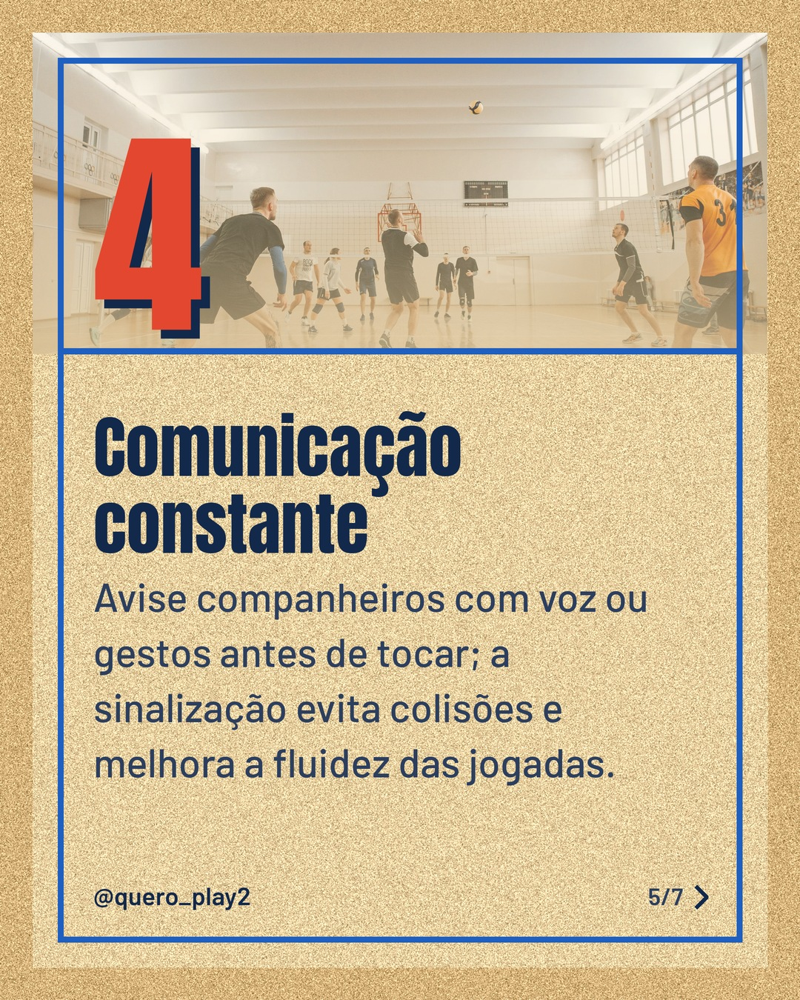
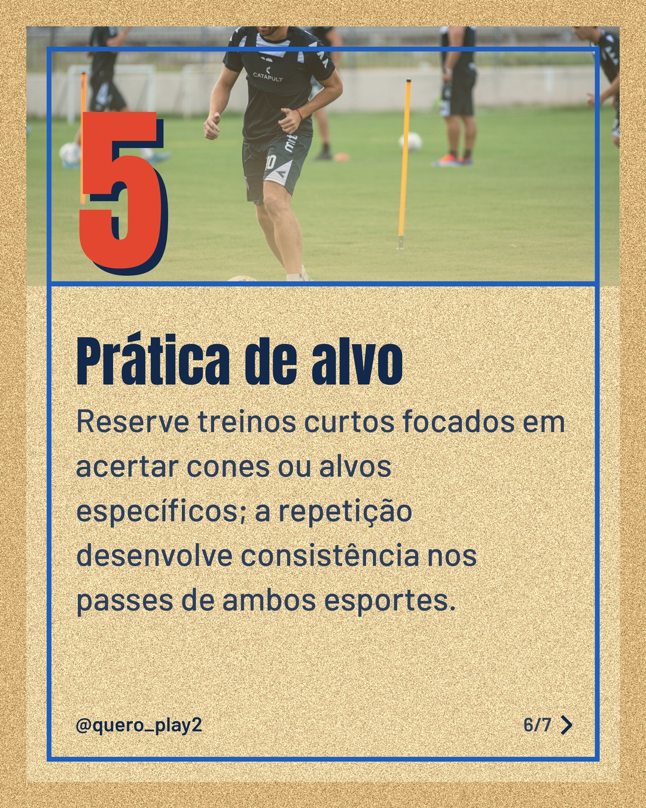
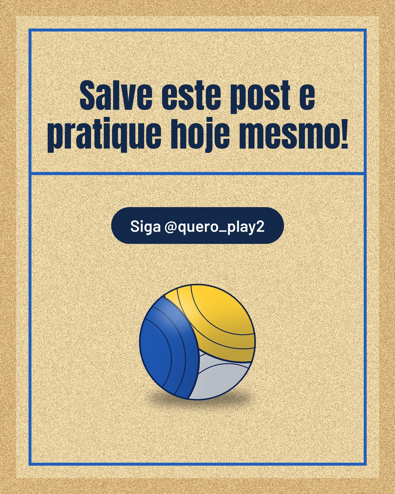

# areia

**Status:** aguardando revisão · 7 slides · gerado com `groq/openai/gpt-oss-120b`

      

## Legenda

> Quer melhorar a precisão dos seus passes no futebol e no vôlei? ⚽🏐
> Confira 5 dicas simples que vão transformar sua técnica: posicionamento, foco, rotação, comunicação e treino de alvo.
> Deslize para o lado, teste cada passo nos treinos e marque alguém que precisa ver isso. 👉 Salve, curta e siga para mais curiosidades!
>
> 📷 Fotos: Mateo Franciosi, Gonzalo Acuña, Pavel Danilyuk, Go Journal e Franco Monsalvo (Pexels)
>
> #futebol #volei #dicasdefutebol #dicasdevolei #precisao #treinamento #esporte #curiosidades #passes #tecnica #treinar

---
**Quer mudar algo?** Edite o `legenda.txt` para trocar a legenda, ou o `post.json` para trocar os textos dos slides (depois rode `python main.py redesenhar 2026-10-20_133731`).
Foto não combinou? `python main.py trocar-foto 2026-10-20_133731 N` (0 = capa, 1, 2... = slides).
Para descartar este post, apague esta pasta.
