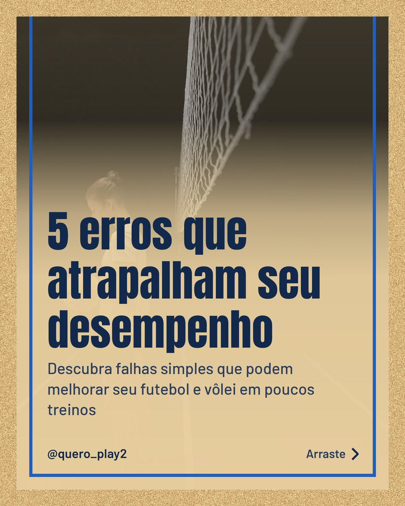
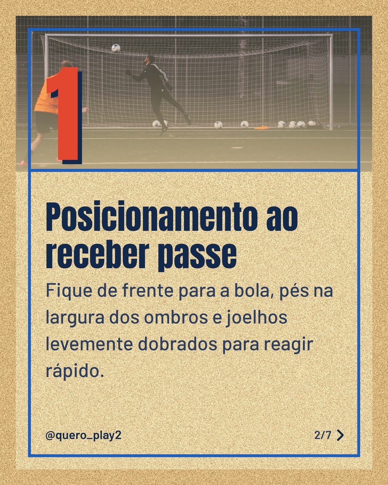
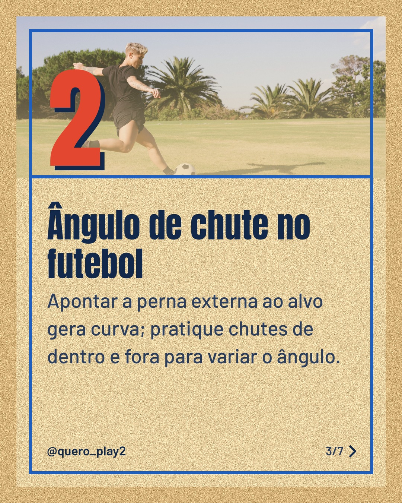
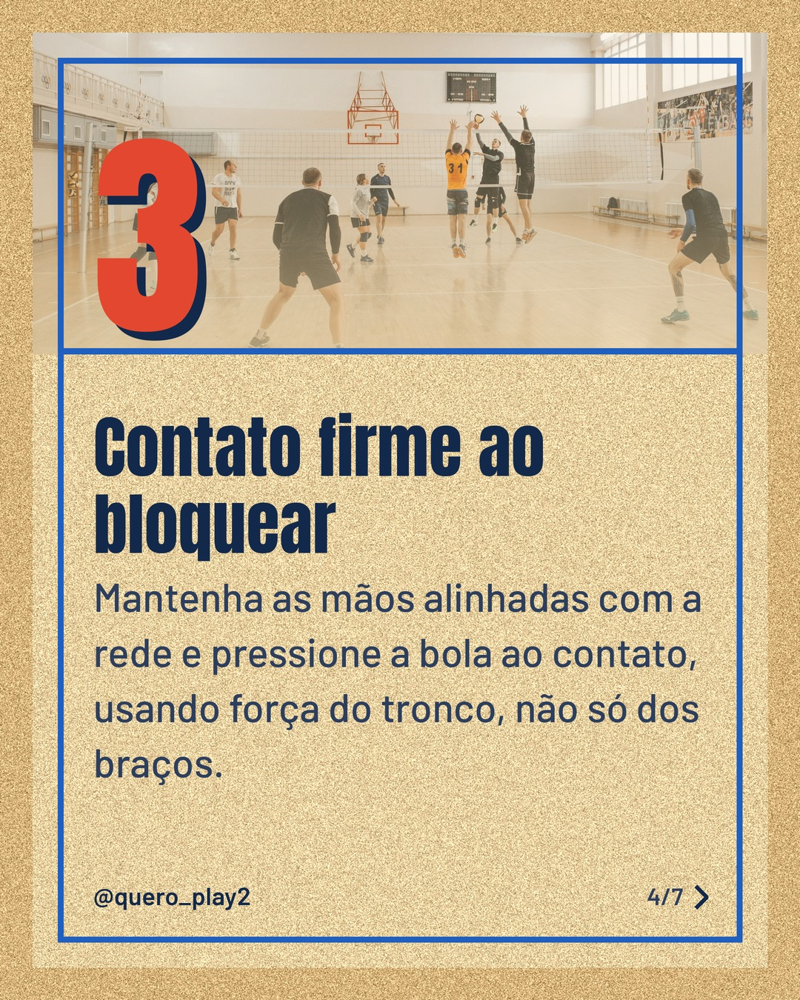
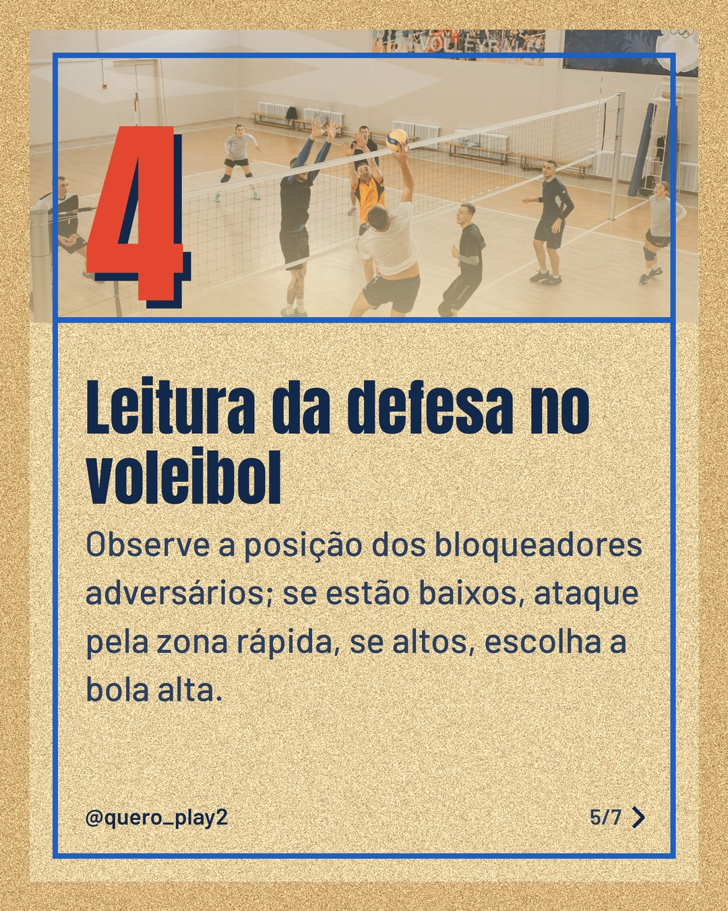
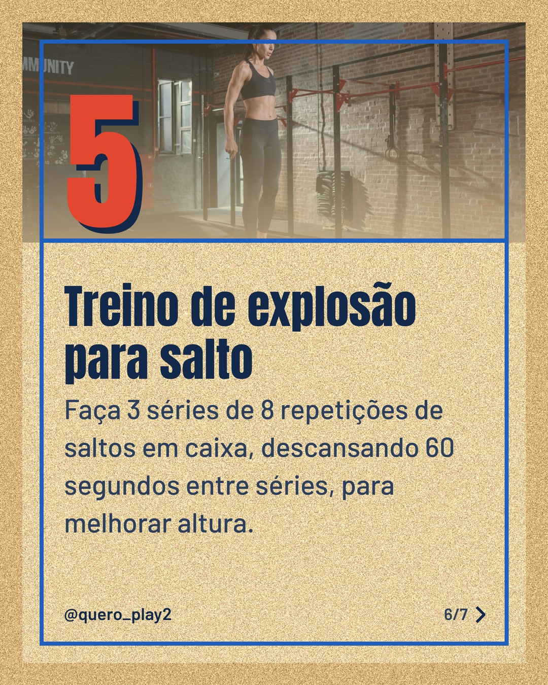
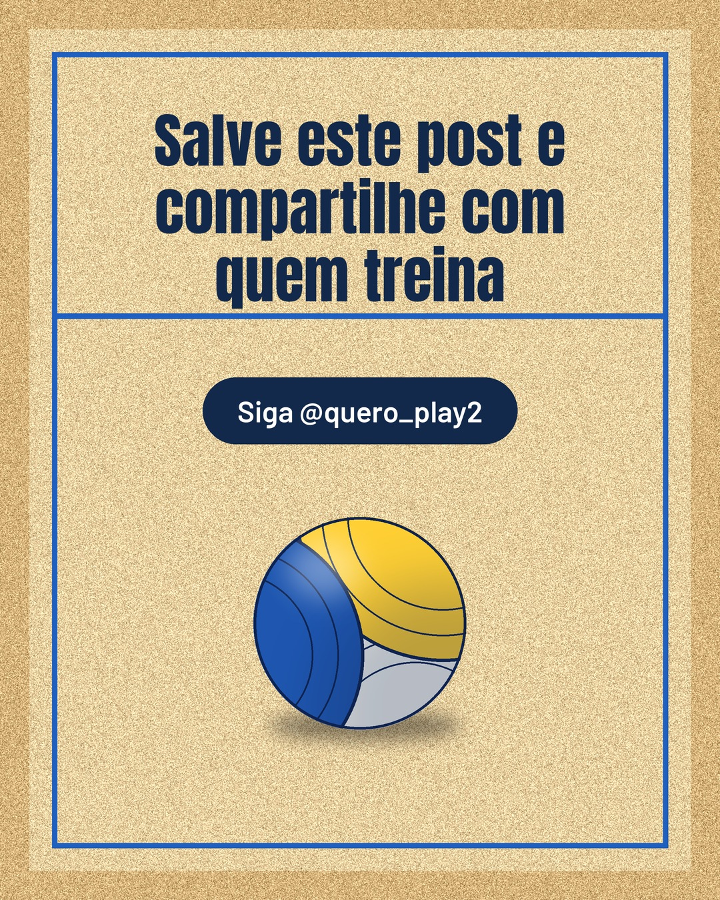

# areia

**Status:** aguardando revisão · 7 slides · gerado com `groq/openai/gpt-oss-120b`

      

## Legenda

> Você sabia que pequenos ajustes podem transformar seu jogo tanto no futebol quanto no vôlei? 🚀 Deslize para ver 5 erros comuns e como corrigi‑los de forma simples e prática. Cada dica cabe num treino rápido! Curtiu? Salve o post, compartilhe com a galera e me conta nos comentários qual dica você já usa!
>
> 📷 Fotos: cottonbro studio, Omar Ramadan, RF._.studio _ e Pavel Danilyuk (Pexels)
>
> #futebol #volei #curiosidades #esportes #treino #dicas #performance #salto #chute #bloqueio

---
**Quer mudar algo?** Edite o `legenda.txt` para trocar a legenda, ou o `post.json` para trocar os textos dos slides (depois rode `python main.py redesenhar 2026-10-21_135610`).
Foto não combinou? `python main.py trocar-foto 2026-10-21_135610 N` (0 = capa, 1, 2... = slides).
Para descartar este post, apague esta pasta.
