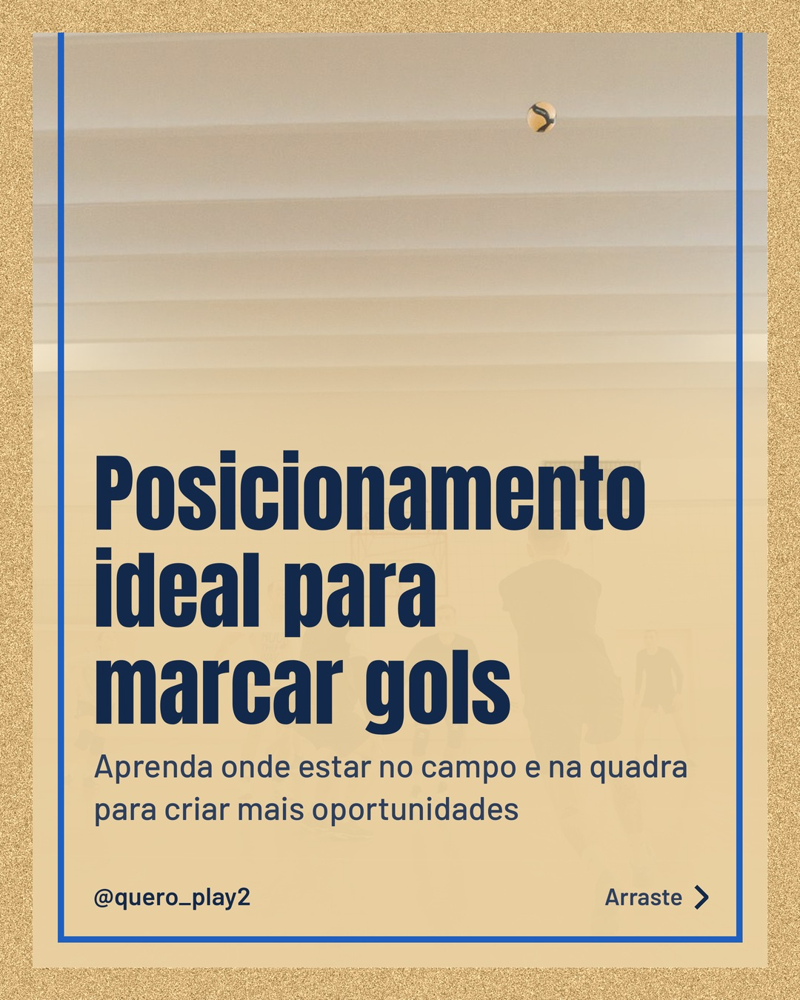
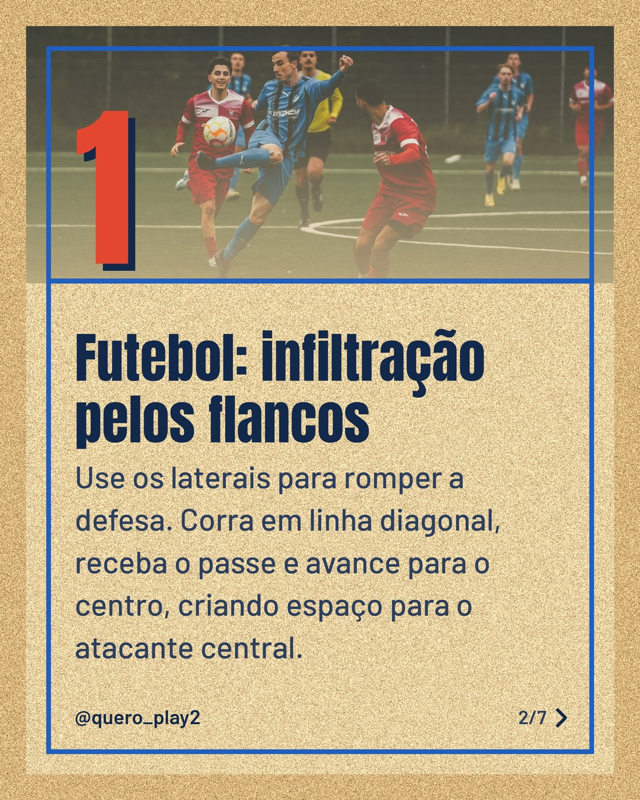
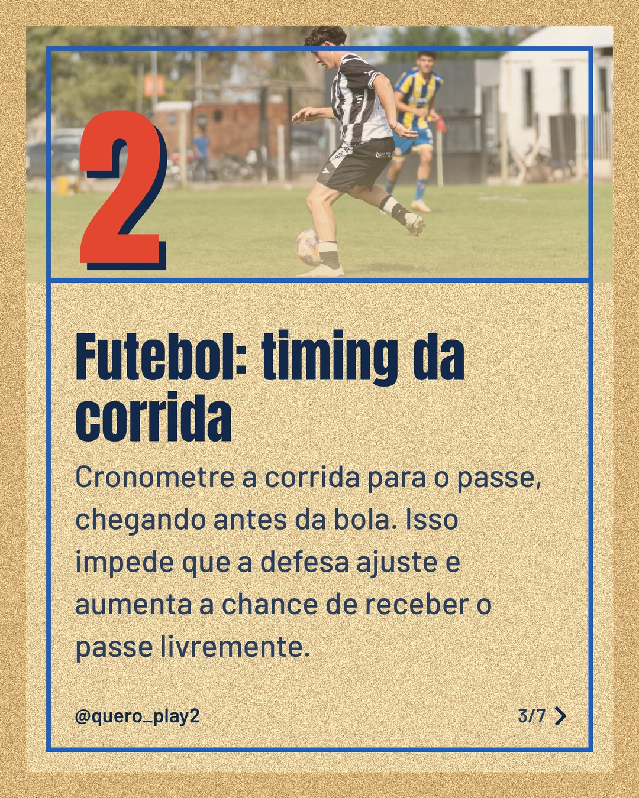
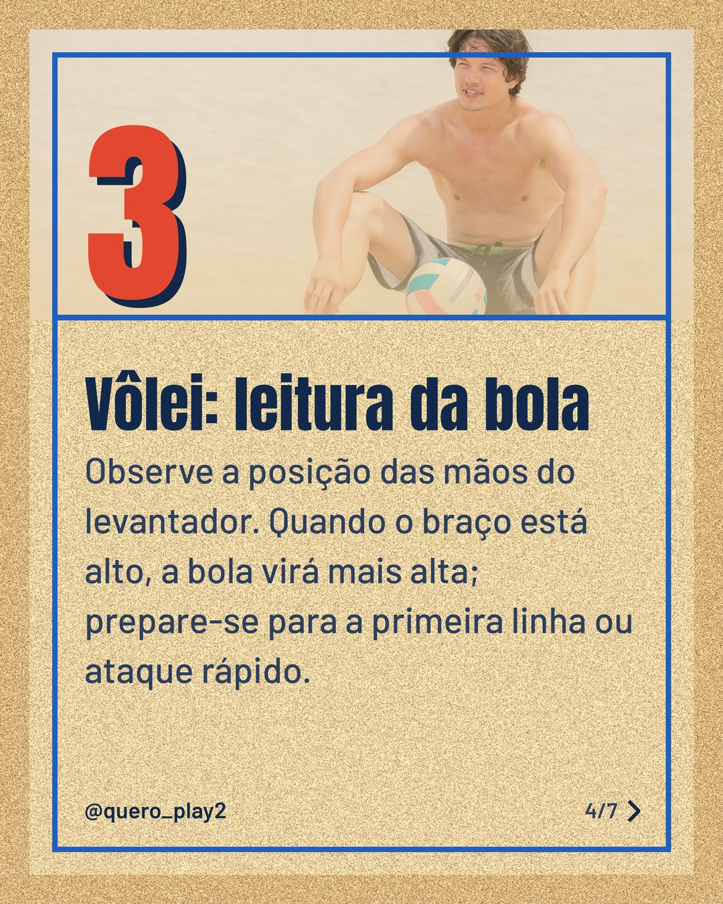
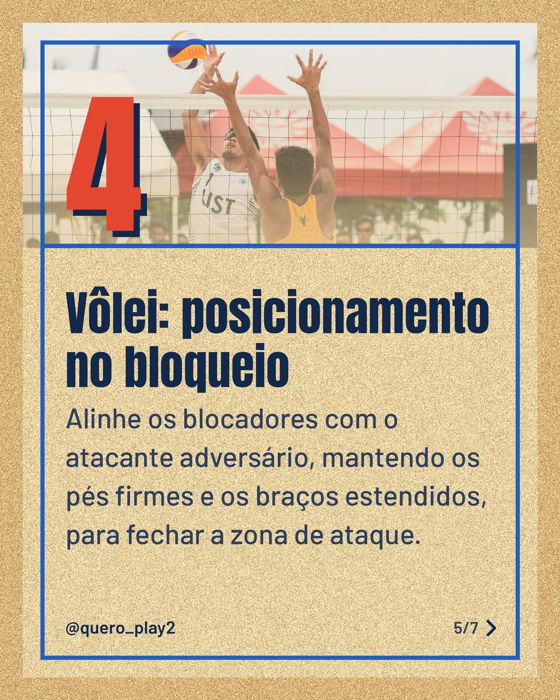
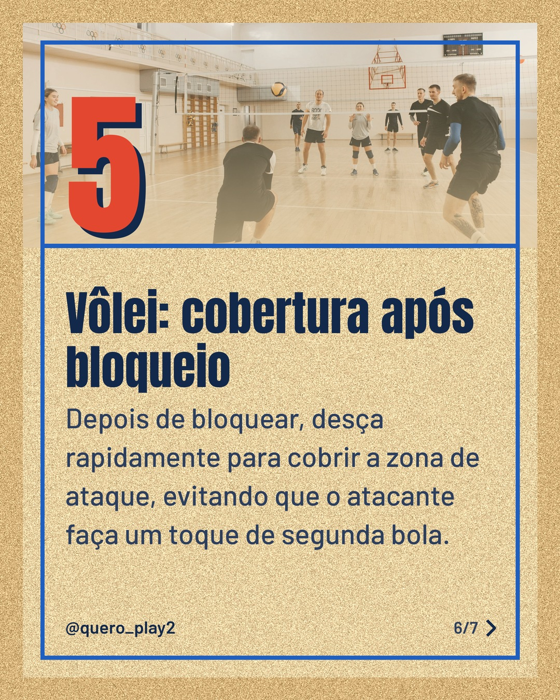
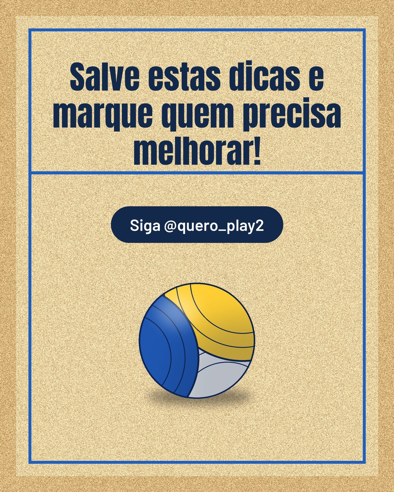

# areia

**Status:** aguardando revisão · 7 slides · gerado com `groq/openai/gpt-oss-120b`

      

## Legenda

> ⚽️ Já pensou como o posicionamento pode mudar o jogo? No futebol, pequenos ajustes criam grandes oportunidades.
>
> 🏐 No voleibol, estar no lugar certo na hora certa faz a diferença entre ponto e defesa.
>
> Deslize para o lado e descubra cada dica prática. Salve para treinar e compartilhe com a galera!
>
> 📷 Fotos: Pavel Danilyuk, Omar Ramadan, Franco Monsalvo, RDNE Stock project e Jim De Ramos (Pexels)
>
> #futebol #volei #dicasdeesporte #posicionamento #taticas #treinamento #esporte #futebolbrasileiro #voleibol #jogandocominteligencia

---
**Quer mudar algo?** Edite o `legenda.txt` para trocar a legenda, ou o `post.json` para trocar os textos dos slides (depois rode `python main.py redesenhar 2026-10-22_135546`).
Foto não combinou? `python main.py trocar-foto 2026-10-22_135546 N` (0 = capa, 1, 2... = slides).
Para descartar este post, apague esta pasta.
