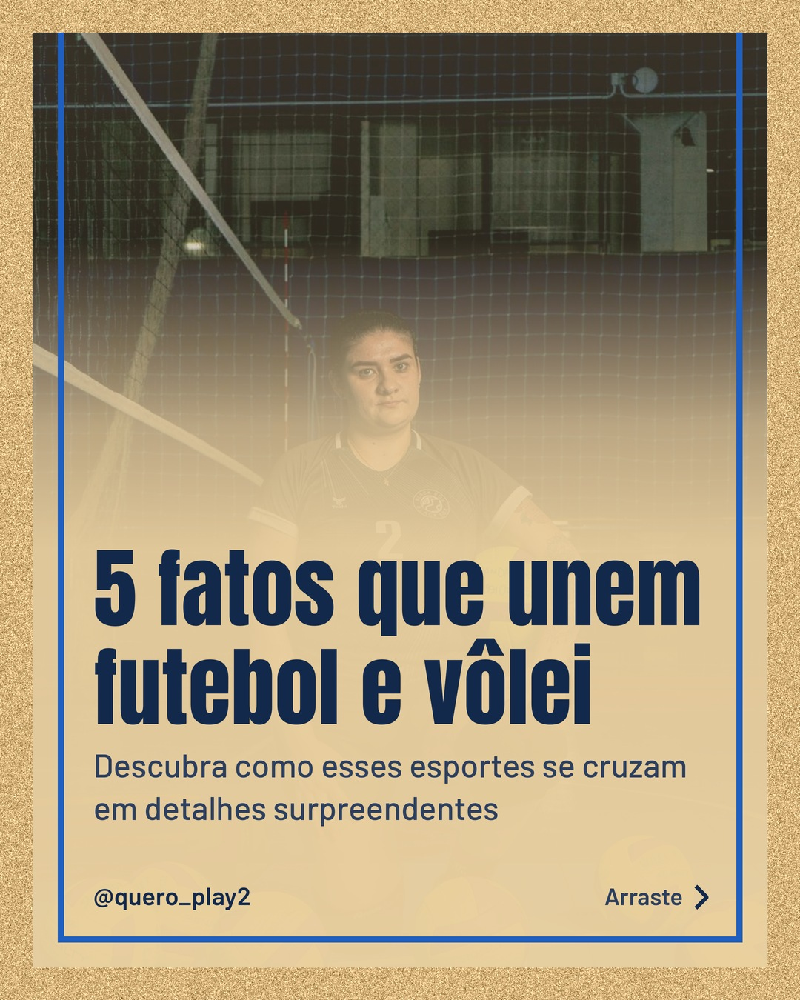
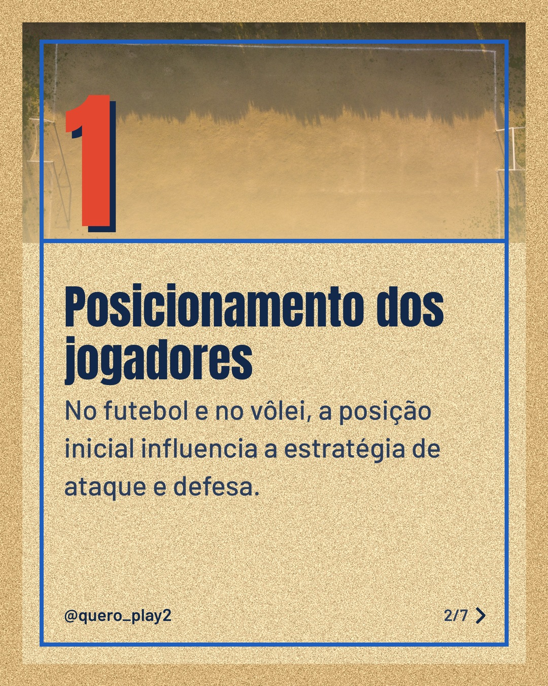
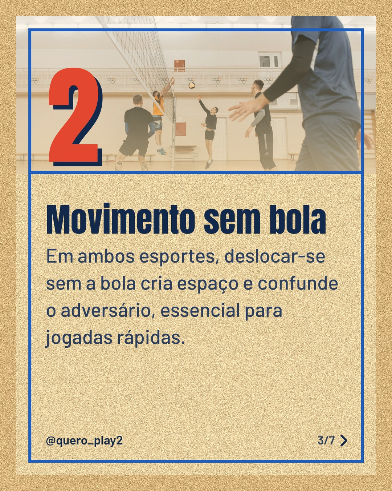
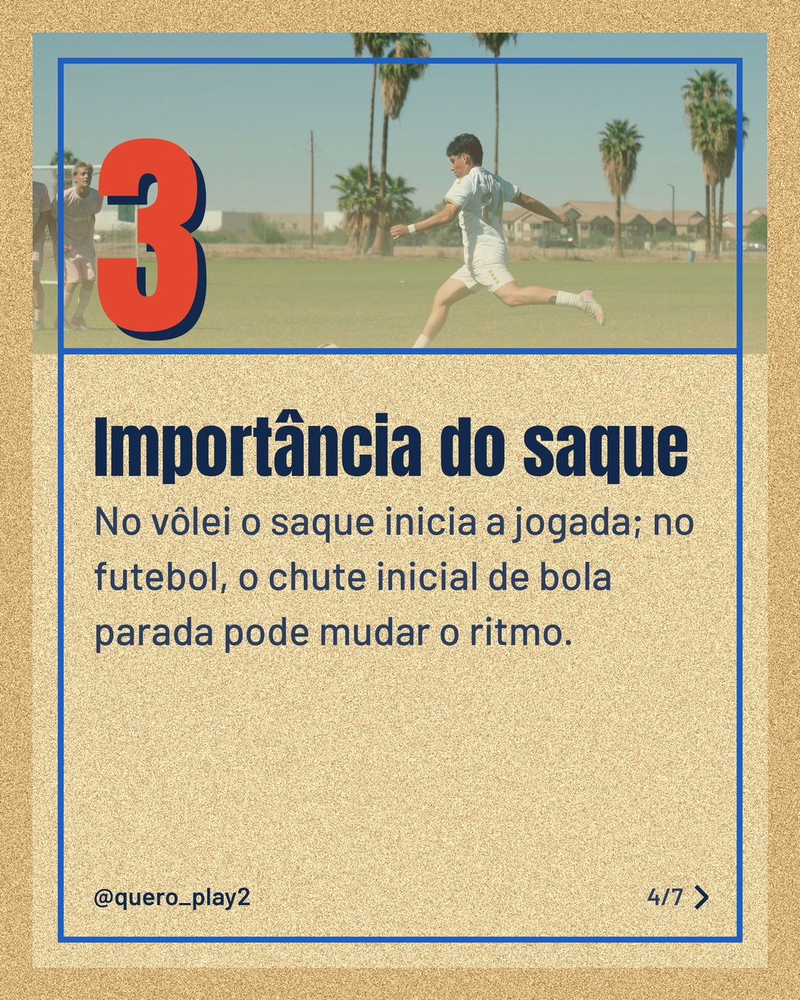
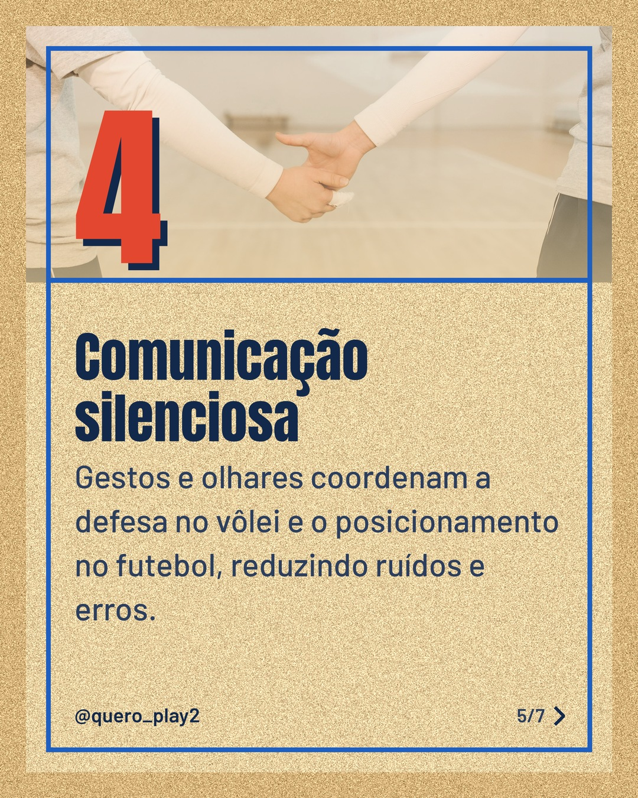
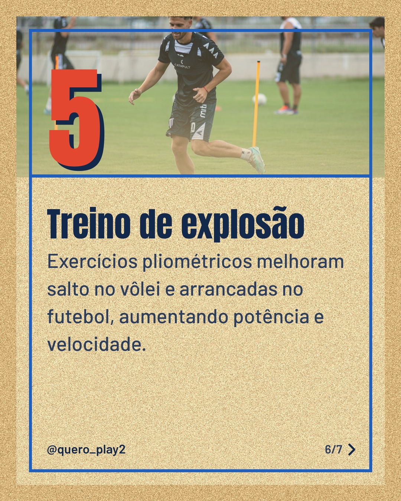
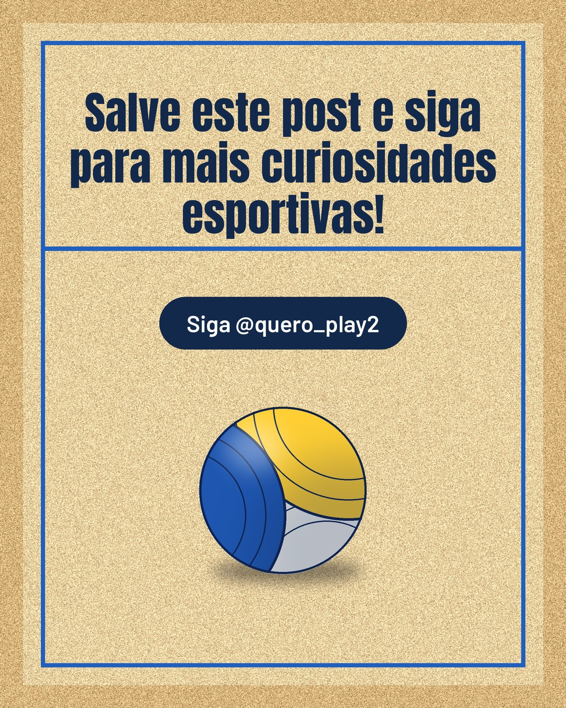

# areia

**Status:** aguardando revisão · 7 slides · gerado com `groq/openai/gpt-oss-120b`

      

## Legenda

> Você sabia que futebol e vôlei compartilham estratégias que vão além da bola? 🤔
>
> Confira cada slide e descubra como o posicionamento, o movimento sem bola, o saque, a comunicação e o treino de explosão se conectam nos dois esportes.
>
> Deslize para a esquerda e aprenda algo novo hoje! 💡 Marque um amigo que adora esses esportes e não esqueça de salvar.
>
> 📷 Fotos: Uiliam Nörnberg, Emiliano Arano, Pavel Danilyuk, Daniel Flores e Franco Monsalvo (Pexels)
>
> #futebol #volei #curiosidades #esportes #taticas #treinamento #dicas #aprendizado #jogos #athlete

---
**Quer mudar algo?** Edite o `legenda.txt` para trocar a legenda, ou o `post.json` para trocar os textos dos slides (depois rode `python main.py redesenhar 2026-10-23_134742`).
Foto não combinou? `python main.py trocar-foto 2026-10-23_134742 N` (0 = capa, 1, 2... = slides).
Para descartar este post, apague esta pasta.
