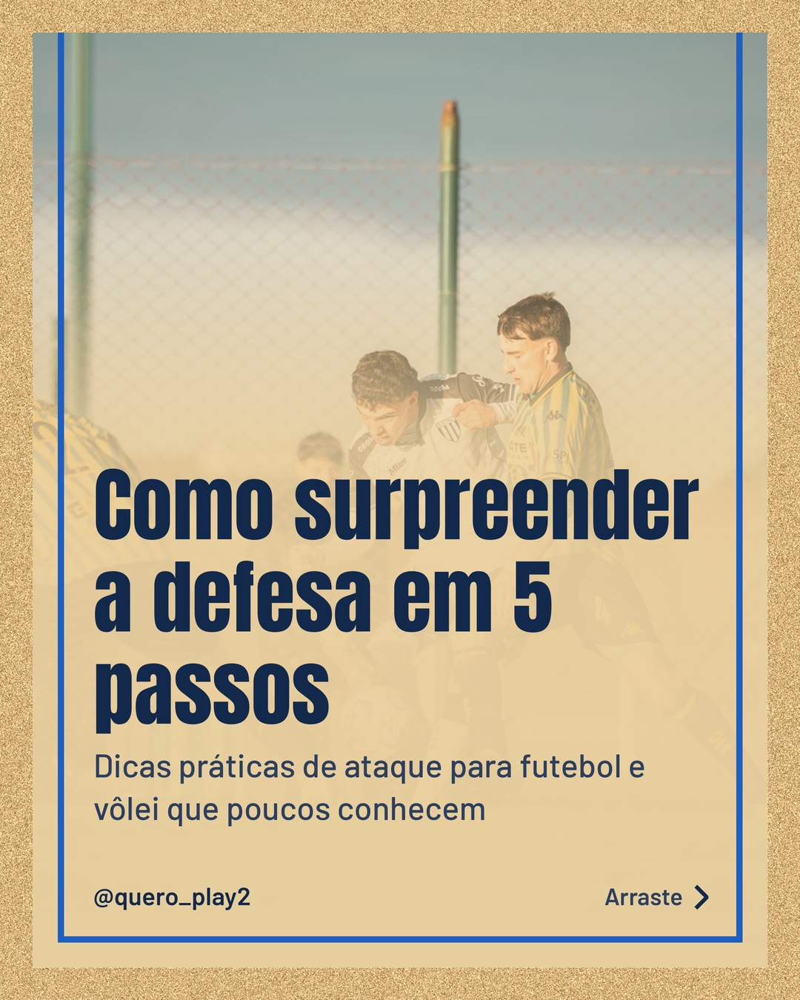
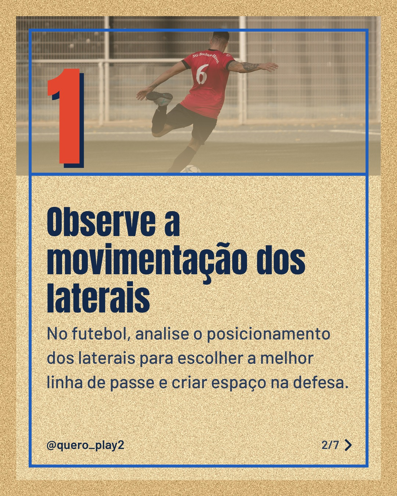
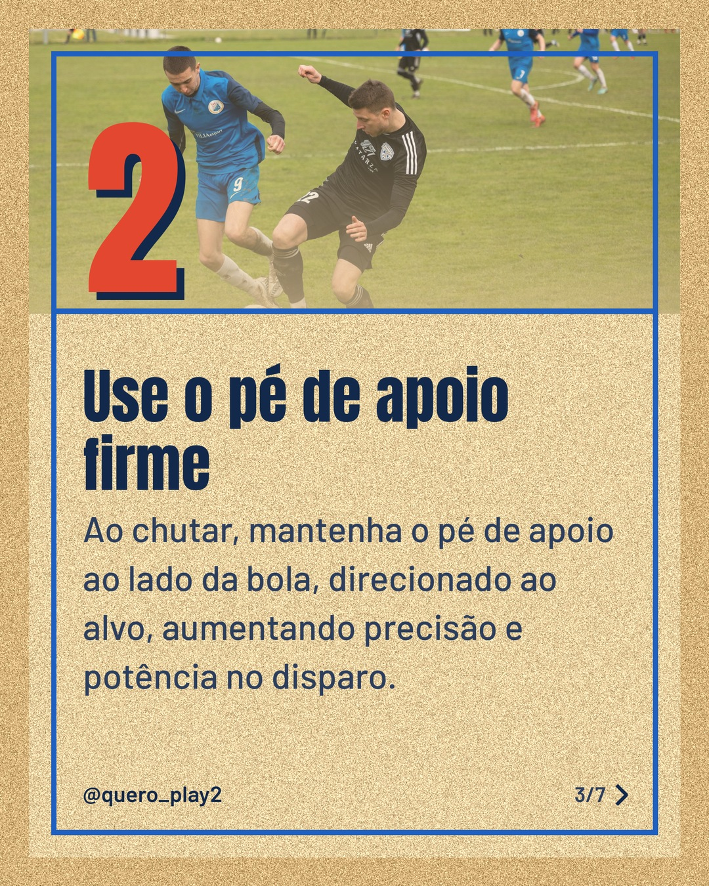
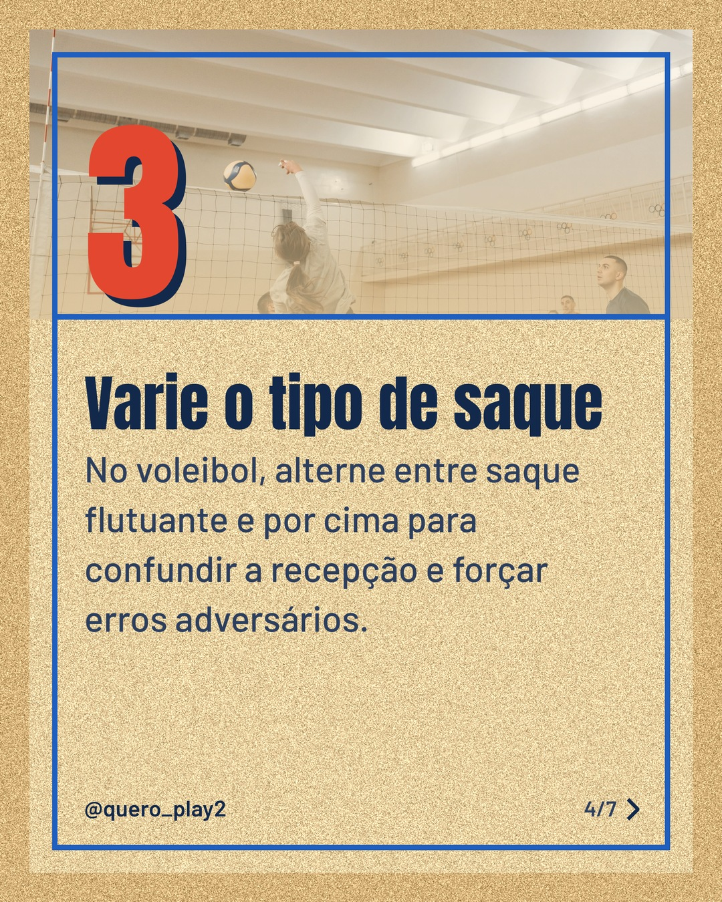
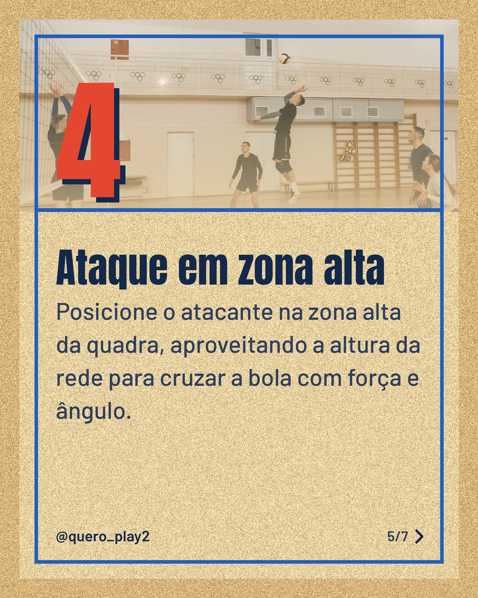
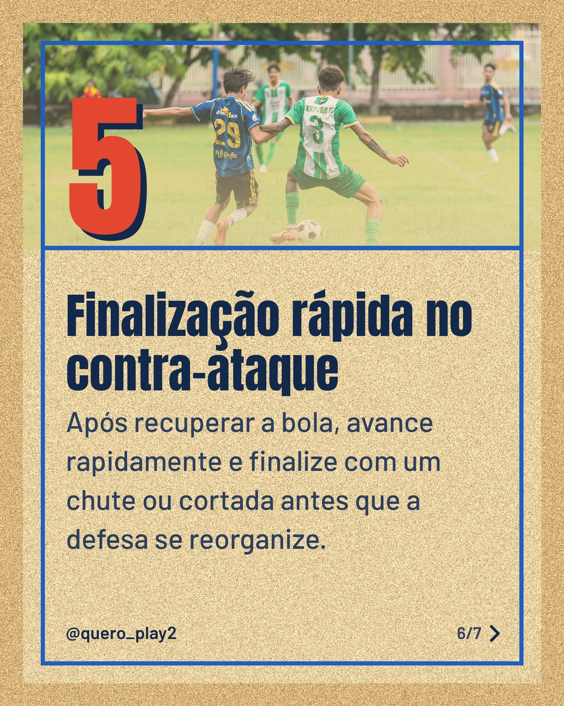
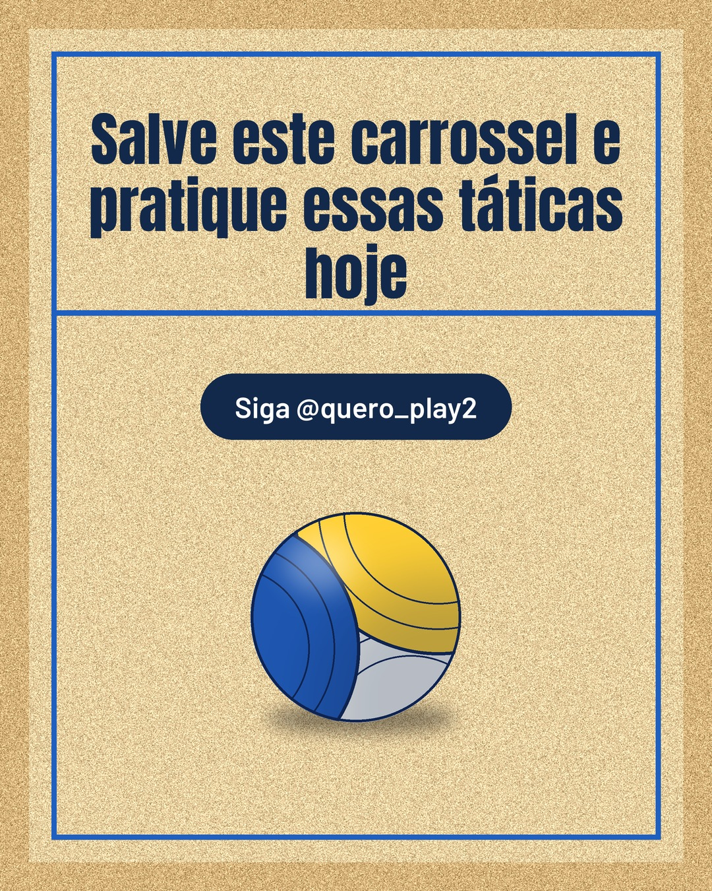

# areia

**Status:** aguardando revisão · 7 slides · gerado com `groq/openai/gpt-oss-120b`

      

## Legenda

> Quer melhorar seu ataque no futebol e no vôlei? 🚀
>
> Descubra 5 dicas práticas que vão deixar a defesa adversária sem resposta. Cada slide traz uma técnica simples que você pode aplicar já nos treinos.
>
> Deslize para o lado e absorva cada passo. Depois, conte nos comentários qual dica você já usa ou qual vai testar primeiro! ⚽🏐
>
> Não esqueça de salvar e seguir para mais curiosidades e estratégias esportivas.
>
> 📷 Fotos: Mateo Franciosi, Omar Ramadan, Vladimir Srajber, Pavel Danilyuk e Sinan KRIYA (Pexels)
>
> #futebol #volei #ataque #dicas #curiosidades #treinamentofutebol #treinamentovolei #tatica #esportes #futebolbrasileiro #voleibol #aprendendo

---
**Quer mudar algo?** Edite o `legenda.txt` para trocar a legenda, ou o `post.json` para trocar os textos dos slides (depois rode `python main.py redesenhar 2026-10-24_124044`).
Foto não combinou? `python main.py trocar-foto 2026-10-24_124044 N` (0 = capa, 1, 2... = slides).
Para descartar este post, apague esta pasta.
