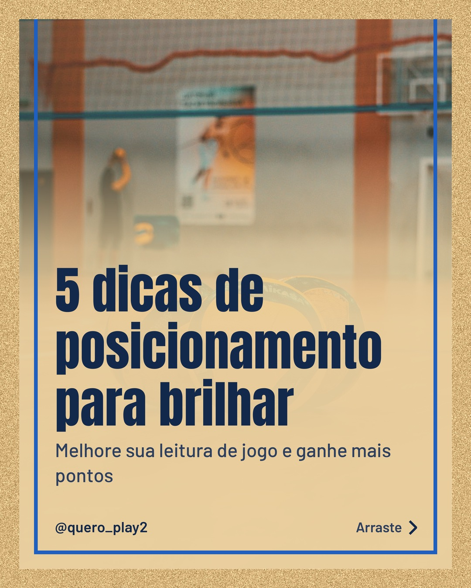
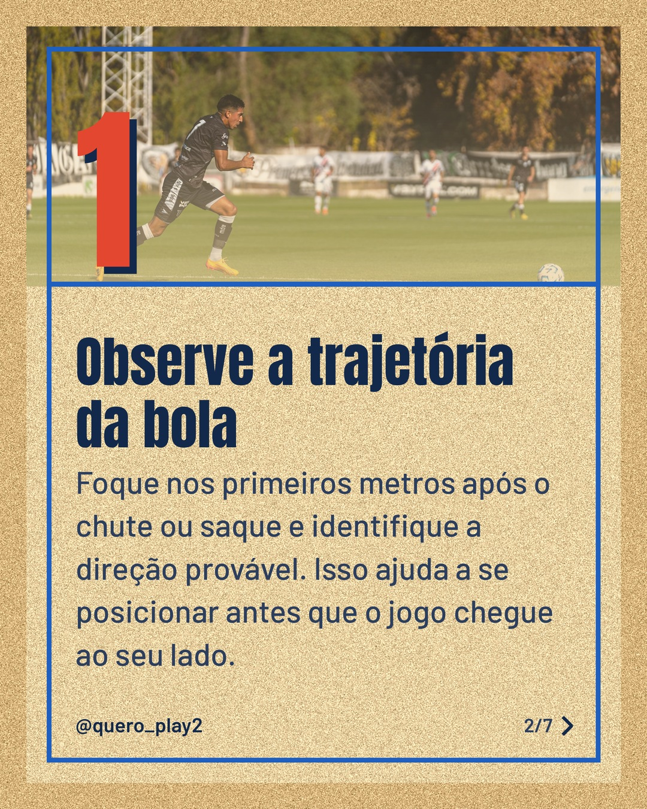
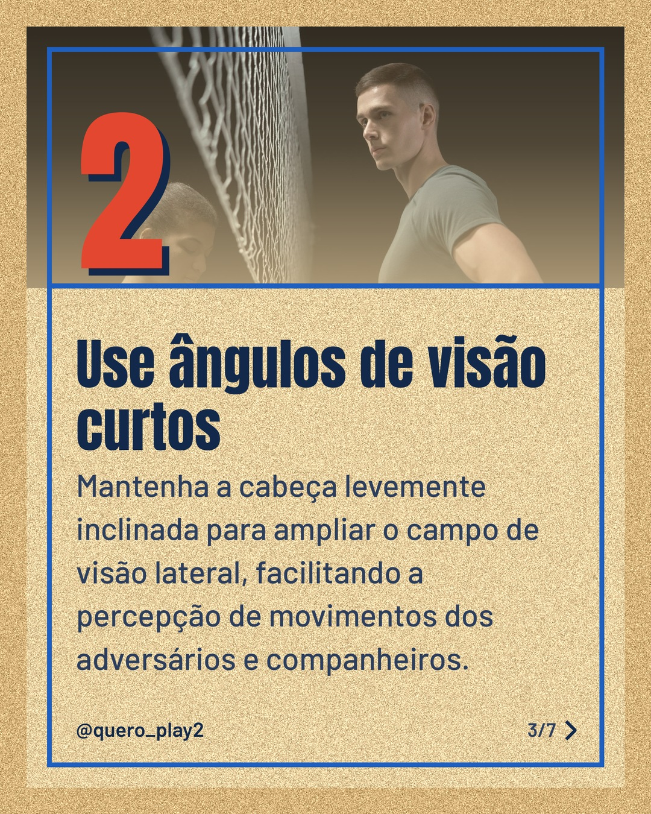
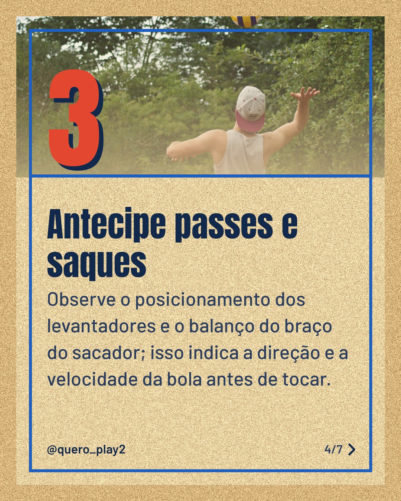
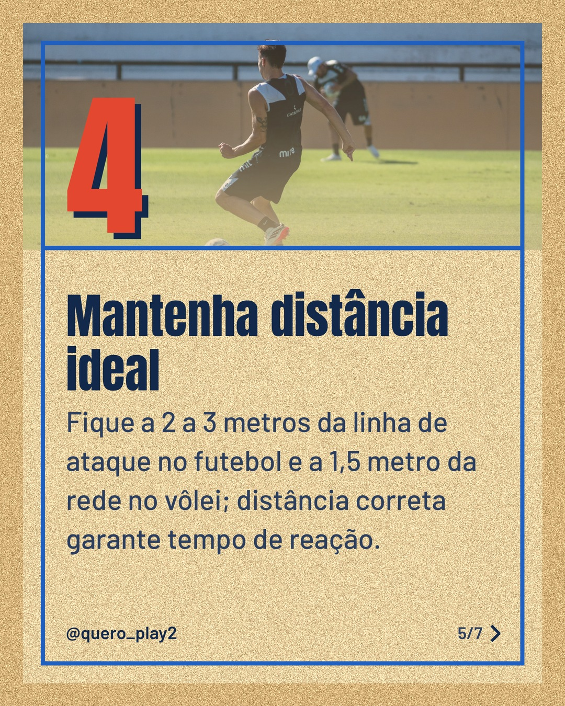
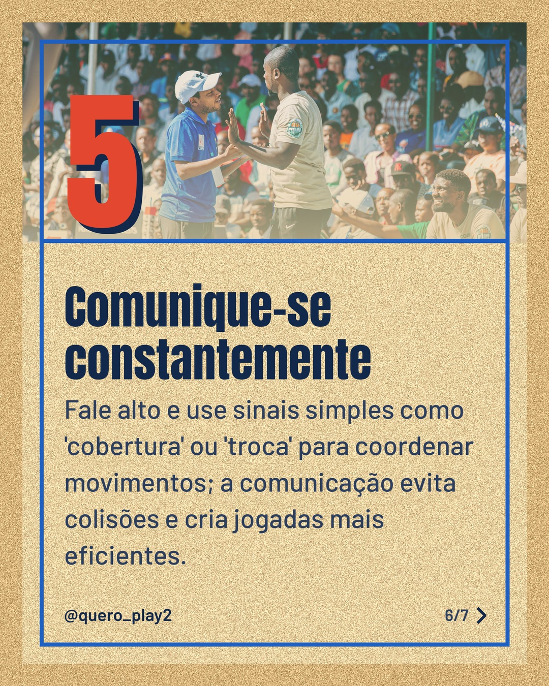
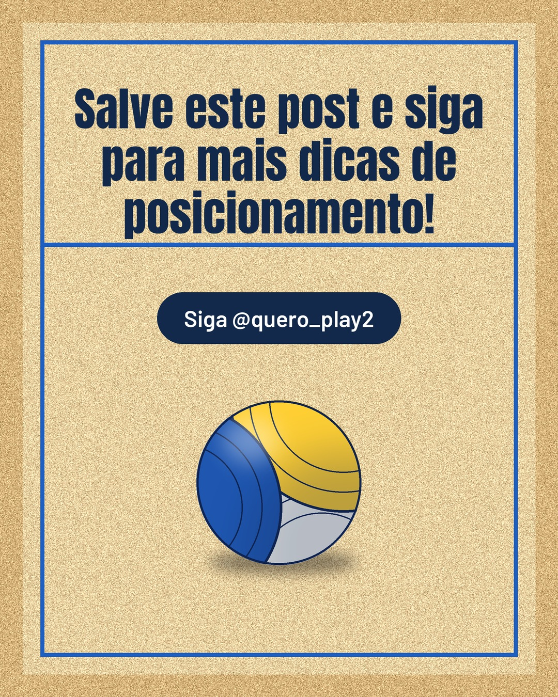

# areia

**Status:** aguardando revisão · 7 slides · gerado com `groq/openai/gpt-oss-120b`

      

## Legenda

> Você já percebeu como um bom posicionamento muda o resultado de um jogo? 🤔
>
> Neste carrossel eu trouxe 5 dicas práticas para melhorar sua leitura de jogo tanto no futebol quanto no vôlei. Cada passo é rápido de aplicar e vai te dar mais segurança em quadra ou campo.
>
> Deslize para a esquerda e confira! 👉 Salve, comente qual dica você já usa e siga o perfil para não perder as próximas!
>
> 📷 Fotos: Oleksandr Plakhota, Franco Monsalvo, cottonbro studio, Miťo e Chris wade NTEZICIMPA (Pexels)
>
> #futebol #voleibol #posicionamento #dicasdeesporte #aprendizado #jogadordefutebol #jogadordevôlei #treinos #estrategia #esportes #performance

---
**Quer mudar algo?** Edite o `legenda.txt` para trocar a legenda, ou o `post.json` para trocar os textos dos slides (depois rode `python main.py redesenhar 2026-10-25_125128`).
Foto não combinou? `python main.py trocar-foto 2026-10-25_125128 N` (0 = capa, 1, 2... = slides).
Para descartar este post, apague esta pasta.
