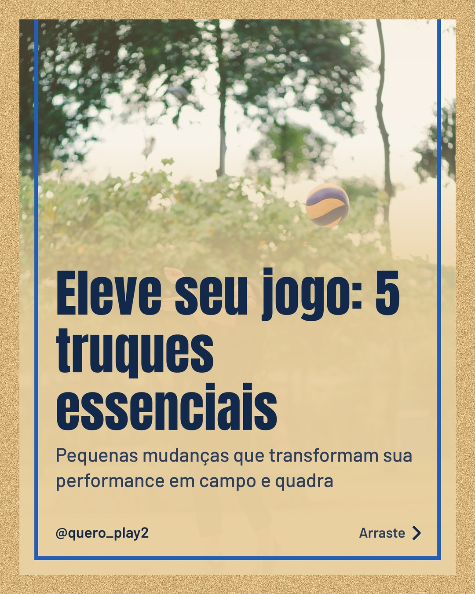
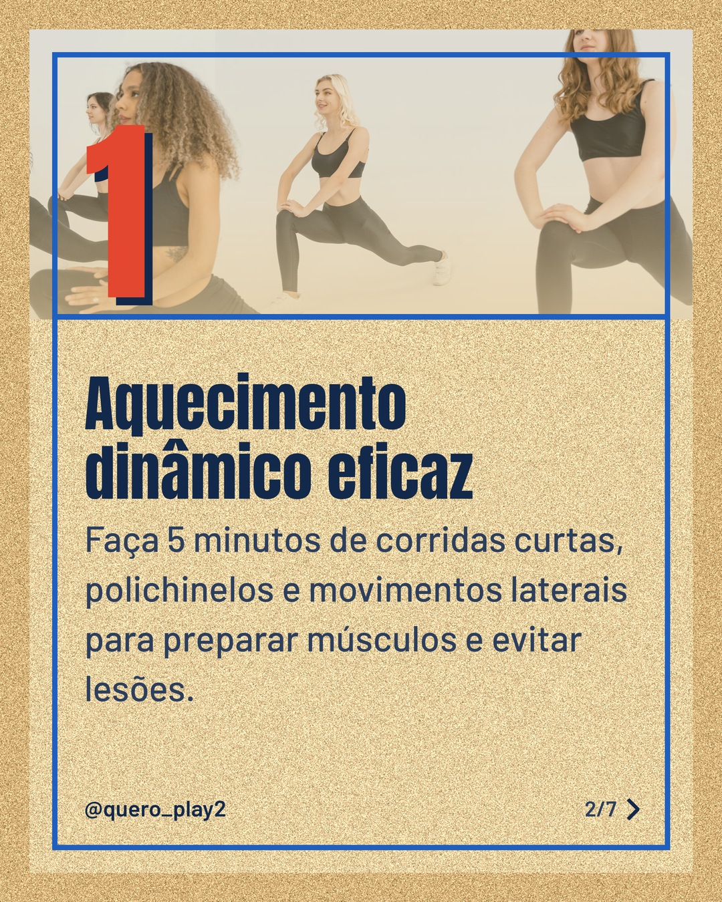
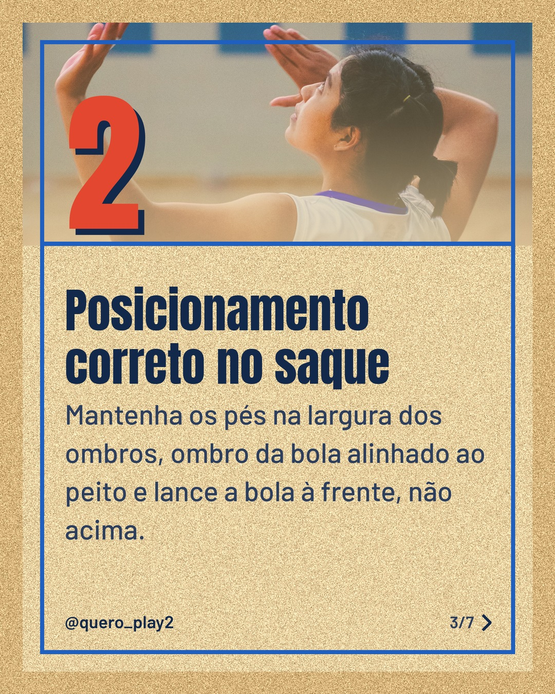
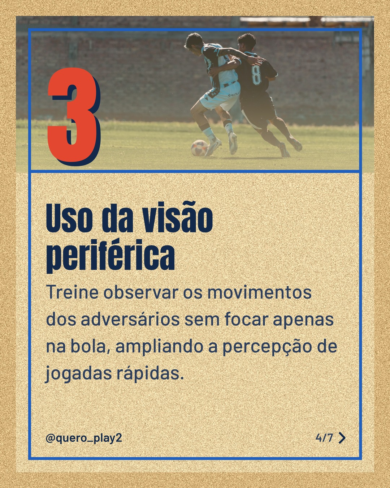
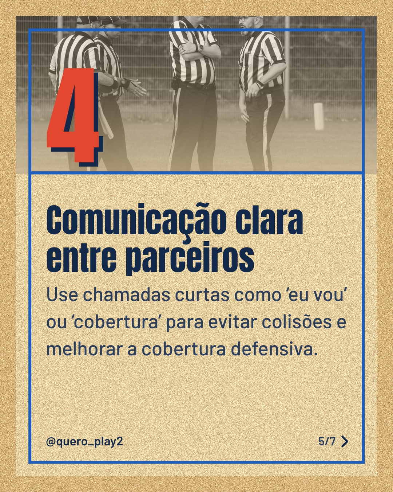
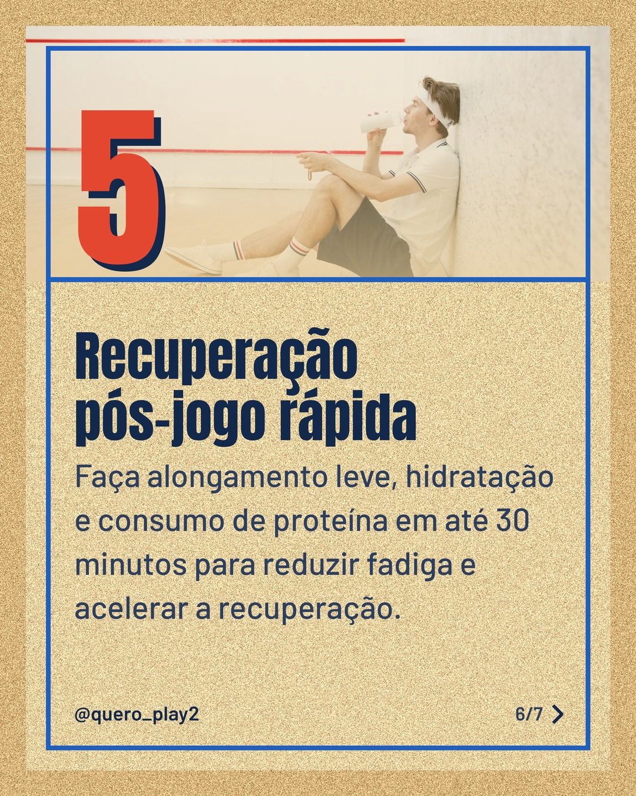
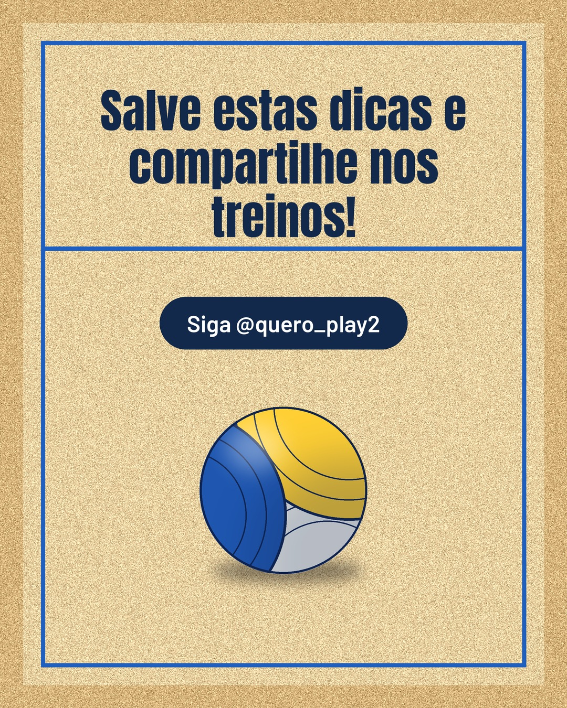

# areia

**Status:** aguardando revisão · 7 slides · gerado com `groq/openai/gpt-oss-120b`

      

## Legenda

> Descubra como pequenos ajustes podem elevar seu desempenho tanto no futebol quanto no vôlei. ⚽🏐
> Deslize para a direita e aprenda cada truque passo a passo. Cada slide traz uma prática simples que você pode aplicar já nos próximos treinos.
> Marque um amigo que precisa dessas dicas e não esqueça de salvar o post para consultar depois! 🚀
>
> 📷 Fotos: Thể Phạm, MART  PRODUCTION, Miguel Guerra, Franco Monsalvo, Haberdoedas Photography e Artem Podrez (Pexels)
>
> #futebol #volei #dicasdeesporte #treinamento #curiosidades #performance #saudefisica #motivacao #esporte #treinos #futeboldicas #voeledicas

---
**Quer mudar algo?** Edite o `legenda.txt` para trocar a legenda, ou o `post.json` para trocar os textos dos slides (depois rode `python main.py redesenhar 2026-10-26_153142`).
Foto não combinou? `python main.py trocar-foto 2026-10-26_153142 N` (0 = capa, 1, 2... = slides).
Para descartar este post, apague esta pasta.
