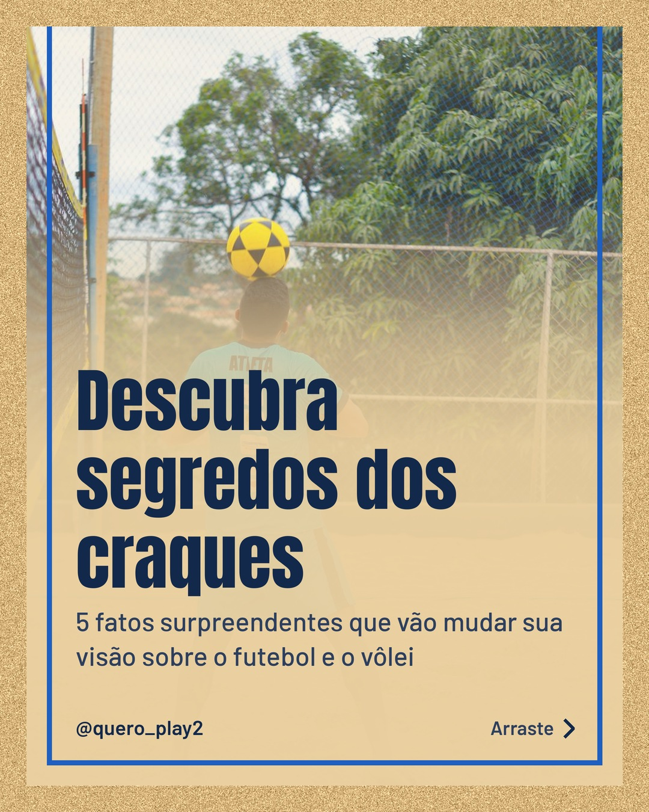
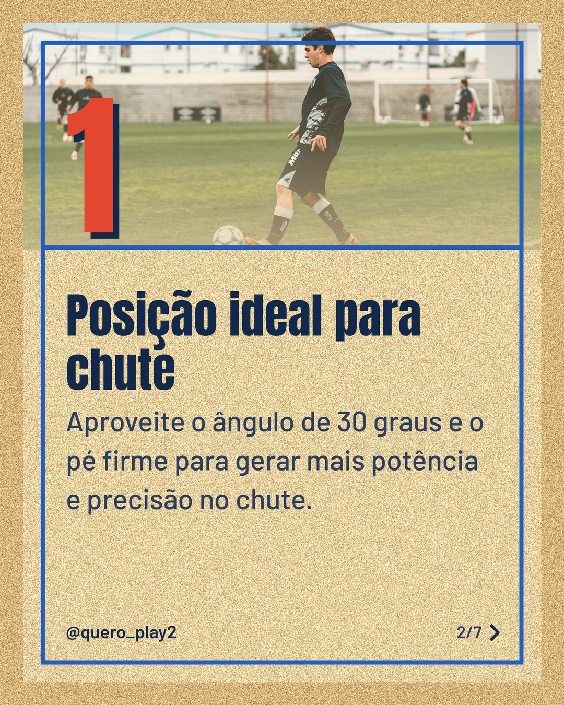
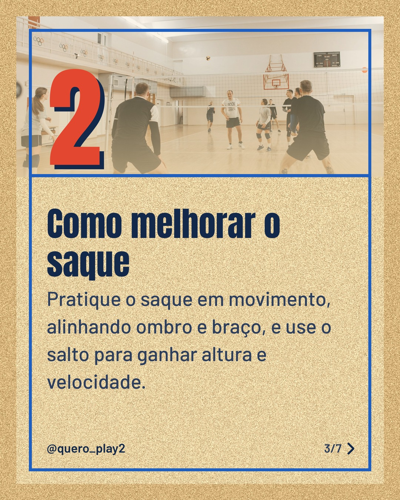
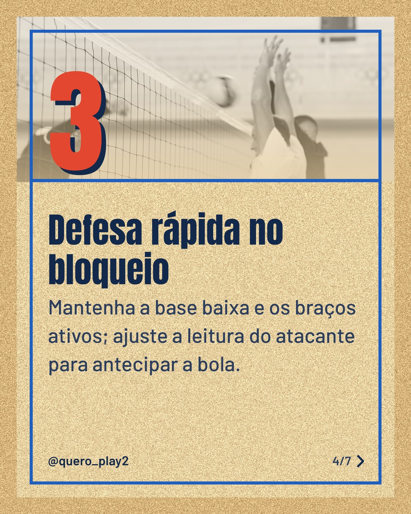
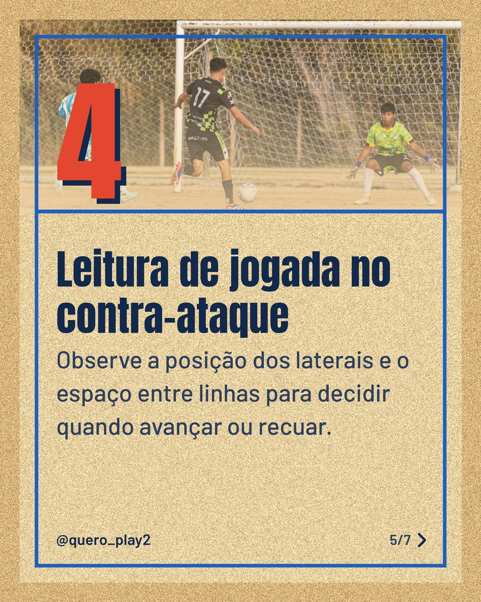
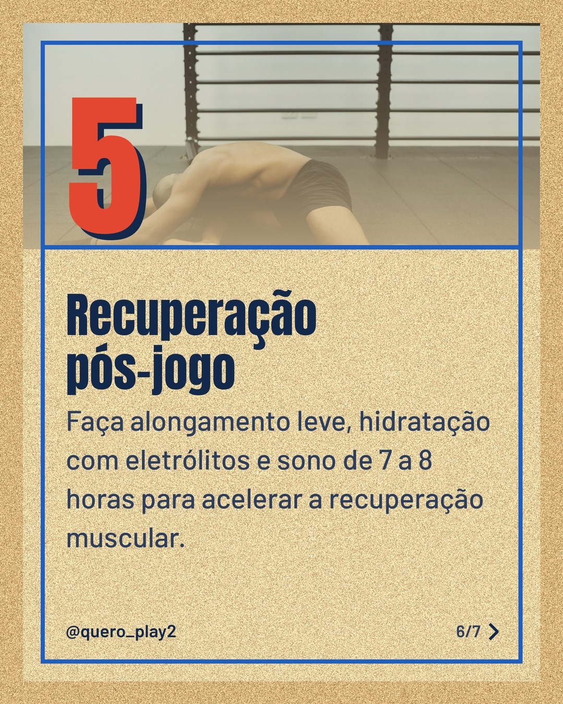
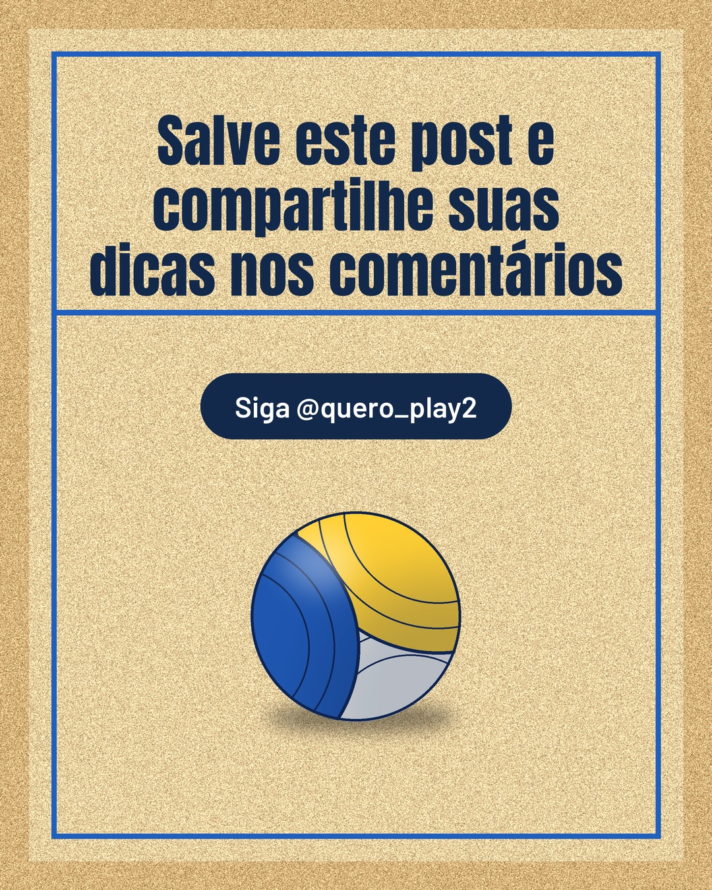

# areia

**Status:** aguardando revisão · 7 slides · gerado com `groq/openai/gpt-oss-120b`

      

## Legenda

> Você sabia que pequenos ajustes podem mudar o desempenho tanto no futebol quanto no vôlei? 🤔
>
> Deslize para a esquerda e descubra dicas práticas que você pode aplicar hoje mesmo nos treinos. Cada slide traz um conselho simples, mas poderoso.
>
> Teste, compartilhe seus resultados e marque quem precisa ver isso! 💬
>
> 📷 Fotos: ENIO ENGENHEIRO, Franco Monsalvo, Pavel Danilyuk e Ketut Subiyanto (Pexels)
>
> #futebol #volei #curiosidades #esporte #dicasdesportivas #treinoeficaz #aprendizado #vidadeatleta #taticasportivas #motivacao

---
**Quer mudar algo?** Edite o `legenda.txt` para trocar a legenda, ou o `post.json` para trocar os textos dos slides (depois rode `python main.py redesenhar 2026-10-27_144656`).
Foto não combinou? `python main.py trocar-foto 2026-10-27_144656 N` (0 = capa, 1, 2... = slides).
Para descartar este post, apague esta pasta.
