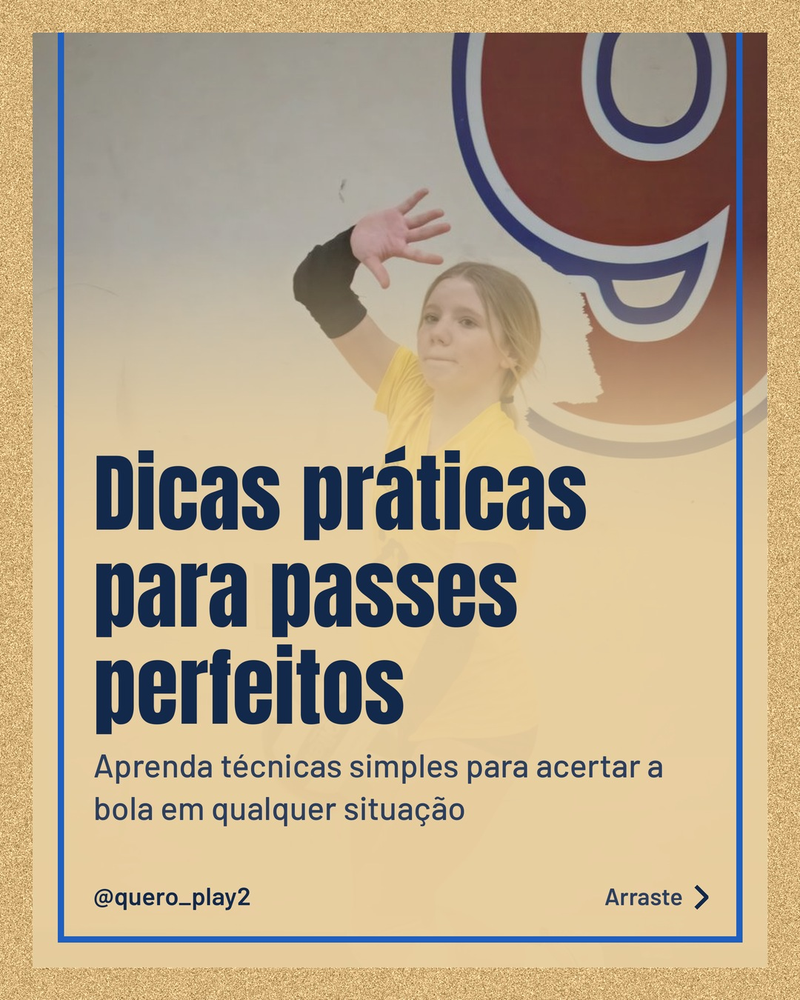
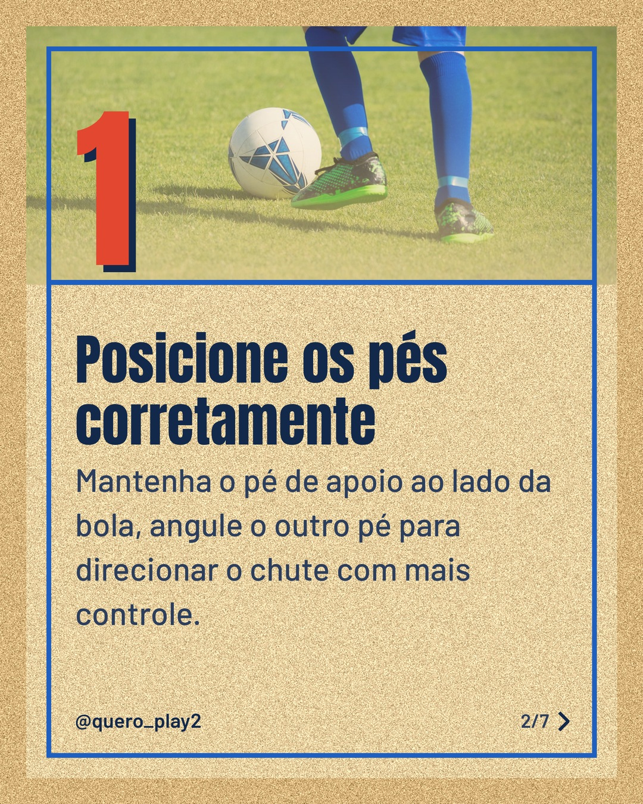
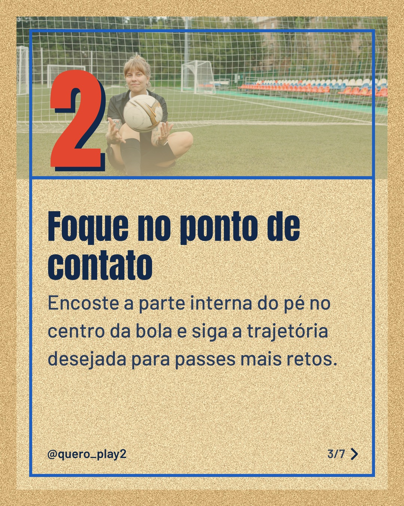
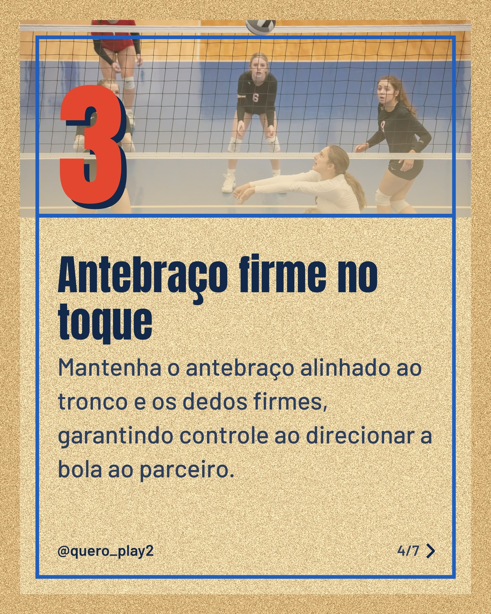
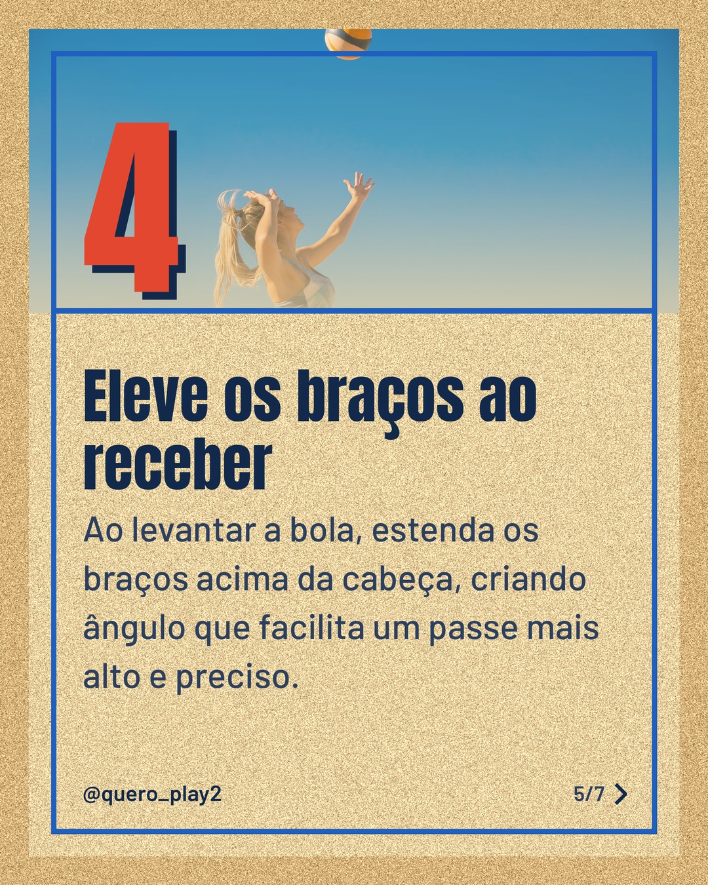
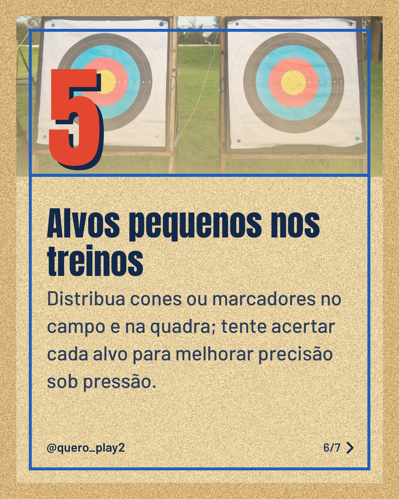
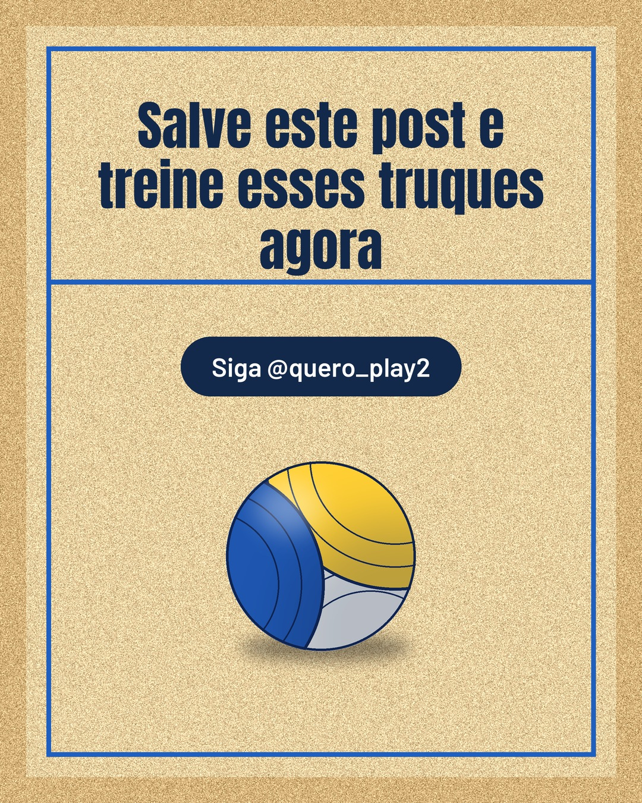

# areia

**Status:** aguardando revisão · 7 slides · gerado com `groq/openai/gpt-oss-120b`

      

## Legenda

> Você sabia que pequenos ajustes podem transformar seus passes? 🤔
>
> Deslize para descobrir cinco dicas práticas que funcionam tanto no futebol quanto no vôlei. Cada slide traz um passo simples que você pode aplicar já nos próximos treinos.
>
> Teste as técnicas, marque um amigo que precisa melhorar e conte nos comentários como foi sua evolução! 📈
>
> Não esqueça de salvar o post para consultar sempre que precisar e seguir para mais curiosidades esportivas.
>
> 📷 Fotos: Tom Fisk, Kampus Production e Anastasia  Shuraeva (Pexels)
>
> #futebol #voleibol #passes #tecnica #treino #dicas #esporte #futebolbrasileiro #volei #melhorasportiva #passesprecisos #treinamento

---
**Quer mudar algo?** Edite o `legenda.txt` para trocar a legenda, ou o `post.json` para trocar os textos dos slides (depois rode `python main.py redesenhar 2026-10-28_151157`).
Foto não combinou? `python main.py trocar-foto 2026-10-28_151157 N` (0 = capa, 1, 2... = slides).
Para descartar este post, apague esta pasta.
