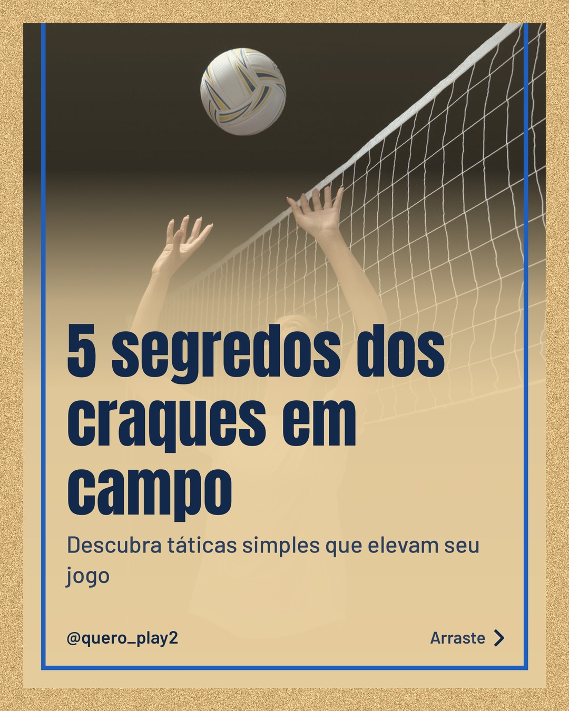
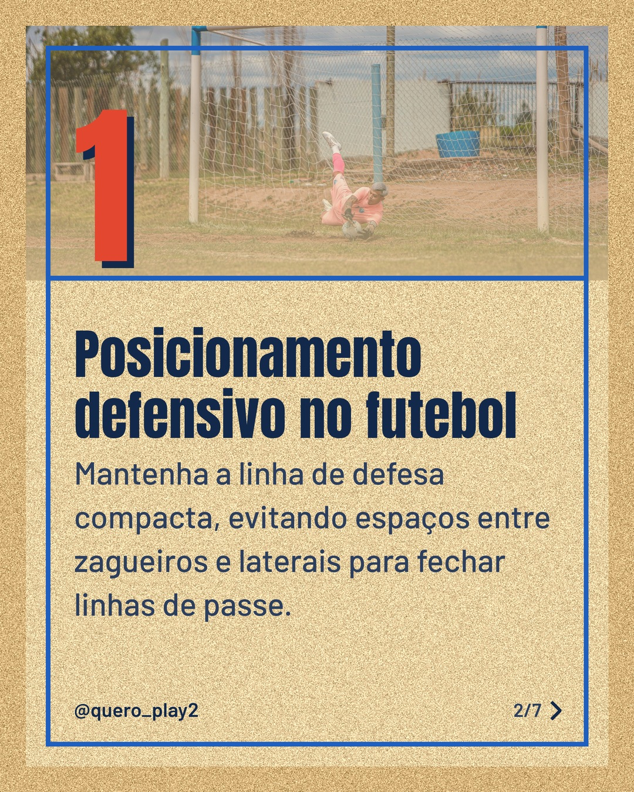
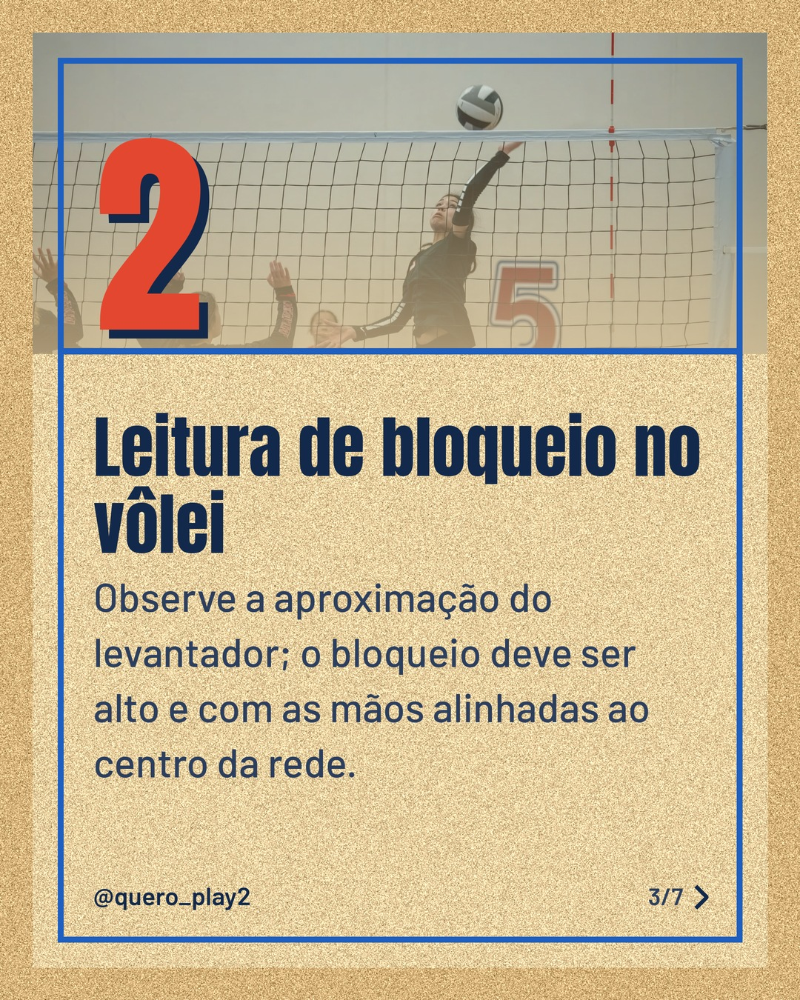
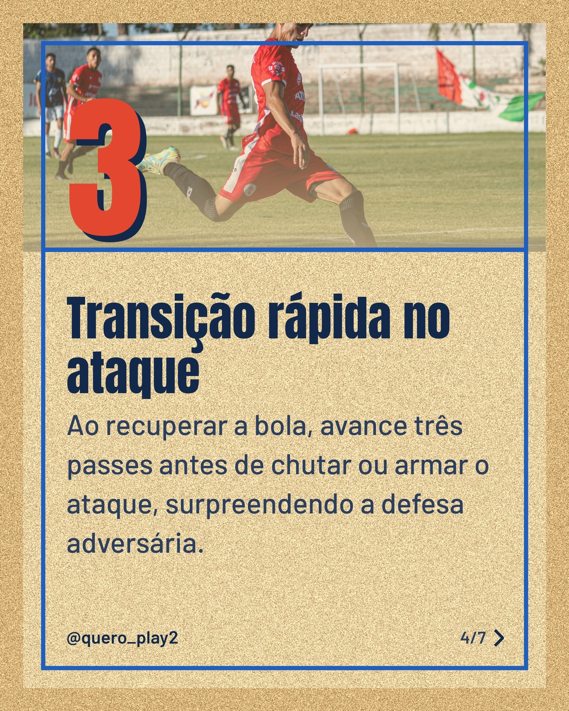
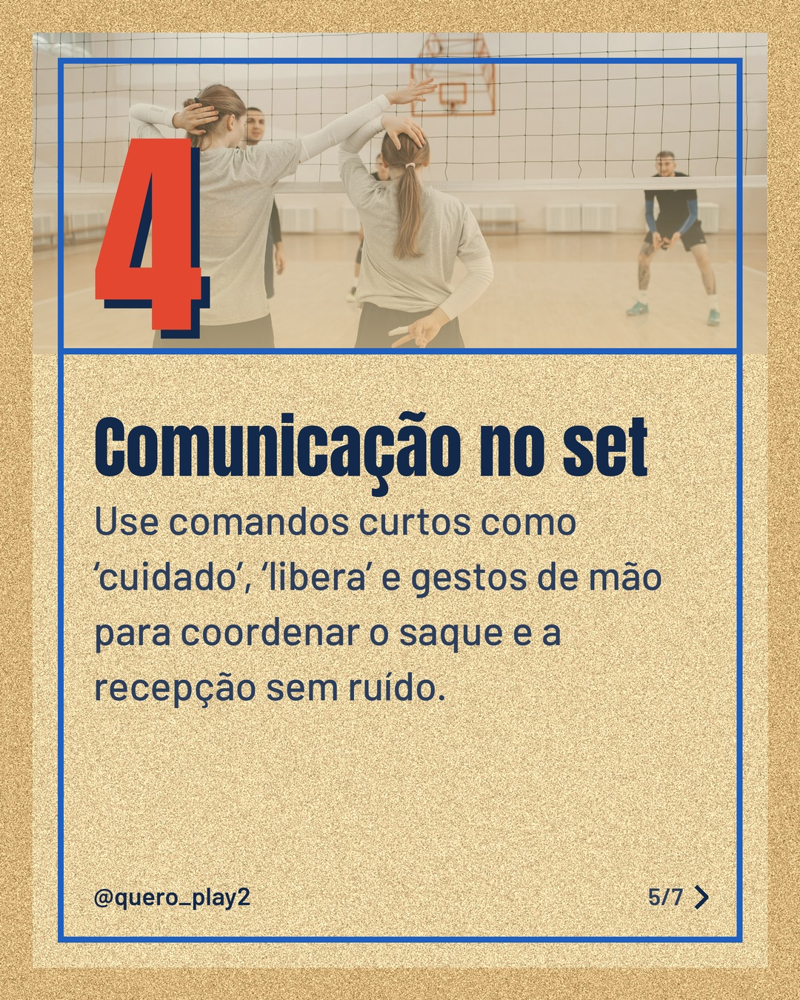
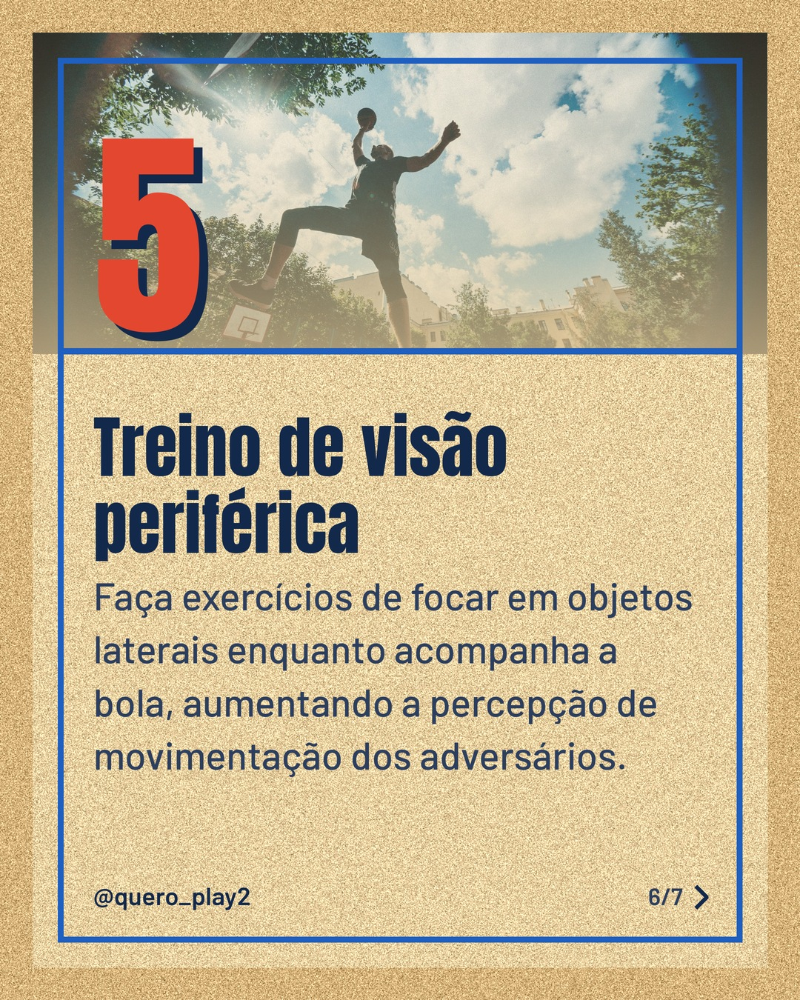

# areia

**Status:** aguardando revisão · 7 slides · gerado com `groq/openai/gpt-oss-120b`

      

## Legenda

> Curiosidades que fazem a diferença no seu jogo! ⚽🏐
> Deslize para descobrir dicas práticas de futebol e vôlei que você pode aplicar hoje.
> Comente qual dica você já usa e marque alguém que precisa ver isso.
> Não esqueça de salvar e seguir para mais conteúdos como este!
>
> 📷 Fotos: cottonbro studio, Thiago Sepulveda, Tom Fisk, Franco Monsalvo e Pavel Danilyuk (Pexels)
>
> #futebol #volei #curiosidades #dicasdefutebol #dicasdevolei #esportes #treinamento #tática #aprendizado #jogabilidade

---
**Quer mudar algo?** Edite o `legenda.txt` para trocar a legenda, ou o `post.json` para trocar os textos dos slides (depois rode `python main.py redesenhar 2026-10-29_151705`).
Foto não combinou? `python main.py trocar-foto 2026-10-29_151705 N` (0 = capa, 1, 2... = slides).
Para descartar este post, apague esta pasta.
