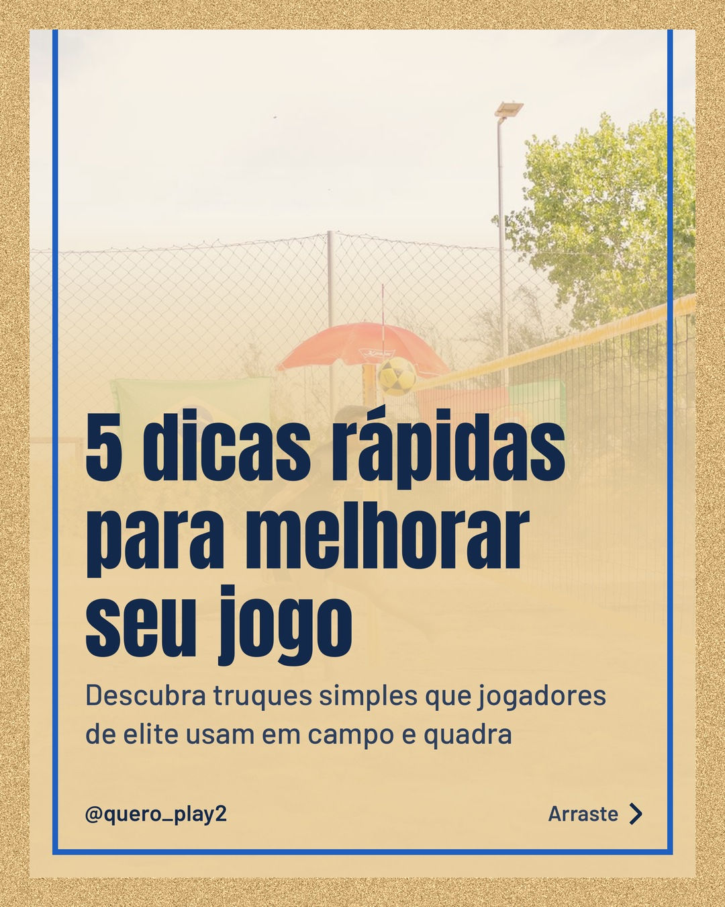
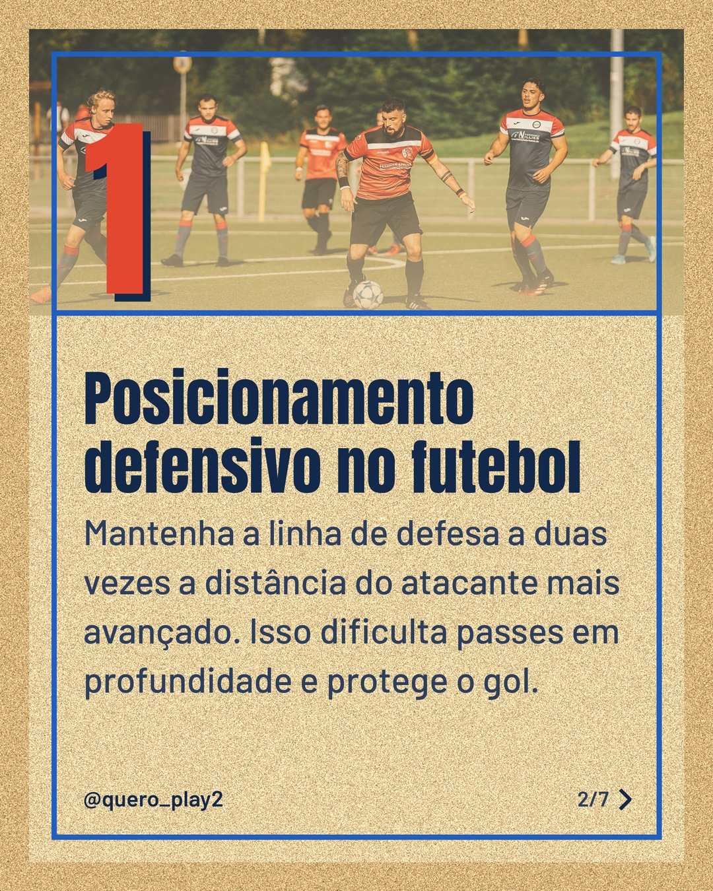
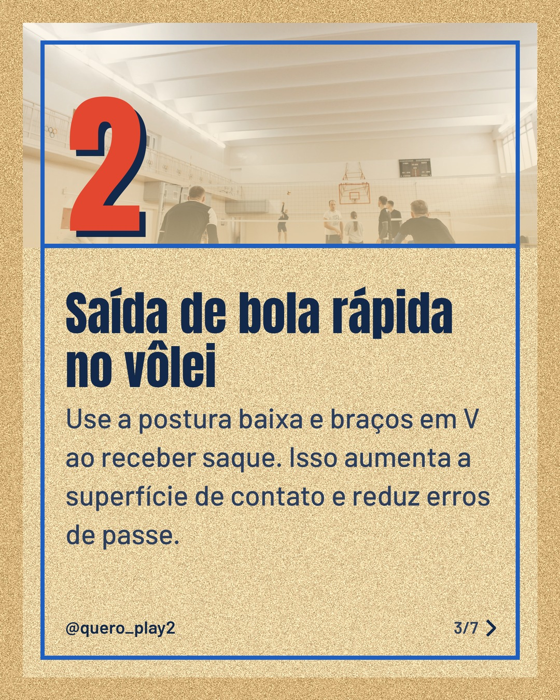
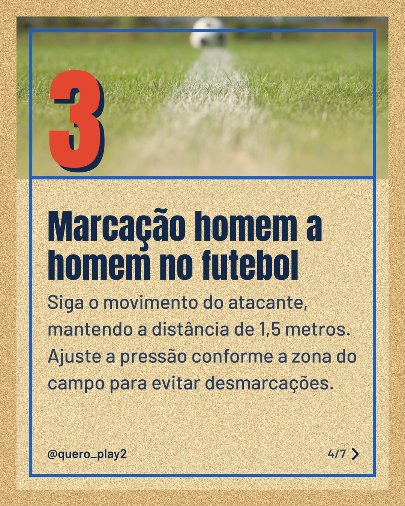
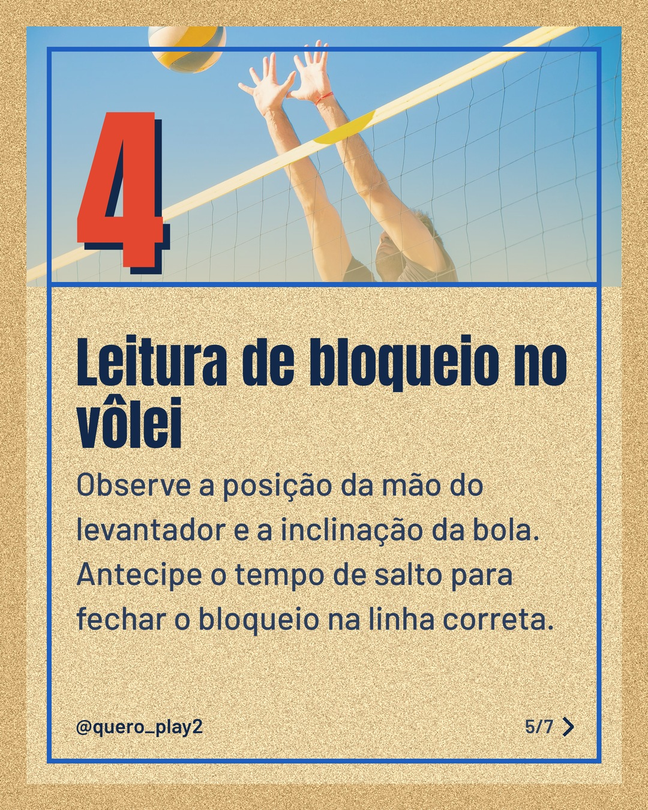
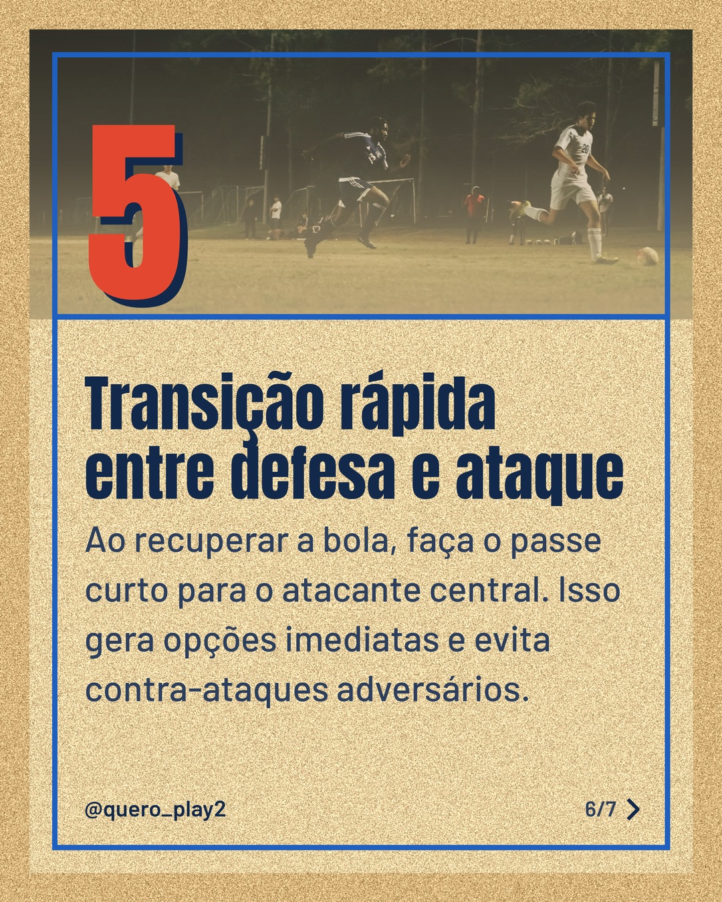
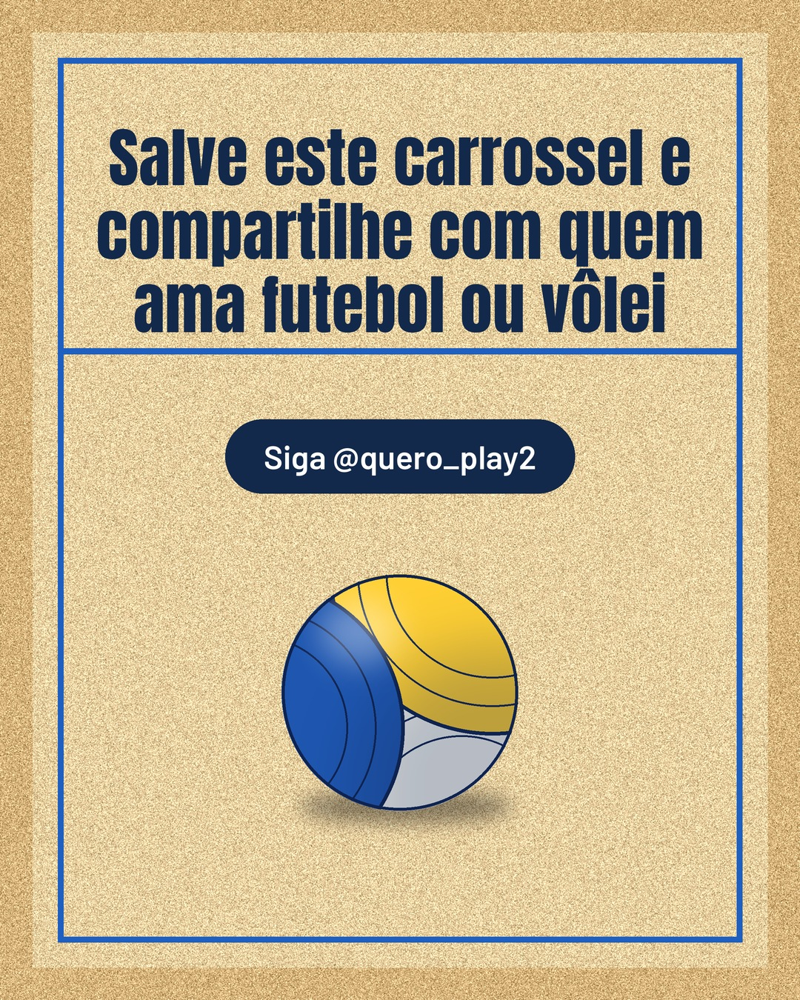

# areia

**Status:** aguardando revisão · 7 slides · gerado com `groq/openai/gpt-oss-120b`

      

## Legenda

> ⚽️🏐 Você sabia que pequenos ajustes podem mudar totalmente o desempenho em campo ou na quadra? Hoje trago 5 dicas práticas para elevar seu nível no futebol e no vôlei.
>
> Deslize para o lado e descubra cada truque passo a passo. Cada slide traz uma ideia direta que você pode aplicar já nos treinos.
>
> Curtiu? Salve para rever depois, marque um amigo que precisa melhorar e siga o perfil para mais curiosidades esportivas! 🎯
>
> 📷 Fotos: Denis  Almeida, Omar Ramadan, Pavel Danilyuk, BOOM 💥 Photography, Kampus Production e Raditya Narendrasuta (Pexels)
>
> #futebol #volei #curiosidades #dicasdefutebol #dicasdevolei #treinamento #esportelivre #jogadores #tacticas #aprenda

---
**Quer mudar algo?** Edite o `legenda.txt` para trocar a legenda, ou o `post.json` para trocar os textos dos slides (depois rode `python main.py redesenhar 2026-10-30_145302`).
Foto não combinou? `python main.py trocar-foto 2026-10-30_145302 N` (0 = capa, 1, 2... = slides).
Para descartar este post, apague esta pasta.
