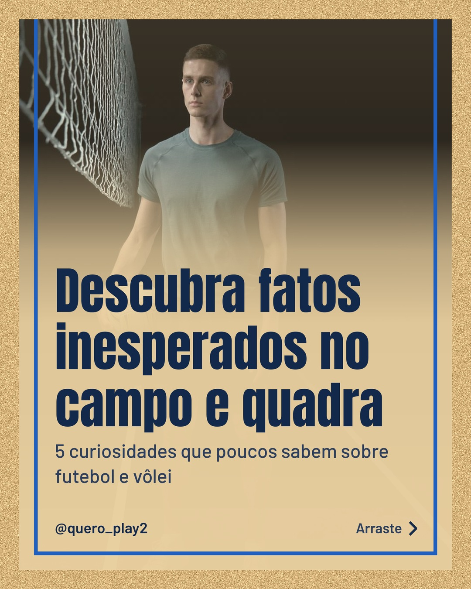
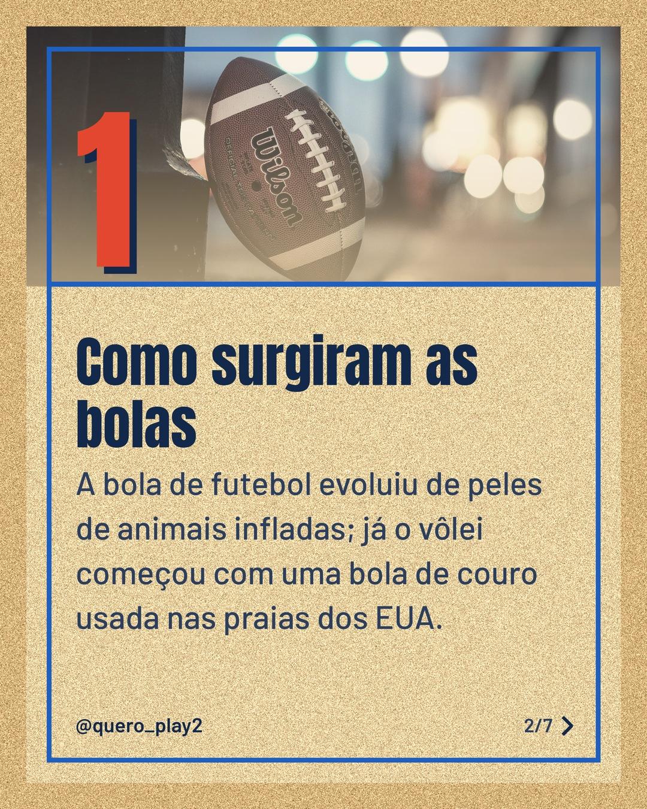
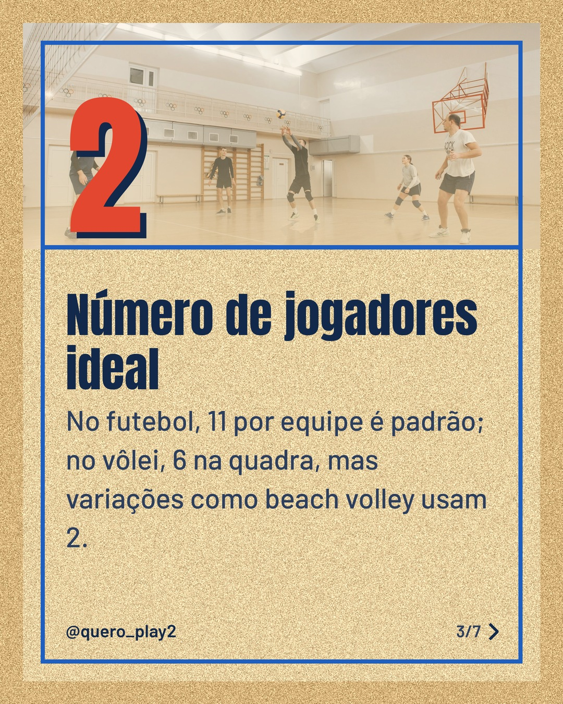
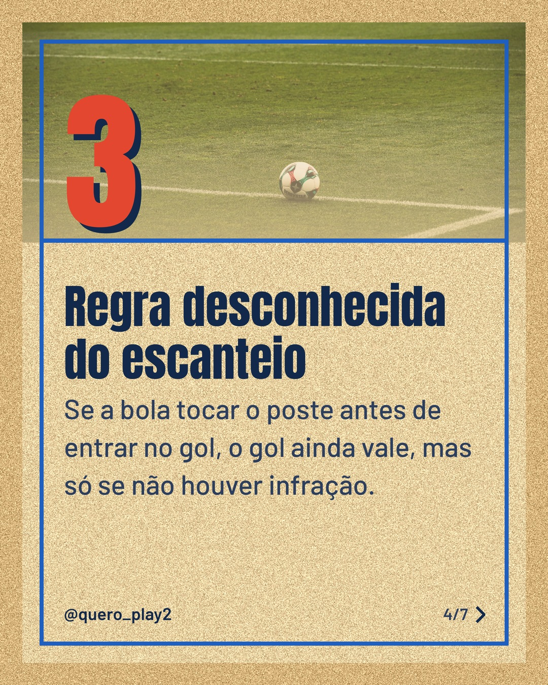
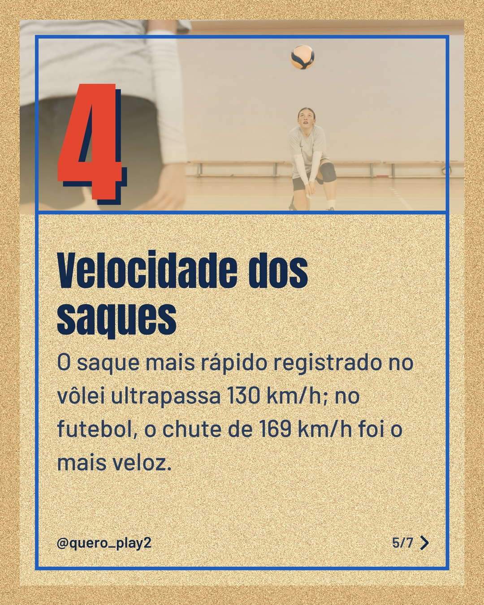
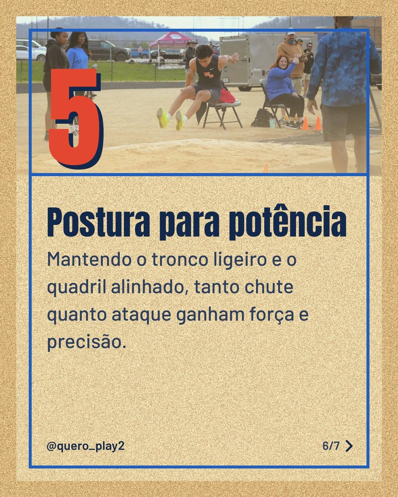
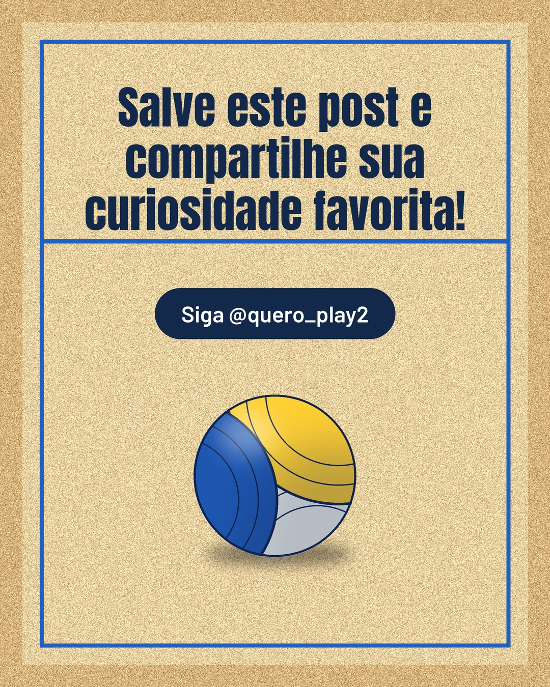

# areia

**Status:** aguardando revisão · 7 slides · gerado com `groq/openai/gpt-oss-120b`

      

## Legenda

> Já se pegou pensando por que algumas bolas parecem diferentes? 🤔 Vamos descobrir juntos! 
> Deslize para o lado e mergulhe em curiosidades que poucos sabem sobre futebol e vôlei. 
> Curtiu? Deixe seu comentário e marque um amigo que vai adorar essas curiosidades. 🚀
>
> 📷 Fotos: cottonbro studio, Eric Steinhauer, Pavel Danilyuk, Haitham Almasari e Chris L (Pexels)
>
> #futebol #volei #curiosidades #esporte #futebolbrasil #voleiBrasil #sportfacts #instasport #dicasdesport #curiosidadesdesporte

---
**Quer mudar algo?** Edite o `legenda.txt` para trocar a legenda, ou o `post.json` para trocar os textos dos slides (depois rode `python main.py redesenhar 2026-10-31_140428`).
Foto não combinou? `python main.py trocar-foto 2026-10-31_140428 N` (0 = capa, 1, 2... = slides).
Para descartar este post, apague esta pasta.
