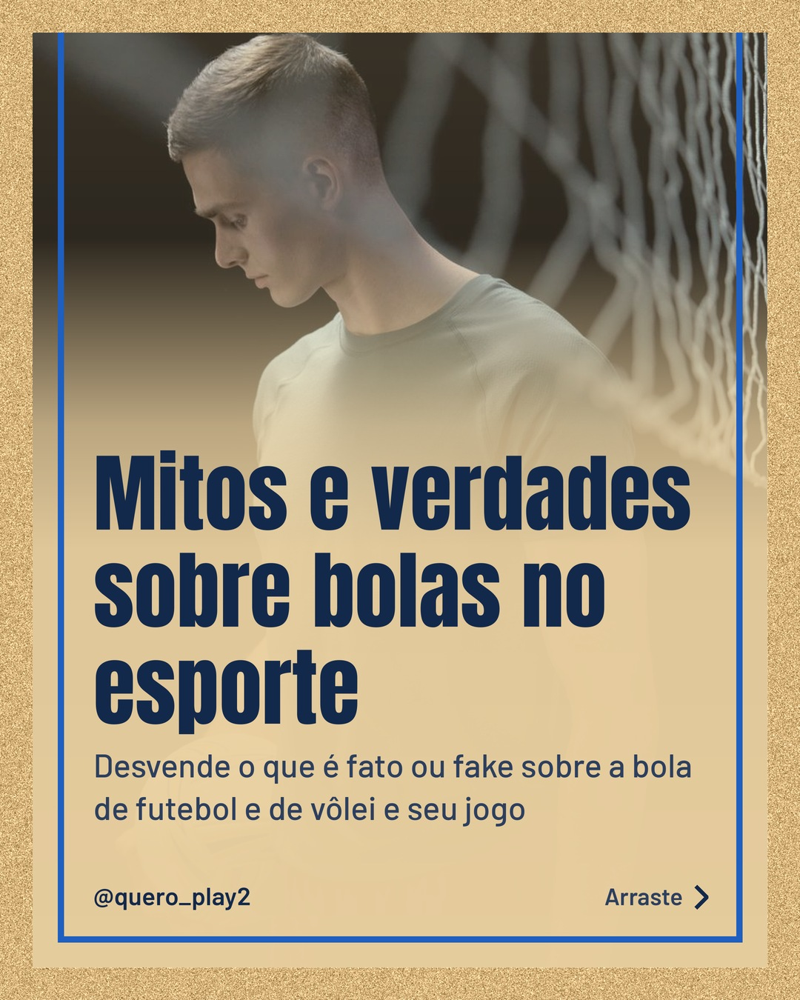
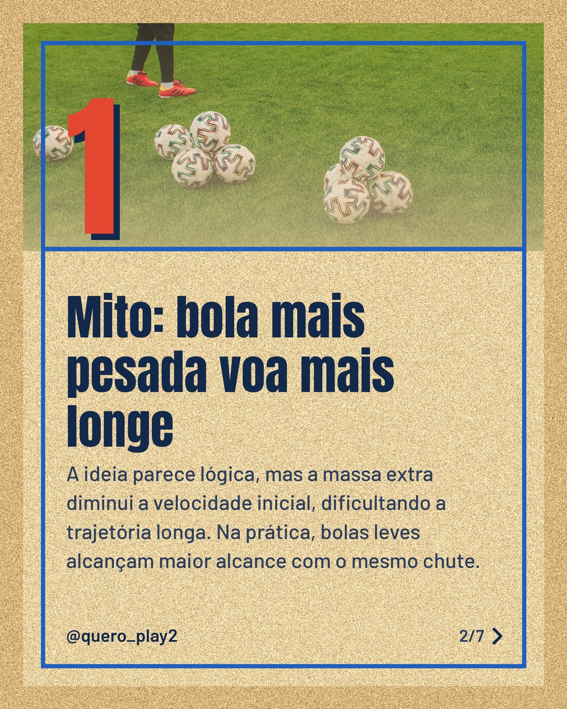
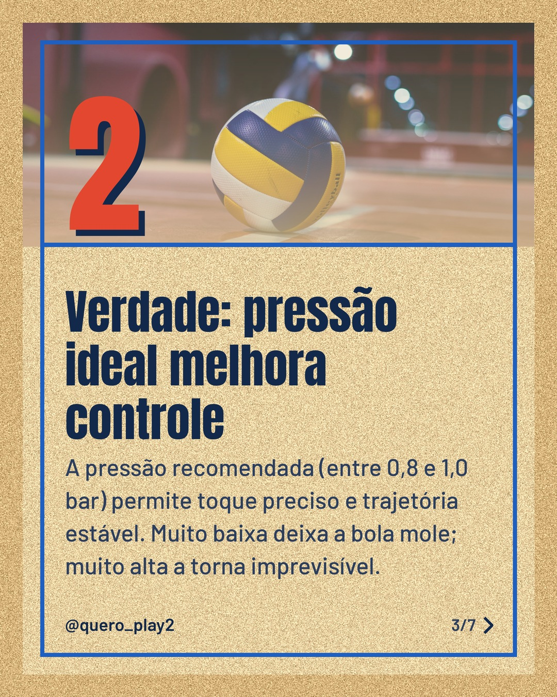
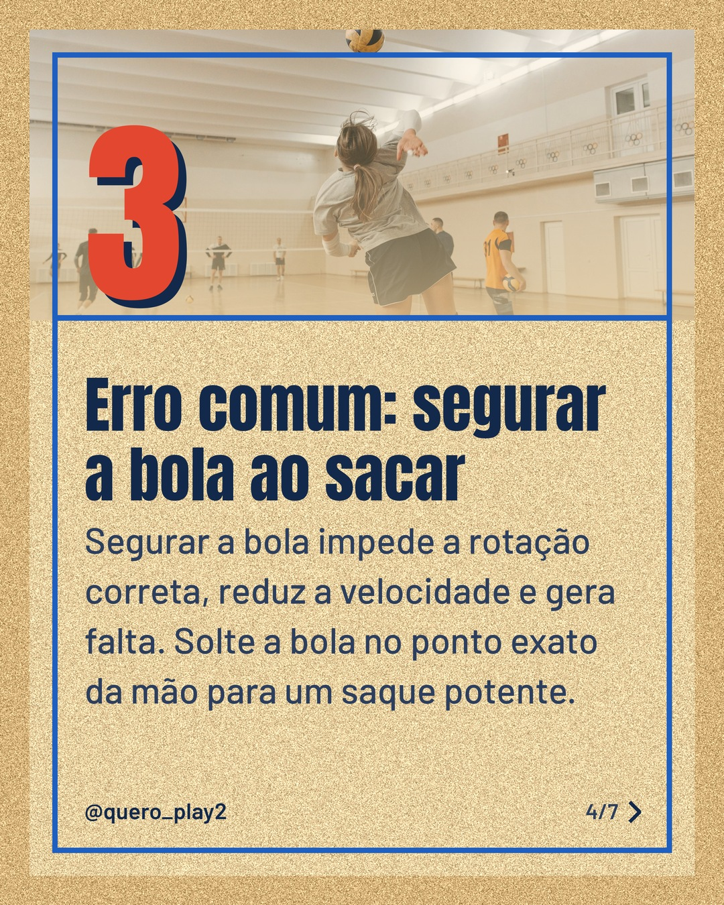
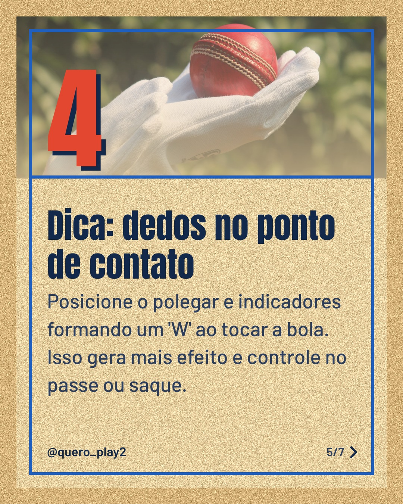
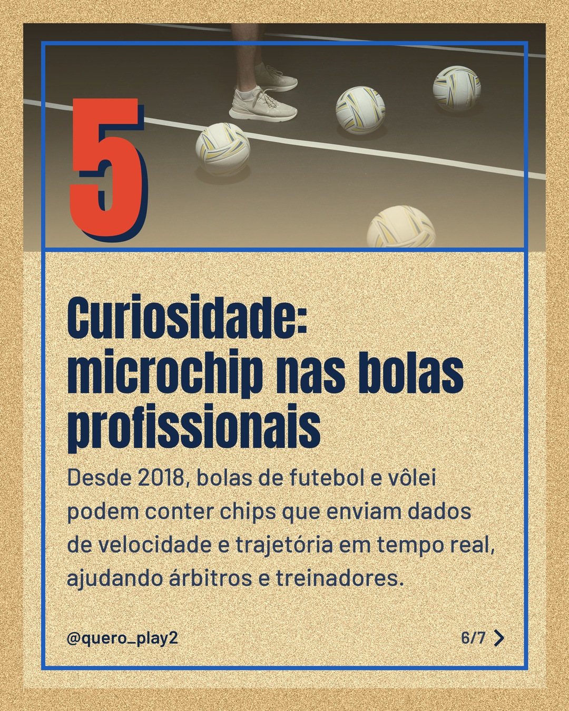

# areia

**Status:** aguardando revisão · 7 slides · gerado com `groq/openai/gpt-oss-120b`

      

## Legenda

> Você sabia que muita gente ainda acredita em mitos sobre a bola? 🤔
>
> Deslize para descobrir a verdade por trás da pressão ideal, erros comuns e curiosidades que podem mudar seu desempenho.
>
> Curtiu? Salve, comente e siga para mais dicas de futebol e vôlei! 🚀
>
> 📷 Fotos: cottonbro studio, Hanna Auramenka, Critical Smith, Pavel Danilyuk e Manoj Poosam (Pexels)
>
> #futebol #volei #curiosidades #esporte #bolas #dicas #treino #jogadores #futebolbrasil #voleiBrasil

---
**Quer mudar algo?** Edite o `legenda.txt` para trocar a legenda, ou o `post.json` para trocar os textos dos slides (depois rode `python main.py redesenhar 2026-11-01_144820`).
Foto não combinou? `python main.py trocar-foto 2026-11-01_144820 N` (0 = capa, 1, 2... = slides).
Para descartar este post, apague esta pasta.
