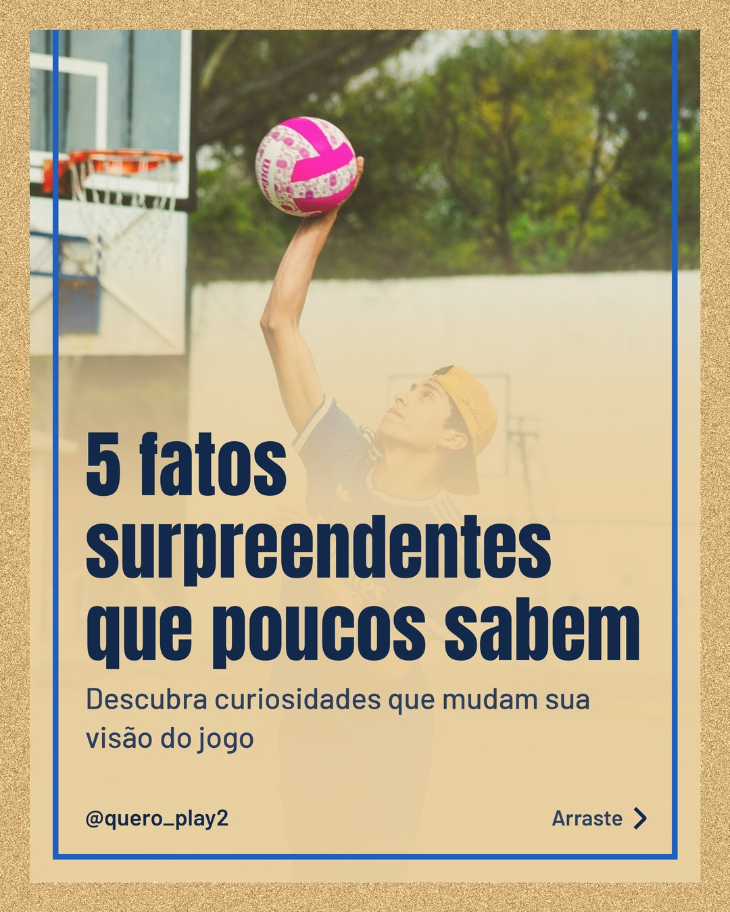
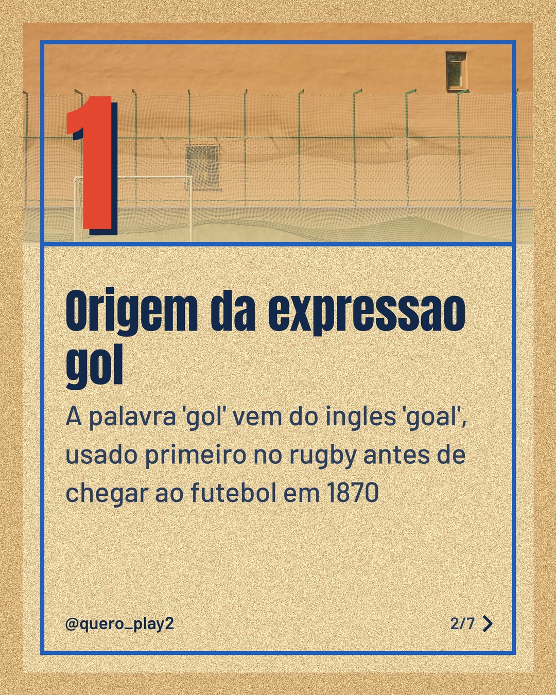
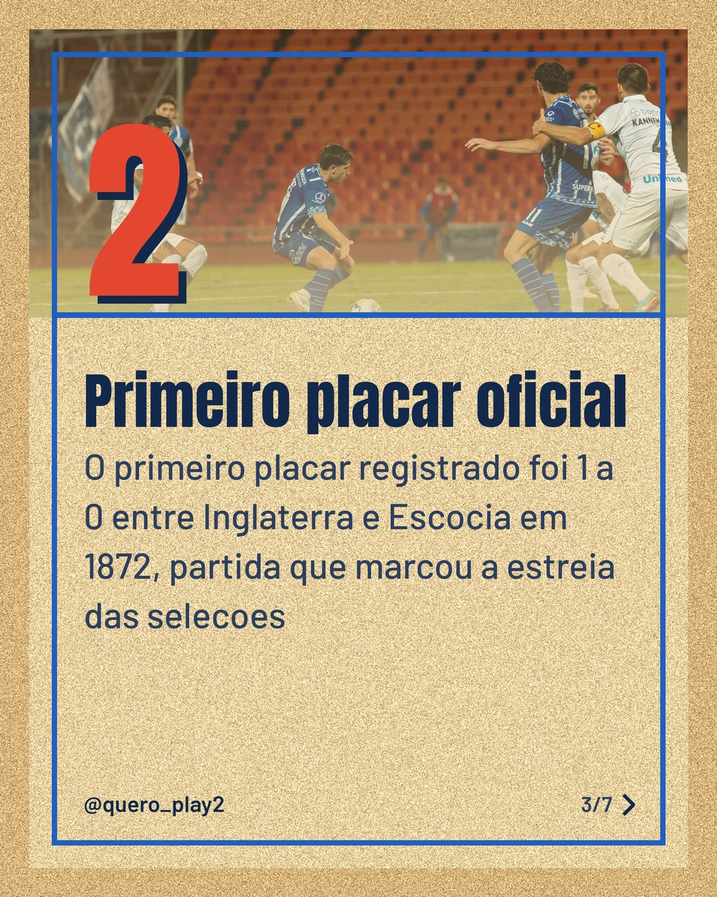
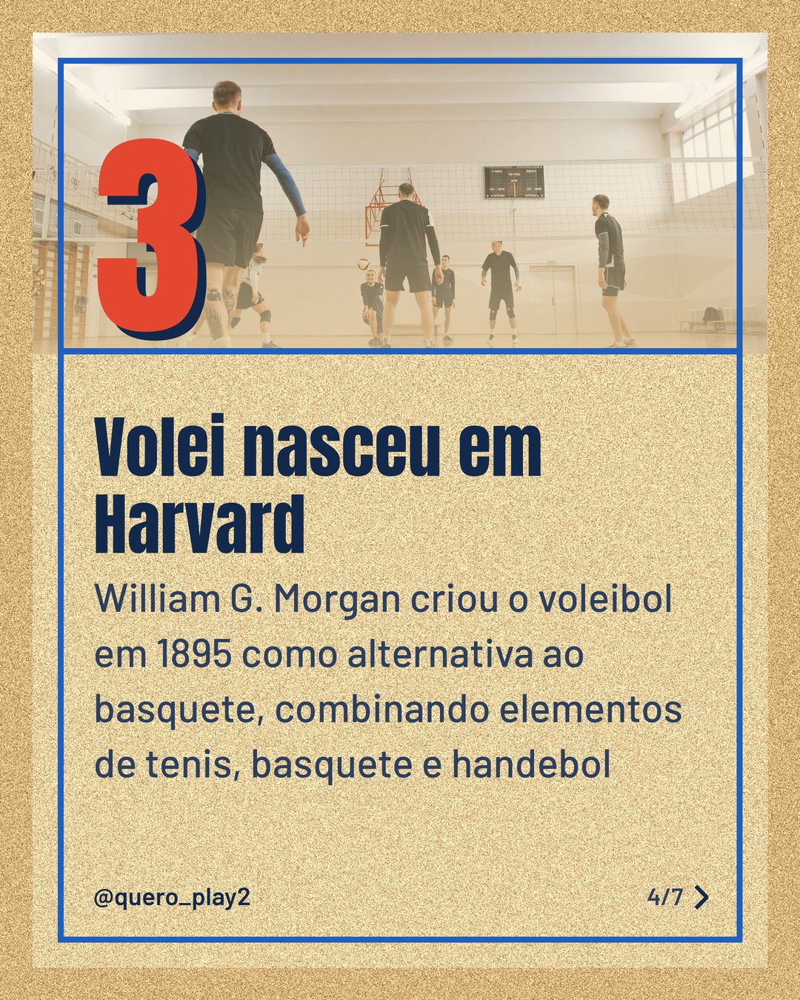
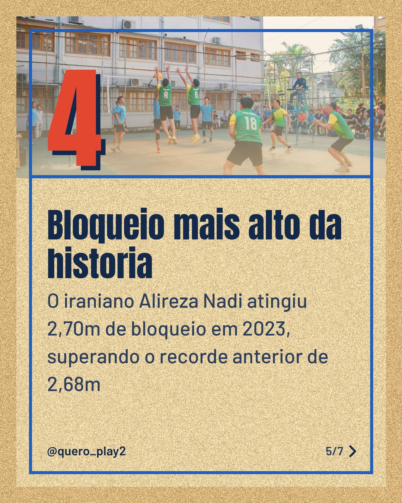
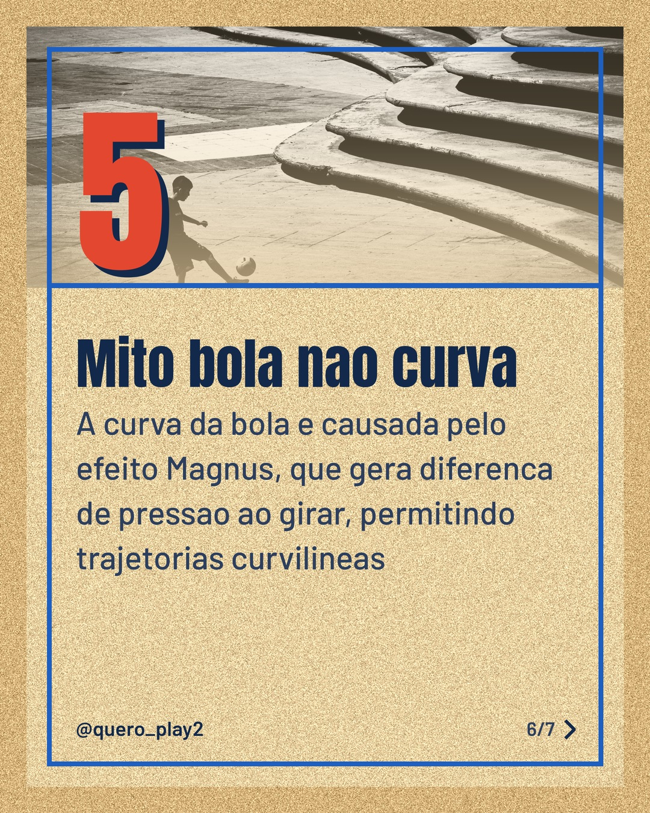

# areia

**Status:** aguardando revisão · 7 slides · gerado com `groq/openai/gpt-oss-120b`

      

## Legenda

> ⚽️ Você sabia que muitos termos do futebol têm origens curiosas? 🤔
> Deslize para descobrir fatos que poucos conhecem sobre futebol e vôlei.
> 📚 Cada slide traz um detalhe que muda a sua perspectiva do esporte.
> 🚀 Curta, comente qual curiosidade mais te surpreendeu e siga para mais conteúdos como este!
>
> 📷 Fotos: Miguel Guerra, cottonbro studio, Franco Monsalvo, Pavel Danilyuk, Thành Đỗ e Esra Erdoğdu (Pexels)
>
> #futebol #curiosidades #voleibol #fatos #esportes #historia #brasil #aprendizado #esporte

---
**Quer mudar algo?** Edite o `legenda.txt` para trocar a legenda, ou o `post.json` para trocar os textos dos slides (depois rode `python main.py redesenhar 2026-11-02_183523`).
Foto não combinou? `python main.py trocar-foto 2026-11-02_183523 N` (0 = capa, 1, 2... = slides).
Para descartar este post, apague esta pasta.
