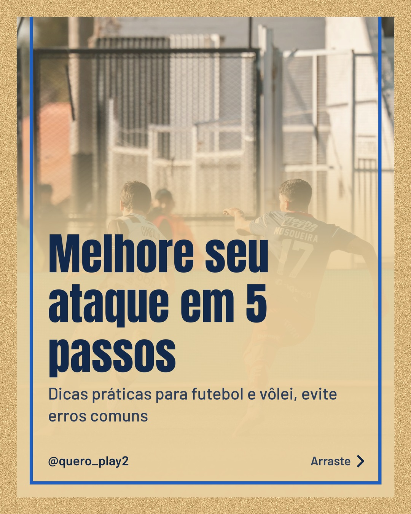
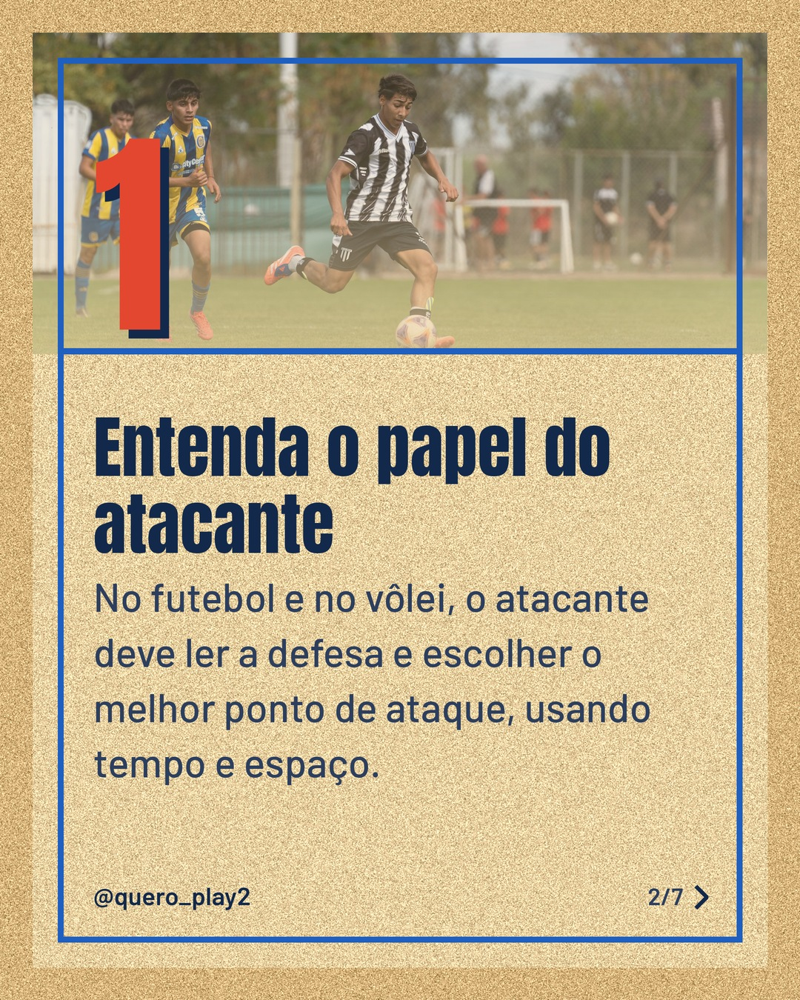
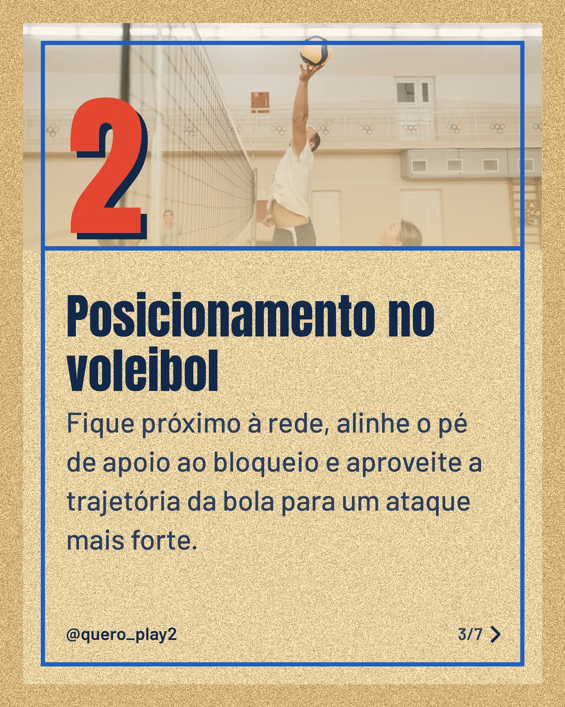
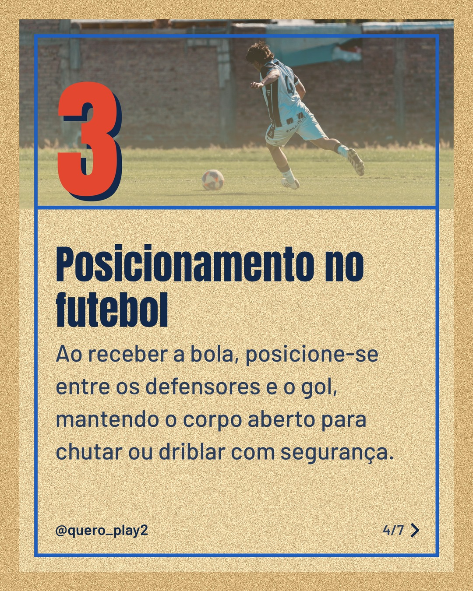
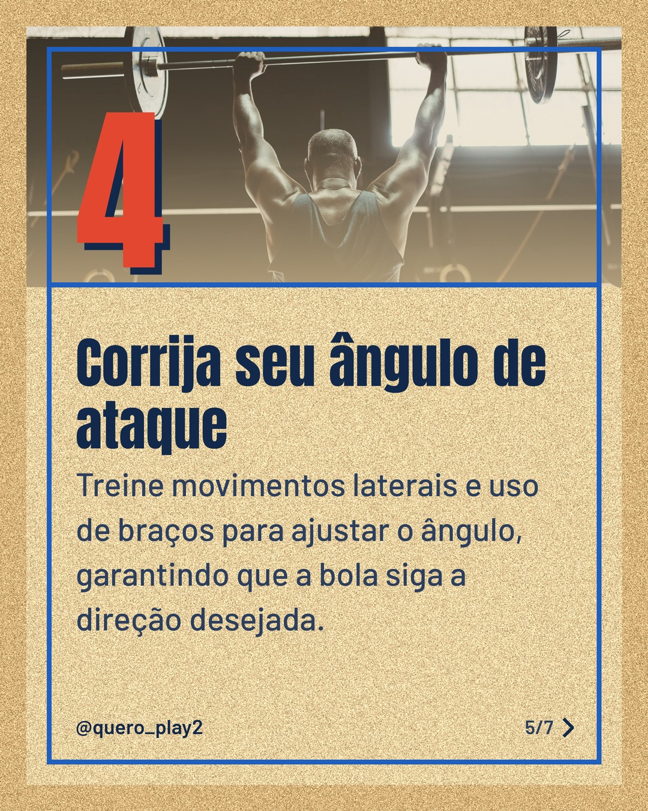
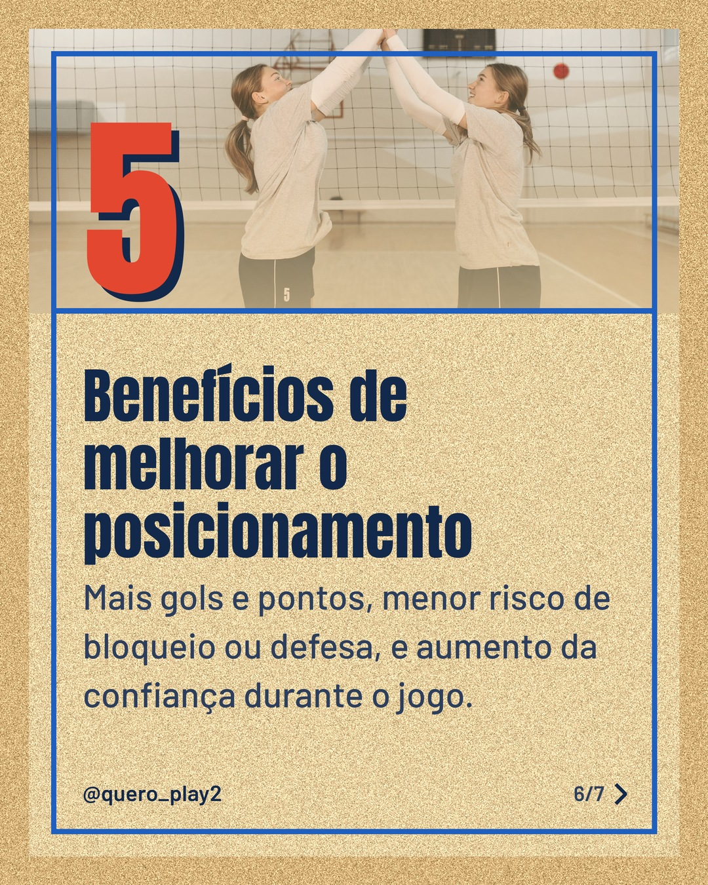
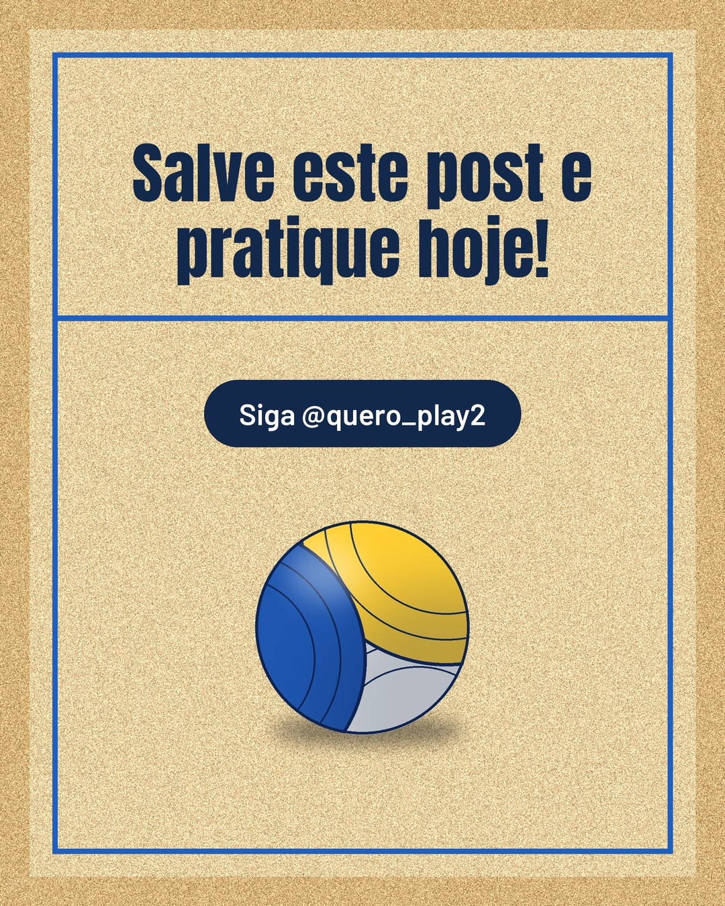

# areia

**Status:** aguardando revisão · 7 slides · gerado com `groq/openai/gpt-oss-120b`

      

## Legenda

> Você sabia que um pequeno ajuste no posicionamento pode mudar totalmente o resultado do ataque?
>
> No carrossel de hoje, separei 5 dicas práticas para futebol e vôlei, fáceis de aplicar nos treinos.
>
> Deslize para o lado, descubra cada passo e comece a evoluir seu jogo agora mesmo!
>
> Marca alguém que precisa melhorar o ataque e não esqueça de seguir para mais curiosidades! 🚀⚽🏐
>
> 📷 Fotos: Mateo Franciosi, Franco Monsalvo, Pavel Danilyuk e Ketut Subiyanto (Pexels)
>
> #futebol #volei #curiosidades #ataque #posicionamento #dicaspraticas #treinos #esporte #futebolbrasileiro #voleibolbrasil #aprendizado #jogadores

---
**Quer mudar algo?** Edite o `legenda.txt` para trocar a legenda, ou o `post.json` para trocar os textos dos slides (depois rode `python main.py redesenhar 2026-11-03_161928`).
Foto não combinou? `python main.py trocar-foto 2026-11-03_161928 N` (0 = capa, 1, 2... = slides).
Para descartar este post, apague esta pasta.
