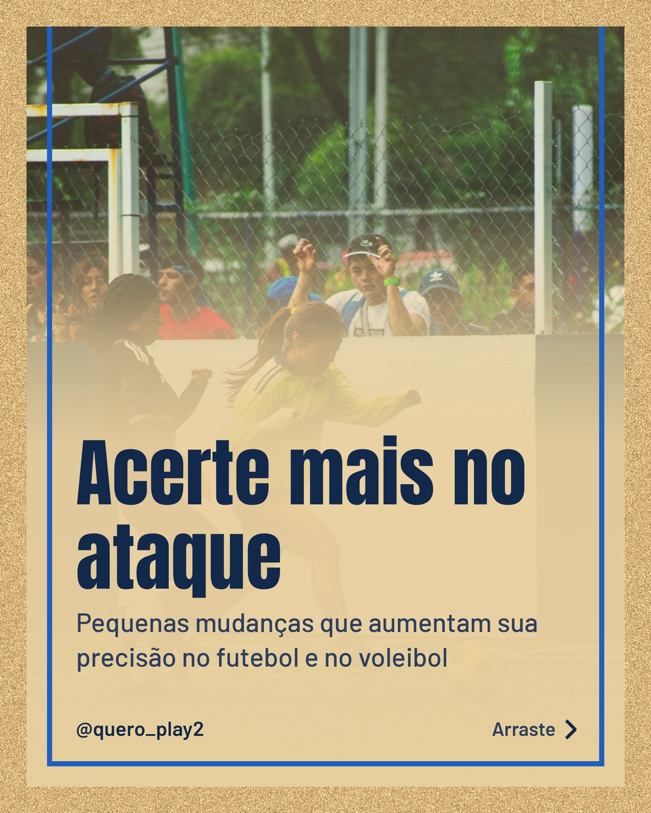
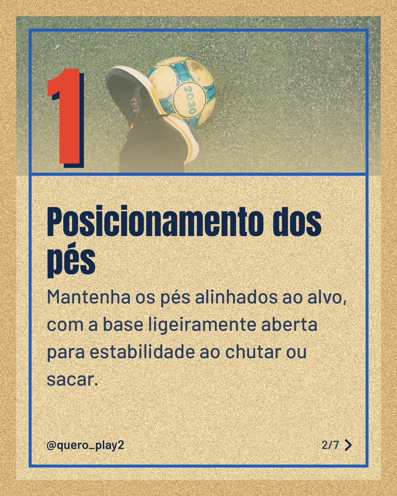
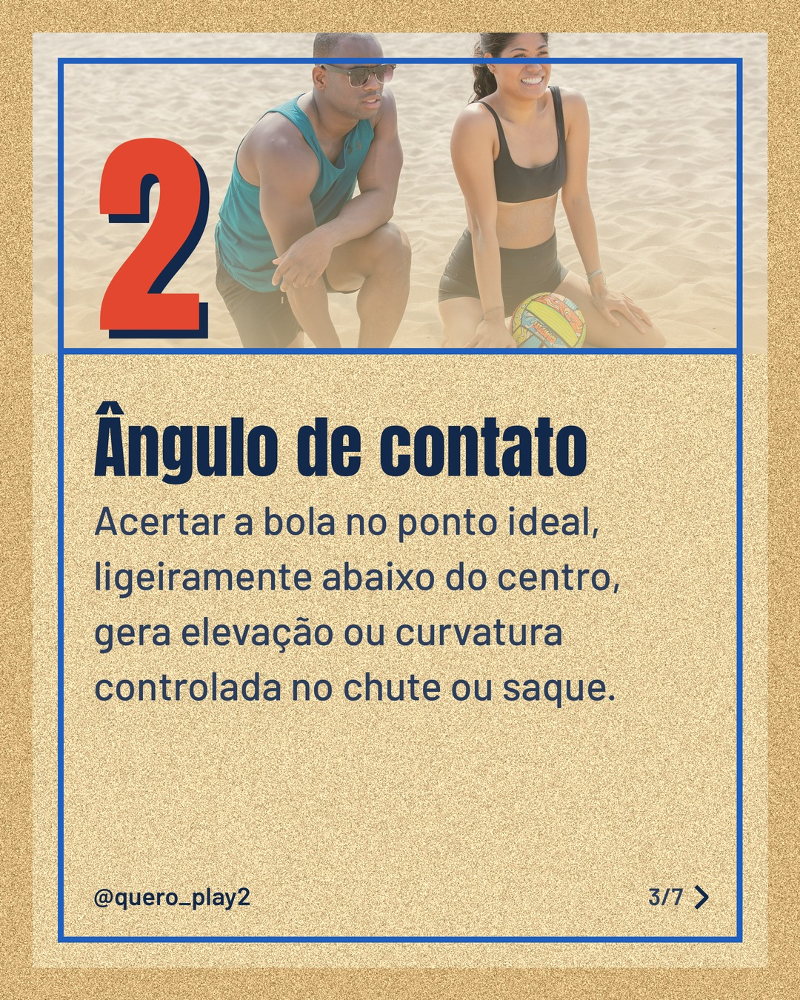
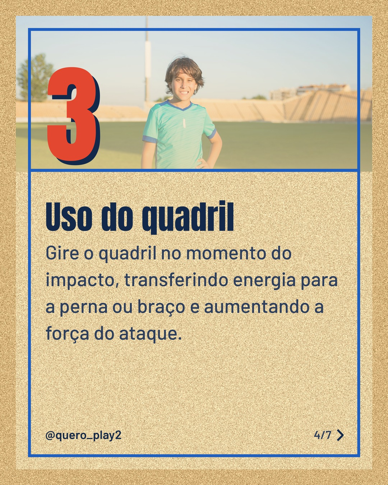
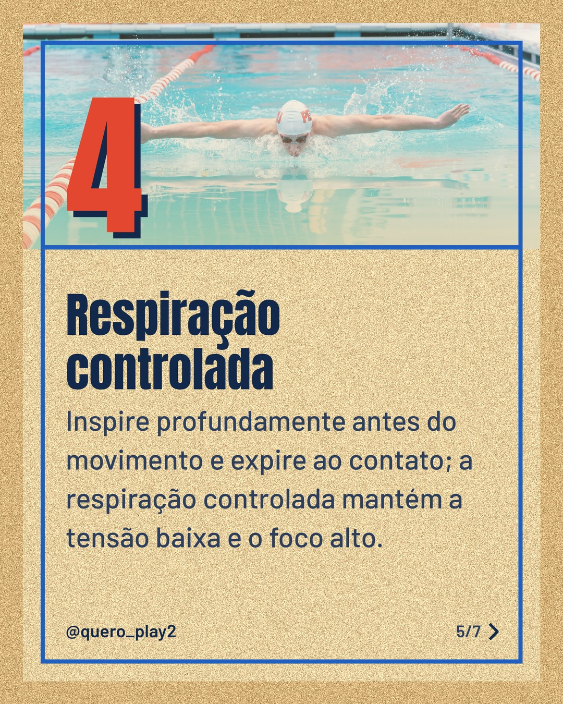
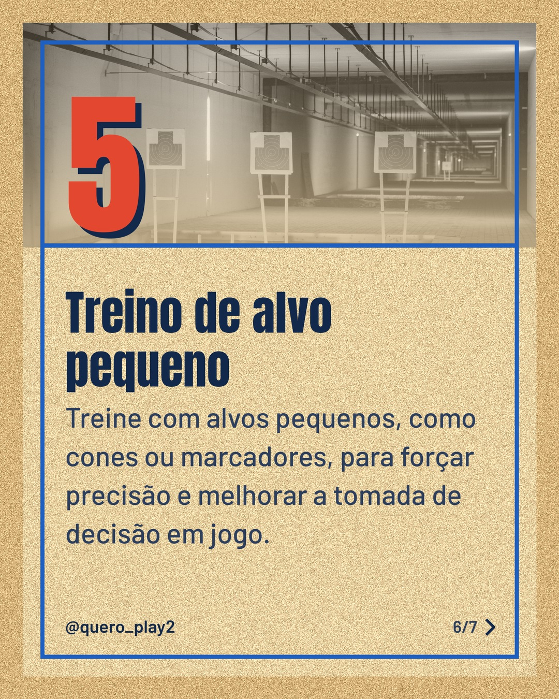
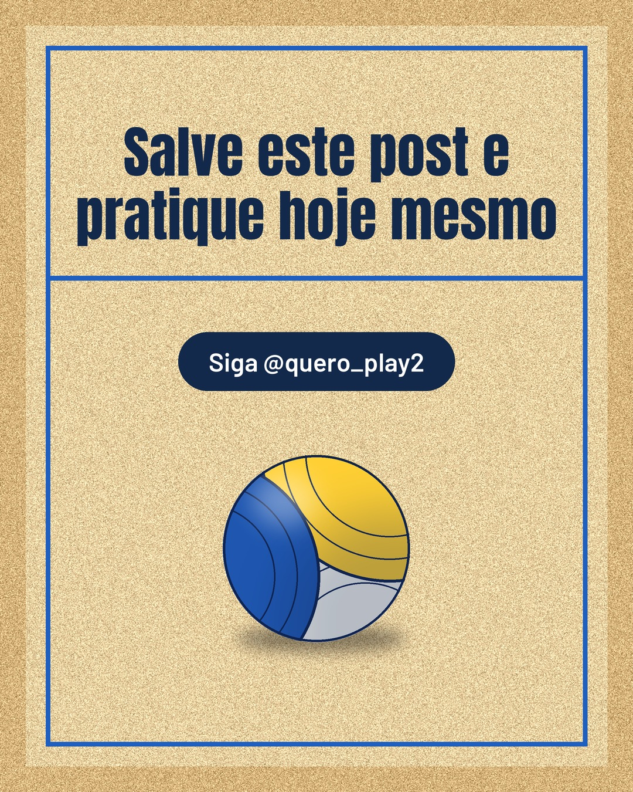

# areia

**Status:** aguardando revisão · 7 slides · gerado com `groq/openai/gpt-oss-120b`

      

## Legenda

> Quer melhorar a precisão nos seus ataques? 🤔
>
> Deslize para descobrir 5 dicas práticas que funcionam tanto no futebol quanto no vôlei.
>
> Aplicando cada passo você sente a diferença nas partidas.
>
> Comente qual dica você já usa e siga para mais curiosidades! 🚀
>
> 📷 Fotos: Miguel Guerra, Hồng Thắng Lê, RDNE Stock project, Kampus Production, Sergio Benavides e Tima Miroshnichenko (Pexels)
>
> #futebol #volei #dicasdesportivas #treinamento #precisao #ataque #esportelivre #melhorarjogo #gol #saque

---
**Quer mudar algo?** Edite o `legenda.txt` para trocar a legenda, ou o `post.json` para trocar os textos dos slides (depois rode `python main.py redesenhar 2026-11-04_163554`).
Foto não combinou? `python main.py trocar-foto 2026-11-04_163554 N` (0 = capa, 1, 2... = slides).
Para descartar este post, apague esta pasta.
