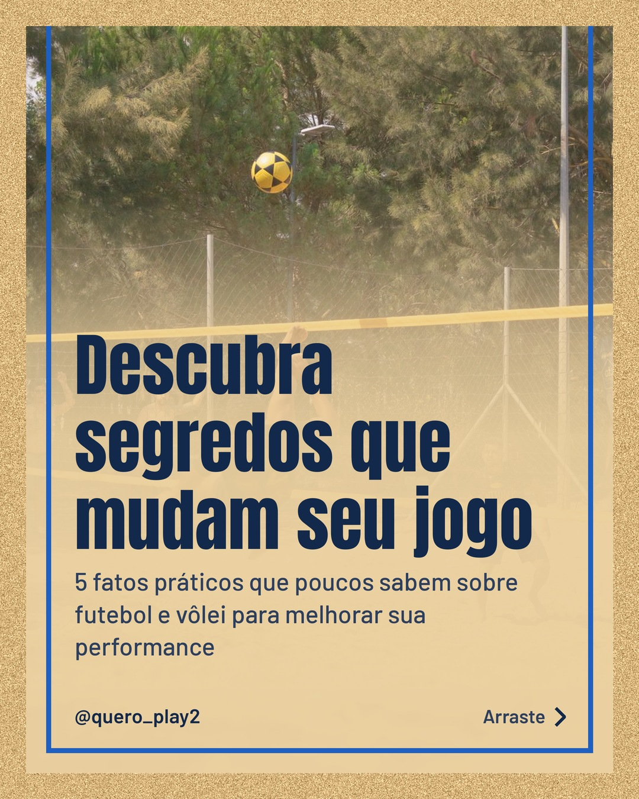
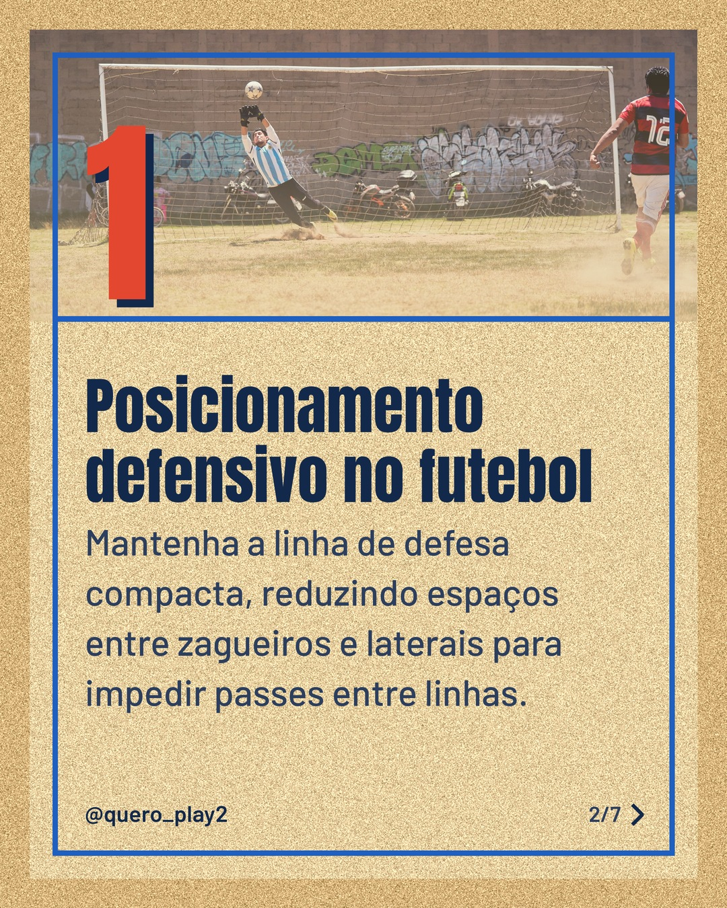
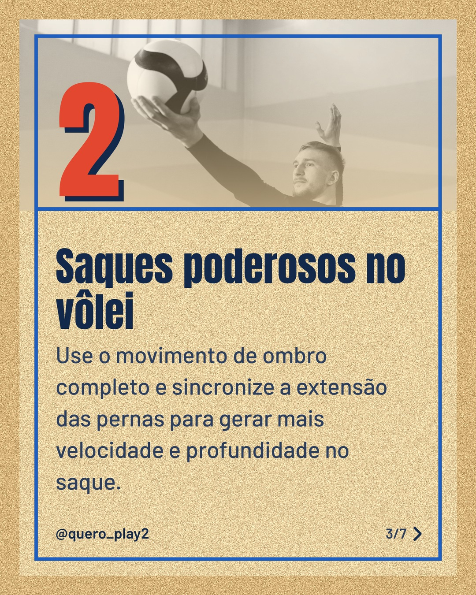
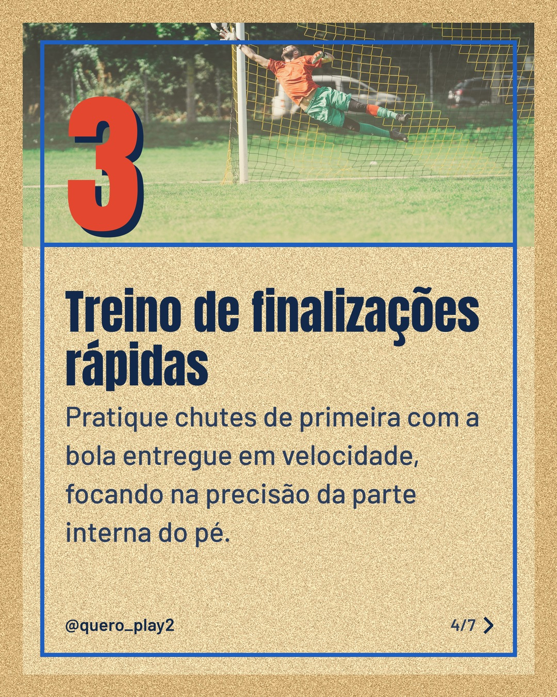
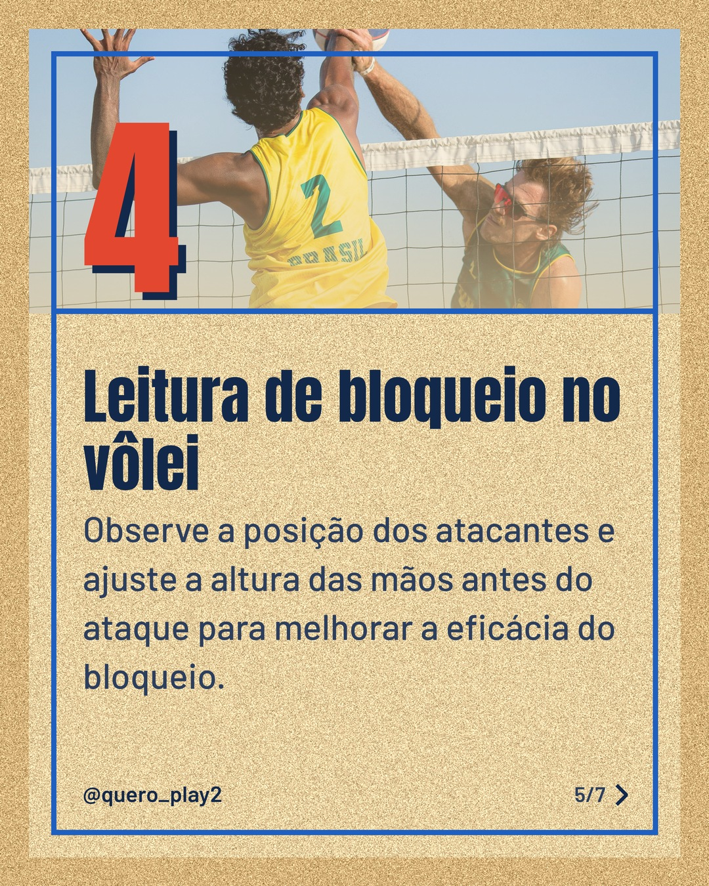
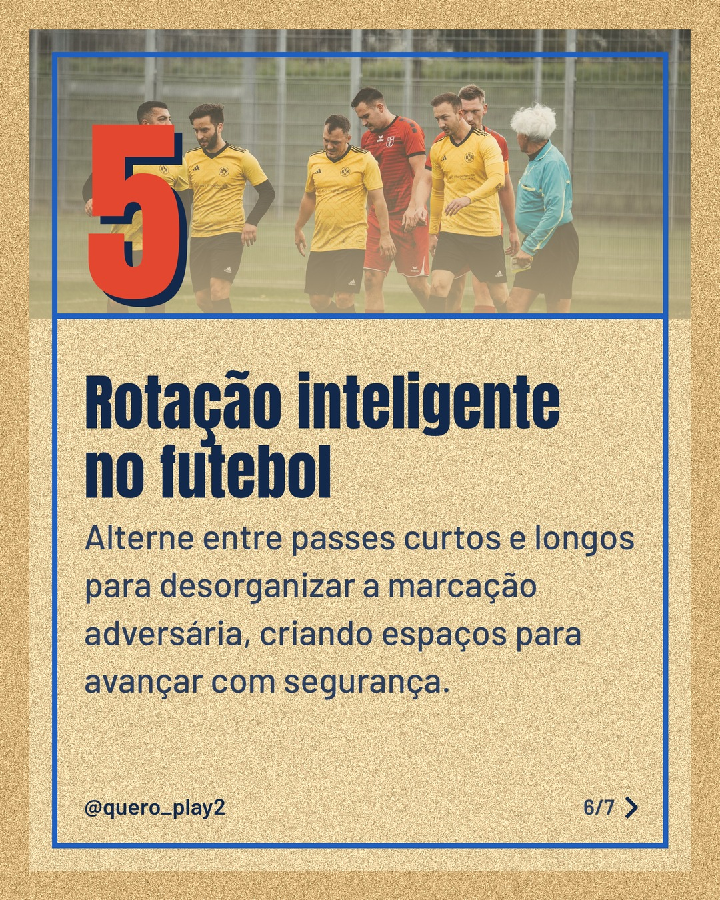
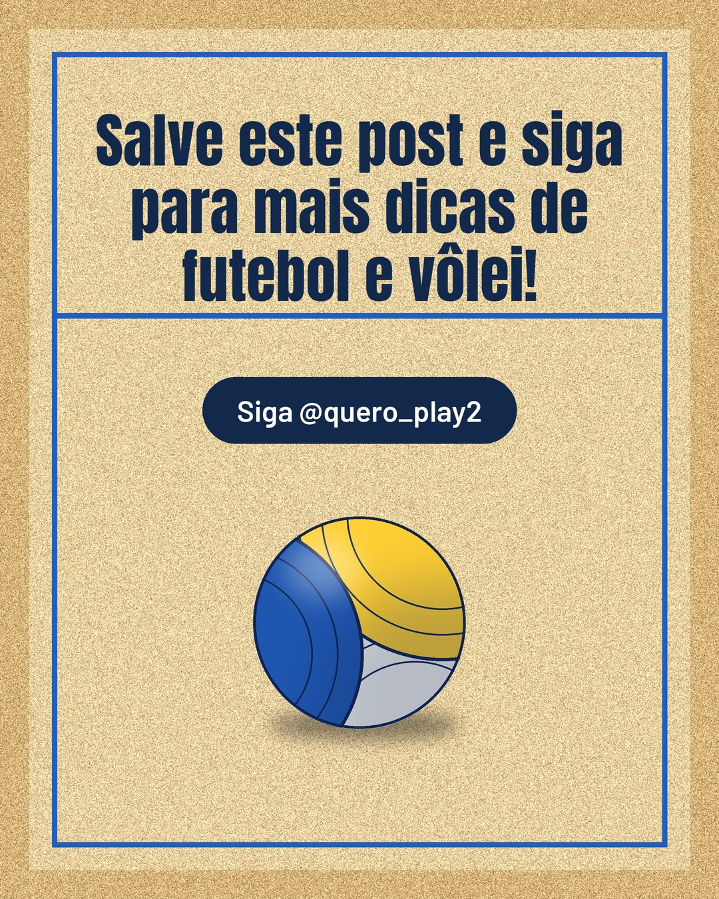

# areia

**Status:** aguardando revisão · 7 slides · gerado com `groq/openai/gpt-oss-120b`

      

## Legenda

> ⚽️ Você sabia que pequenos ajustes no posicionamento defensivo podem reduzir quase 30% dos gols sofridos?
>
> 🏐 E no vôlei, um saque bem executado abre a quadra para a vitória. Teste as dicas e sinta a diferença.
>
> Deslize para o lado e descubra cada truque. Curta, comente qual dica você vai aplicar primeiro e siga nosso perfil para não perder nada!
>
> 📷 Fotos: Denis  Almeida, Willians Huerta, Pavel Danilyuk, Omar Ramadan e Célio Júnior (Pexels)
>
> #futebol #volei #curiosidades #dicasdeesporte #treinamento #posicionamento #saque #bloqueio #tacticas #performance

---
**Quer mudar algo?** Edite o `legenda.txt` para trocar a legenda, ou o `post.json` para trocar os textos dos slides (depois rode `python main.py redesenhar 2026-11-05_164446`).
Foto não combinou? `python main.py trocar-foto 2026-11-05_164446 N` (0 = capa, 1, 2... = slides).
Para descartar este post, apague esta pasta.
