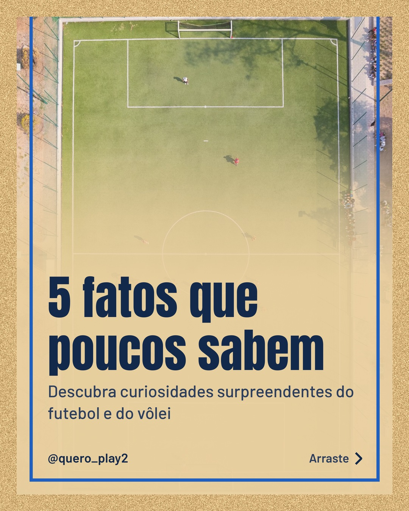
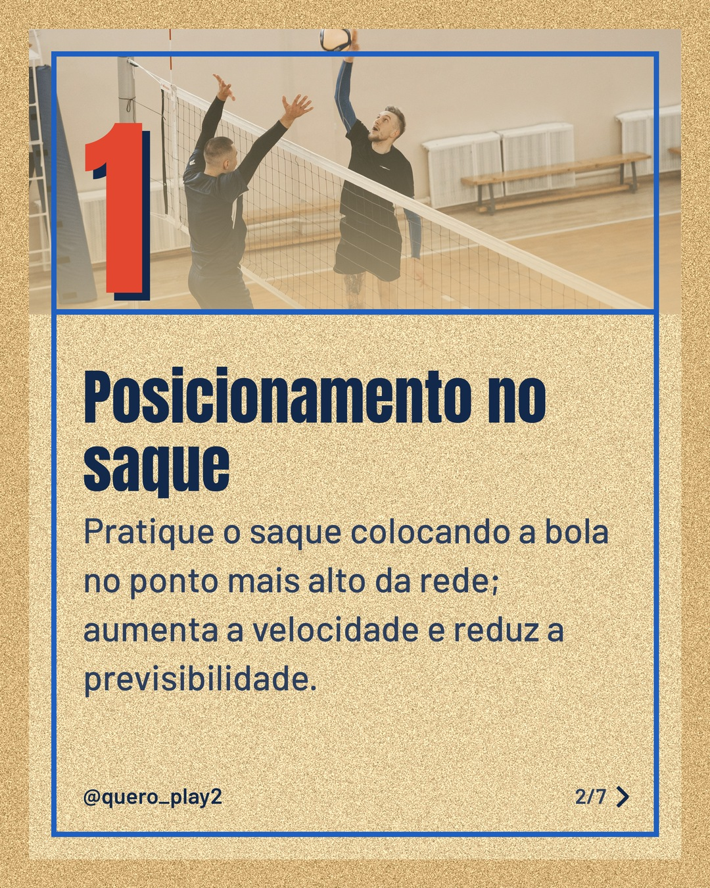
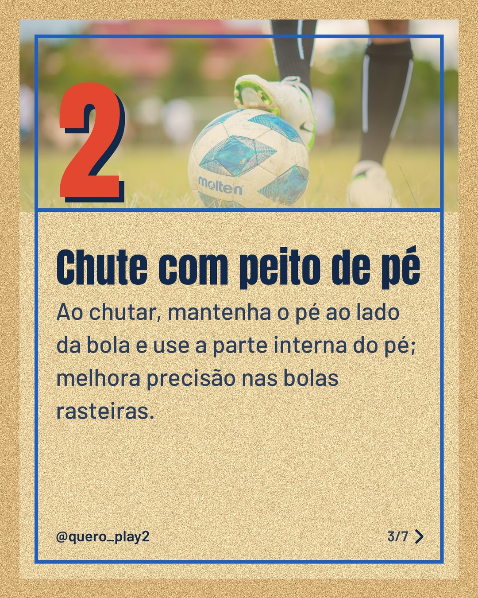
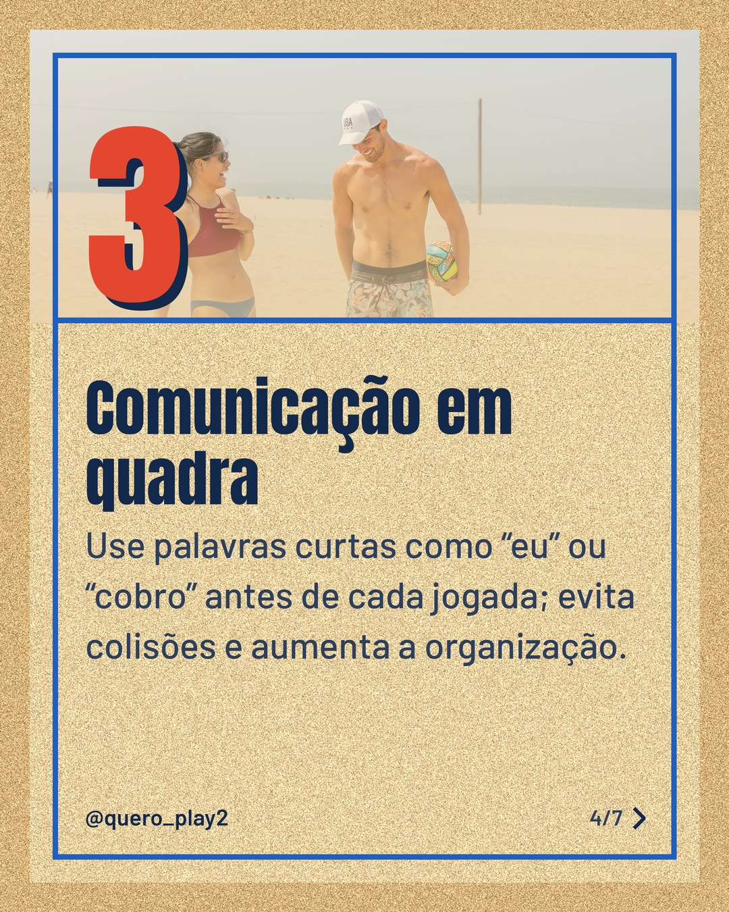
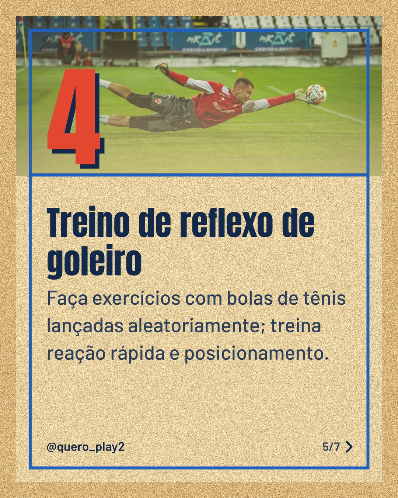
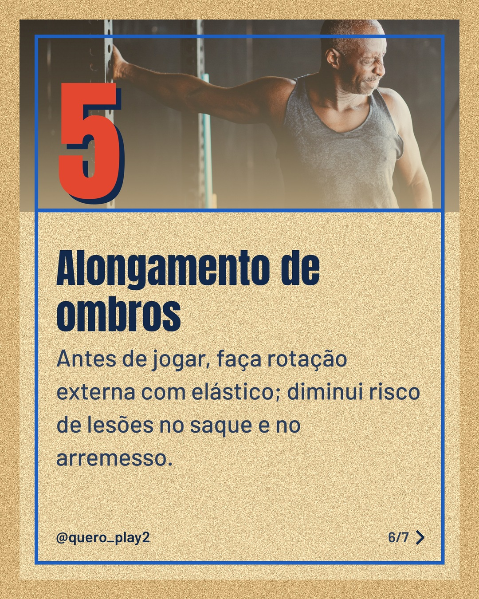

# areia

**Status:** aguardando revisão · 7 slides · gerado com `groq/openai/gpt-oss-120b`

      

## Legenda

> 🚀 Quer descobrir segredos que poucos conhecem no futebol e no vôlei? Deslize para o lado e aprenda dicas práticas que vão melhorar seu jogo imediatamente.
>
> Cada slide traz um conselho simples, fácil de aplicar nos treinos e nas partidas. Experimente hoje e sinta a diferença!
>
> Curtiu? Deixe seu comentário, siga o perfil para mais curiosidades e marque quem vai adorar essas dicas. 💬⚽🏐
>
> 📷 Fotos: Carlos Reyes, Pavel Danilyuk, Thanyakorn krisorn, RDNE Stock project, Nicu Ene e Ketut Subiyanto (Pexels)
>
> #futebol #volei #curiosidades #esporte #dicasdesportivas #futebolbrasil #voleibol #treinamentodesport #esporteeducativo #fatosinteressantes #paixaodesporte #curiosidadesdesportivas

---
**Quer mudar algo?** Edite o `legenda.txt` para trocar a legenda, ou o `post.json` para trocar os textos dos slides (depois rode `python main.py redesenhar 2026-11-06_160747`).
Foto não combinou? `python main.py trocar-foto 2026-11-06_160747 N` (0 = capa, 1, 2... = slides).
Para descartar este post, apague esta pasta.
