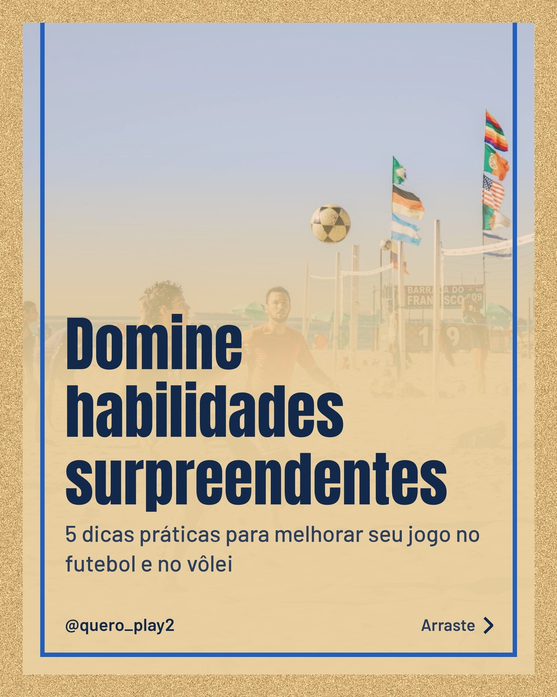
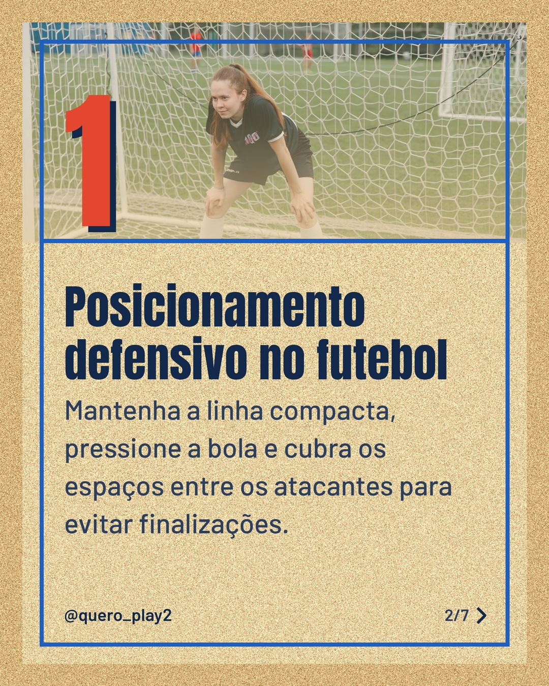
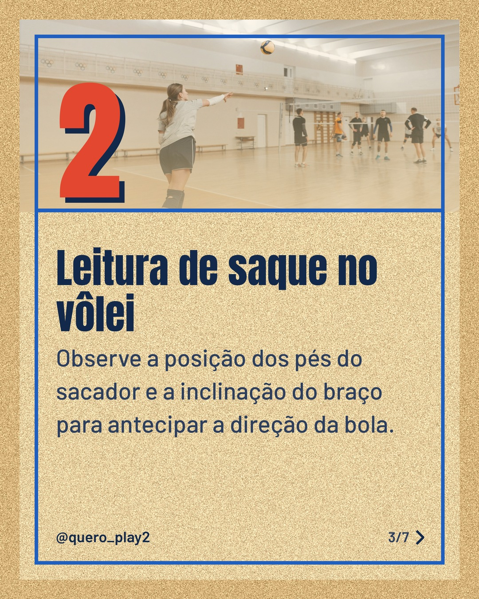
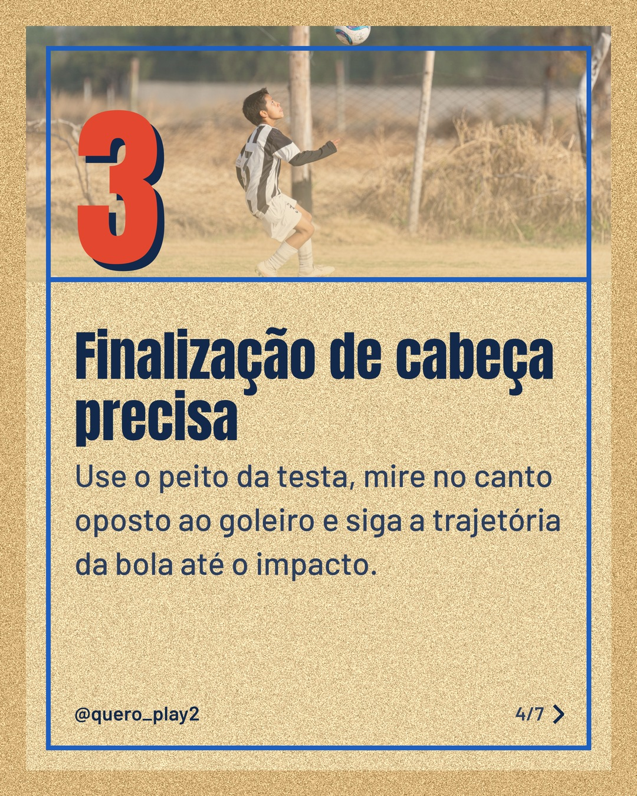
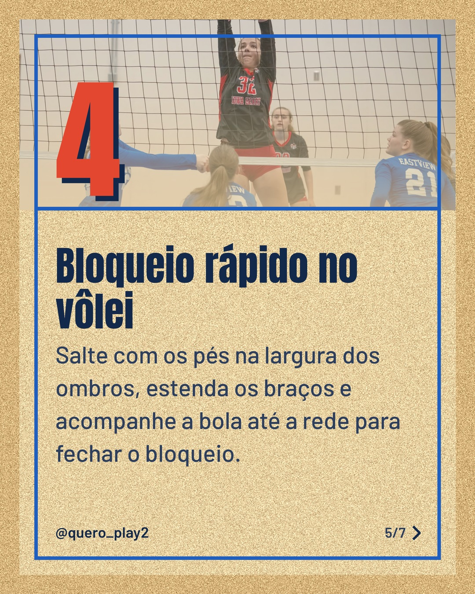
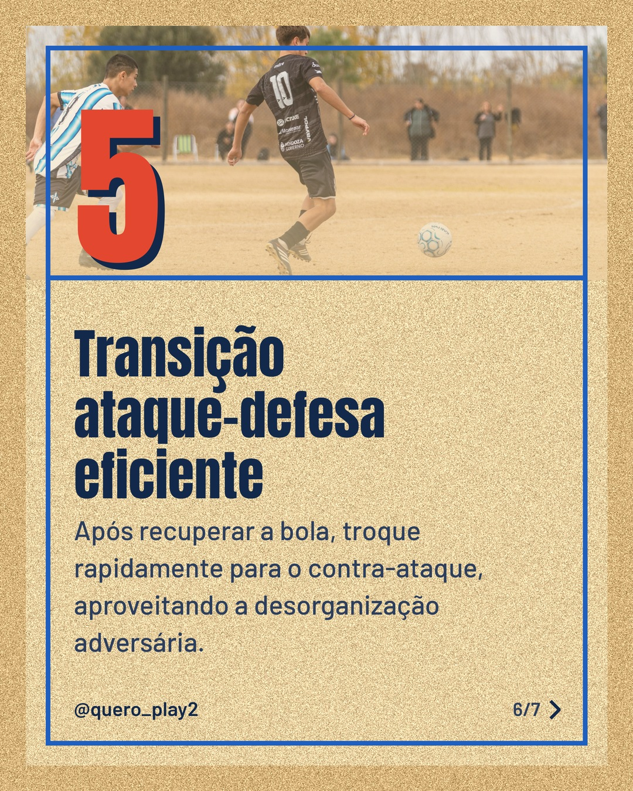
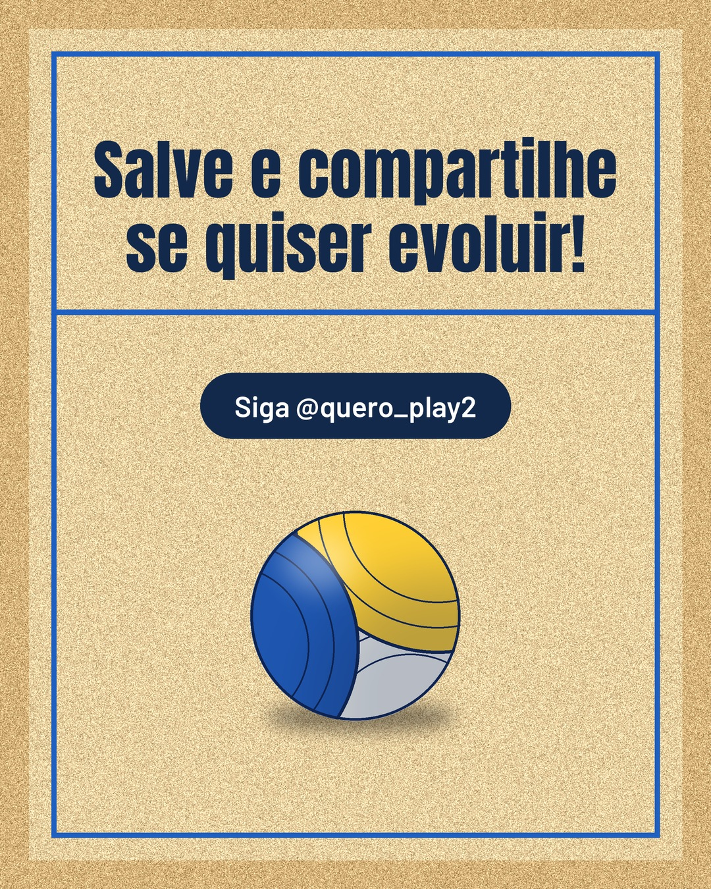

# areia

**Status:** aguardando revisão · 7 slides · gerado com `groq/openai/gpt-oss-120b`

      

## Legenda

> Quer melhorar seu desempenho tanto no futebol quanto no vôlei? 🤔 Arraste para o lado e descubra dicas práticas que realmente funcionam. Cada slide traz uma técnica que você pode aplicar já nos treinos.
>
> Teste uma dica por semana e sinta a diferença nos jogos. ⚽🏐 Não esqueça de marcar aquele amigo que precisa dessas ideias!
>
> Curtiu? Salve o post, siga o perfil e deixe seu comentário com a dica que você mais gostou. 🚀
>
> 📷 Fotos: Henrique Morais, Anastasia  Shuraeva, Pavel Danilyuk, Franco Monsalvo e Tom Fisk (Pexels)
>
> #futebol #volei #dicasdesportivas #treinos #tecnica #esportes #aprendizado #curiosidades #performance #jogo

---
**Quer mudar algo?** Edite o `legenda.txt` para trocar a legenda, ou o `post.json` para trocar os textos dos slides (depois rode `python main.py redesenhar 2026-11-07_143858`).
Foto não combinou? `python main.py trocar-foto 2026-11-07_143858 N` (0 = capa, 1, 2... = slides).
Para descartar este post, apague esta pasta.
