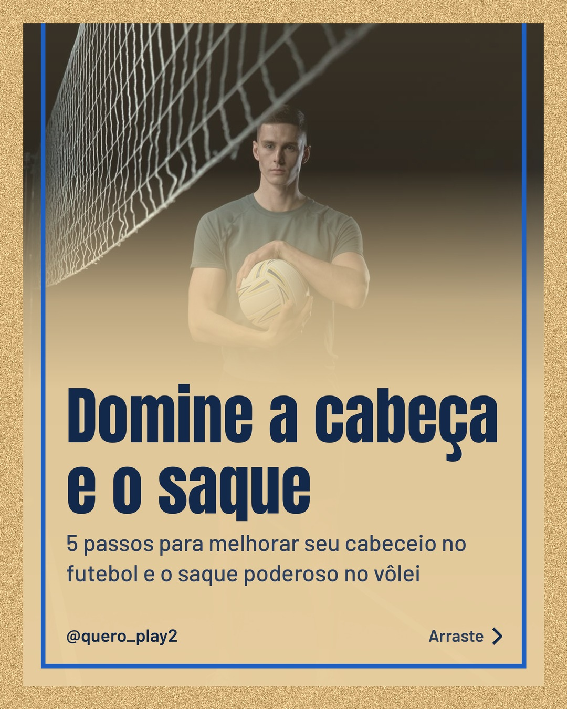
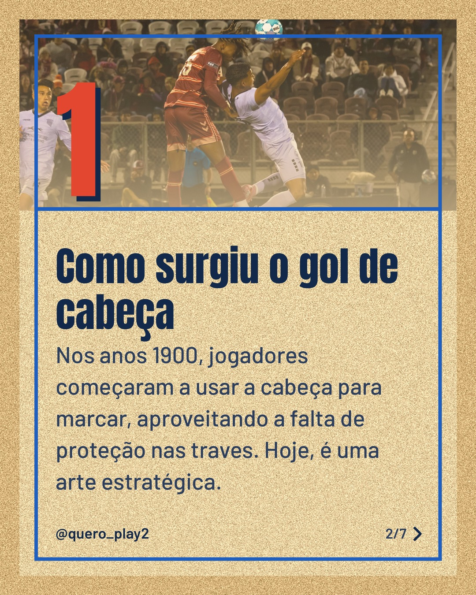
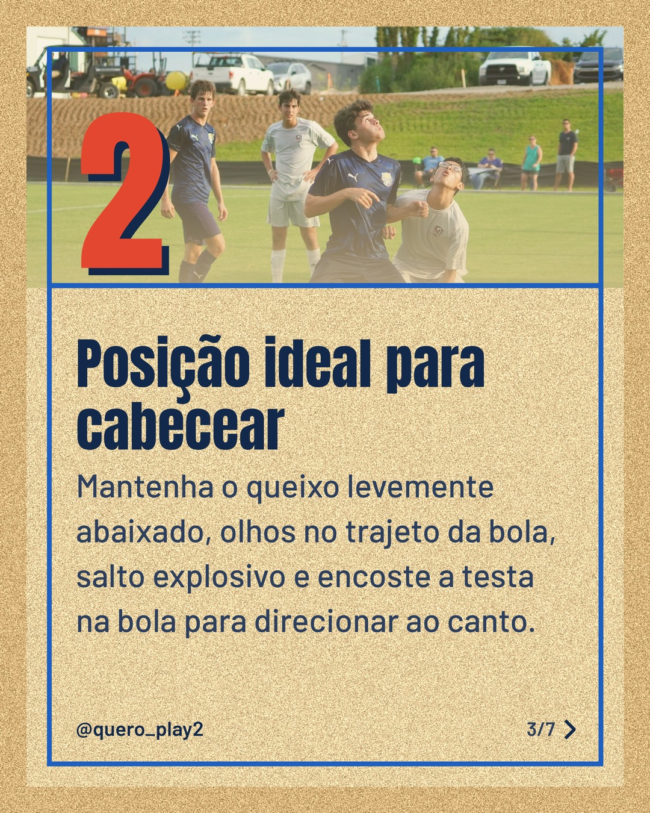
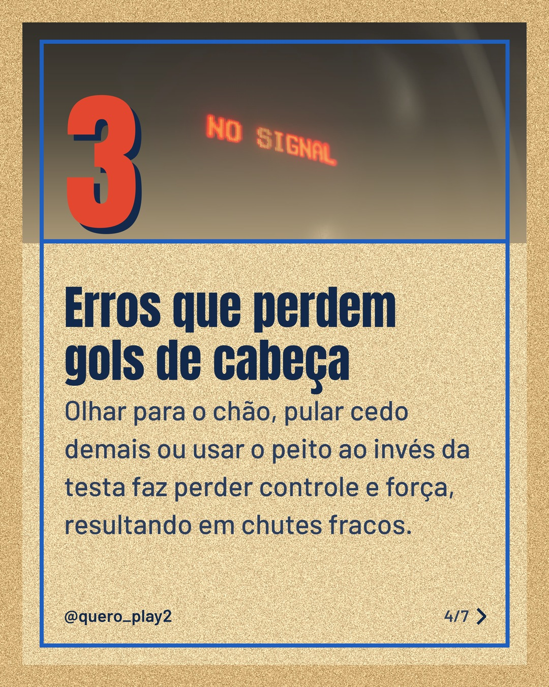
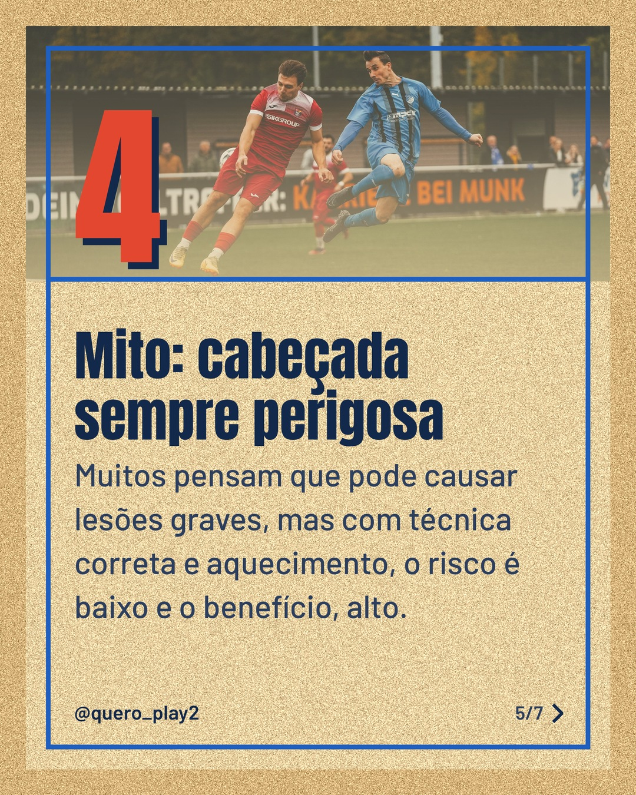
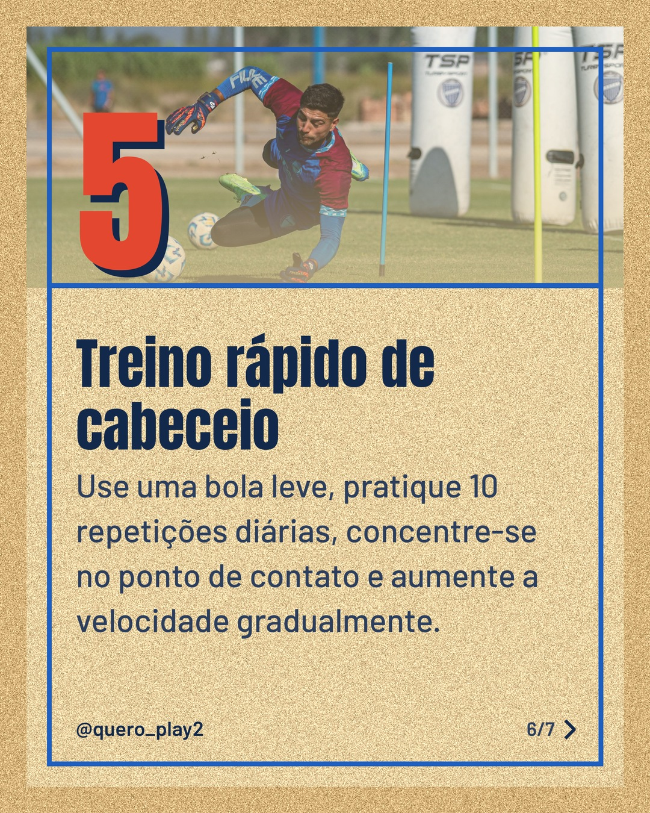

# areia

**Status:** aguardando revisão · 7 slides · gerado com `groq/openai/gpt-oss-120b`

      

## Legenda

> Você sabia que o cabeceio pode mudar o rumo de um jogo? 🤔
>
> No carrossel de hoje, descubra como aprimorar essa técnica e ainda dominar o saque no vôlei, com dicas simples e eficientes. 🚀
>
> Deslize para o lado, experimente as dicas e conte nos comentários como foi. Não esqueça de salvar e seguir para mais curiosidades! 📲
>
> 📷 Fotos: cottonbro studio, Stephen Leonardi, Chris L, Benjamin Farren, Omar Ramadan e Franco Monsalvo (Pexels)
>
> #futebol #voleibol #curiosidades #esporte #treino #dica #futebolbrasil #voleibrasil #cabeceio #saque #esporteeducativo #curiosidadessport

---
**Quer mudar algo?** Edite o `legenda.txt` para trocar a legenda, ou o `post.json` para trocar os textos dos slides (depois rode `python main.py redesenhar 2026-11-08_144838`).
Foto não combinou? `python main.py trocar-foto 2026-11-08_144838 N` (0 = capa, 1, 2... = slides).
Para descartar este post, apague esta pasta.
