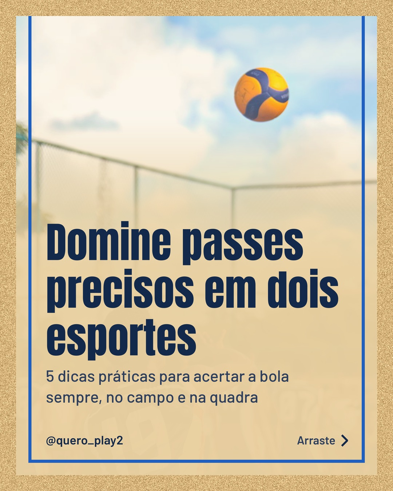
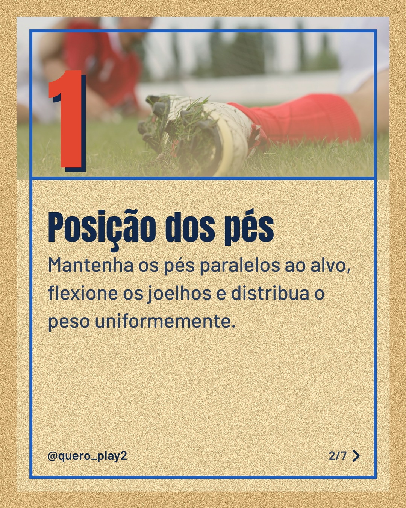
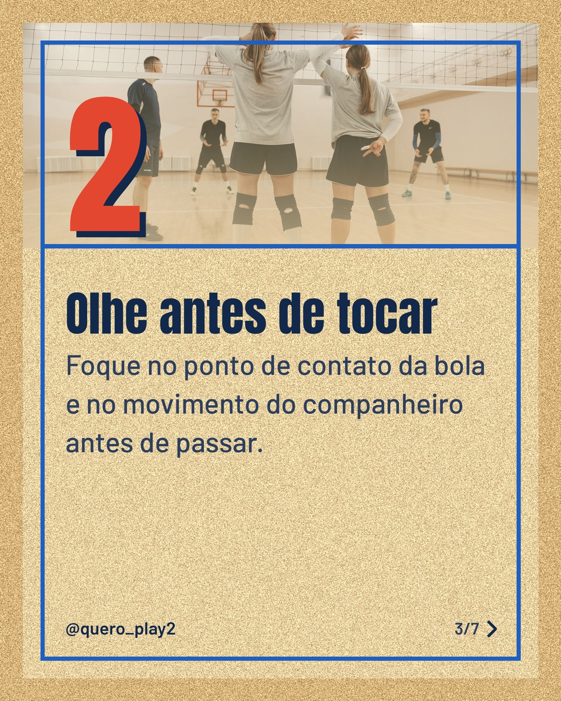
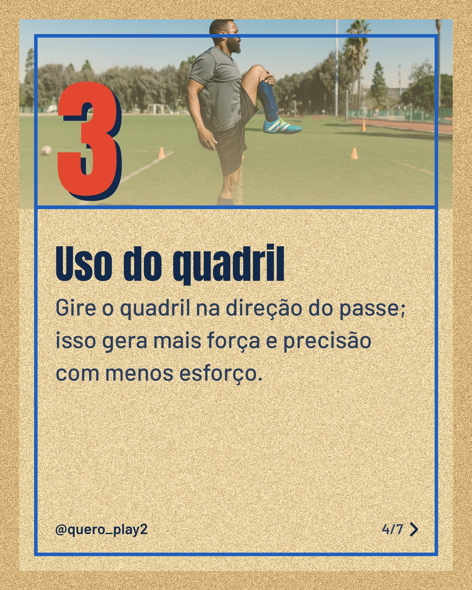
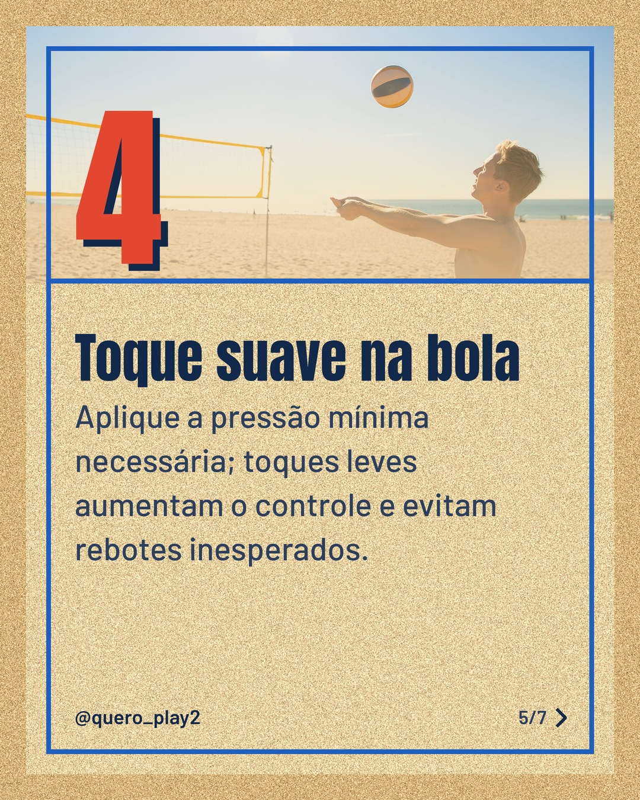
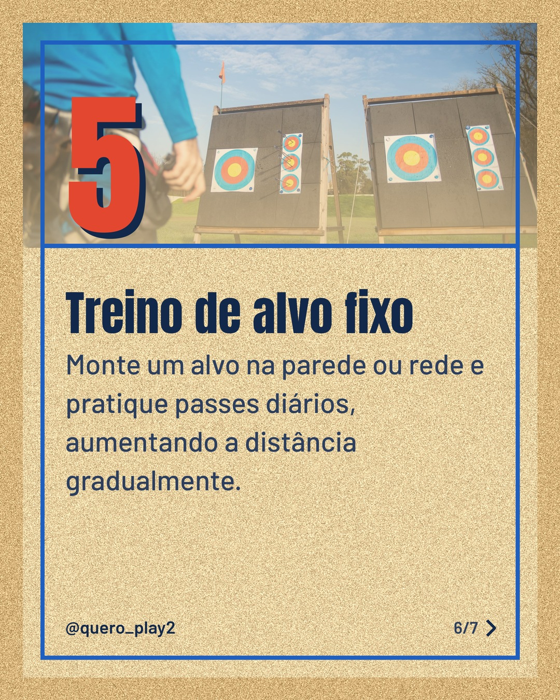
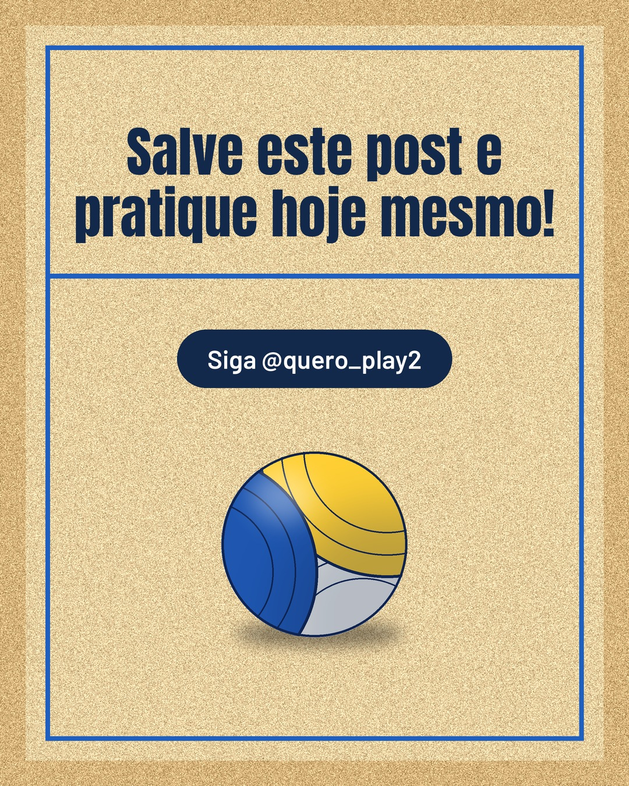

# areia

**Status:** aguardando revisão · 7 slides · gerado com `groq/openai/gpt-oss-120b`

      

## Legenda

> Você já percebeu como um passe certeiro muda o jogo? 🤔
>
> Descubra 5 passos simples que funcionam tanto no futebol quanto no vôlei. Cada dica é fácil de aplicar no treino diário.
>
> Deslize para o lado e veja como melhorar sua precisão agora! 📈
>
> Curtiu? Marque um amigo e siga para mais curiosidades esportivas.
>
> 📷 Fotos: Ansey Photography, BOOM 💥 Photography, Pavel Danilyuk, RDNE Stock project e Kampus Production (Pexels)
>
> #futebol #volei #passes #treino #dicasdeesporte #precisao #esportelivre #aprendizado #jogadores #tactica

---
**Quer mudar algo?** Edite o `legenda.txt` para trocar a legenda, ou o `post.json` para trocar os textos dos slides (depois rode `python main.py redesenhar 2026-11-09_190822`).
Foto não combinou? `python main.py trocar-foto 2026-11-09_190822 N` (0 = capa, 1, 2... = slides).
Para descartar este post, apague esta pasta.
