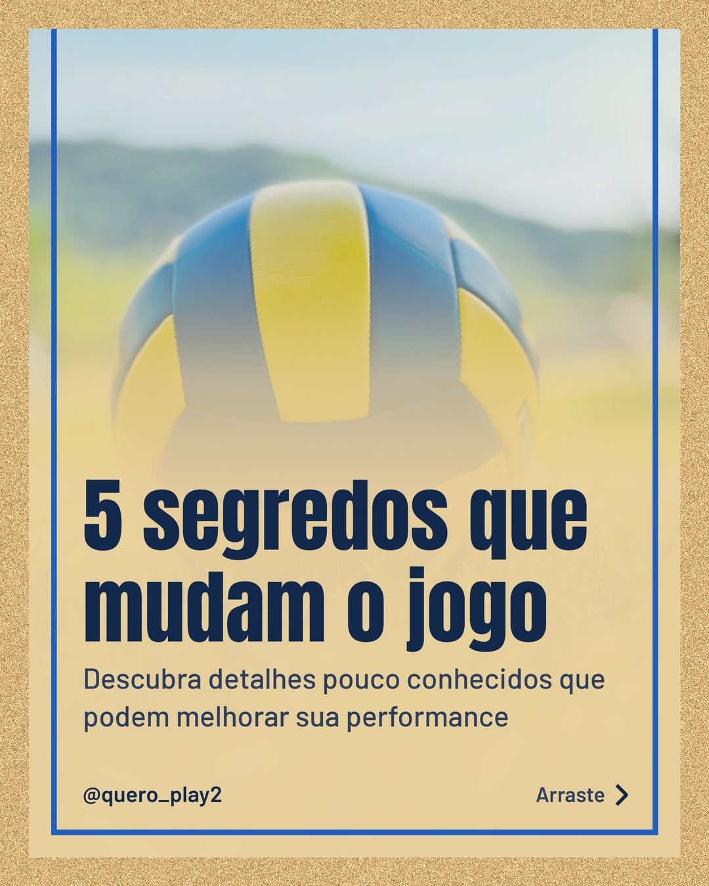
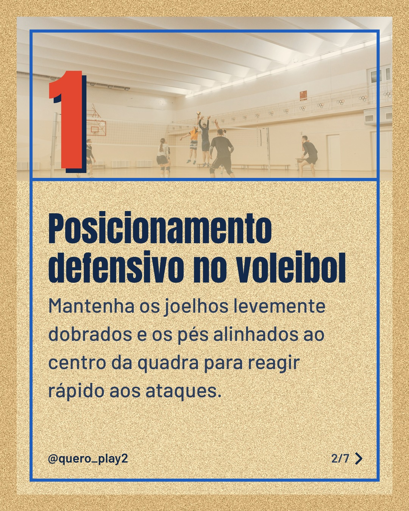
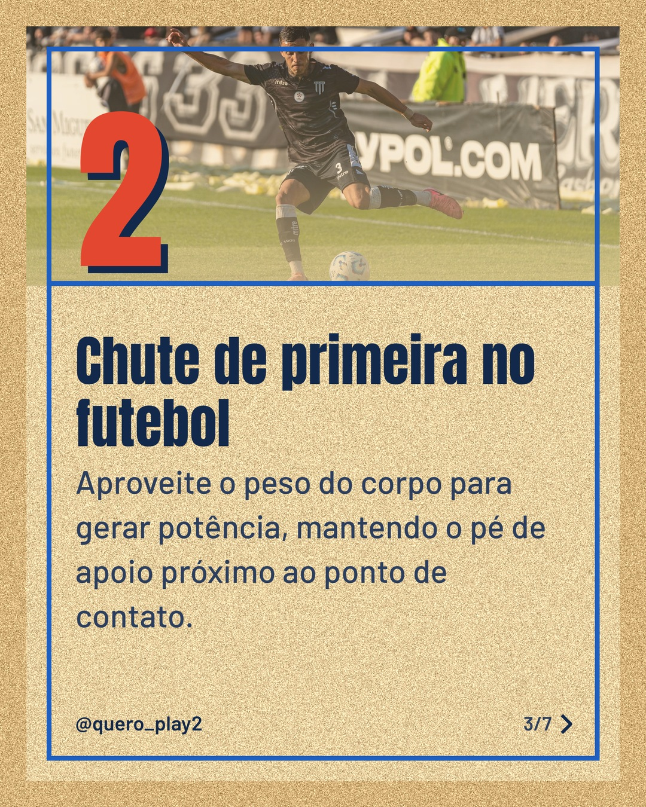
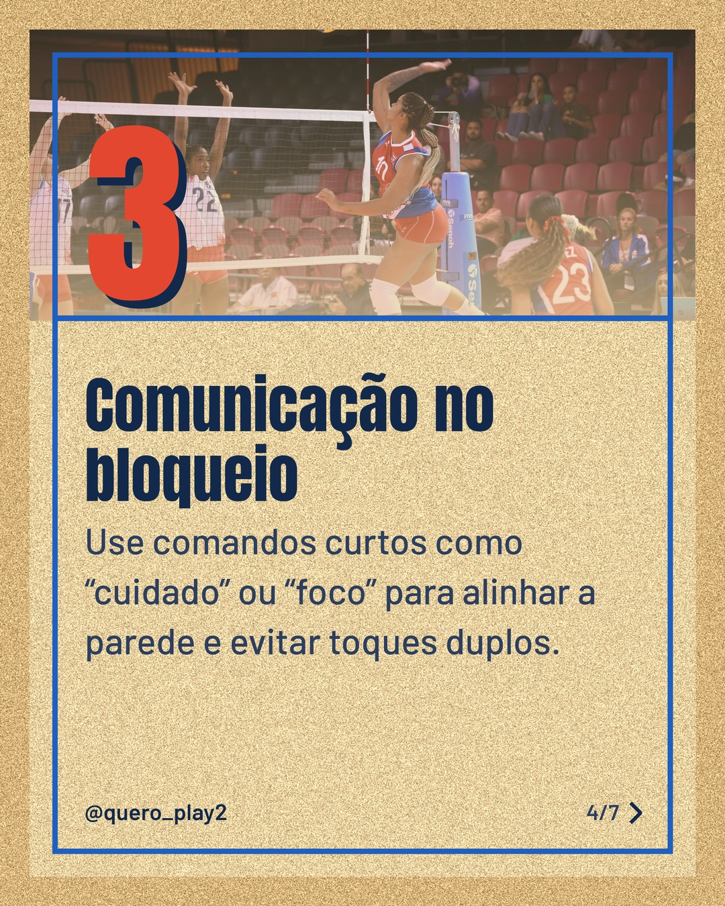
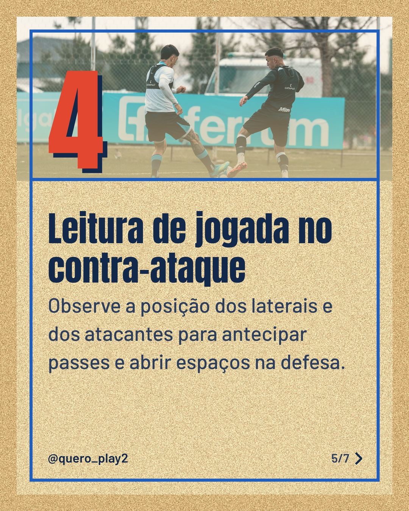
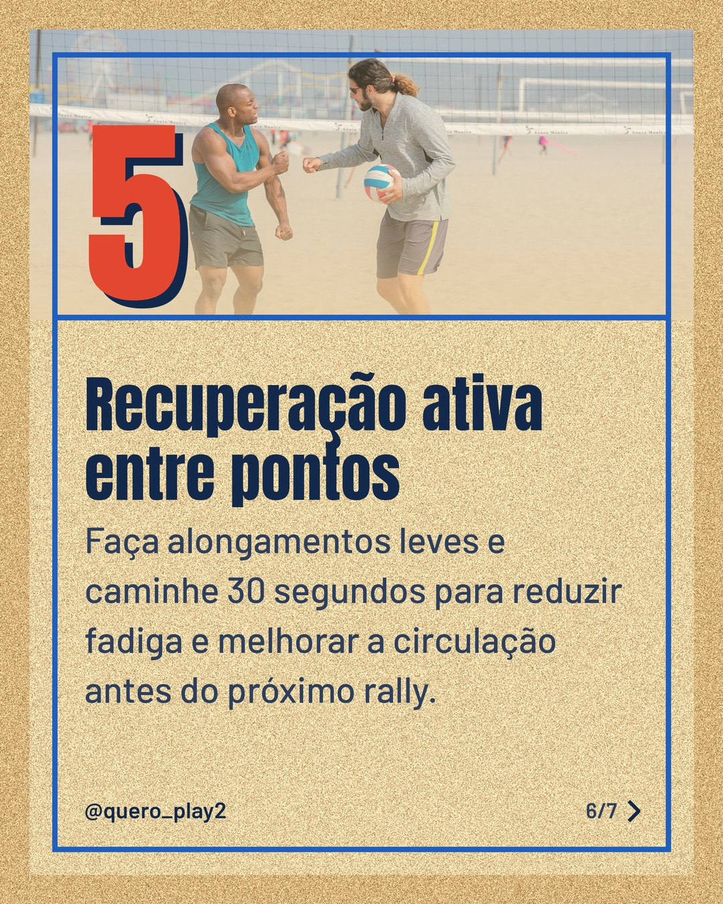
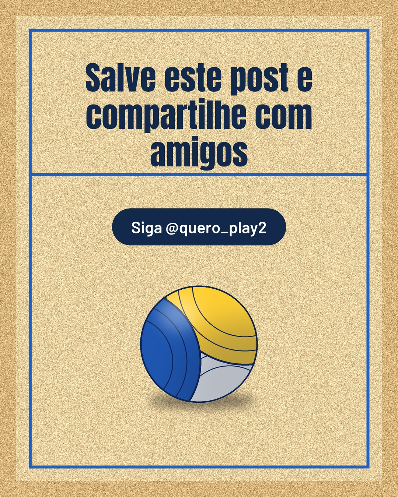

# areia

**Status:** aguardando revisão · 7 slides · gerado com `groq/openai/gpt-oss-120b`

      

## Legenda

> ⚽️ Você sabia que pequenos ajustes podem transformar seu desempenho? No futebol e no vôlei, detalhes fazem a diferença.
>
> 🔍 Cada slide traz uma dica prática que você pode aplicar agora mesmo nos treinos ou partidas. Basta seguir o passo a passo.
>
> 💡 Arraste para o lado e descubra os segredos que os profissionais usam. Gostou? Salve, comente e marque quem precisa ver isso!
>
> 🚀 Continue acompanhando para mais curiosidades e estratégias que vão elevar seu jogo.
>
> 📷 Fotos: Dr. Mohammad  Hoque, Pavel Danilyuk, Franco Monsalvo, Heriberto Jahir Medina e RDNE Stock project (Pexels)
>
> #futebol #volei #curiosidades #esporte #dicas #treinamento #performance #taticas #jogadores #historias

---
**Quer mudar algo?** Edite o `legenda.txt` para trocar a legenda, ou o `post.json` para trocar os textos dos slides (depois rode `python main.py redesenhar 2026-11-10_163022`).
Foto não combinou? `python main.py trocar-foto 2026-11-10_163022 N` (0 = capa, 1, 2... = slides).
Para descartar este post, apague esta pasta.
