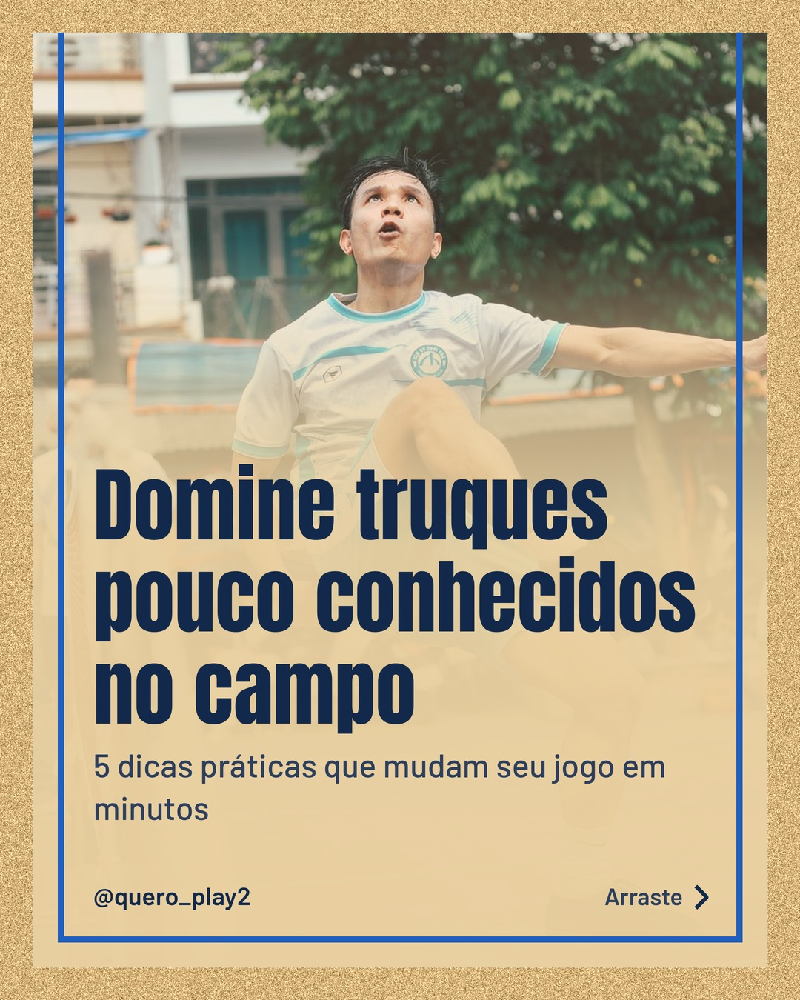
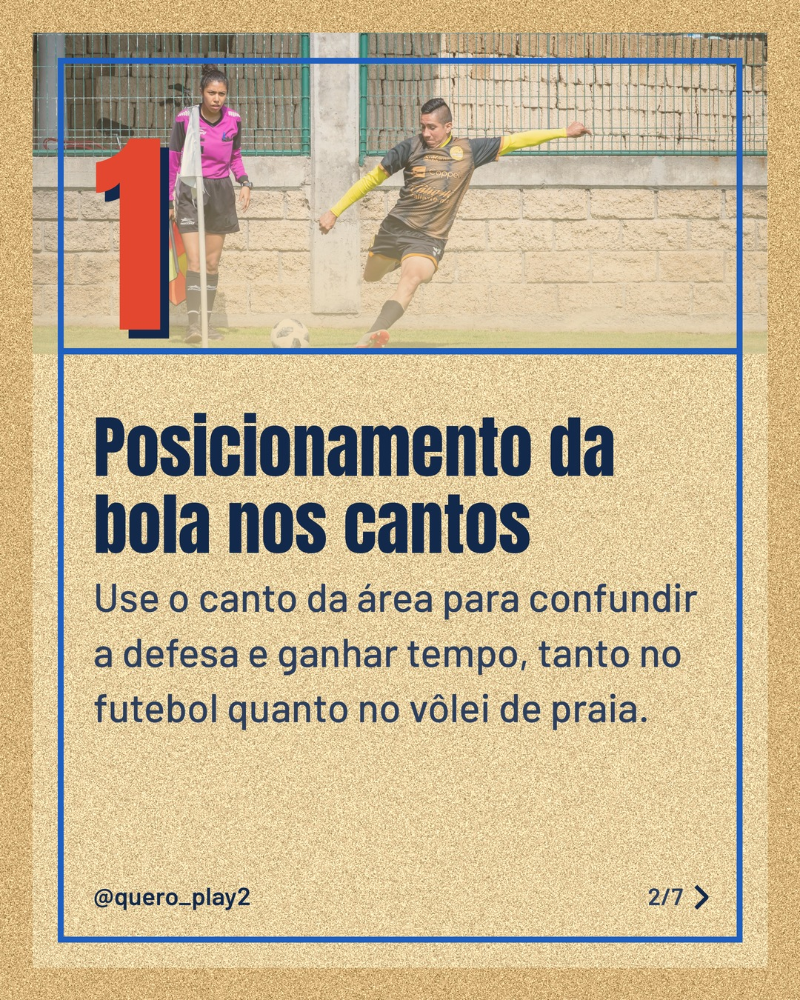
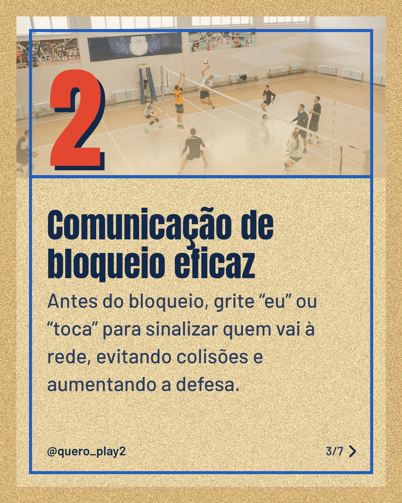
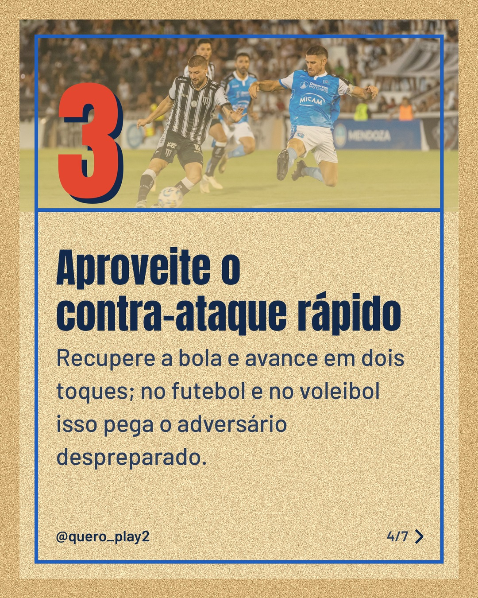
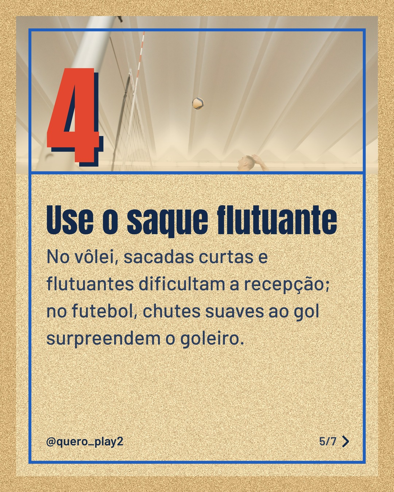
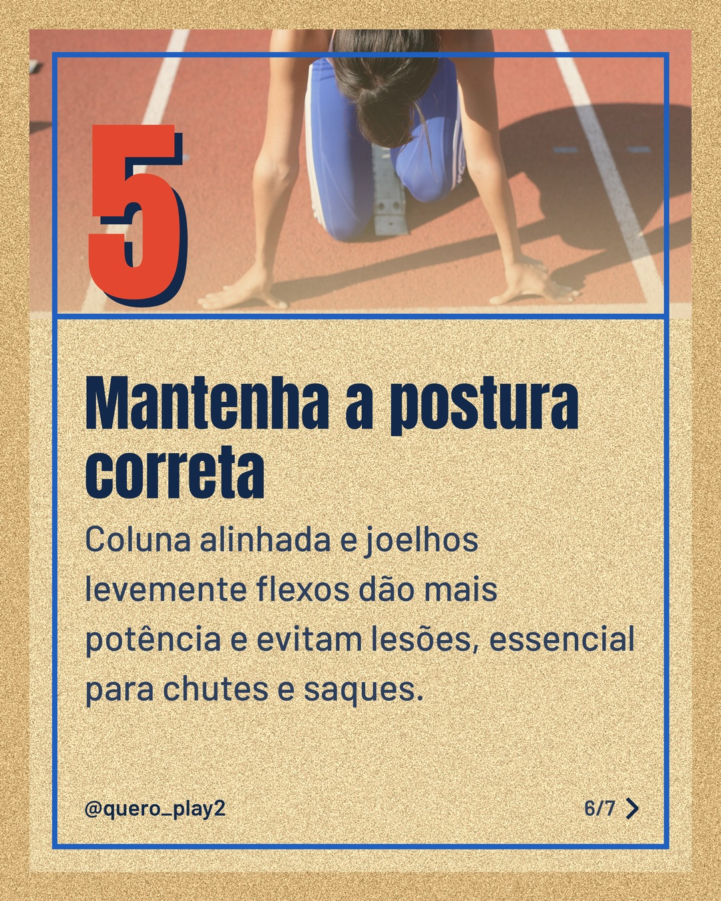

# areia

**Status:** aguardando revisão · 7 slides · gerado com `groq/openai/gpt-oss-120b`

      

## Legenda

> Você sabia que pequenos ajustes podem transformar seu desempenho no futebol e no vôlei? 🚀
> Deslize para a esquerda e descubra cada dica prática, fácil de aplicar nos treinos e jogos.
> Curtiu? Deixe um comentário, marque quem vai usar essas táticas e siga para mais curiosidades!
>
> 📷 Fotos: Thang Nguyen, Israel Torres, Pavel Danilyuk, Franco Monsalvo e BOOM 💥 Photography (Pexels)
>
> #futebol #volei #curiosidades #dicaspraticas #esportes #treinamento #tática #contraataque #postura #saque #bloqueio #futebolbrasileiro

---
**Quer mudar algo?** Edite o `legenda.txt` para trocar a legenda, ou o `post.json` para trocar os textos dos slides (depois rode `python main.py redesenhar 2026-11-11_162613`).
Foto não combinou? `python main.py trocar-foto 2026-11-11_162613 N` (0 = capa, 1, 2... = slides).
Para descartar este post, apague esta pasta.
