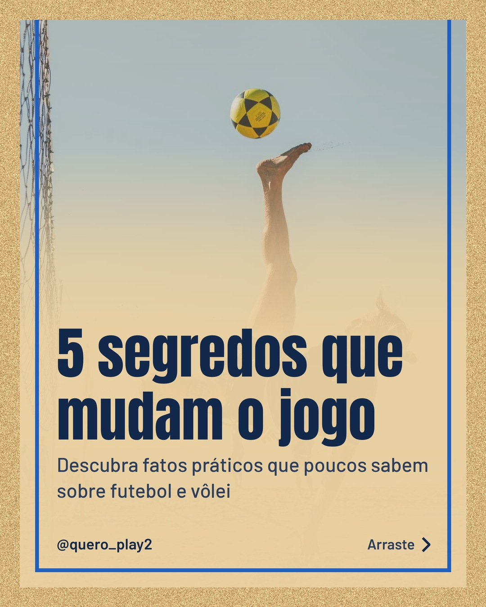
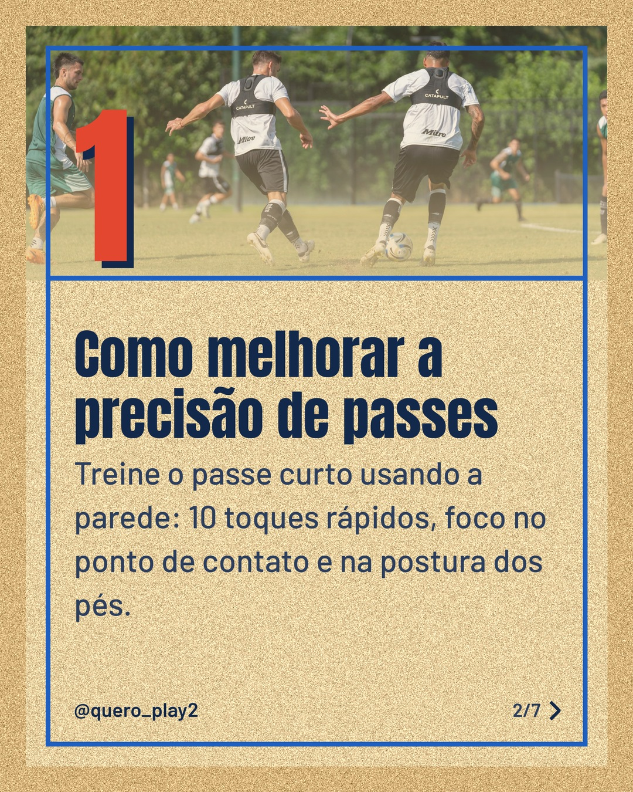
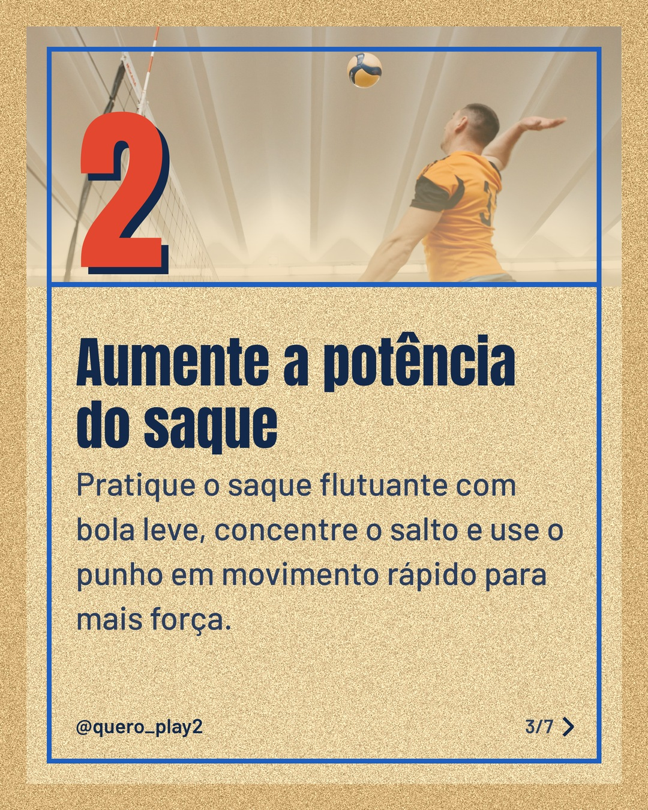
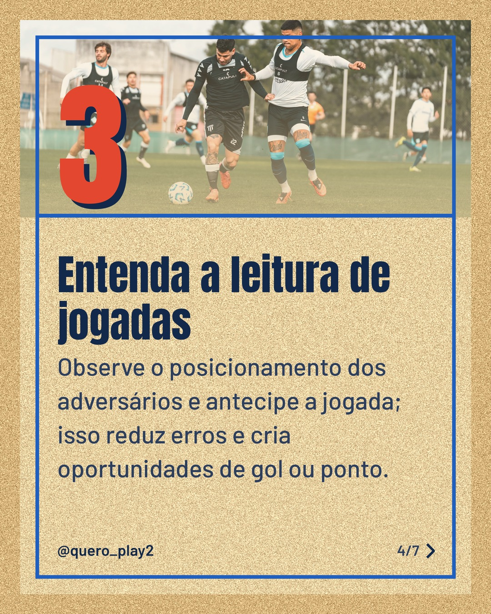
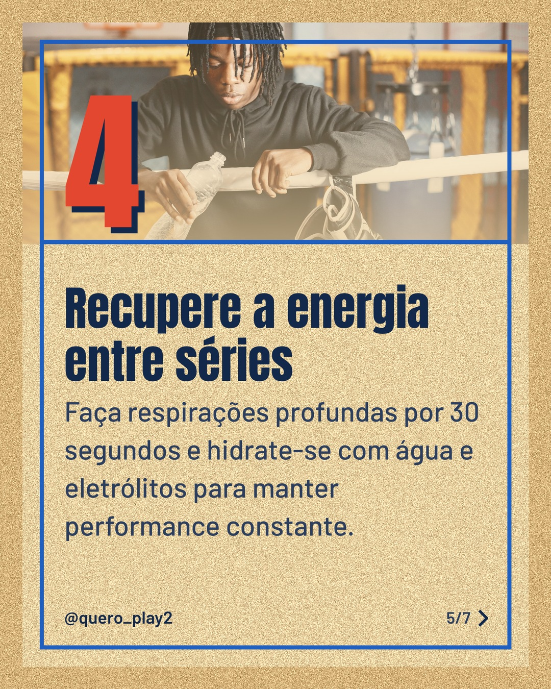
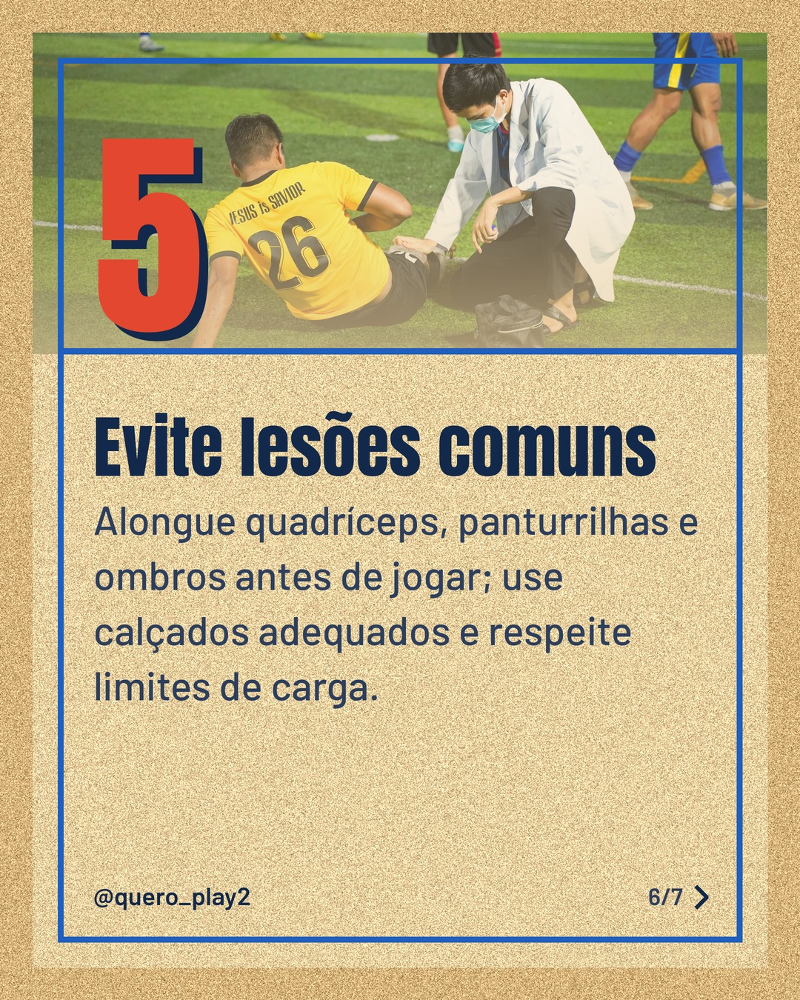
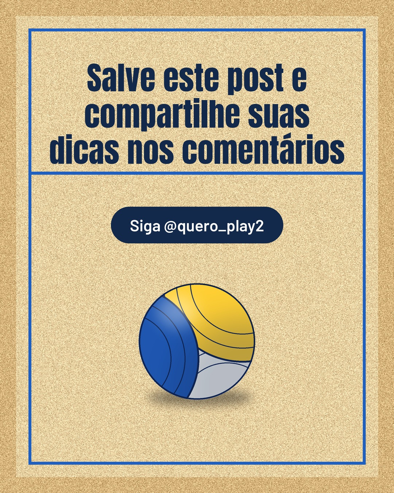

# areia

**Status:** aguardando revisão · 7 slides · gerado com `groq/openai/gpt-oss-120b`

      

## Legenda

> Você sabia que pequenos ajustes podem transformar seu desempenho no futebol e no vôlei? ⚽️🏐
>
> Deslize para o lado e descubra dicas práticas que você pode aplicar hoje nos treinos. 🔄
>
> Curtiu? Deixe um comentário, salve para rever depois e siga para mais curiosidades! 👍💬
>
> 📷 Fotos: Ezequiel Milano, Franco Monsalvo, Pavel Danilyuk, Gustavo Fring e Quyn Phạm (Pexels)
>
> #futebol #volei #curiosidades #esportes #dicasdesporte #treino #performance #bola #atletismo

---
**Quer mudar algo?** Edite o `legenda.txt` para trocar a legenda, ou o `post.json` para trocar os textos dos slides (depois rode `python main.py redesenhar 2026-11-12_164402`).
Foto não combinou? `python main.py trocar-foto 2026-11-12_164402 N` (0 = capa, 1, 2... = slides).
Para descartar este post, apague esta pasta.
