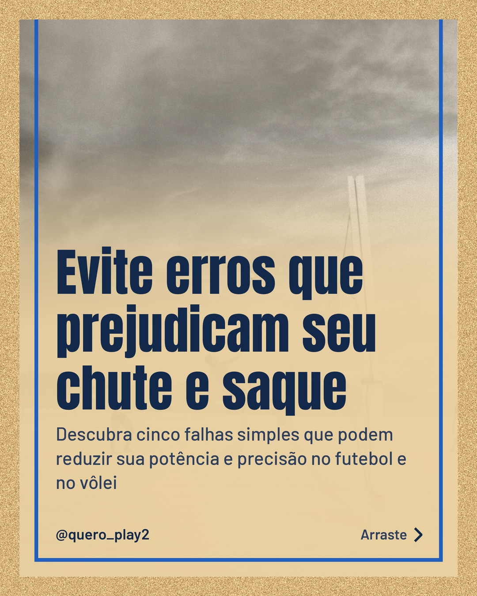
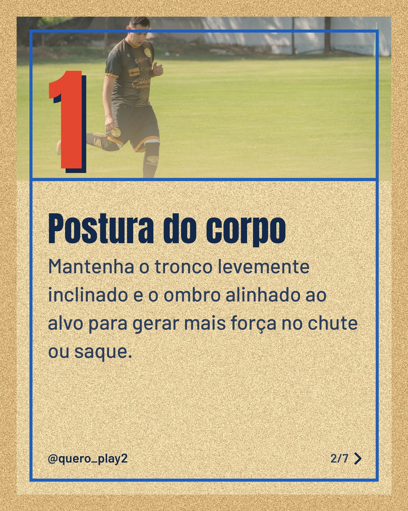
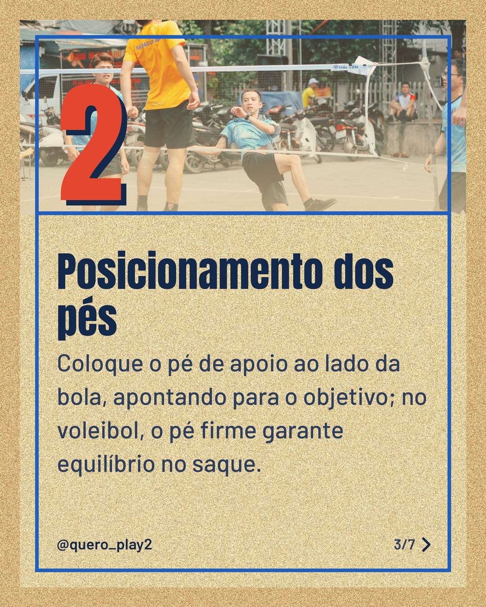
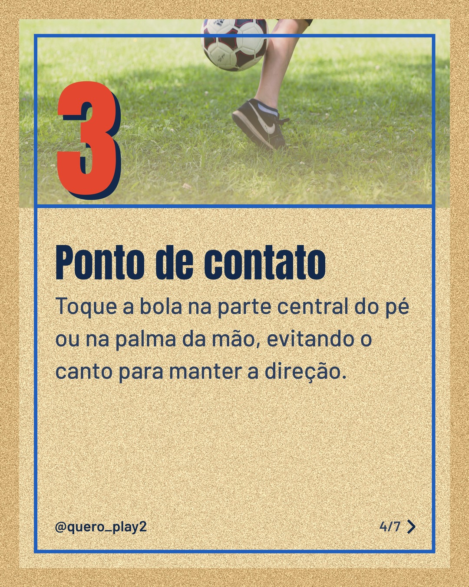
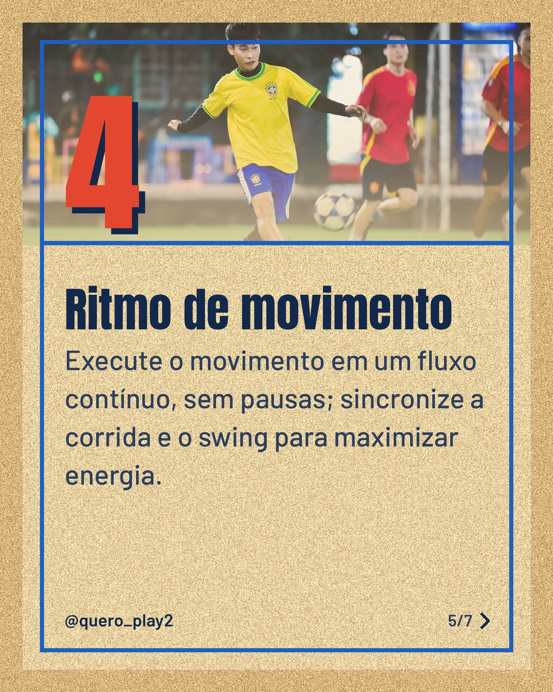
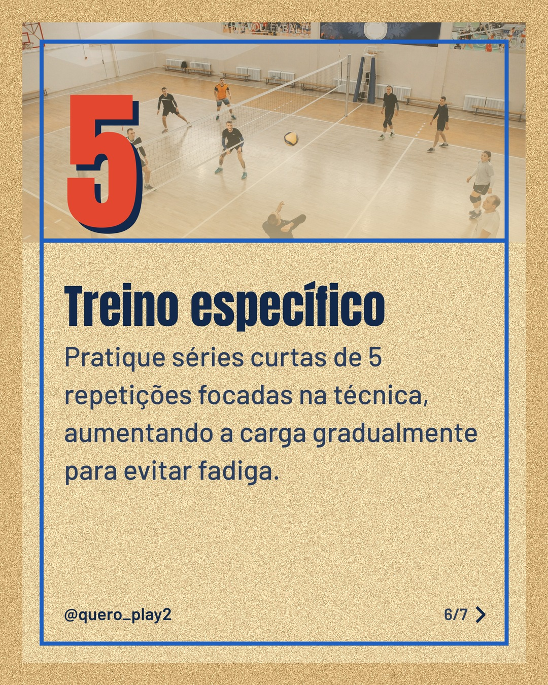

# areia

**Status:** aguardando revisão · 7 slides · gerado com `groq/openai/gpt-oss-120b`

      

## Legenda

> ⚽️ Já percebeu que pequenos detalhes podem mudar tudo no chute e no saque? 
>
> 📈 No primeiro slide mostro a postura ideal, depois falamos sobre onde colocar os pés, o ponto exato de contato, o ritmo do movimento e, por fim, um treino prático. 
>
> Deslize para aprender cada dica e eleve seu desempenho em campo ou quadra! 
>
> 💬 Comente qual erro você mais comete e siga para mais curiosidades esportivas.
>
> 📷 Fotos: joaquin Farias Plaza, Israel Torres, Thang Nguyen, Markus Spiske, ANH LÊ e Pavel Danilyuk (Pexels)
>
> #futebol #volei #dicasdesportivas #treinamento #potencial #tecnica #esporte #chute #saque #performance #curiosidades #athlete

---
**Quer mudar algo?** Edite o `legenda.txt` para trocar a legenda, ou o `post.json` para trocar os textos dos slides (depois rode `python main.py redesenhar 2026-11-13_162557`).
Foto não combinou? `python main.py trocar-foto 2026-11-13_162557 N` (0 = capa, 1, 2... = slides).
Para descartar este post, apague esta pasta.
