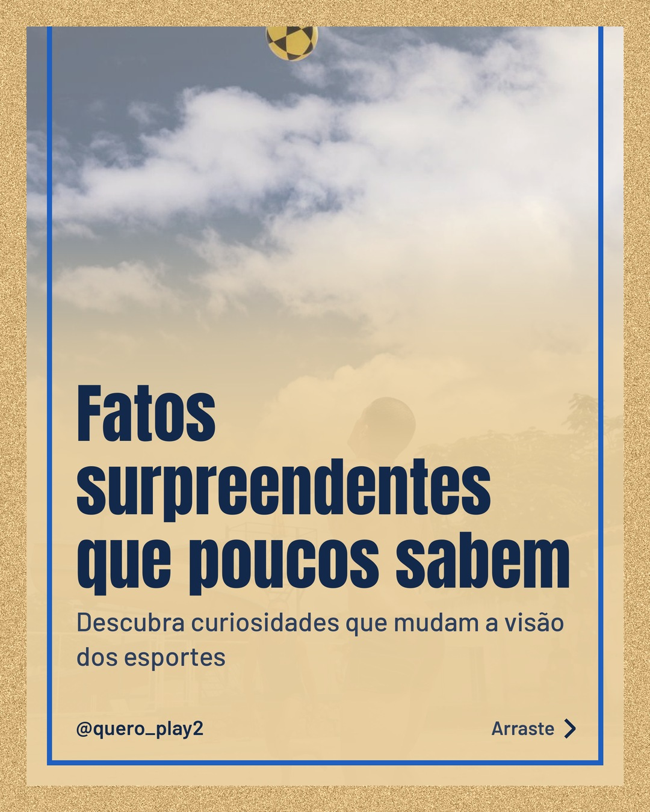
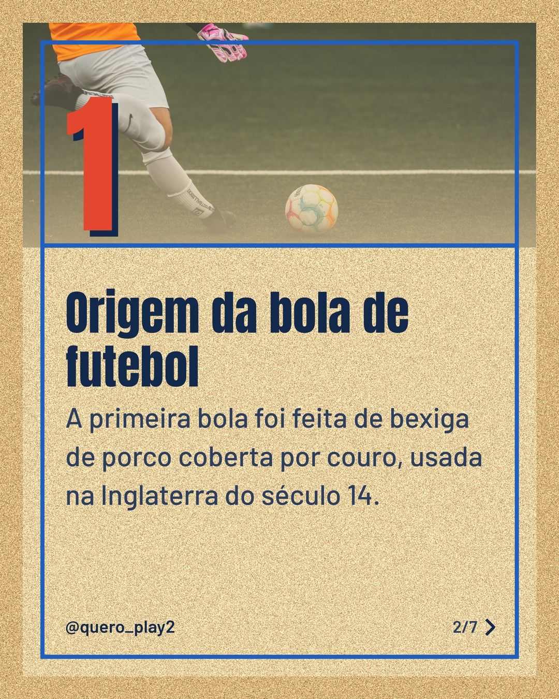
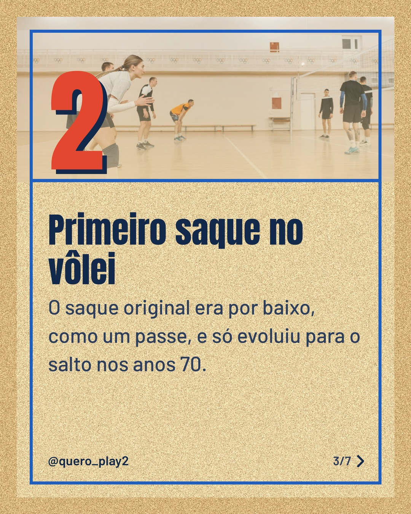
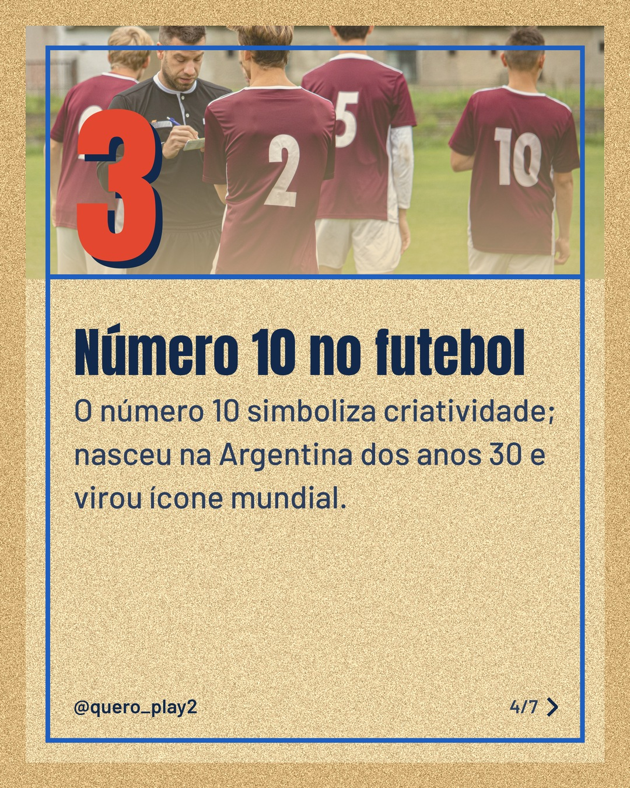
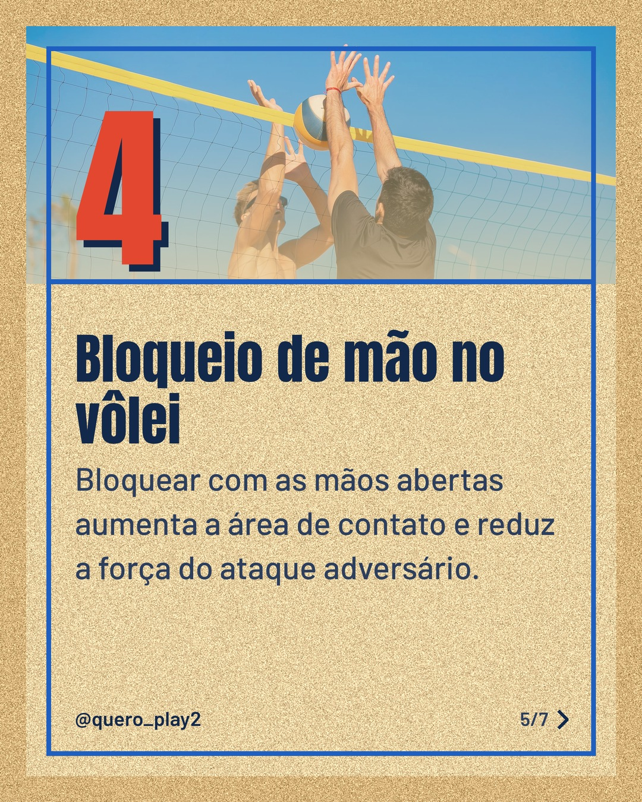

# areia

**Status:** aguardando revisão · 7 slides · gerado com `groq/openai/gpt-oss-120b`

      

## Legenda

> Você sabia que a bola de futebol começou como uma bexiga de porco? 🤔
>
> No vôlei, o saque evoluiu muito desde o simples passe por baixo. 🏐
>
> Arraste para o lado e descubra mais curiosidades que vão impressionar sua galera! Marque alguém nos comentários e siga para não perder nada. 🚀
>
> 📷 Fotos: Priscila Almeida, Omar Ramadan, Pavel Danilyuk, Robo Michalec, Kampus Production e BOOM 💥 Photography (Pexels)
>
> #futebol #curiosidades #volei #esporte #historia #fatos #incrivel #aprendizado #sportlife #curiosidadeesportiva

---
**Quer mudar algo?** Edite o `legenda.txt` para trocar a legenda, ou o `post.json` para trocar os textos dos slides (depois rode `python main.py redesenhar 2026-11-14_145010`).
Foto não combinou? `python main.py trocar-foto 2026-11-14_145010 N` (0 = capa, 1, 2... = slides).
Para descartar este post, apague esta pasta.
