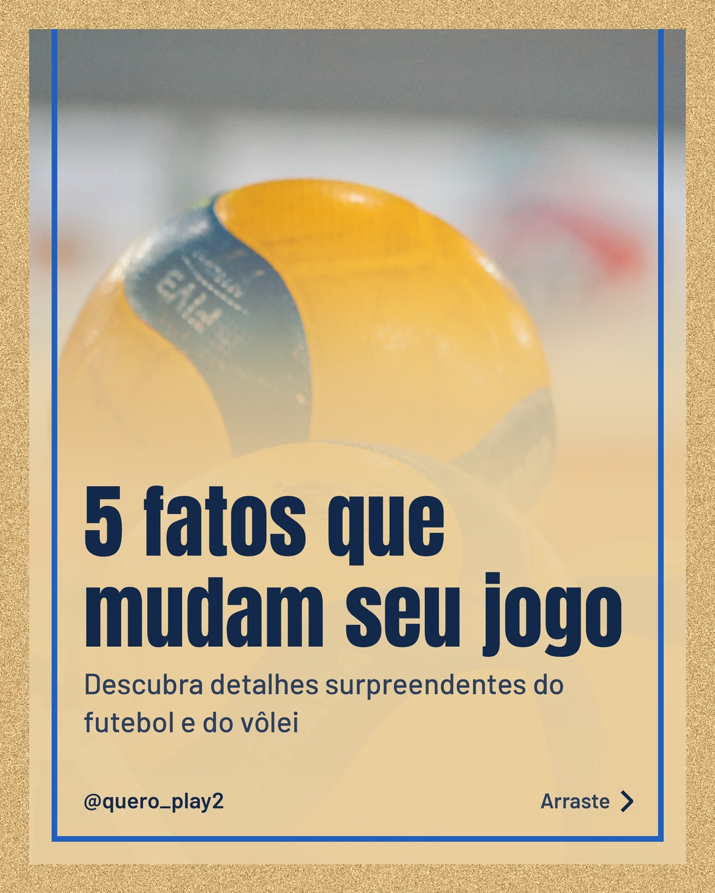
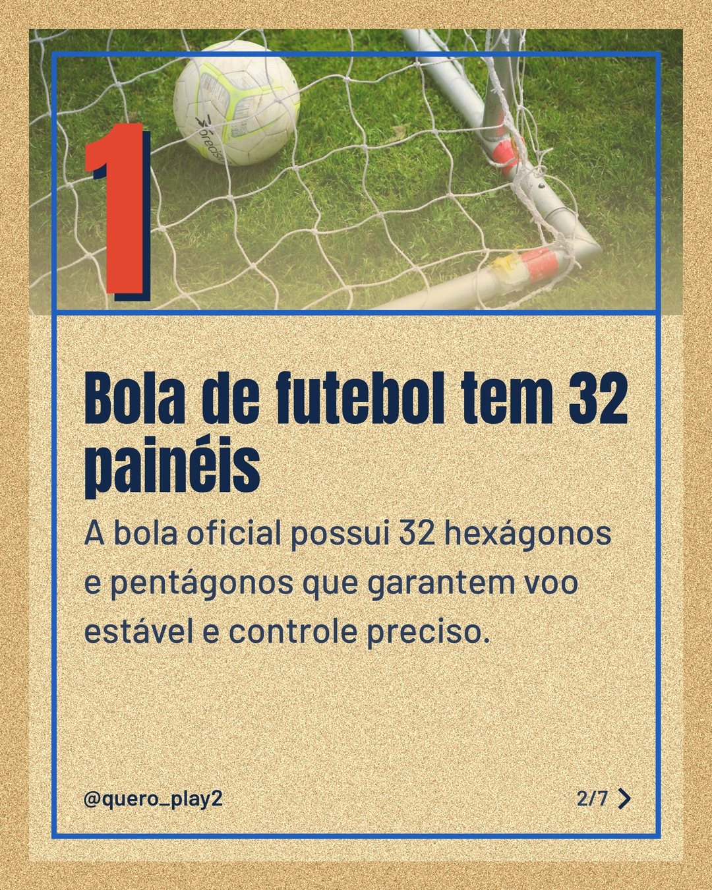
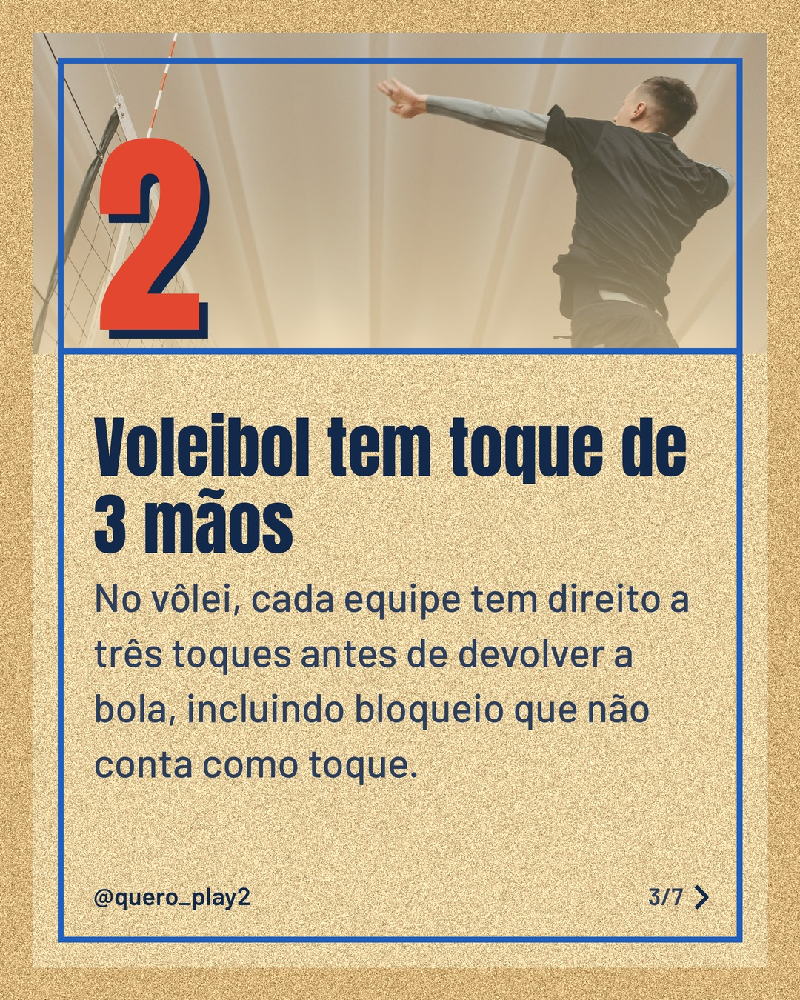
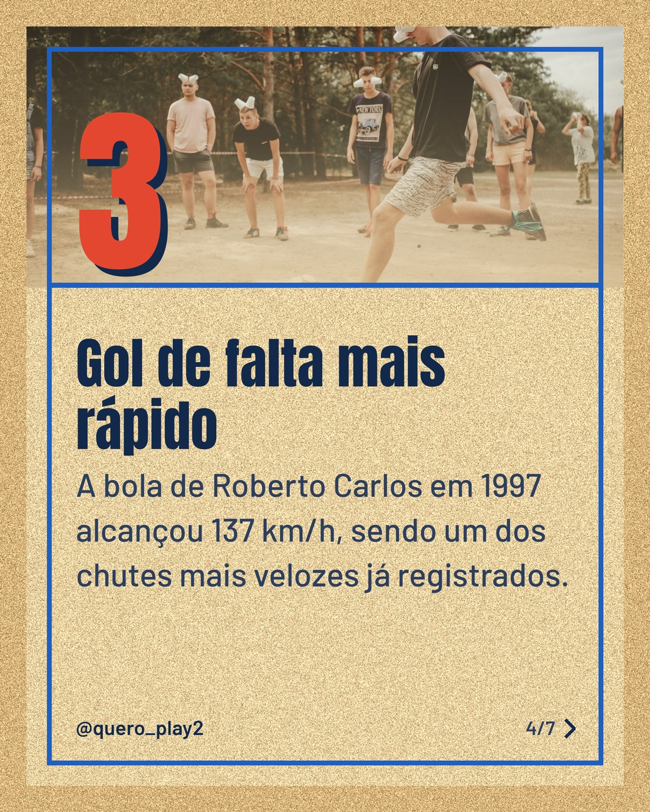
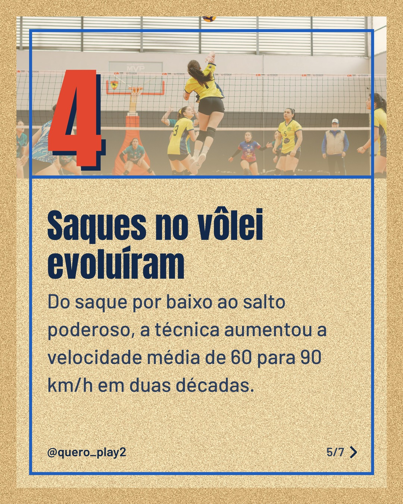
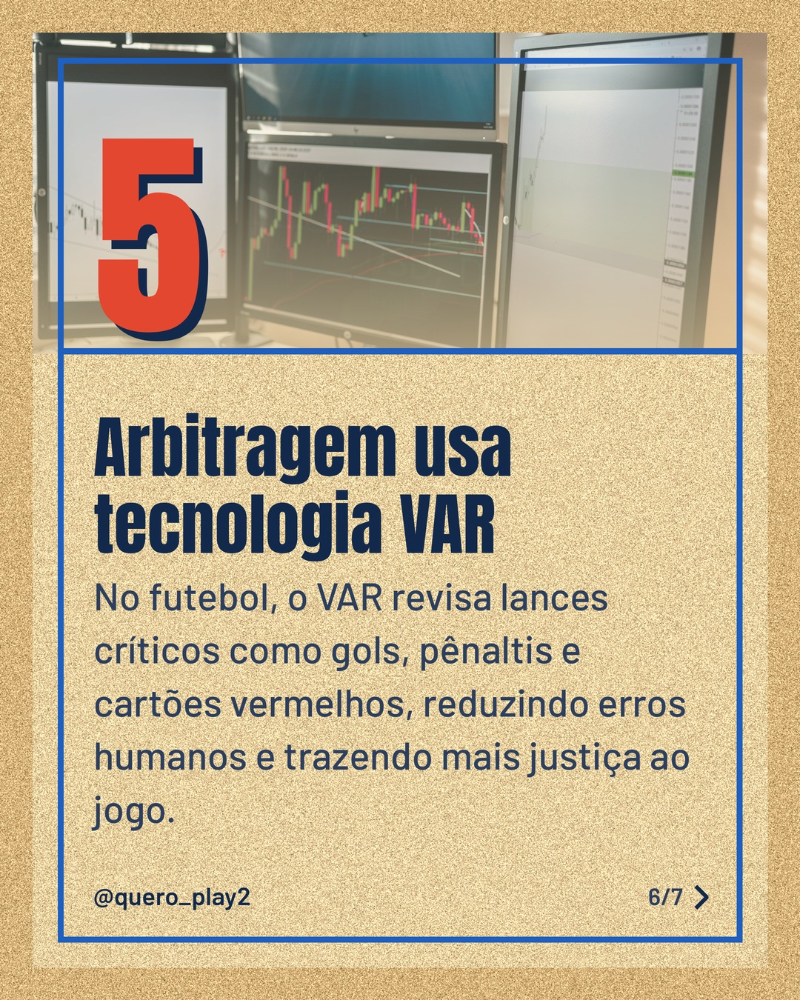
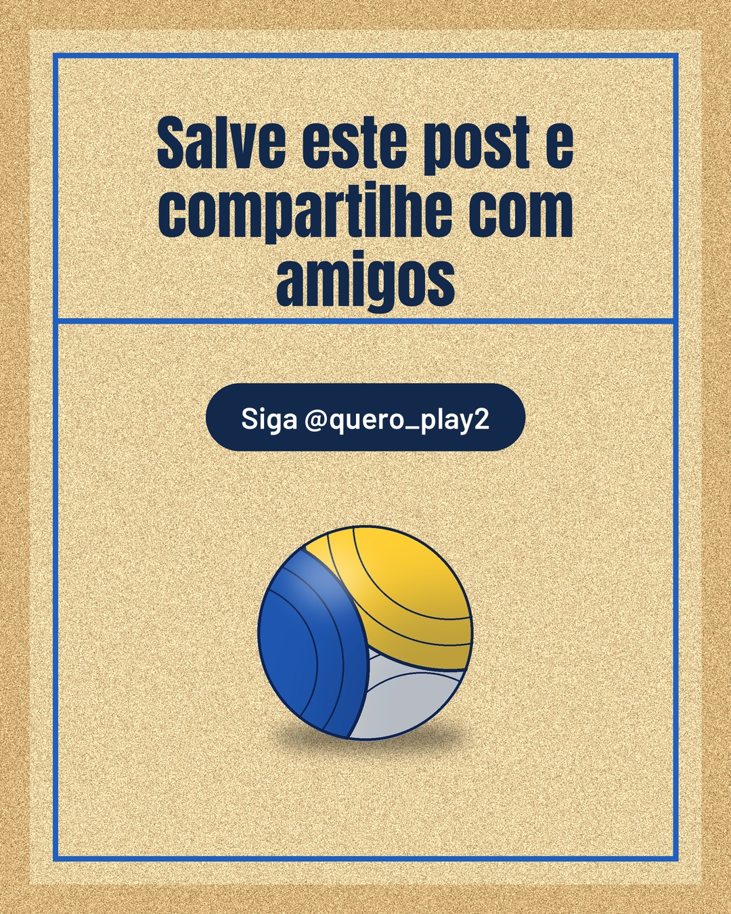

# areia

**Status:** aguardando revisão · 7 slides · gerado com `groq/openai/gpt-oss-120b`

      

## Legenda

> Você sabia que a bola de futebol tem 32 painéis e que o vôlei permite três toques? 🤔
>
> Neste carrossel trouxe curiosidades que mudam a forma de ver esses esportes. Deslize para descobrir!
>
> Curtiu? Deixe seu comentário, siga a página e salve para lembrar dessas dicas! 📲
>
> 📷 Fotos: ENIO ENGENHEIRO, atelierbyvineeth . . ., Pavel Danilyuk, Danik Prihodko, MrP13 e AlphaTradeZone (Pexels)
>
> #futebol #volei #curiosidades #esporte #bola #jogadores #tecnologia #VAR #saque #gol

---
**Quer mudar algo?** Edite o `legenda.txt` para trocar a legenda, ou o `post.json` para trocar os textos dos slides (depois rode `python main.py redesenhar 2026-11-15_154015`).
Foto não combinou? `python main.py trocar-foto 2026-11-15_154015 N` (0 = capa, 1, 2... = slides).
Para descartar este post, apague esta pasta.
