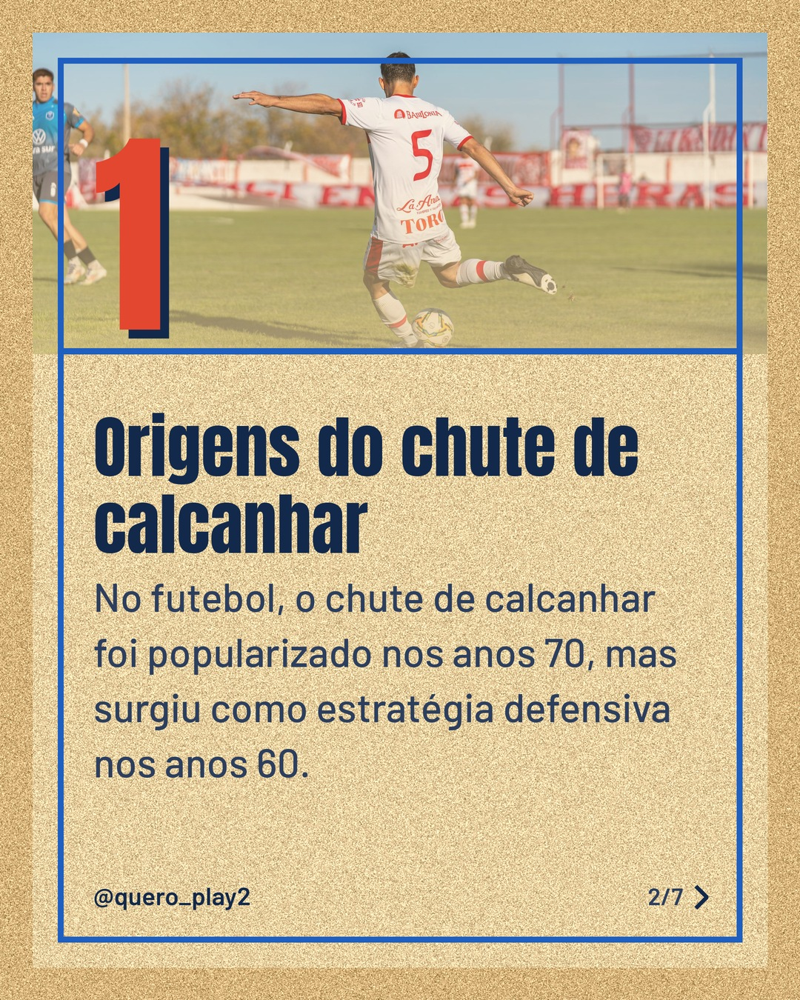
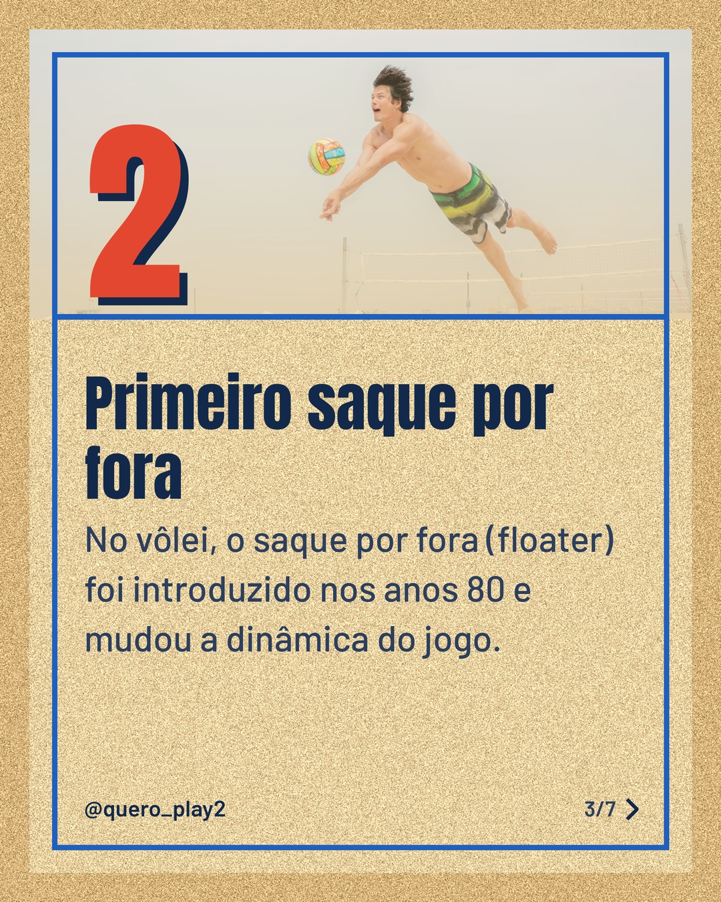
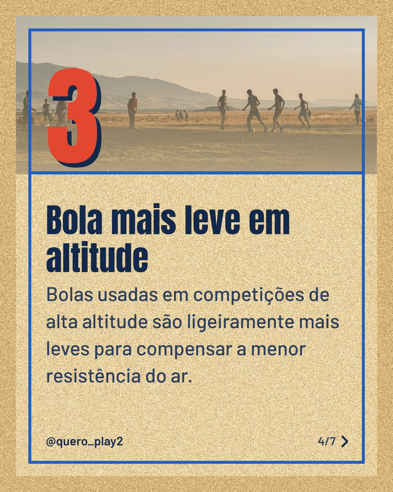
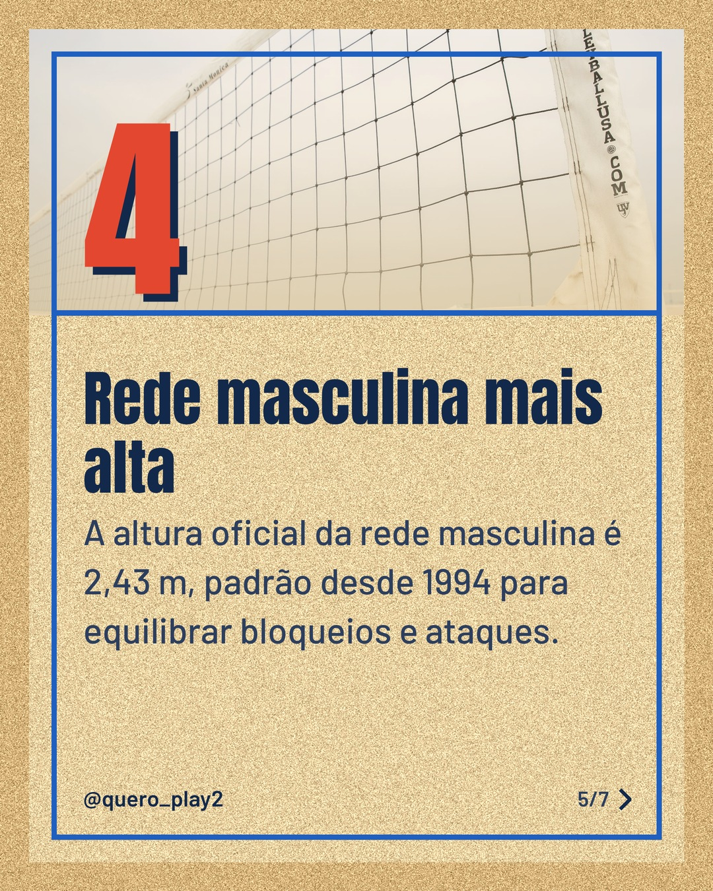
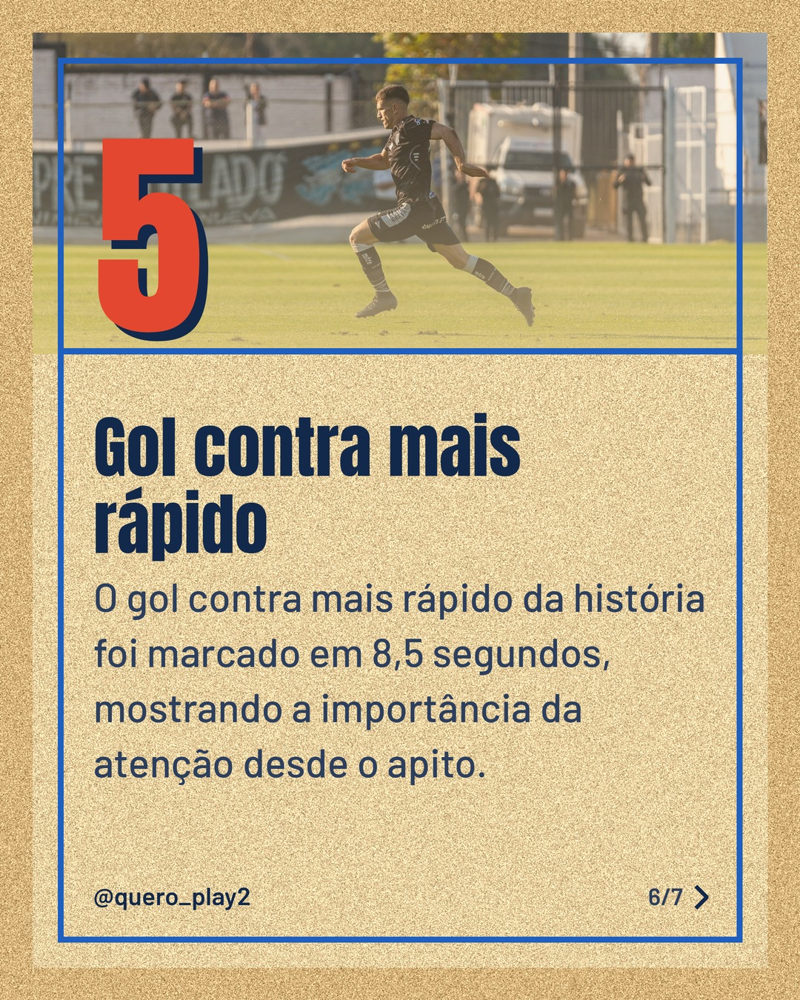

# areia

**Status:** aguardando revisão · 7 slides · gerado com `groq/openai/gpt-oss-120b`

      

## Legenda

> Você sabia que o chute de calcanhar tem origem defensiva? ⚽️
>
> E que o saque por fora revolucionou o vôlei nos anos 80? 🏐
>
> Deslize para descobrir mais curiosidades que poucos conhecem.
>
> Curtiu? Salve, comente e siga para mais fatos incríveis!
>
> 📷 Fotos: FOXES IABC, Franco Monsalvo, RDNE Stock project e mohammad majid (Pexels)
>
> #futebol #volei #curiosidades #esporte #futebolcuriosidades #voelicuriosidades #fatosdesportivos #aprenda #sportfacts #football #volleyball #conhecimento

---
**Quer mudar algo?** Edite o `legenda.txt` para trocar a legenda, ou o `post.json` para trocar os textos dos slides (depois rode `python main.py redesenhar 2026-11-16_185036`).
Foto não combinou? `python main.py trocar-foto 2026-11-16_185036 N` (0 = capa, 1, 2... = slides).
Para descartar este post, apague esta pasta.
