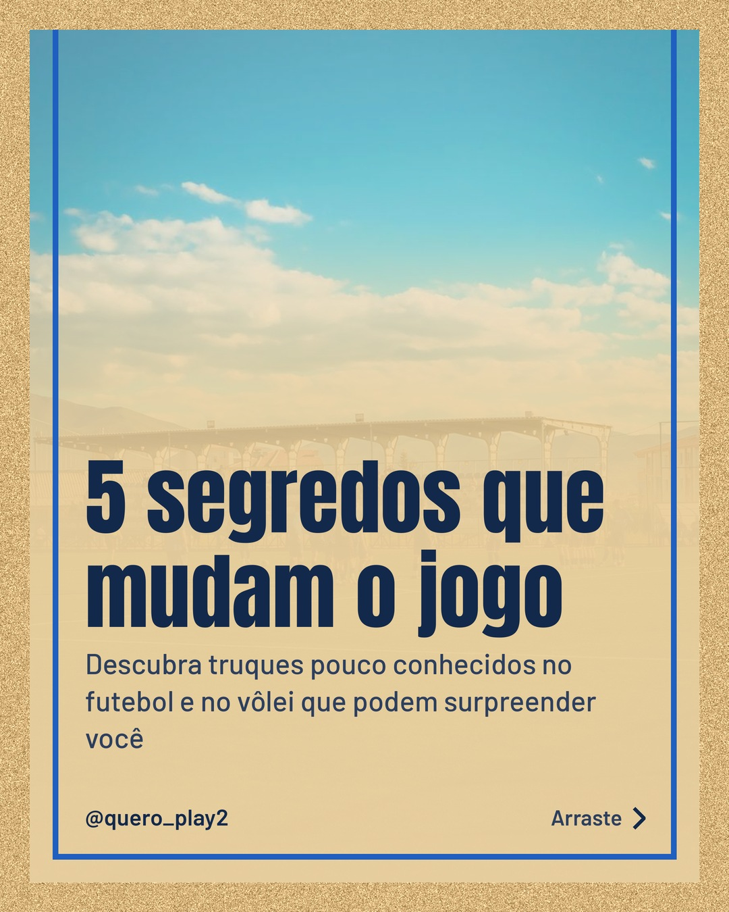
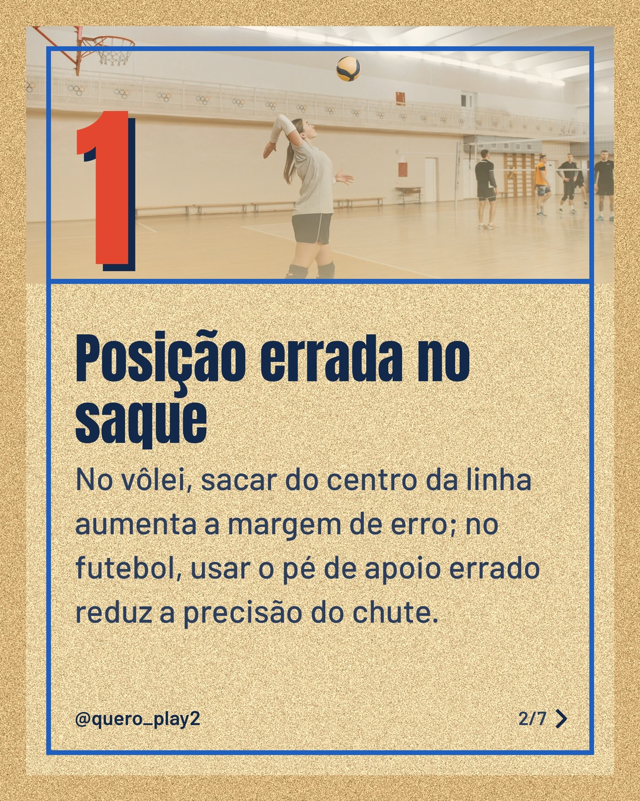
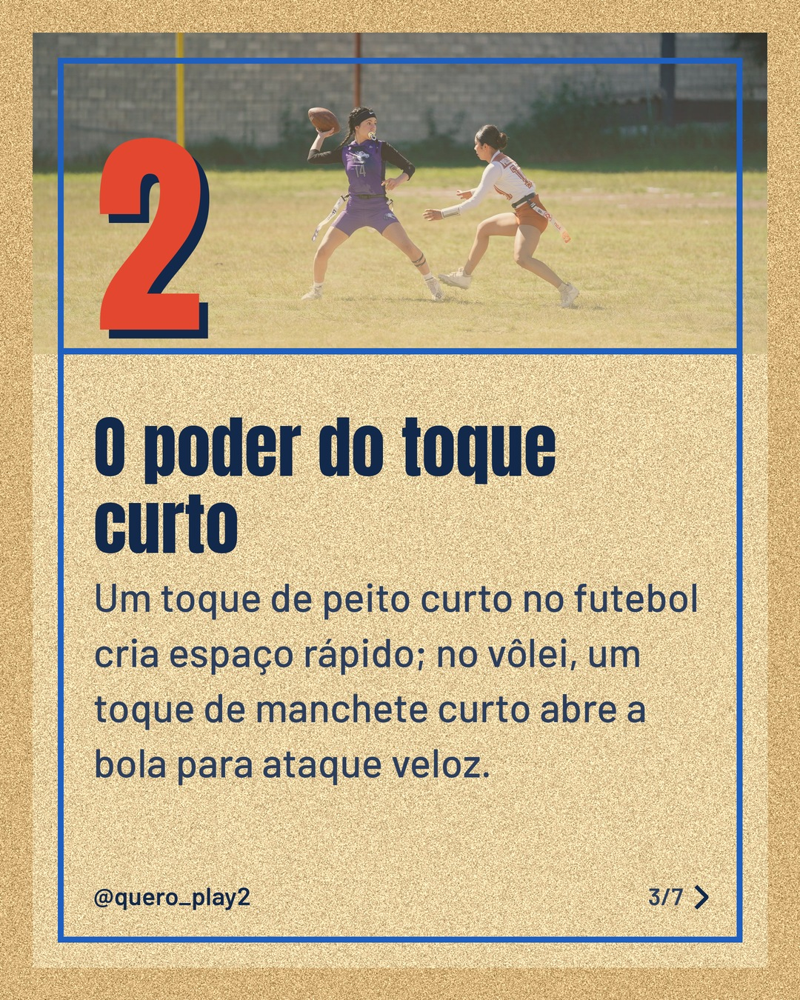
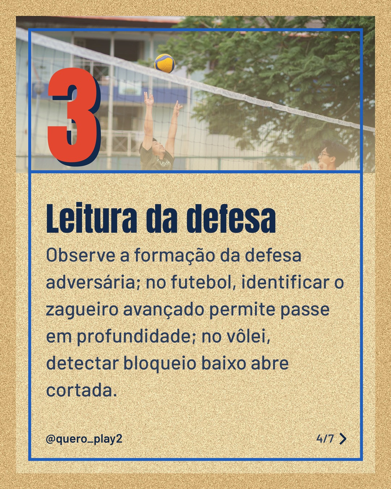
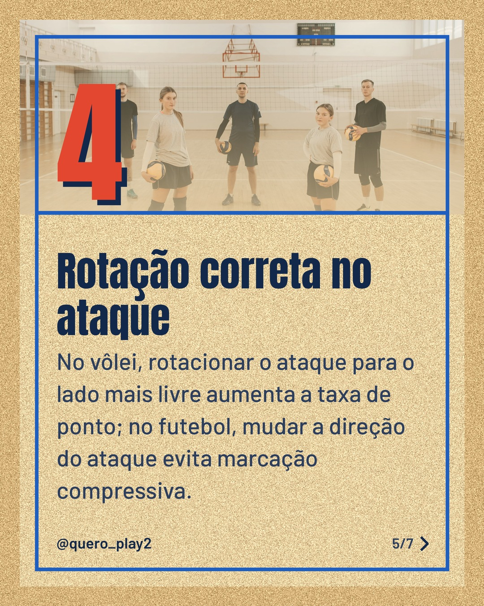
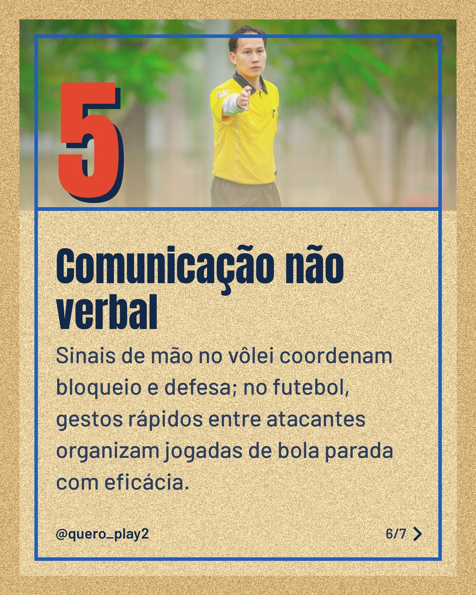

# areia

**Status:** aguardando revisão · 7 slides · gerado com `groq/openai/gpt-oss-120b`

      

## Legenda

> Você sabia que pequenos ajustes podem transformar seu desempenho no futebol e no vôlei? ⚽🏐
>
> Deslize para o lado e descubra cada dica prática que vai elevar seu jogo e impressionar os adversários. 👈
>
> Curtiu? Deixe um comentário, compartilhe com os amigos e siga a página para mais curiosidades esportivas! 🚀
>
> 📷 Fotos: Samet Kaplan 🇹🇷, Pavel Danilyuk, Willians Huerta, Biong Abdalla e Anh Lee (Pexels)
>
> #futebol #volei #curiosidades #esportes #dicasdeesporte #treinamento #jogada #aprendizado #passion #esportebrasil

---
**Quer mudar algo?** Edite o `legenda.txt` para trocar a legenda, ou o `post.json` para trocar os textos dos slides (depois rode `python main.py redesenhar 2026-11-17_174043`).
Foto não combinou? `python main.py trocar-foto 2026-11-17_174043 N` (0 = capa, 1, 2... = slides).
Para descartar este post, apague esta pasta.
