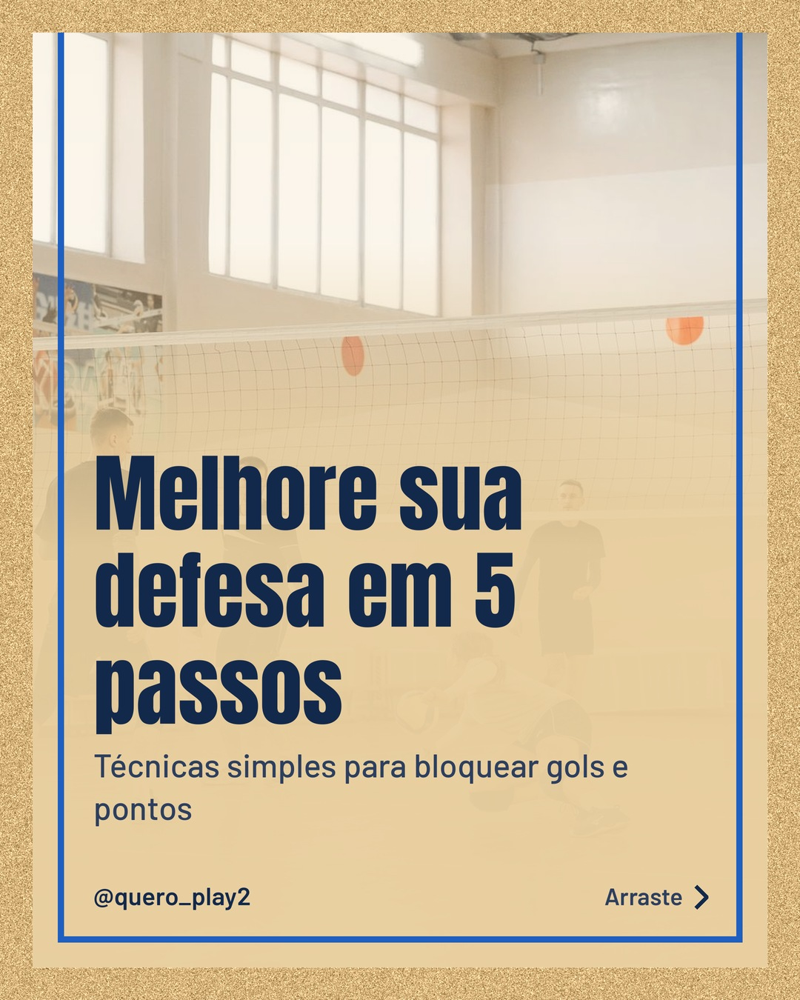
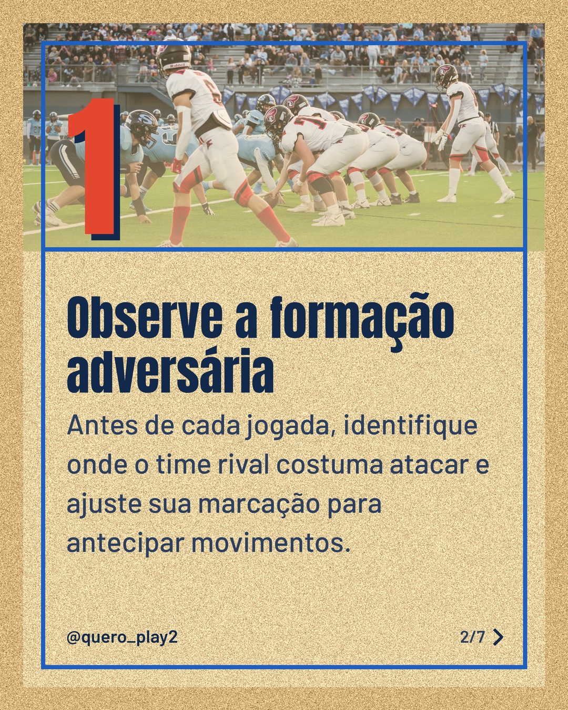
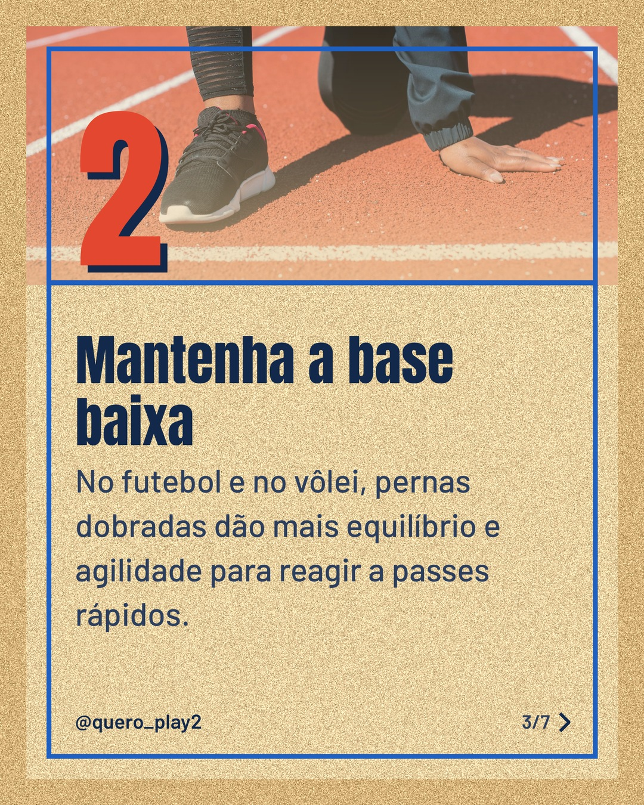
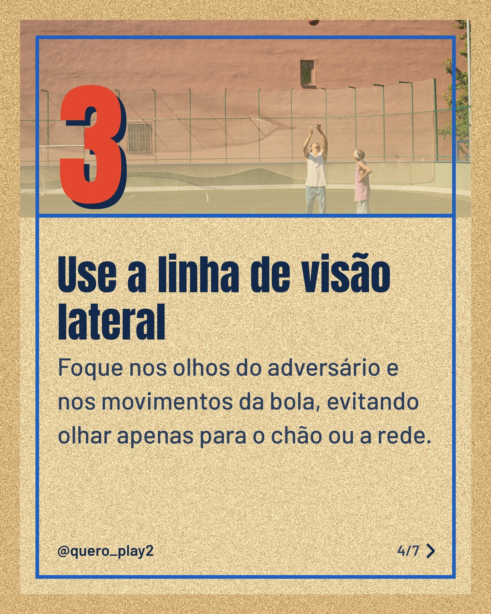
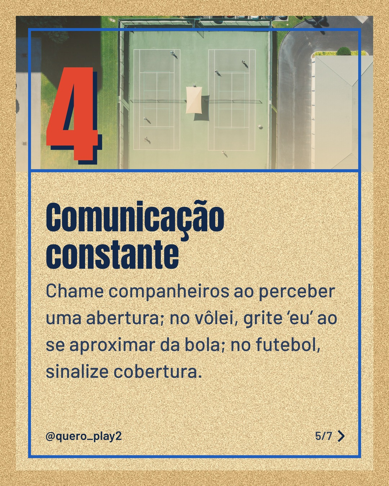
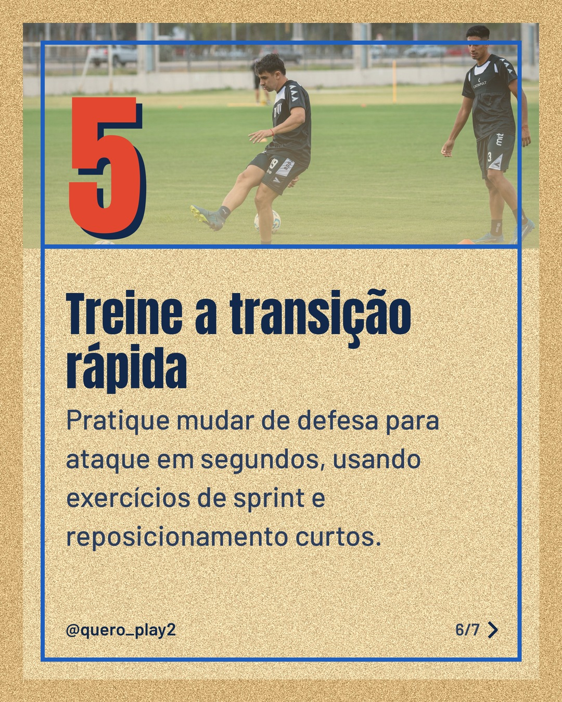
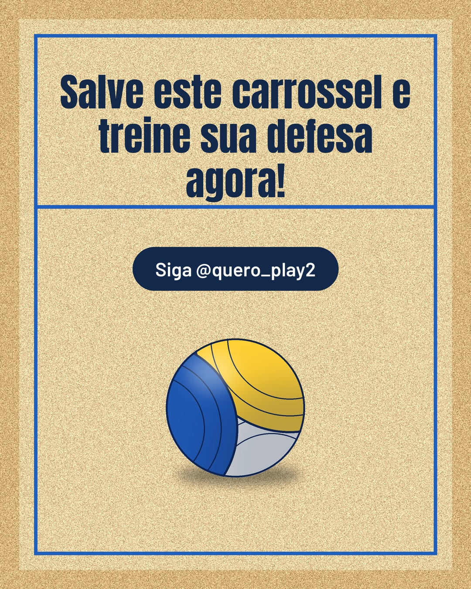

# areia

**Status:** aguardando revisão · 7 slides · gerado com `groq/openai/gpt-oss-120b`

      

## Legenda

> Descubra como melhorar sua defesa tanto no futebol quanto no vôlei com dicas práticas e fáceis de aplicar. 🚀
>
> Deslize para o lado e veja cada passo detalhado, do posicionamento à comunicação em quadra ou campo. 📖
>
> Curtiu? Salve, comente sua experiência e siga para mais curiosidades esportivas! 🙌
>
> 📷 Fotos: Pavel Danilyuk, Tim Mossholder, Mikhail Nilov, cottonbro studio, K e Franco Monsalvo (Pexels)
>
> #curiosidadesfutebol #curiosidadesvolei #futebol #volei #dicasdefesa #esporte #aprendizado #treinos #posicionamento #futebolbrasileiro

---
**Quer mudar algo?** Edite o `legenda.txt` para trocar a legenda, ou o `post.json` para trocar os textos dos slides (depois rode `python main.py redesenhar 2026-11-18_171440`).
Foto não combinou? `python main.py trocar-foto 2026-11-18_171440 N` (0 = capa, 1, 2... = slides).
Para descartar este post, apague esta pasta.
