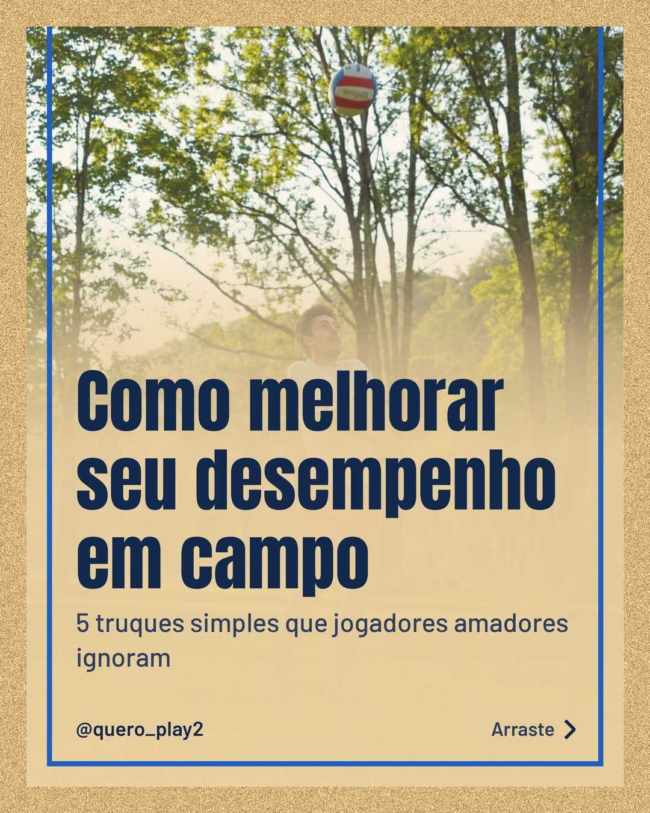
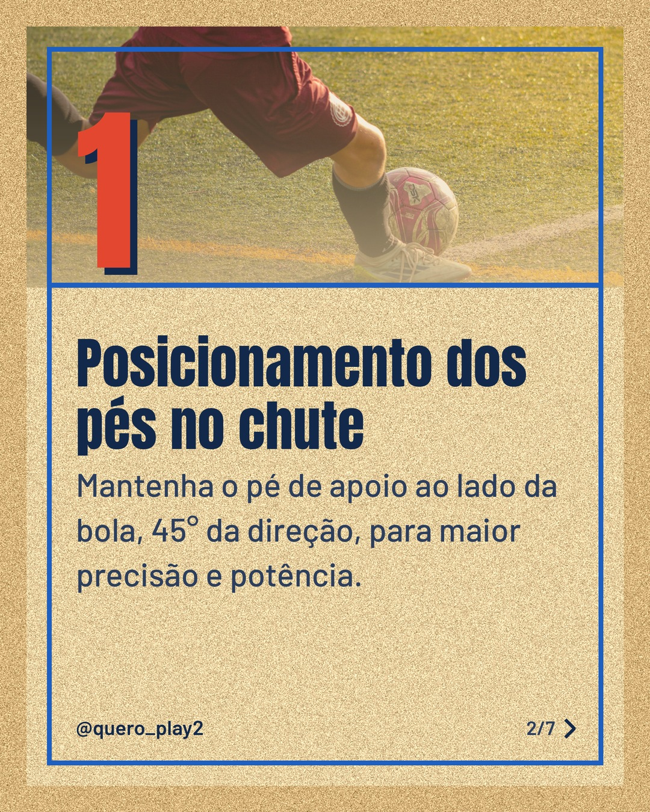
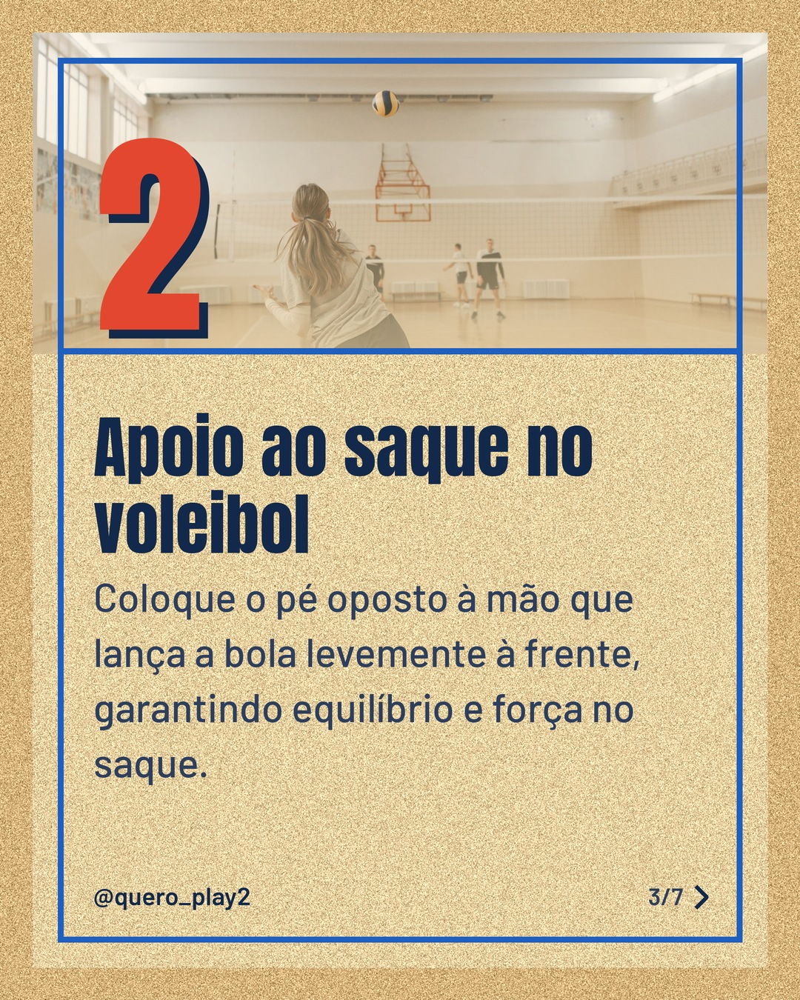
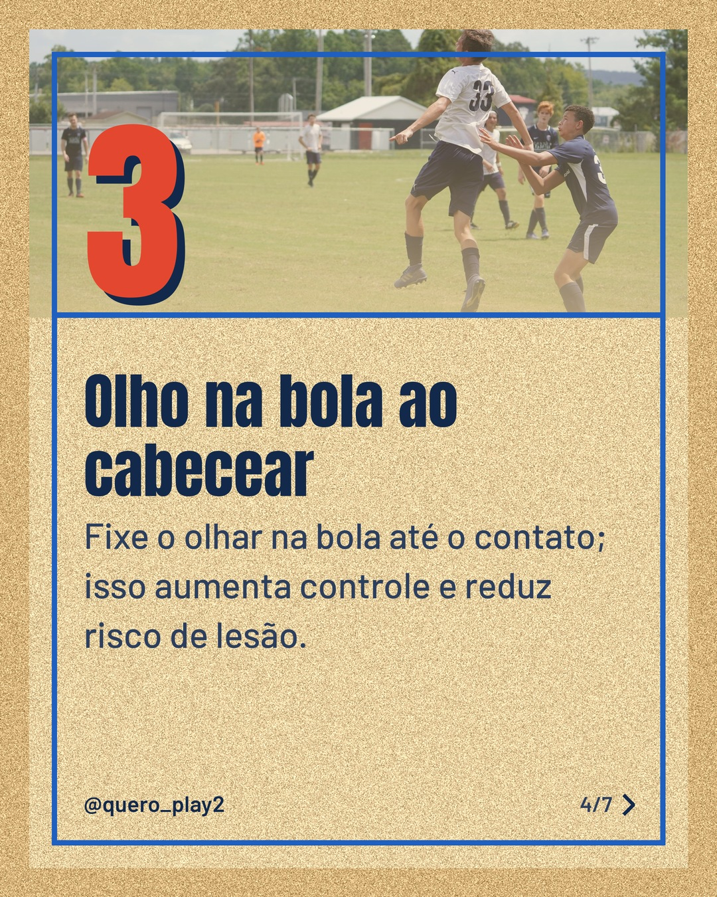
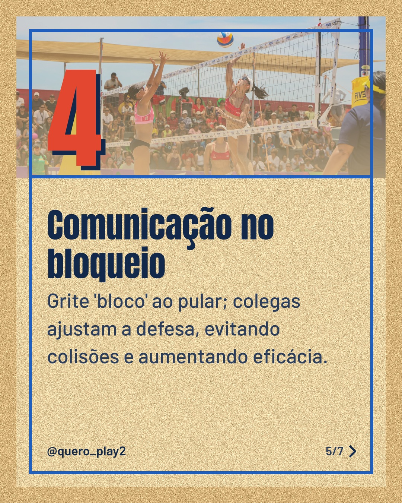
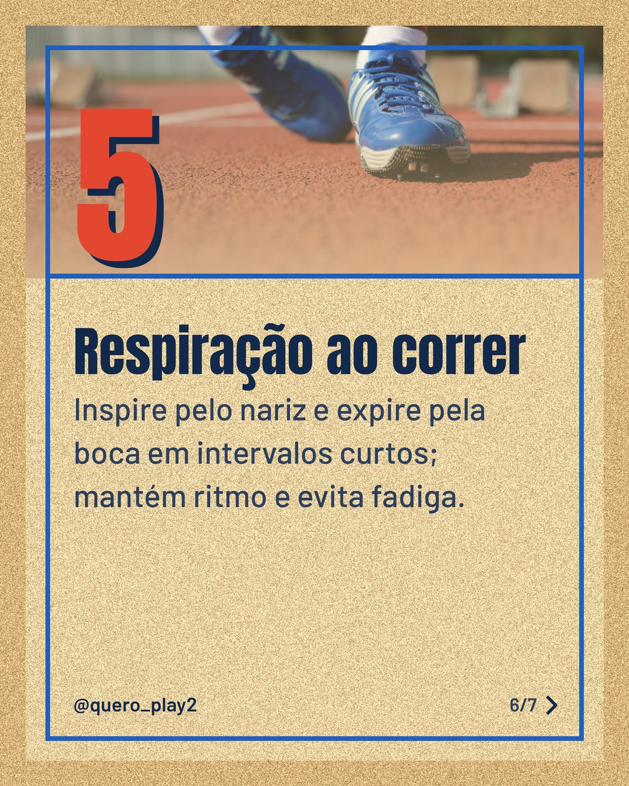
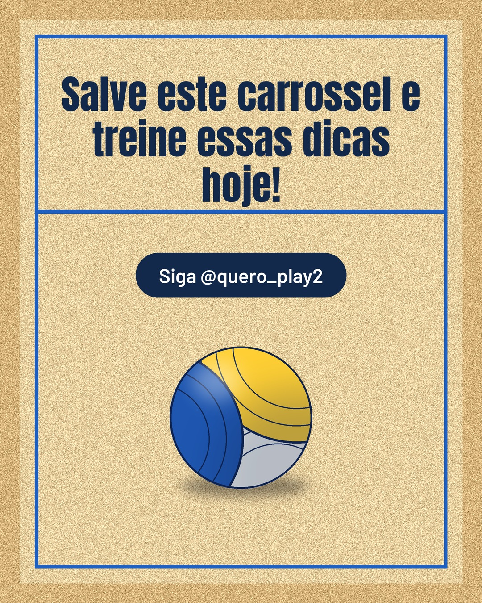

# areia

**Status:** aguardando revisão · 7 slides · gerado com `groq/openai/gpt-oss-120b`

      

## Legenda

> Você sabia que pequenos ajustes podem transformar seu jogo? ⚽🏐
>
> Deslize para descobrir 5 dicas práticas que vão elevar seu desempenho no futebol e no vôlei.
>
> Teste cada truque nos treinos e sinta a diferença. Compartilhe nos comentários como foi!
>
> Curtiu? Siga para mais curiosidades e marque quem vai gostar!
>
> 📷 Fotos: Johanna, Pablo, Pavel Danilyuk, Chris L, Marco   de Pexels e BOOM 💥 Photography (Pexels)
>
> #futebol #volei #dicasdesporte #treinamento #curiosidades #futebolbrasileiro #voleibolbrasil #esportes #melhorarjogo #praticasportiva #treinoeficaz #esporte

---
**Quer mudar algo?** Edite o `legenda.txt` para trocar a legenda, ou o `post.json` para trocar os textos dos slides (depois rode `python main.py redesenhar 2026-11-19_171820`).
Foto não combinou? `python main.py trocar-foto 2026-11-19_171820 N` (0 = capa, 1, 2... = slides).
Para descartar este post, apague esta pasta.
