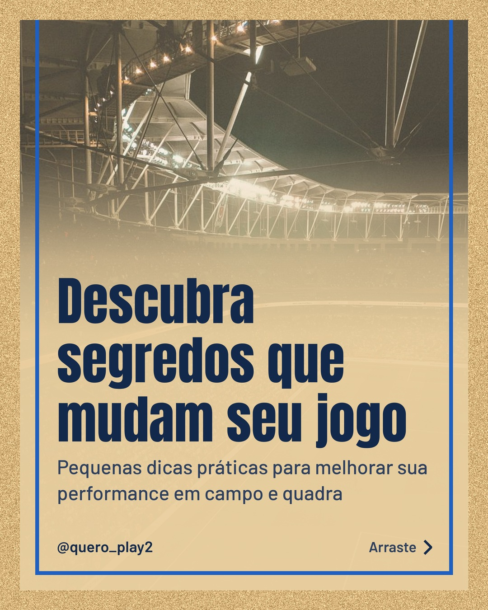
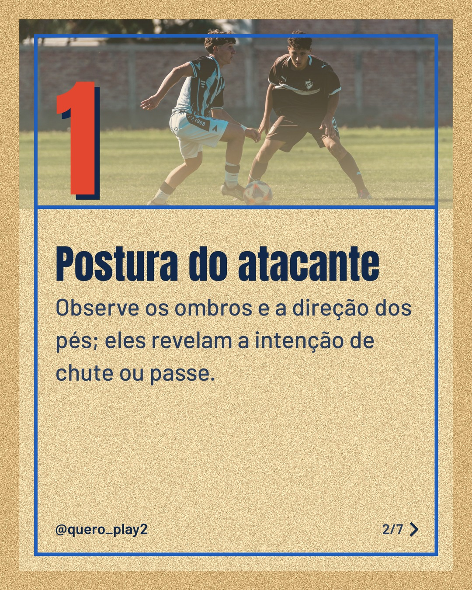
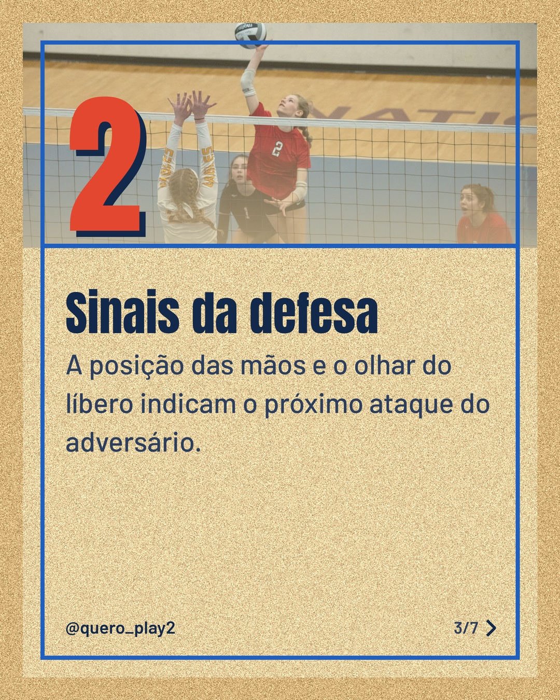
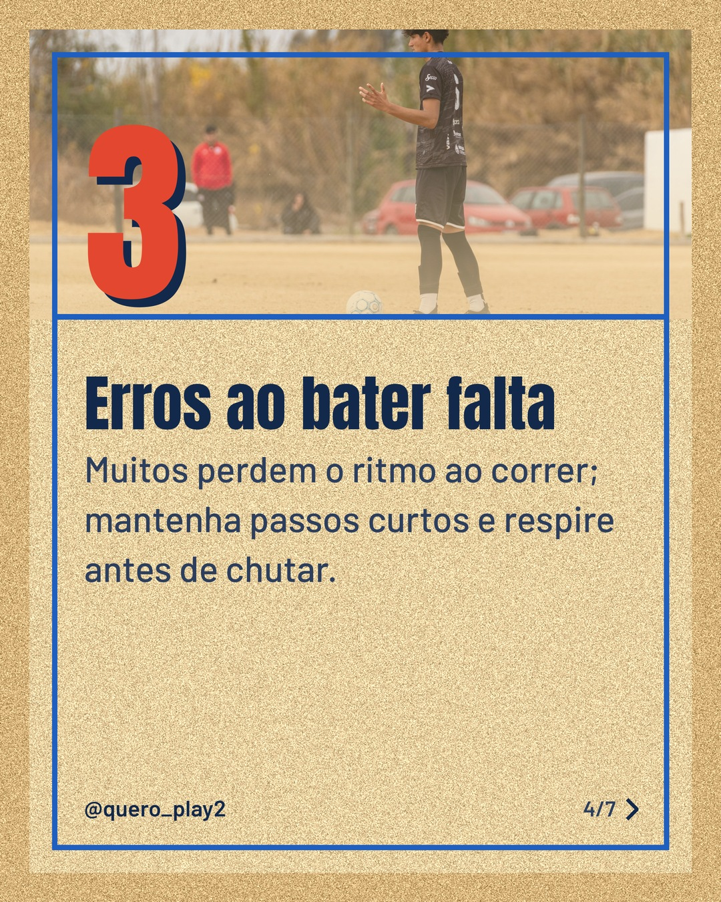
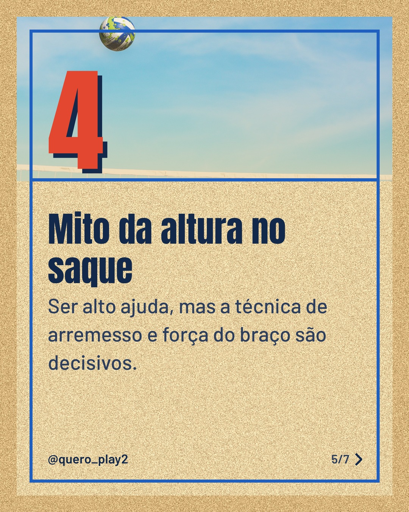
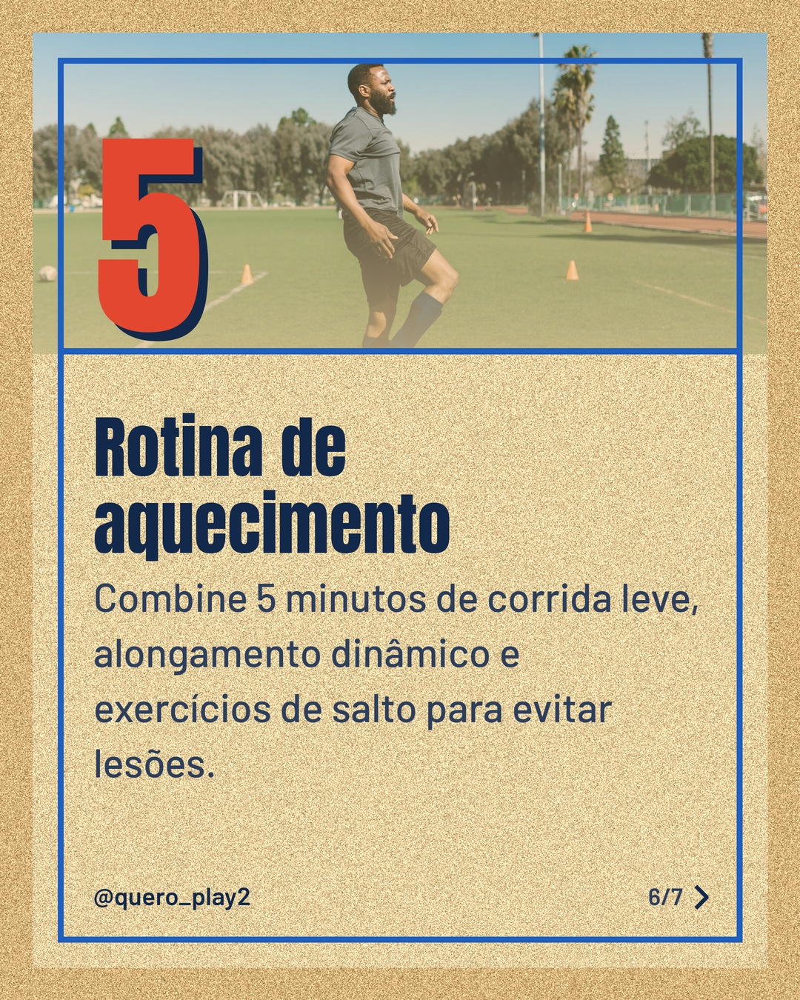
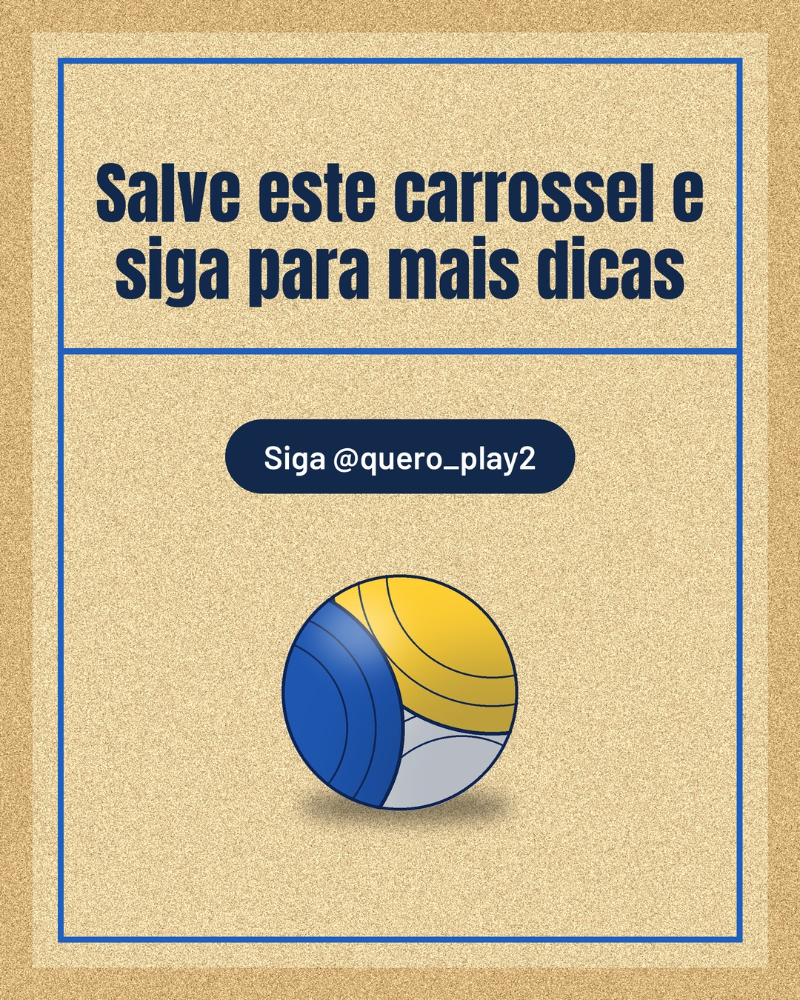

# areia

**Status:** aguardando revisão · 7 slides · gerado com `groq/openai/gpt-oss-120b`

      

## Legenda

> ⚽️ Você sabia que a postura do atacante pode indicar o tipo de jogada? Pequenos detalhes mudam tudo no campo.
> 🏐 No voleibol, os sinais da defesa são pistas valiosas para antecipar o ataque. Preste atenção nas mãos e no olhar.
> 💡 Salve essas dicas, compartilhe com amigos e siga a página para mais curiosidades sobre futebol e vôlei!
>
> 📷 Fotos: Furknsaglam, Franco Monsalvo, Tom Fisk, Jonatan Gomez e RDNE Stock project (Pexels)
>
> #futebol #voleibol #curiosidades #dicas #esporte #treino #performance #aprendizado #futebolbrasileiro #volei

---
**Quer mudar algo?** Edite o `legenda.txt` para trocar a legenda, ou o `post.json` para trocar os textos dos slides (depois rode `python main.py redesenhar 2026-11-20_164959`).
Foto não combinou? `python main.py trocar-foto 2026-11-20_164959 N` (0 = capa, 1, 2... = slides).
Para descartar este post, apague esta pasta.
