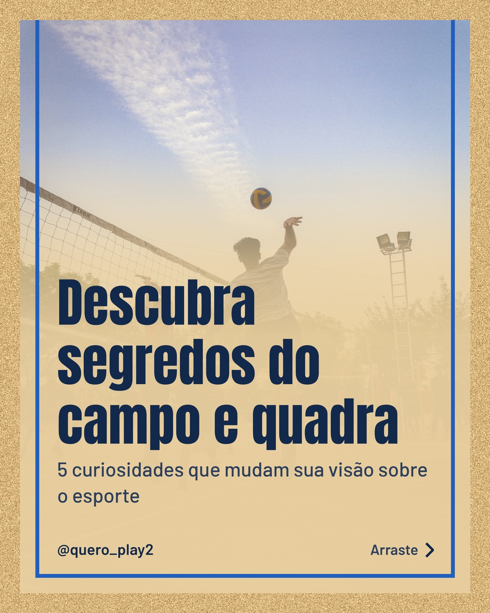
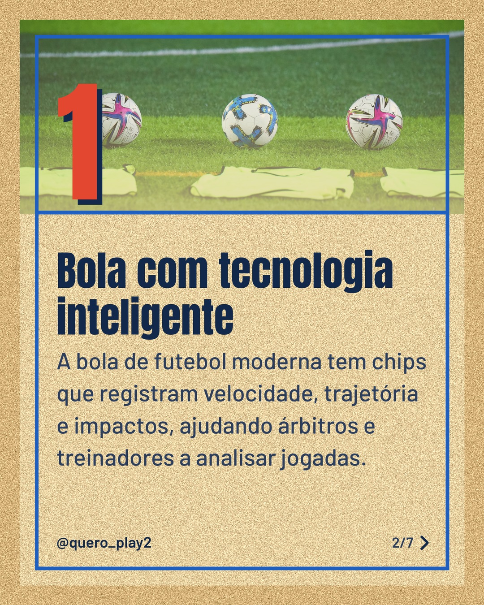
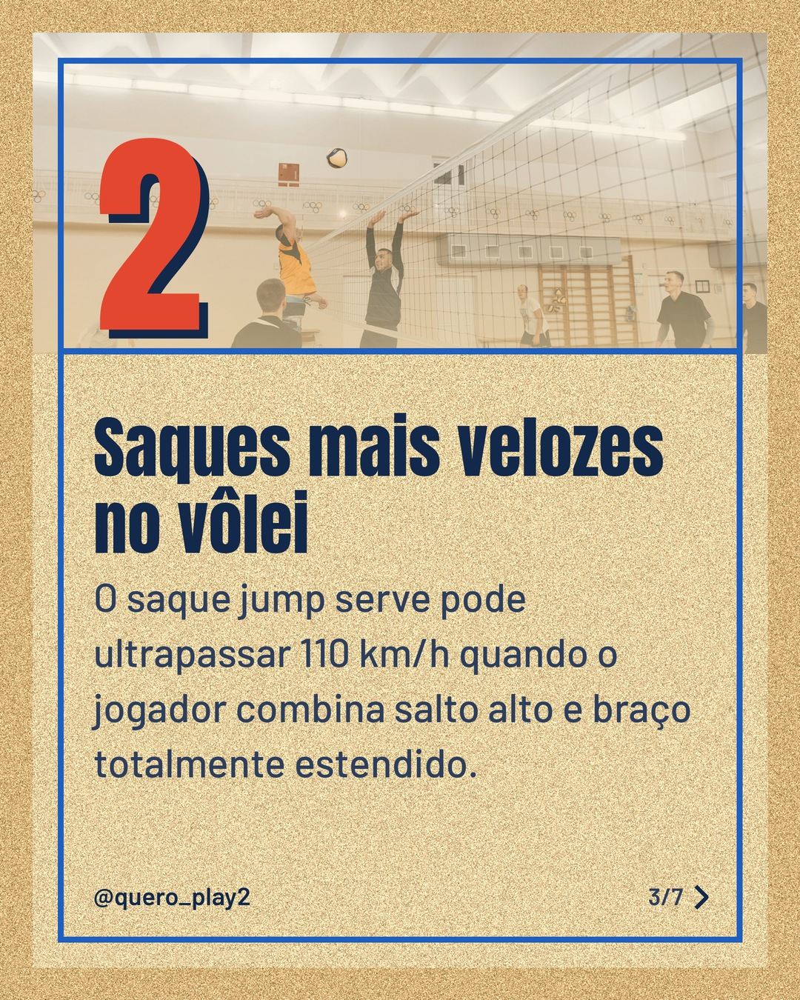
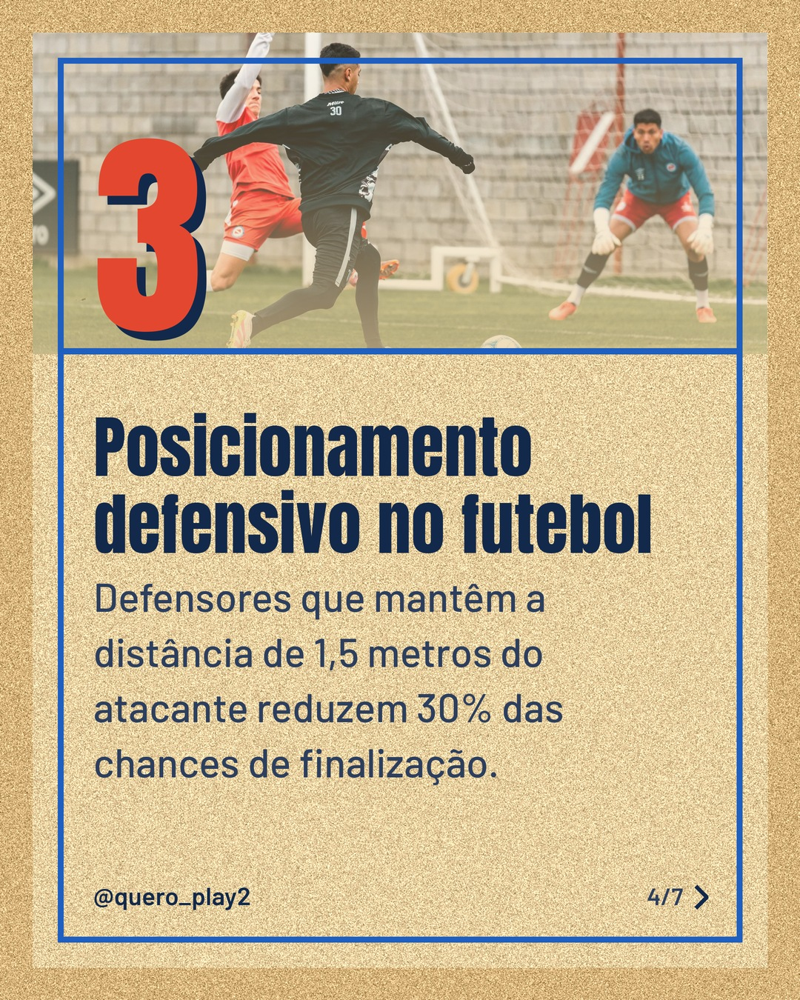
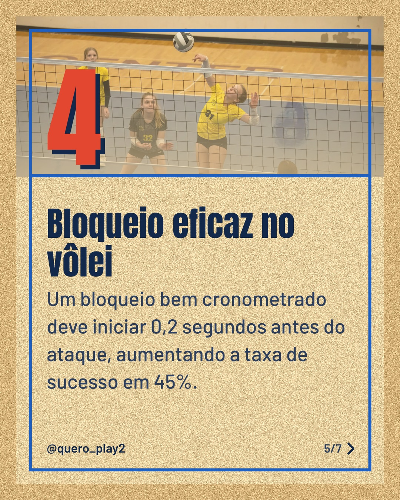
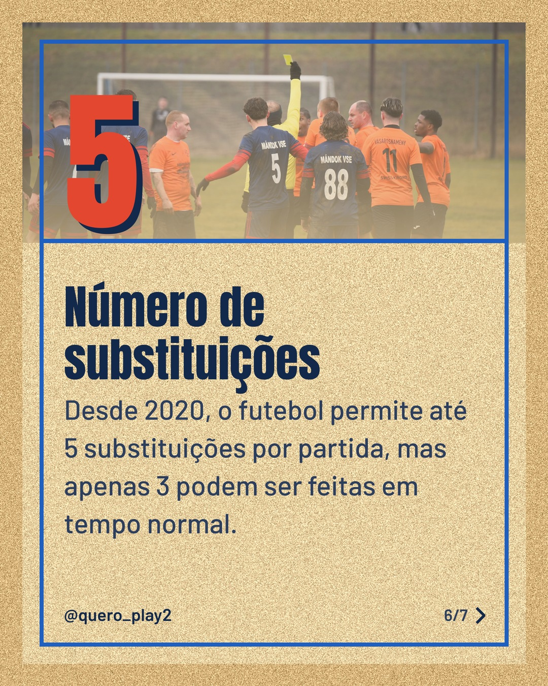

# areia

**Status:** aguardando revisão · 7 slides · gerado com `groq/openai/gpt-oss-120b`

      

## Legenda

> ⚽️ Você sabia que a bola de futebol hoje tem tecnologia que registra cada detalhe da partida?
>
> 🏐 No vôlei, o salto no saque e o timing do bloqueio podem mudar o resultado de um set.
>
> Deslize 👉 para descobrir essas curiosidades e mais. Salve, curta e marque alguém que ama futebol ou vôlei!
>
> 📷 Fotos: Nishant Meena, Zyn Aly, Pavel Danilyuk, Franco Monsalvo, Tom Fisk e Zsolt Bodnár (Pexels)
>
> #futebol #volei #curiosidades #esporte #bola #treinamento #dicas #futebolbrasil #voleibol #fatos

---
**Quer mudar algo?** Edite o `legenda.txt` para trocar a legenda, ou o `post.json` para trocar os textos dos slides (depois rode `python main.py redesenhar 2026-11-21_155539`).
Foto não combinou? `python main.py trocar-foto 2026-11-21_155539 N` (0 = capa, 1, 2... = slides).
Para descartar este post, apague esta pasta.
