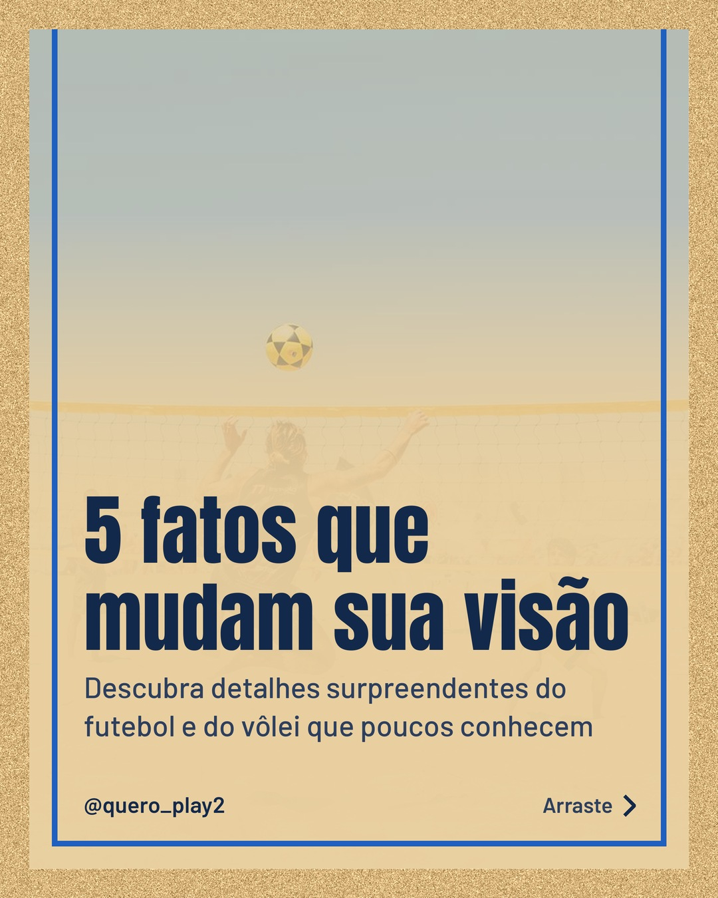
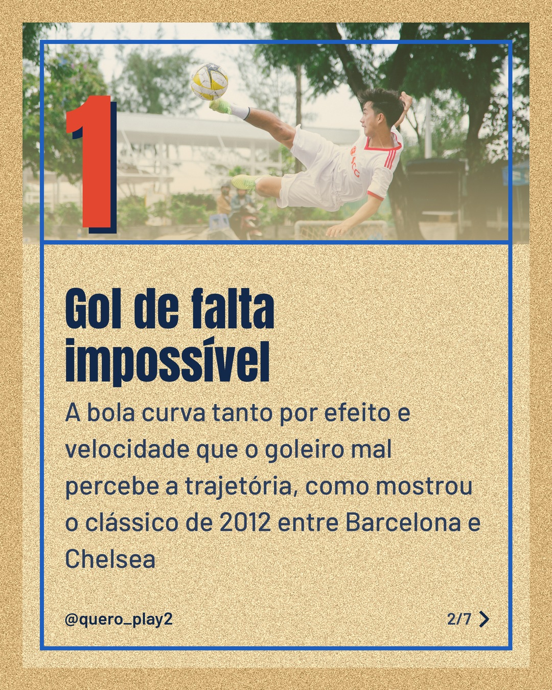
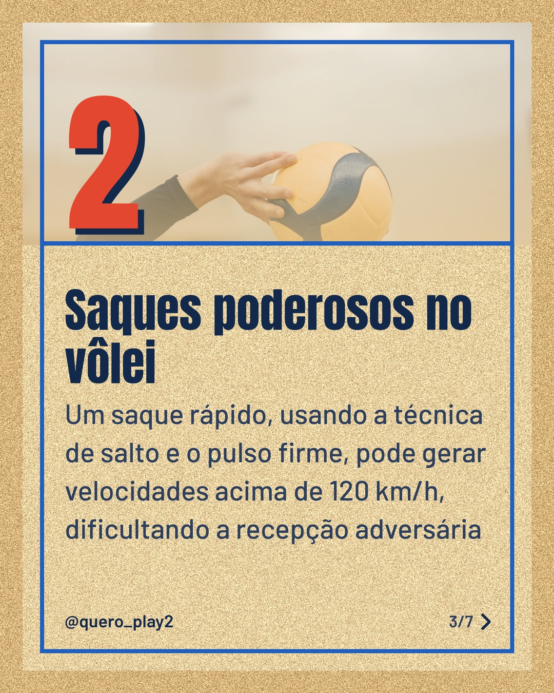
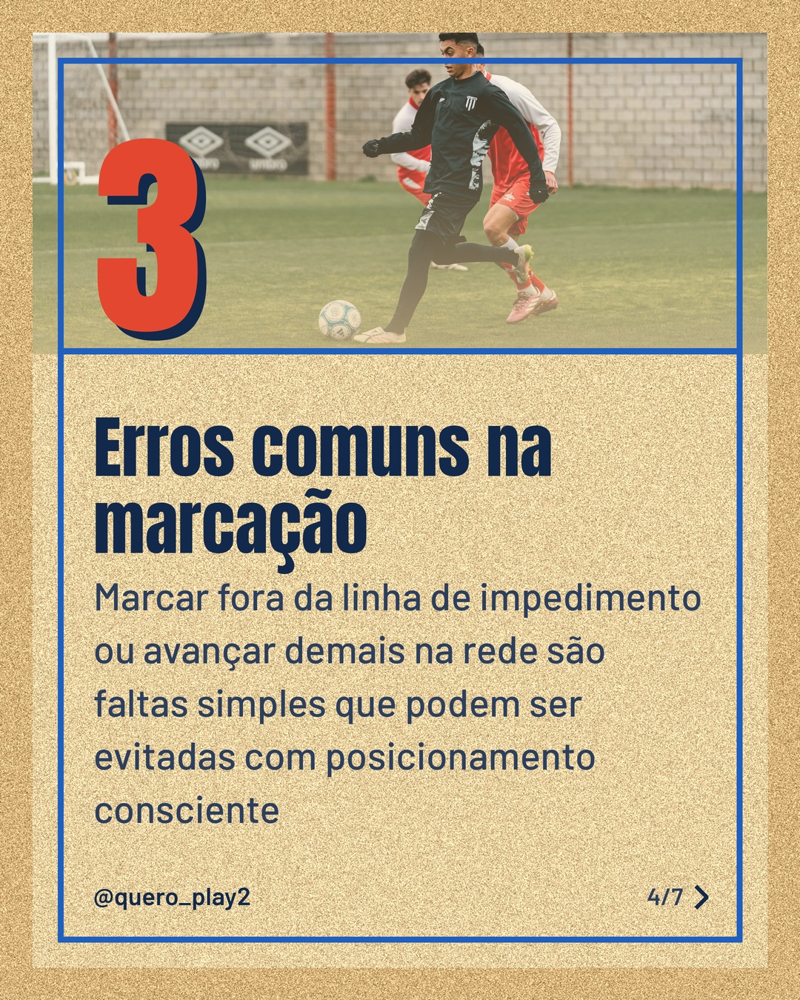
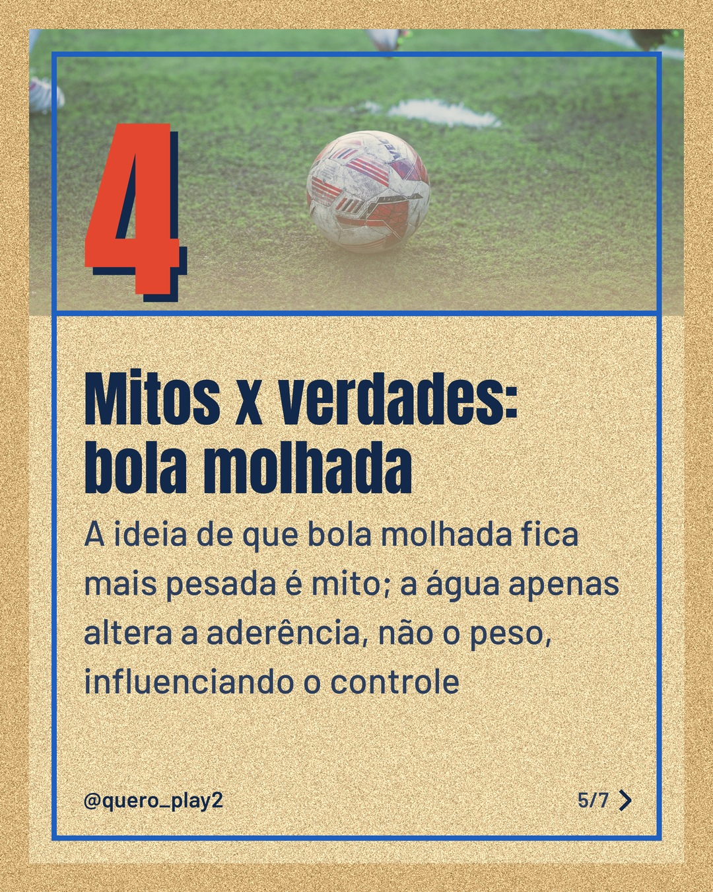
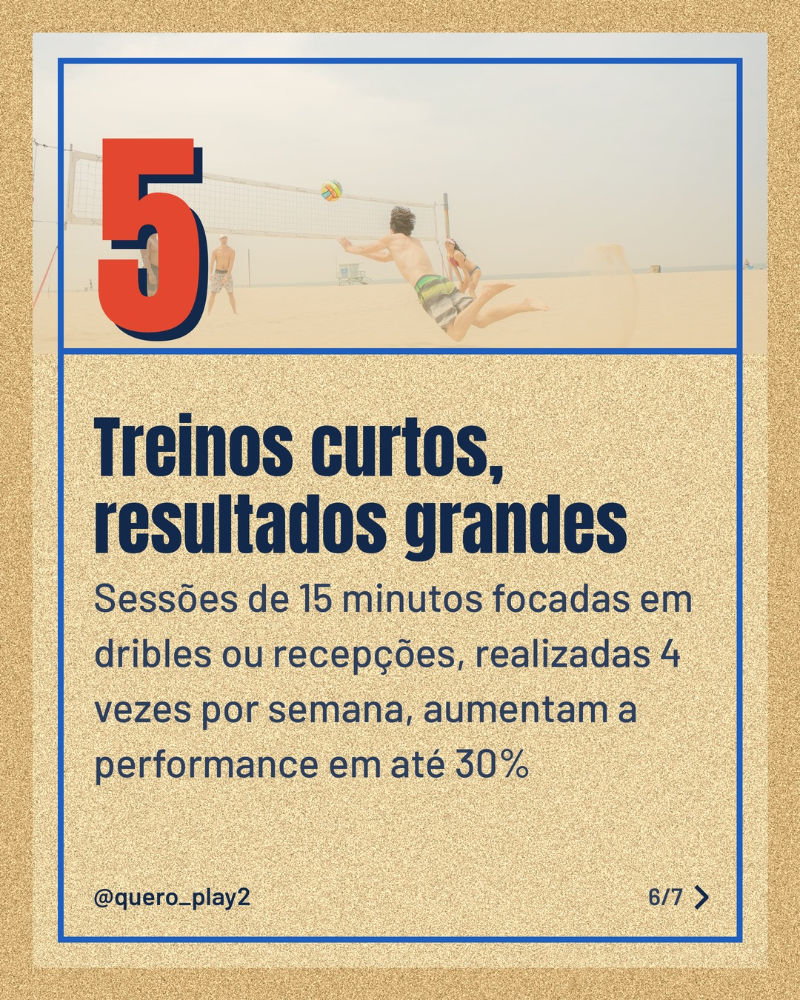

# areia

**Status:** aguardando revisão · 7 slides · gerado com `groq/openai/gpt-oss-120b`

      

## Legenda

> Você sabia que pequenos detalhes podem mudar totalmente o jeito de jogar? 🤔
> Deslize para descobrir curiosidades que poucos falam sobre futebol e vôlei.
> Cada slide traz uma dica prática que você pode aplicar agora mesmo no treino ou na partida. 🚀
> Curtiu? Salve, comente e siga para mais conteúdo incrível!
>
> 📷 Fotos: Ezequiel Milano, Dương Hoàng, Pavel Danilyuk, Franco Monsalvo, Mustafa  Fatemi e RDNE Stock project (Pexels)
>
> #curiosidadesfutebol #curiosidadesvolei #futebol #volei #esporte #curiosidade #futebolbrasil #voleiBrasil #fatosdesportivos #aprendizadoesportivo

---
**Quer mudar algo?** Edite o `legenda.txt` para trocar a legenda, ou o `post.json` para trocar os textos dos slides (depois rode `python main.py redesenhar 2026-11-22_161606`).
Foto não combinou? `python main.py trocar-foto 2026-11-22_161606 N` (0 = capa, 1, 2... = slides).
Para descartar este post, apague esta pasta.
