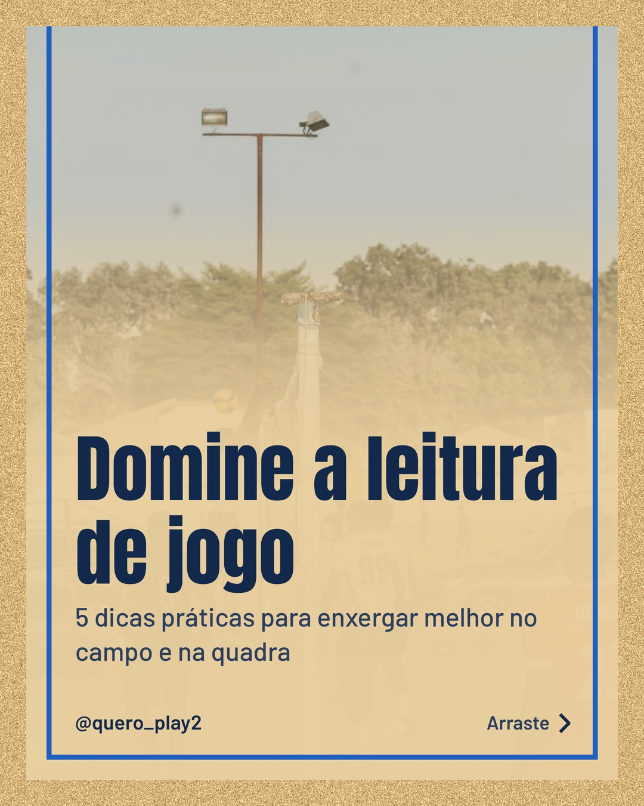
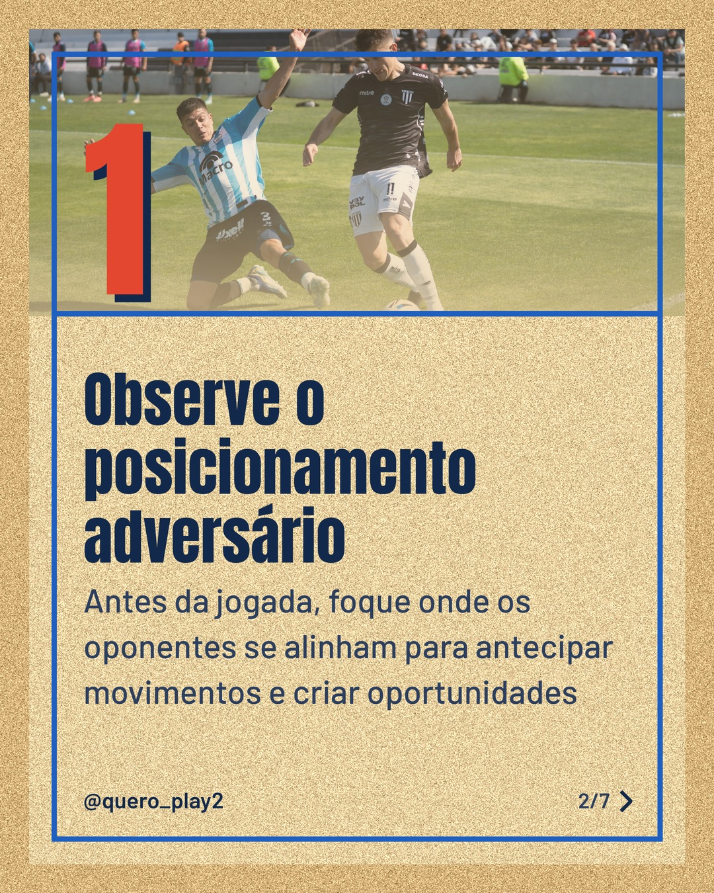
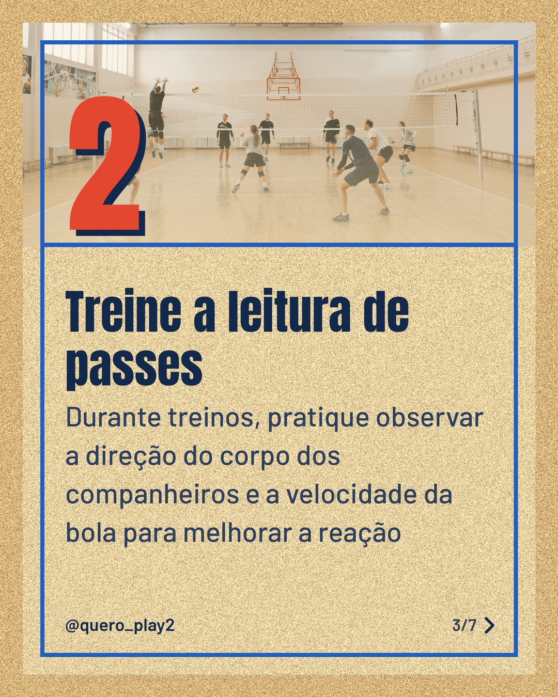
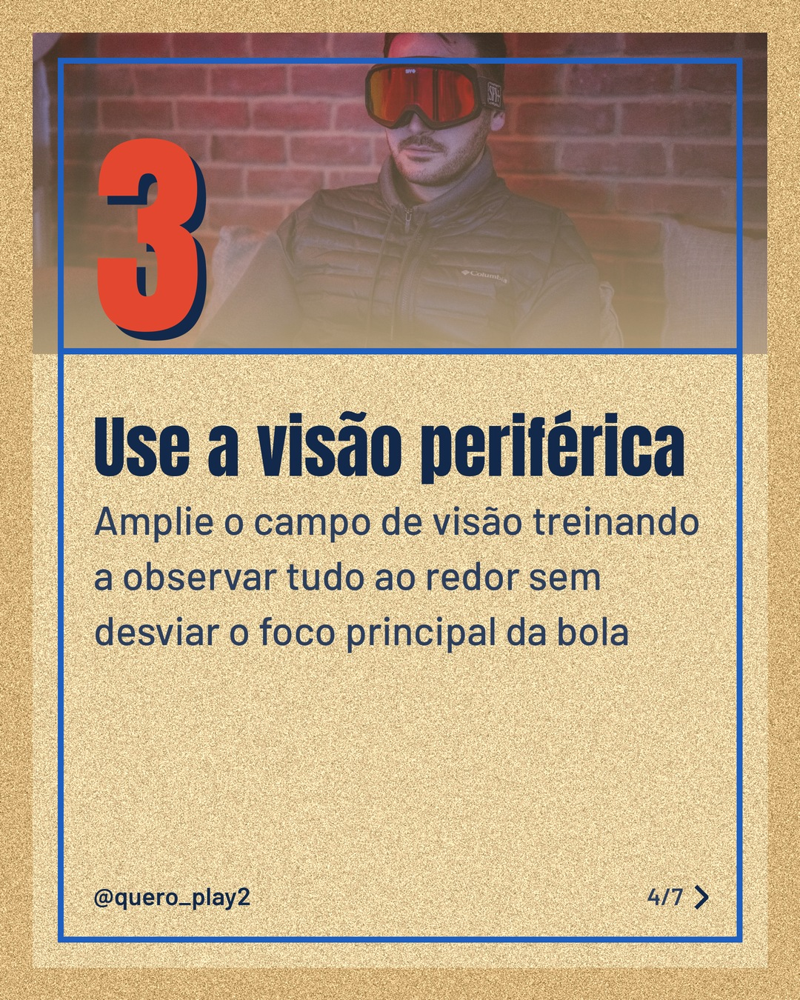
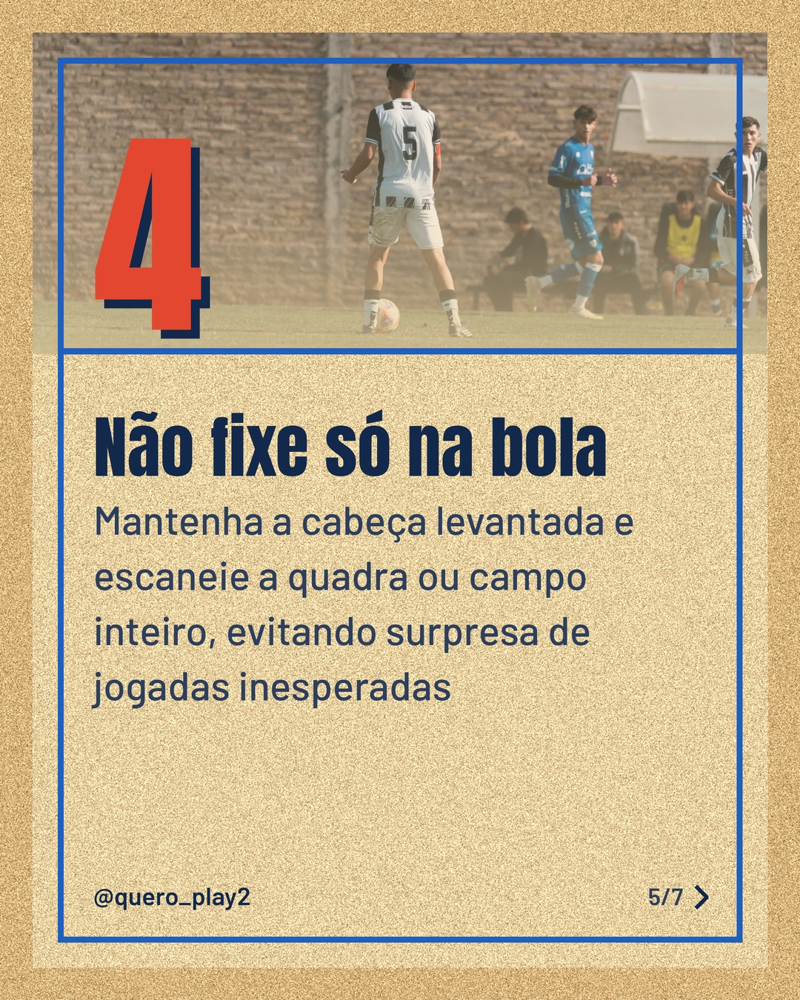
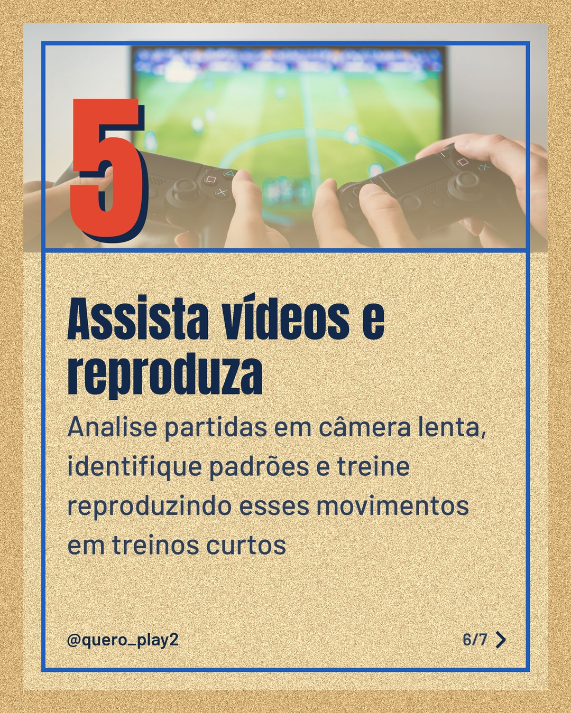
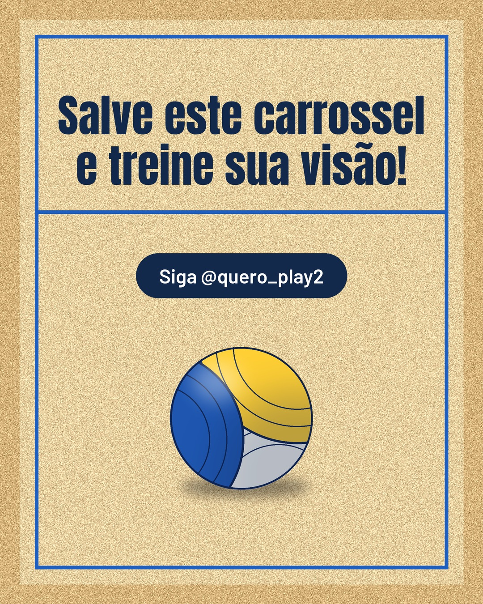

# areia

**Status:** aguardando revisão · 7 slides · gerado com `groq/openai/gpt-oss-120b`

      

## Legenda

> Você já percebeu como jogadores de futebol e vôlei parecem ler o jogo antes de acontecer? ⚽🏐
>
> Neste carrossel reuni 5 dicas práticas para melhorar sua visão de jogo e antecipar jogadas, tanto no campo quanto na quadra. 💡
>
> Deslize para o lado e descubra cada passo. Depois, teste nos treinos e compartilhe seus resultados nos comentários! 👇
>
> 📷 Fotos: Darkside Photography, Franco Monsalvo, Pavel Danilyuk, Sami  Abdullah e JESHOOTS.com (Pexels)
>
> #futebol #volei #esportes #curiosidades #treinamento #visãodejogo #dicaspraticas #performance #jogadores

---
**Quer mudar algo?** Edite o `legenda.txt` para trocar a legenda, ou o `post.json` para trocar os textos dos slides (depois rode `python main.py redesenhar 2026-11-23_203859`).
Foto não combinou? `python main.py trocar-foto 2026-11-23_203859 N` (0 = capa, 1, 2... = slides).
Para descartar este post, apague esta pasta.
