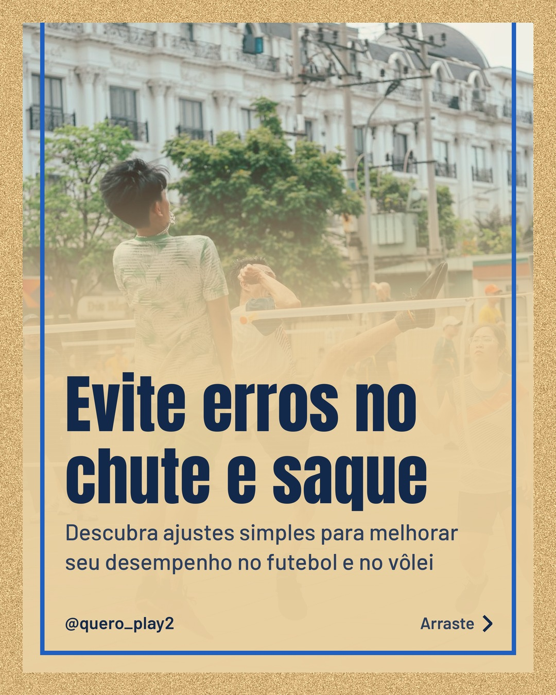
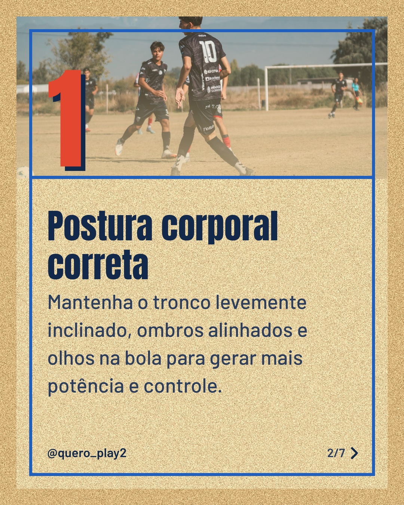
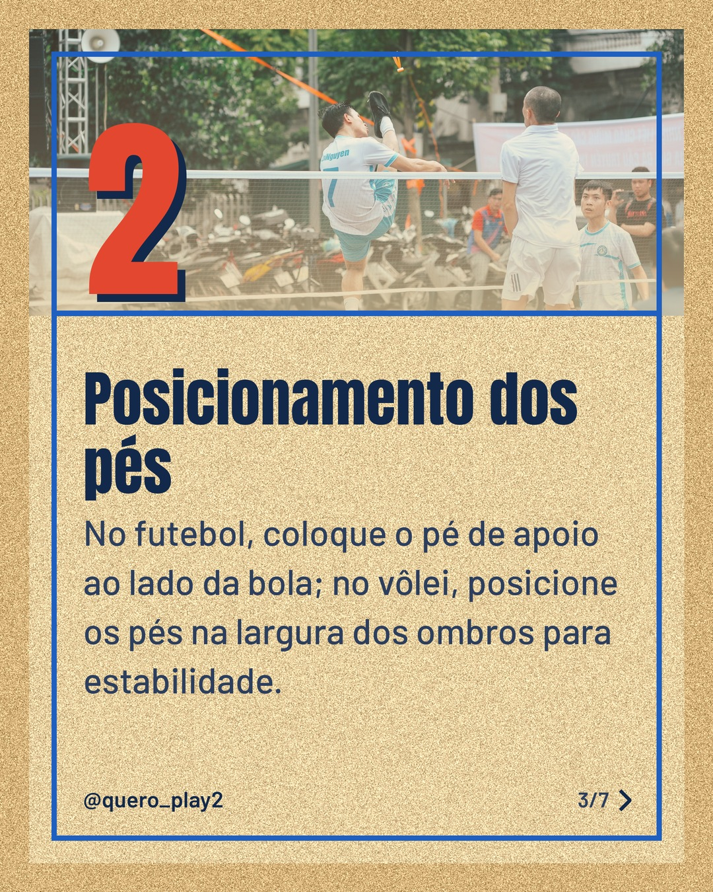
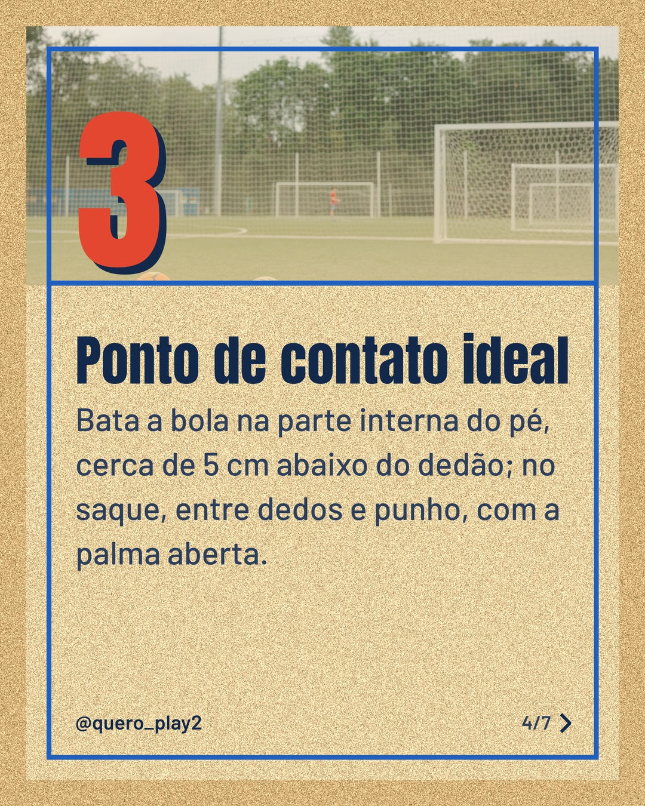
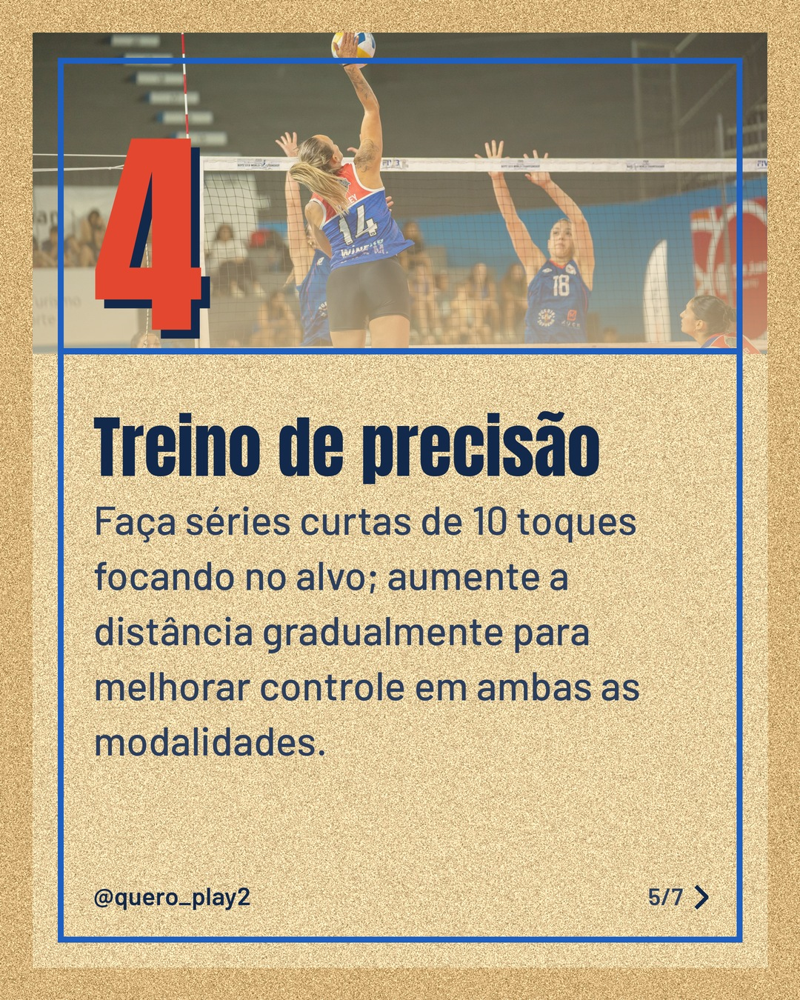
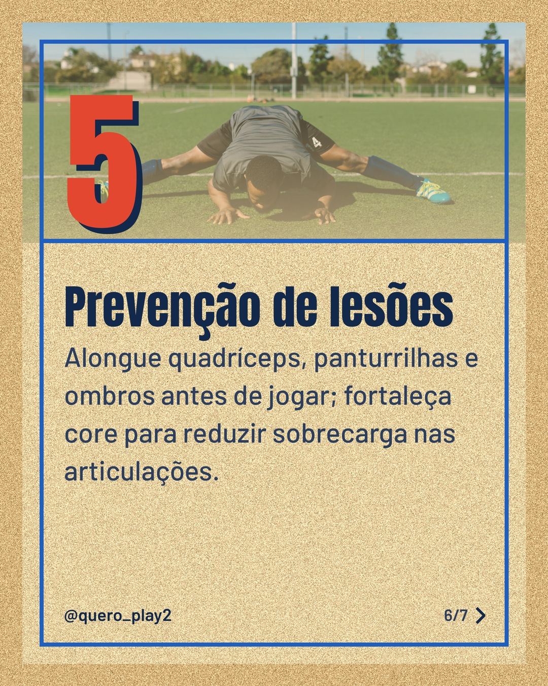
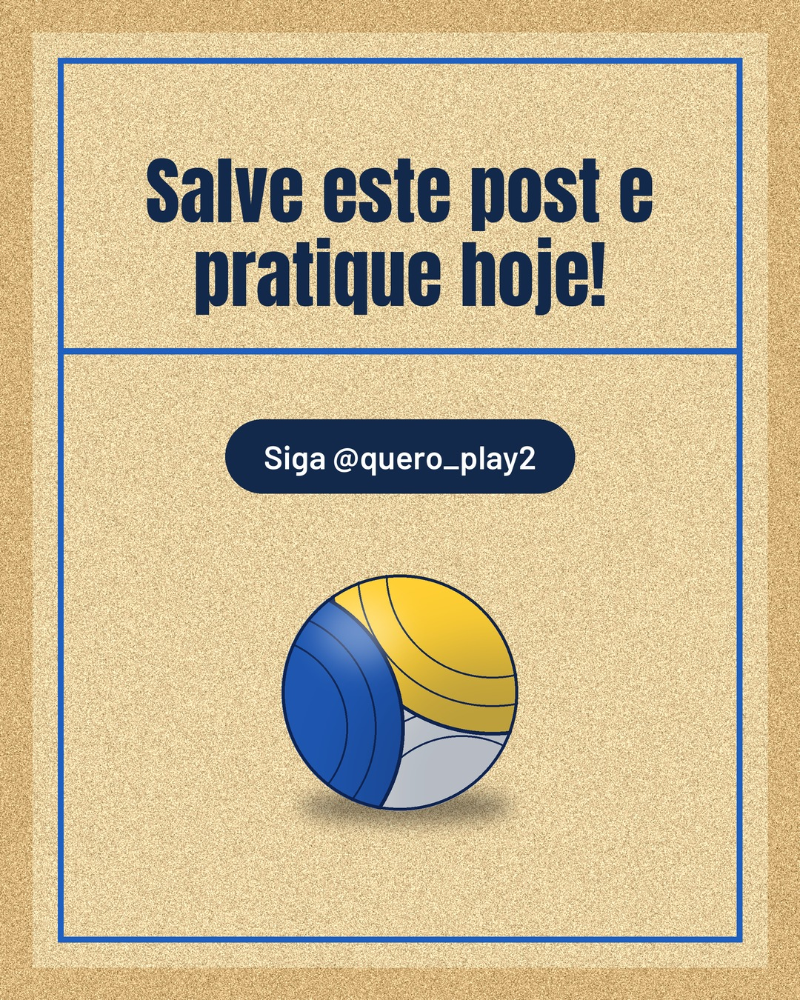

# areia

**Status:** aguardando revisão · 7 slides · gerado com `groq/openai/gpt-oss-120b`

      

## Legenda

> Você sabia que pequenos ajustes no chute e no saque podem transformar seu desempenho? 😮
>
> Deslize 👉 para conferir cinco dicas práticas que você pode aplicar agora mesmo nos treinos. 📈
>
> Comente qual dica você já usa e marque alguém que precisa melhorar! 💬
>
> 📷 Fotos: Thang Nguyen, Franco Monsalvo, Anastasia  Shuraeva e RDNE Stock project (Pexels)
>
> #futebol #voleibol #dicasdesporte #treinamento #chute #saque #curiosidades #esporte #performance #treino #atleta #motivação

---
**Quer mudar algo?** Edite o `legenda.txt` para trocar a legenda, ou o `post.json` para trocar os textos dos slides (depois rode `python main.py redesenhar 2026-11-24_191009`).
Foto não combinou? `python main.py trocar-foto 2026-11-24_191009 N` (0 = capa, 1, 2... = slides).
Para descartar este post, apague esta pasta.
