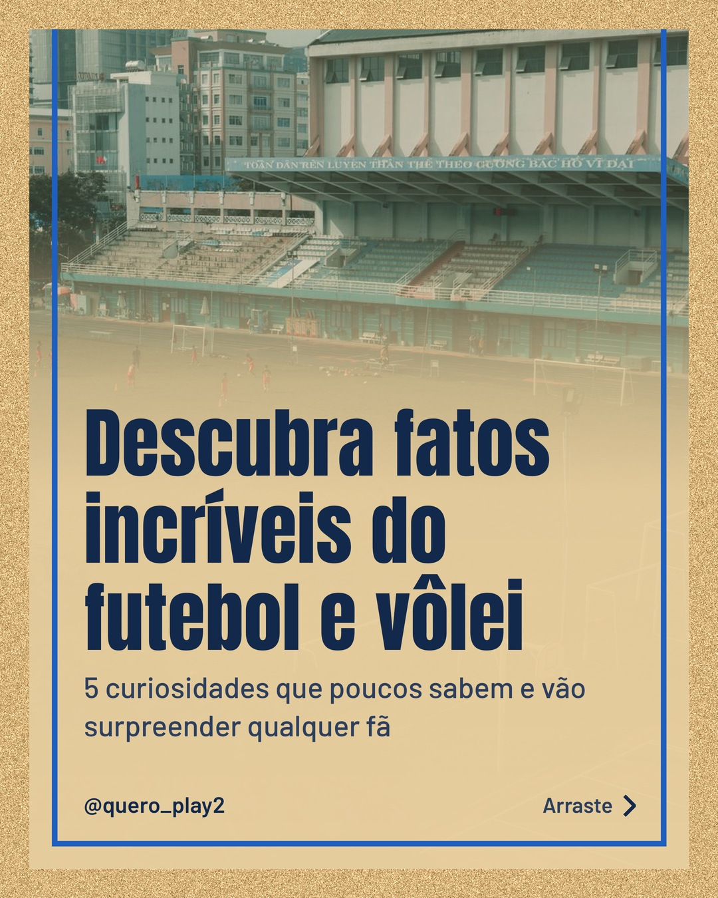
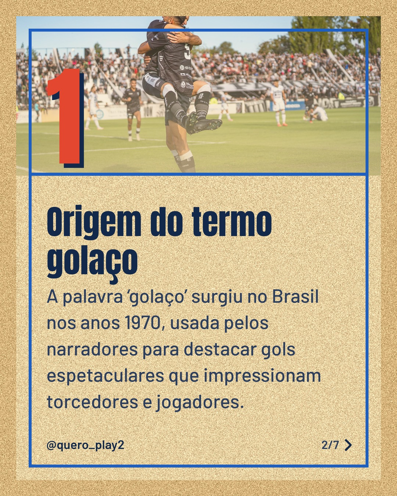
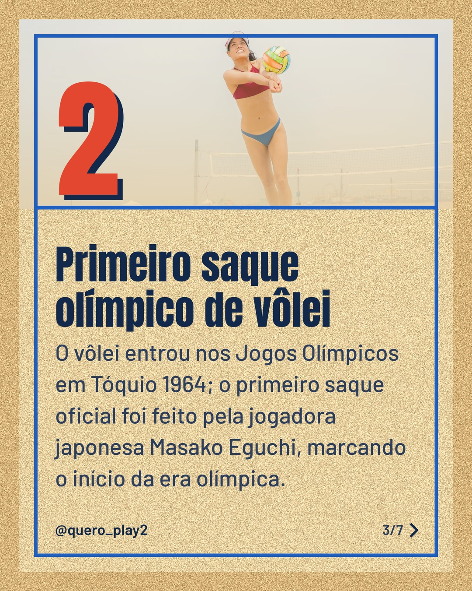
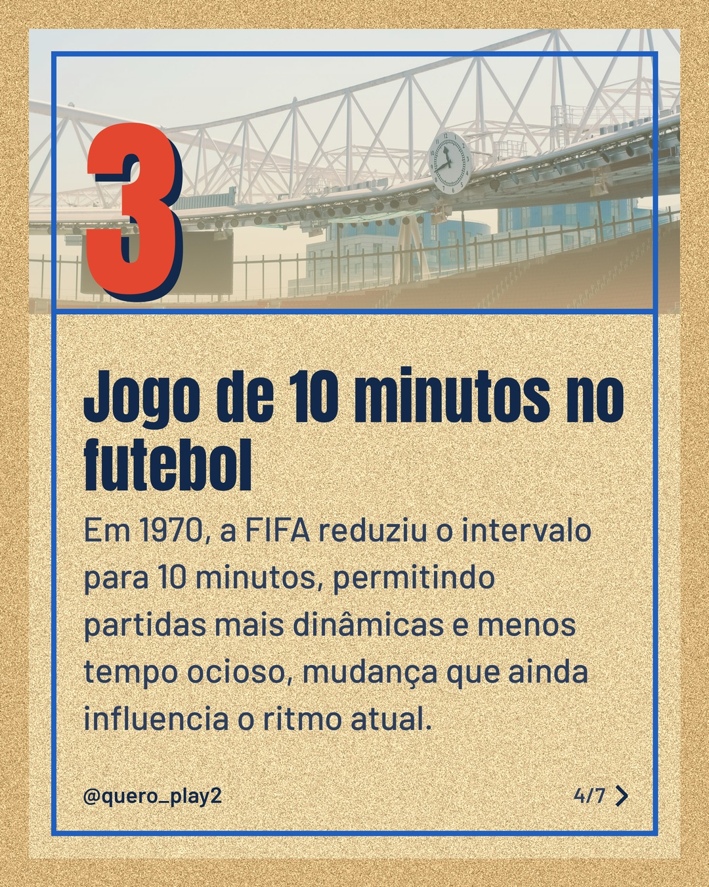
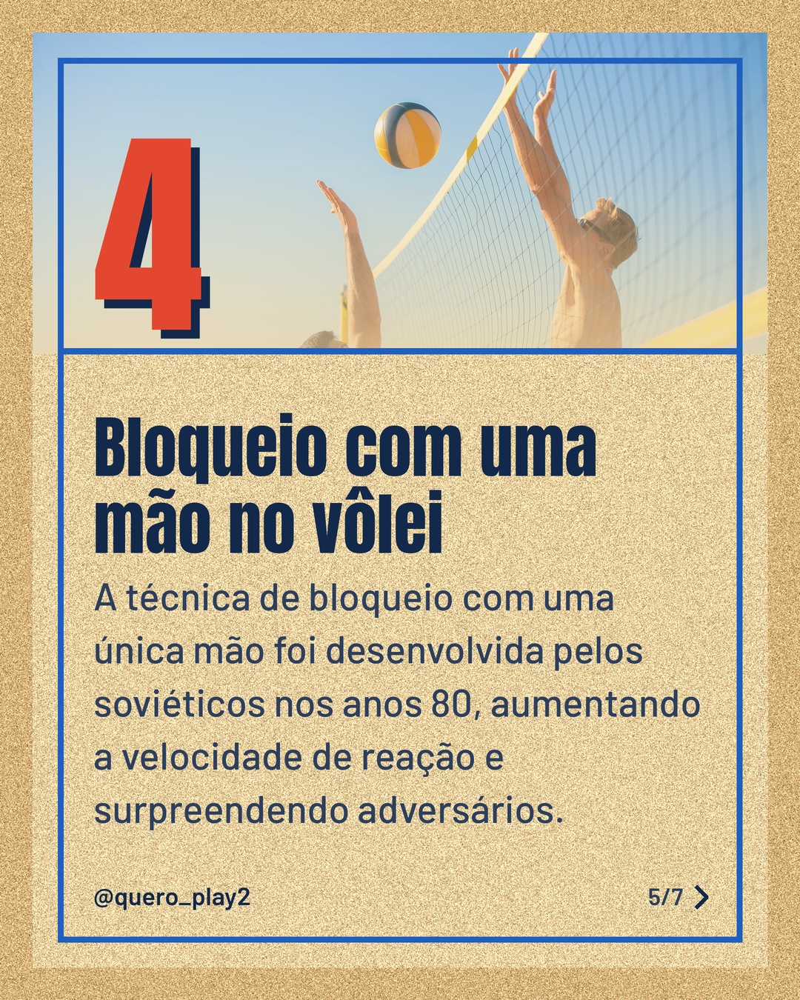
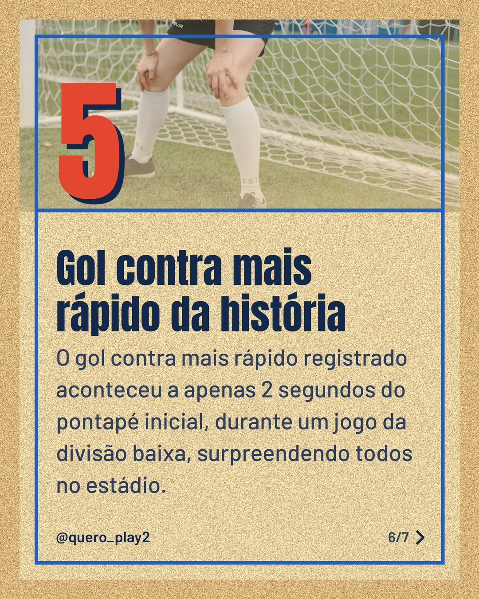

# areia

**Status:** aguardando revisão · 7 slides · gerado com `groq/openai/gpt-oss-120b`

      

## Legenda

> Você sabia que o mundo do esporte guarda detalhes que mudam a forma como vemos cada partida? 🏟️
>
> Deslize para a esquerda e descubra curiosidades que vão impressionar seus amigos e deixar seu conhecimento ainda mais afiado. ⚽️🏐
>
> Curtiu? Marque alguém, deixe seu comentário e siga para mais fatos incríveis! 📲
>
> 📷 Fotos: Le Do  Thanh Dat, Franco Monsalvo, RDNE Stock project, Huy Phan, Kampus Production e Anastasia  Shuraeva (Pexels)
>
> #futebol #volei #curiosidades #esporte #historia #fatos #aprendizado #fa #esporteBrasil #dica

---
**Quer mudar algo?** Edite o `legenda.txt` para trocar a legenda, ou o `post.json` para trocar os textos dos slides (depois rode `python main.py redesenhar 2026-11-25_182554`).
Foto não combinou? `python main.py trocar-foto 2026-11-25_182554 N` (0 = capa, 1, 2... = slides).
Para descartar este post, apague esta pasta.
