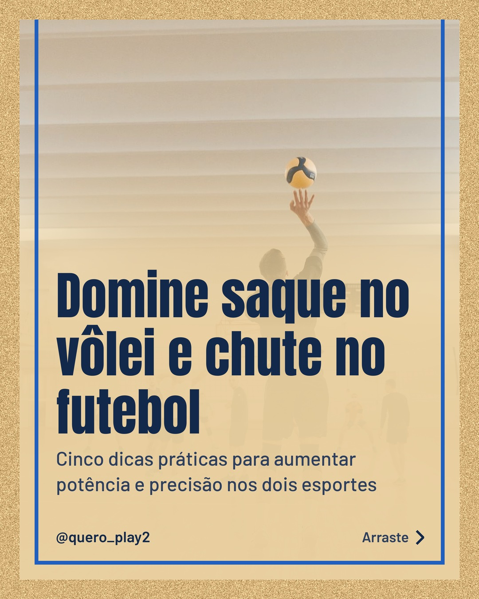
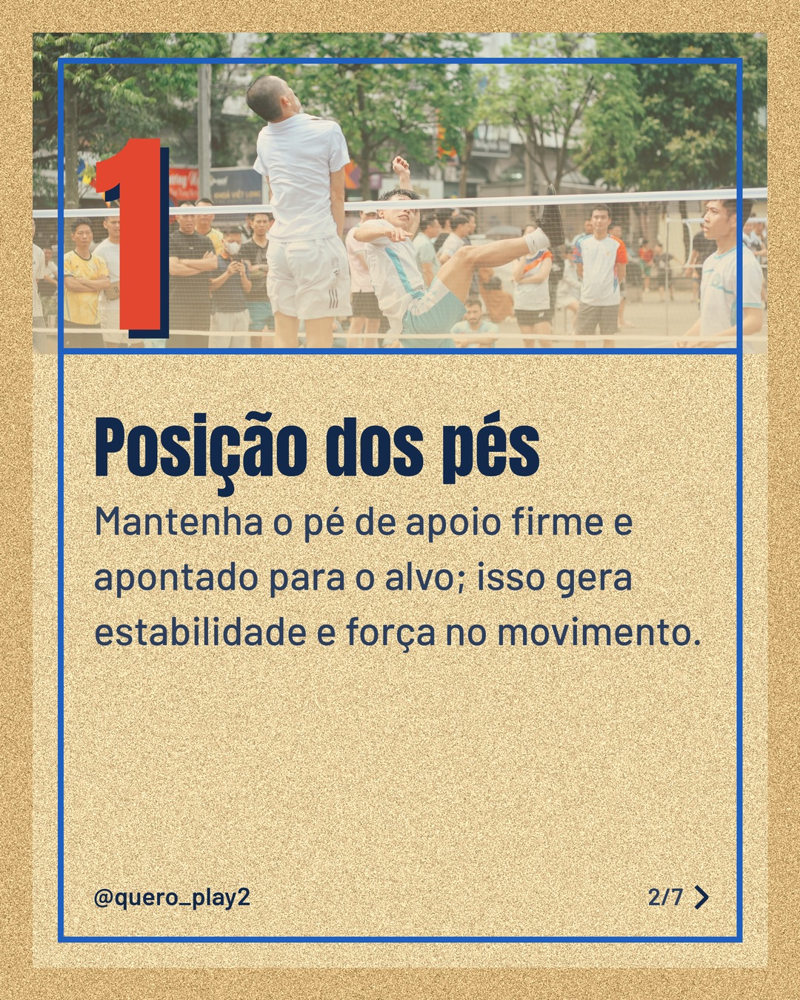
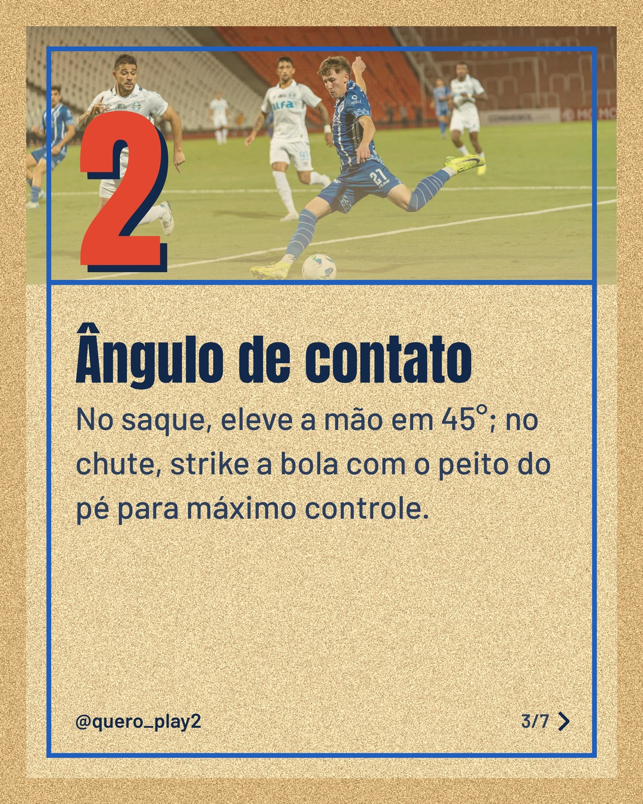
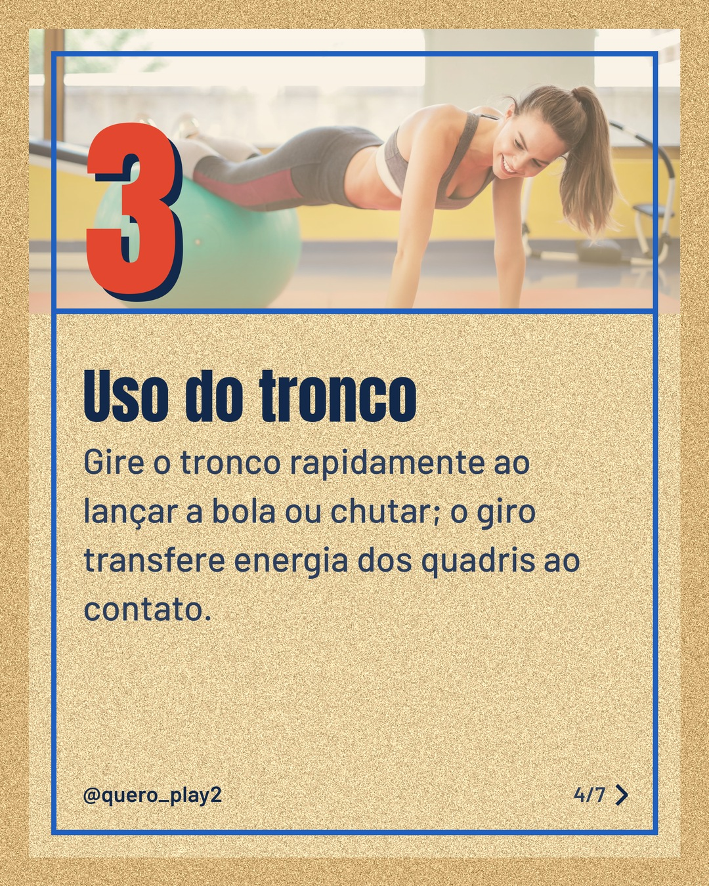
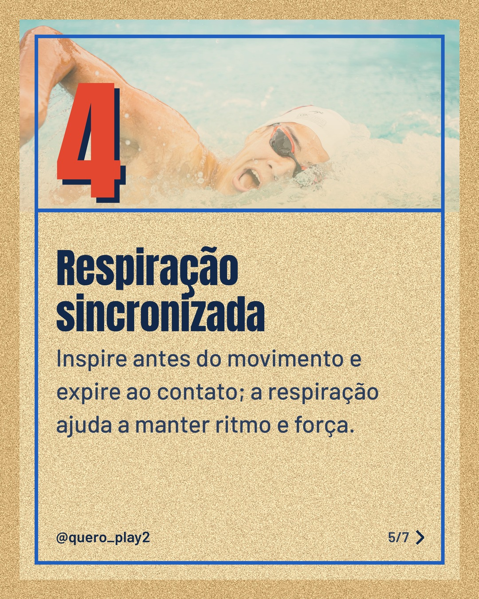
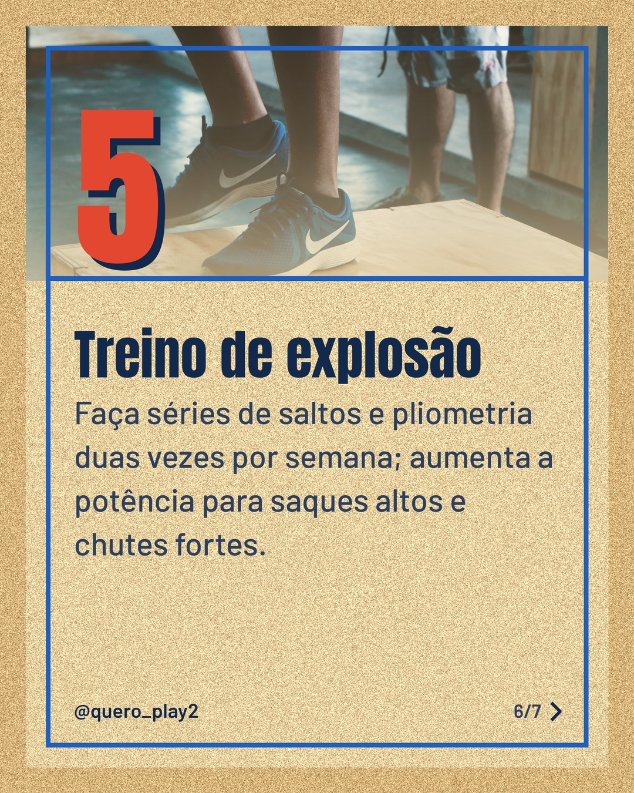
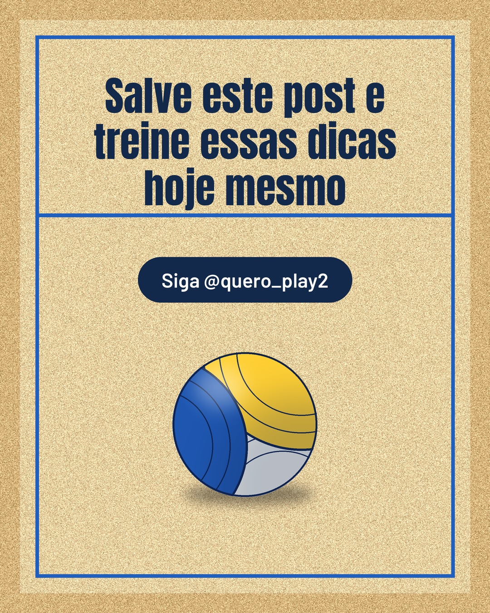

# areia

**Status:** aguardando revisão · 7 slides · gerado com `groq/openai/gpt-oss-120b`

      

## Legenda

> ⚡️ Quer melhorar seu saque no vôlei e seu chute no futebol? Arraste para descobrir cinco passos simples que vão transformar sua performance! Cada slide traz uma dica prática que você pode aplicar agora, seja nos treinos ou nas partidas. 🚀
>
> Teste as técnicas, compartilhe seu progresso nos comentários e marque alguém que precisa ver isso. Não esqueça de salvar para revisar depois! 📌
>
> Curtiu? Siga o perfil para mais curiosidades e dicas de futebol e vôlei. 🎯
>
> 📷 Fotos: Pavel Danilyuk, Thang Nguyen, Franco Monsalvo, Andrea Piacquadio, Paulo Guilherme Mouta e Eduardo  Cano Photo Co. (Pexels)
>
> #futebol #volei #saque #chute #dicasdeesporte #treino #potencia #tecnica #esportelivre #curiosidades #performance #poder

---
**Quer mudar algo?** Edite o `legenda.txt` para trocar a legenda, ou o `post.json` para trocar os textos dos slides (depois rode `python main.py redesenhar 2026-11-26_181301`).
Foto não combinou? `python main.py trocar-foto 2026-11-26_181301 N` (0 = capa, 1, 2... = slides).
Para descartar este post, apague esta pasta.
