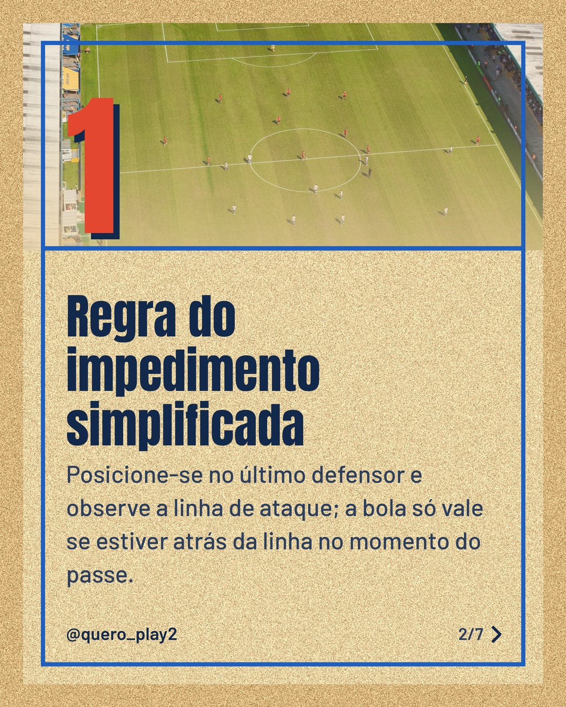
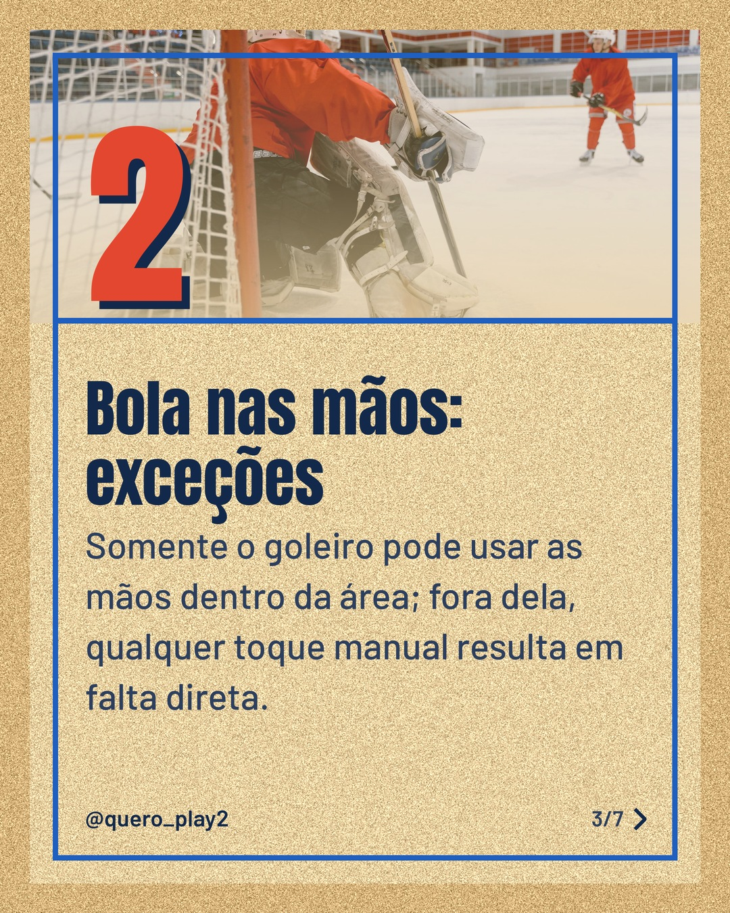
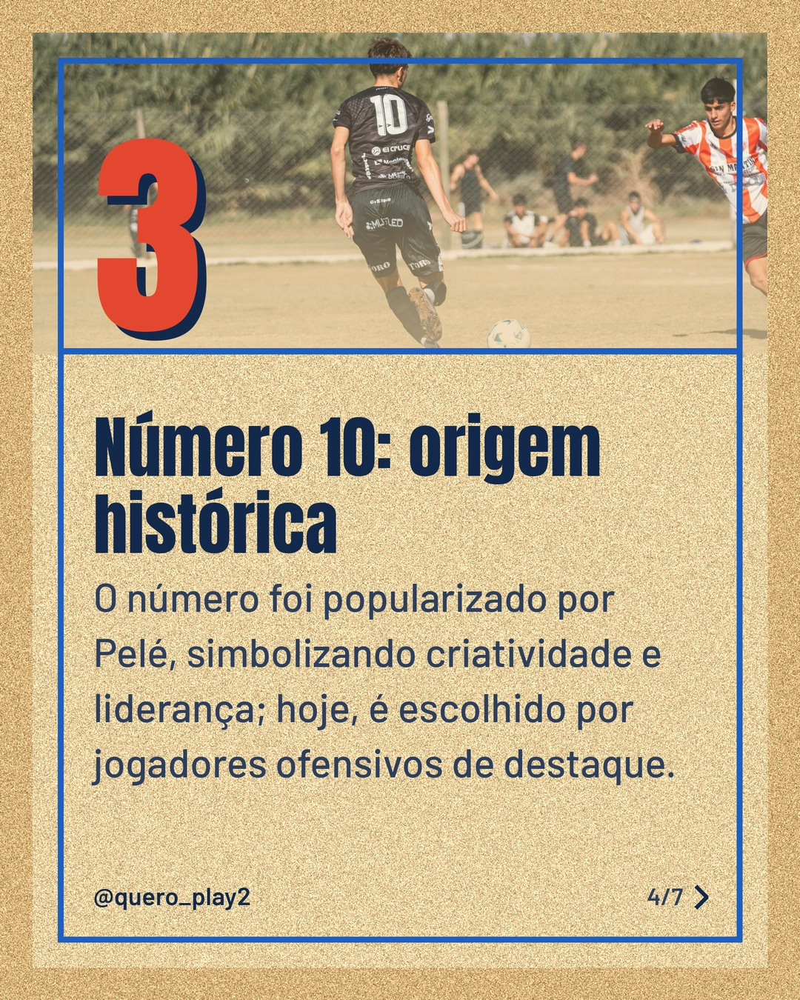
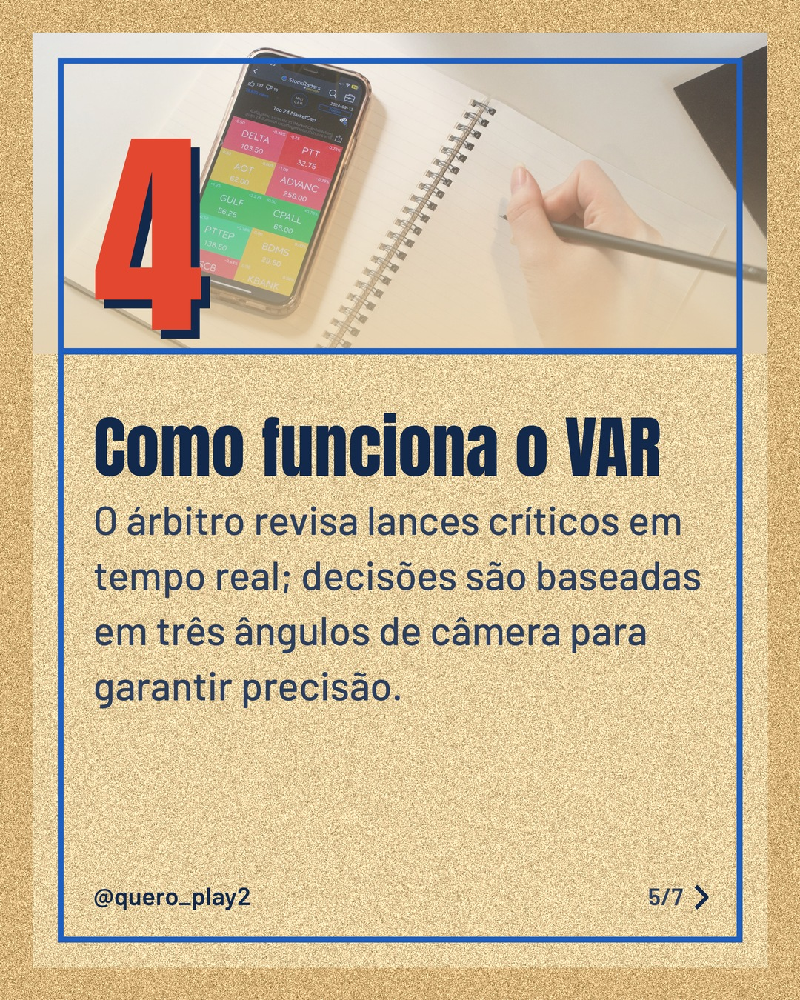
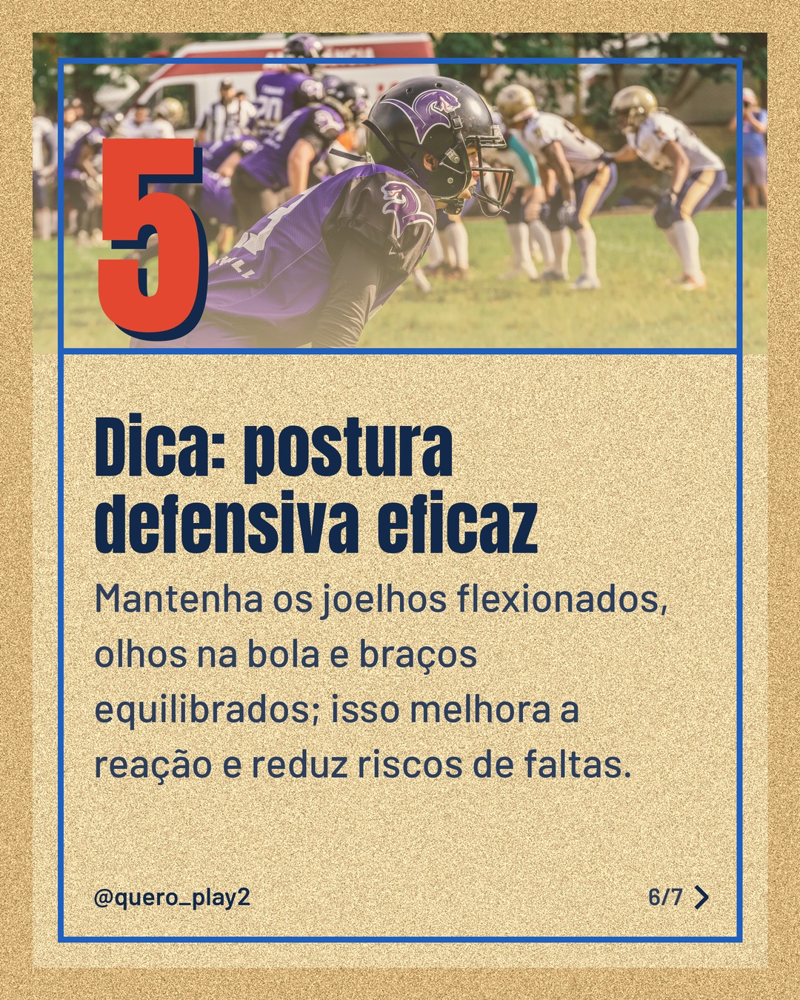

# areia

**Status:** aguardando revisão · 7 slides · gerado com `groq/openai/gpt-oss-120b`

      

## Legenda

> Você sabia que o impedimento tem uma lógica simples? 🤔
>
> Descubra neste carrossel como cada detalhe do jogo pode influenciar sua forma de assistir e jogar. ⚽️
>
> Deslize para o lado e aprenda algo novo a cada slide! 🚀
>
> Curtiu? Deixe seu comentário e siga para mais curiosidades sobre futebol e vôlei.
>
> 📷 Fotos: Mohamed Ishaq Villan, Mylo Kaye, Tima Miroshnichenko, Franco Monsalvo, StockRadars Co., e SAULO LEITE (Pexels)
>
> #futebol #curiosidades #esporte #soccerfacts #jogodefutebol #footballtips #var #goleiro #camiseta10 #posicaodefensiva #aprendizado #instasport

---
**Quer mudar algo?** Edite o `legenda.txt` para trocar a legenda, ou o `post.json` para trocar os textos dos slides (depois rode `python main.py redesenhar 2026-11-27_175556`).
Foto não combinou? `python main.py trocar-foto 2026-11-27_175556 N` (0 = capa, 1, 2... = slides).
Para descartar este post, apague esta pasta.
